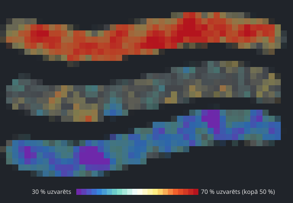

# Uzvaru daļa: cik bieži vieta, maršruts vai gājiens uzvar

Kur spēlētājs stāv, kurp viņš dodas, kur viņš met savu aprīkojumu - un cik bieži viņa puse pēc tam uzvar raundā. **Uzvaru karte** iekrāso katru vietu pēc tā, cik liela daļa tur esošo rindu pieder raundiem, kuros rindas puse uzvarēja, salīdzinot ar daļu visā parādītajā: silts, kur tā ir lielāka, auksts, kur tā ir mazāka, nekas, kur tā ir tāda pati.

*Attēlā ir izdomāti dati: trīs maršruti tukšā līmenī, ar 68%, 50% un 33% to rindu uzvarētos raundos.*

Tam vajag datus, kas saka, kurš uzvarēja: [iznākuma kolonnas](data-formats.md#outcome-columns) (`won`, `matchWon`, `roundEndReason`). CS2 un War Thunder konvertētāji tās raksta, Tacview konvertētājs - DCS servera kampaņām ([DCS serveri](tacview-acmi.md#dcs-servers-who-won-and-how-each-sortie-ended)); tās var būt jebkurā failā.

## Izmēģini {#try-it}

1. Ielādē spēles ar iznākuma kolonnu un nospied `2` (**Starpība**).
2. Sadaļā **Starpības sadalījums** nospied **Uzvaru daļa raundos** (vai **Uzvaru daļa spēlēs**). Tas uzliek uzvarētos raundus uz **+** un zaudētos uz **−** un pārslēdz paneli uz **+ daļa**.
3. Nolasi krāsas. Panelis parāda kopējo daļu: *Kopā 52,0% no 1 200 000 rindām ir uz +.*
4. Sašaurini to ar [filtriem](filters.md): viena puse (T vai CT), viens notikuma veids (*Pozīcija* tam, kur cilvēki stāvēja, *Šāviens* vai *Palaišana* tam, no kurienes viņi šāva vai meta), viens pirkums, viena karte.

Vieta, kas ir silta ar *Pozīcija* rindām, ir vieta, kuras turētāji parasti uzvarēja raundā. Ar *Notriekšana* rindām tā ir vieta, kur izdarītās notriekšanas noveda pie uzvarētiem raundiem.

## Iestatījumi {#the-settings}

| Iestatījums | Ko tas dara | Noklusējums |
|---|---|---|
| **Starpība** / **+ daļa** | pati starpība vai + puses daļa no abu pušu rindām | Starpība |
| **Pilna krāsa pie** | cik tālu virs vai zem kopējās daļas vieta tiek rādīta pilnā krāsā, procentpunktos | ± 20 procentpunkti |
| **Mazākais rindu skaits vietas iekrāsošanai** | vieta ar mazāk rindām netiek iekrāsota; krāsa pakāpeniski parādās, sākot no puses no šī skaita | 12 |
| **Pievilkšana kopējai daļai (rindas)** | katra vieta sāk ar tik daudz rindām pie kopējās daļas, lai vieta ar 3 rindām, visām uzvarētām, netiktu rādīta kā 100% | 12 |

Visi trīs darbojas uz gatavo attēlu: to vilkšana nekad nesāk uzkrāšanu no jauna.

Daļa attiecas uz jebkuru sadalījumu, ne tikai uzvarām: *+ daļa* ar sadalījumu pēc puses rāda, kur T puse bija lielākā klātbūtnes daļa, un ar sadalījumu pēc divu karšu failiem, kur viena faila rindas sver vairāk nekā otra.

## Rindas, nevis raundi {#rows-not-rounds}

Karte skaita rindas. Spēlētājs, kas stāv vienā vietā divdesmit sekundes, pievieno rindu par katru paraugu, visas no viena raunda, tāpēc pierādījumi vietā ir rindas tās tuvumā, nevis raundi. Tāpēc minimums un pievilkšana ir rindās, un tāpēc tie ir lielāki nekā viena raunda apjoms.

Pašiem raundiem:

- **[Sadalījums](breakdown.md)** punktā, skatā vai tilpumā: *Uzvaras %* skaita katra spēlētāja raundu vienu reizi, tāpat pievilktu vietas kopējai daļai (4 raundi).
- **[Tilpumi](volumes.md)** statistika: *Uzvaru daļa* - raundi, kuros spēlētājs bija tilpumā, katrs vienu reizi, pievilkti visa parādītā daļai, ar skaitiem.

## Iznākuma filtri {#outcome-filters}

Panelis [Filtri](filters.md) uzskaita iznākuma kolonnas tūlīt pēc skatītāja paša kolonnām: **Raunda iznākums** un **Spēles iznākums** (*Jebkurš*, *Uzvarēts*, *Zaudēts*) un **Kā raunds beidzās** (Eliminācija, Bumba uzsprāga, Bumba atmīnēta, Laiks beidzās, Padošanās, Neizšķirts, Mērķis, Zonas noturētas, Biļetes zaudētas, Zaudēti visi transportlīdzekļi), skatītāja valodā.

## Izstrādātājiem {#for-developers}

Siltuma gājiens ieraksta trīs summas četru kanālu mērķī, ko izmanto komandu siltums: siltumu `R = Σ|v|`, + puses siltumu `P` un `S = Σ v²/w`, kur `w` ir gājiena svars (izlases svars reiz kadra pastiprinājums). Kompozīcija nolasa daļu `P/R` (ar kodolu svērts vidējais) un rindas, uz kurām tā balstās, `n = R²/S` (Kiša efektīvais izlases lielums), pievelk daļu kopējai daļai, `p = (n·P/R + m·r0)/(n + m)`, un iekrāso `p - r0` pāri diapazonam uz starpības skalām.

`n` izdala ārā katru faktoru, kas kopīgs rindām pie pikseļa - kadra pastiprinājumu, izlases svaru, apgriezta sprite laukuma svaru - tāpēc attēls ir tāds pats pie jebkuras tālummaiņas un izlases blīvuma, un katras k-tās rindas kadri saplūst veselumā, krāsām nelecot. Kopējā daļa nāk no procesora pušu skaitītājiem, ar procenta desmitdaļas precizitāti; no GPU nekas netiek nolasīts atpakaļ. Aprēķins un tā pārbaudes: [`render/rateMap.ts`](https://github.com/Holdi601/3DHeat/blob/main/src/render/rateMap.ts) un tā tests.

Tas maksā tikpat, cik komandu siltums: četru kanālu mērķis četrkāršo siltuma gājiena sajaukšanas joslas platumu, tikai kamēr *+ daļa* ir ieslēgta.
