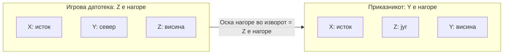

# Оски, единици и време

Игрите и мапите не се согласуваат каде е горе, колку е долга една единица и како се пишува времето. Оваа страница ги прикажува трите поставки што го прават вашиот податочен сет да стои, да има правилна големина и да се пушта правилно.

Ако вашата мапа стои како ѕид наместо да лежи како подлога, префрлете ја **Оска нагоре во изворот**.

Со погрешна **Оска нагоре во изворот** мапата стои како ѕид; со вистинската лежи како подлога.

## Светот во кој црта приказникот {#the-world-the-viewer-draws-in}

Светот на приказникот е **Y-нагоре**: X и Z се рамнината на теренот, Y е висината. Повеќето игрени мотори се **Z-нагоре**: за нив X и Y се теренот, а Z е висината. Некои мотори се и огледални (леворака). Пресликувањето кажува како да се претворат оските на датотеката во оските на приказникот. (Технички, приказникот е десноракав, конвенцијата на three.js.)

### Оска нагоре {#up-axis}

**Оска нагоре во изворот** во [Мапирањето на колоните](column-mapping.md):

| Поставка | Датотека (x, y, z) станува свет (X, Y, Z) |
|---|---|
| *Z е нагоре (повеќето игрени мотори)* - стандардно | (x, **z**, **y**): Z на датотеката станува висина, а Y на датотеката станува Z на светот |
| *Y е нагоре (графичка конвенција)* | (x, y, z) непроменето |

За податоци со Z нагоре, трите низи се преименуваат наместо да се копираат ([`remapAxesInPlace`](https://github.com/Holdi601/3DHeat/blob/main/src/data/ingest.ts)), што заштедува стотици мегабајти при големи вчитувања. Погодувањето се прави од примерокот: која и да е од колоните Y и Z има помал распон, таа е нагоре.

### Превртувања {#flips}

**Флип X**, **Флип Y** и **Флип Z** ја негираат *оската на датотеката* со тоа име, пред преименувањето - па со Z нагоре, *Флип Y* го негира она што на крајот станува Z на светот. Превртувањето ги менува вчитаните податоци: координатите што ги прикажуваат [мерката](measure.md), пресекот и положбата на камерата се превртените.

За да се црта огледален свет правилно **без** промена на податоците, користете **Камера и сцена → Инвертирај оска на светот** наместо тоа ([Камера](camera.md#invert-world-axis)). Тоа е подобар избор за игри чиј свет е леворак, бидејќи секоја координата што алатките ја прикажуваат останува на играта.

### Скала на единицата {#unit-scale}

**Скала на единицата** ја множи секоја позиција. *1 (m)* поставува 1, *0,01 (cm→m)* поставува 0,01 (единиците на Unreal Engine се сантиметри, па користете 0,01; единиците на Source-моторот се инчи, па користете 0,0254; ниту едното не се метри), а полето прифаќа која било вредност. Впишана 0 или вредност што не е број се заменува со 1.

Приказникот ги означува растојанијата во метри (радиус на спрајтот, границите на отсекувањето, мерката, брзината на летање), што е точно само кога скалираната единица на светот е метар. Ништо не се расипува кога не е; ознаките само гласат „m“ за која и да е единица.

## Време {#time}

### Единици за време {#time-units}

Практично правило: вредности како 17000000000 (десет или повеќе цифри) се Unix-временска ознака; вредности како 0, 0,25, 0,5 се секунди од почетокот.

| Единица за време (ознака во менито) | Се чита како | Прикажан часовник |
|---|---|---|
| *Секунди (релативно)* | вредност × 1 s | не |
| *Милисекунди (релативно)* | вредност × 0,001 s | не |
| *Микросекунди (релативно)* | вредност × 10^-6 s | не |
| *Наносекунди (релативно)* | вредност × 10^-9 s | не |
| *Unix-временска ознака (s)* | секунди од 1970-01-01 UTC | да |
| *Unix-временска ознака (ms)* | милисекунди од 1970-01-01 UTC | да |
| *Низа со датум ISO-8601* | текст како `2026-03-14T18:02:11.250Z`, анализиран со `Date.parse` на прелистувачот | да |

Со апсолутна единица (последните три) податочното множество го задржува часовниот момент на својот најран ред, а временската линија го прикажува тековното UTC време од денот (`HH:MM:SSZ`) покрај главата за репродукција.

**Колоните `TIMESTAMP` и `DATE` во Parquet** се декодираат во вистински моменти, па нивната поставка за единица се занемарува, а панелот тоа го кажува. Колоната `DATE` е цел ден: секој ред од еден ден го дели истиот момент, а репродукцијата скока по ден, за што панелот предупредува.

**Низите ISO-8601 работат и во CSV и во Parquet.** Текстуалната колона со време со ISO единицата се анализира еднаш за секоја различна низа; ако ниедна не може да се анализира, вчитувањето пропаѓа со *No parseable ISO-8601 timestamps in the mapped time column.* - а мапирањето веќе одбива да почне кога ниедна од примероците вредности не се анализира. Колоната `TIMESTAMP` во Parquet се чита како временска ознака, без оглед на поставената единица, а бројчаната колона во Parquet со ISO единицата се чита како Unix-милисекунди. Текстуалната колона со време со бројчана единица се одбива пред вчитувањето: секоја вредност би се читала како NaN.

### Како се чува времето {#how-time-is-stored}

Додека датотеките се спојуваат, времињата се 64-битни секунди, така што апсолутната епоха ги задржува своите под-секундни детали. Кога сите датотеки се внесени, најраното време на целиот избор станува 0 и секој ред чува 32-битни секунди од него. 32-битен плутечки број има 24 бита мантиса: распони до околу еден и пол ден се решаваат подобро од 1/100 s, а распони од половина година до околу една секунда. Ред чие време недостасува или не е број се става на 0, почетокот.

Редовите потоа се подредуваат по време, а тоа е што ја прави временската линија јефтина: прозорец на време се наоѓа со два бинарни пребарувања (видете [Земање примероци и буџети](sampling-and-budgets.md)).

### Изминато време наспроти часовник {#elapsed-time-versus-wall-clock}

Колона со време како `match_time` или `round_time` брои од почетокот на секој натпревар. Ако ја изберете, секој натпревар се става на заедничка оска - добро за споредба на тоа што се случува во 3-тата минута од секој натпревар - а панелот на тоа го укажува. Колона со часовно време ги прикажува натпреварите по редоследот по кој навистина се одиграле, преклопувајќи се каде што се преклопиле.

## Насока на гледање {#look-direction}

Насоката на гледање ја користи само [повторувањето со кутии](box-replay.md) (зраците од секоја кутија). Се чува како два агли, јав и нагиб, во радијани.

- **Колоните јав / нагиб** се читаат како што се, претворени од степени кога е избрано *Степени*. Не се прилагодуваат за оската нагоре или за превртувањата.
- **Колоните со вектор на насока** минуваат низ истото преименување и превртувања како позициите, па стануваат јав = atan2(x, -z) и нагиб = atan2(y, √(x² + z²)) во оските на светот, така што зракот покажува каде е свртена кутијата и во свет со огледален извор.

Ако колоните јав/нагиб покажуваат погрешно по превртување, вектор на насока или приспособени агли, поправката е тоа.
