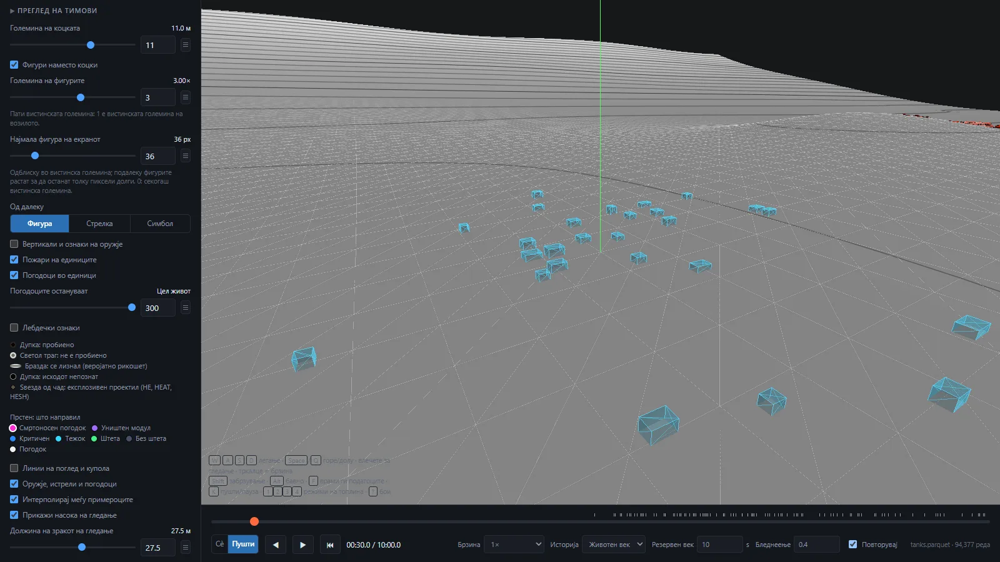

# Преклопување фигури (повторување со кутии)

Мал филм: по една фигура за секоја личност, што се движи додека времето тече, со трага зад неа.

Режимот се вика **Преклопување фигури** во лентата со режими. Оваа страница некогаш се викаше „повторување со кутии“, бидејќи пред фигурите секоја личност била кутија; „повторување со фигури“ и „повторување со кутии“ значат исто. **Преклопувањето фигури** нема број на копче: изберете го во лентата со режими. Црта по една фигура (или кутија) за секоја [личност](glossary.md), што се движи по [временската линија](timeline.md), со незадолжителни зраци на гледање и траги. Ова е репродукција, а не густина: *кој каде бил, кога*. Потребна е колона со личности; без колона со време секој примерок се црта одеднаш.

## Како се користи {#how-to-use-it}

1. Вчитајте податоци со колона за личност и колона за време.
2. Изберете **Преклопување фигури** во лентата со режими.
3. Префрлете ја временската линија на **Пушти** и притиснете пушти (`K`).
4. Отворете **Преглед на тимови** за да ја промените **Должината на трагата**, големината на фигурите или зраците на гледање.

Во овој режим не се црта топлина, а адаптивниот буџет на спрајтовите е неактивен.

Стандардно секоја личност се црта како фигура за она што е, а не како кутија - видете [Фигури](figures.md) за која фигура добива една единица, и [Повторување на натпревар](match-replay.md) за ознаки, камерата што следи, мерење меѓу две единици и списокот на настани.

## Панелот Преглед на тимови {#the-team-viewer-panel}

Се прикажува наместо панелите за топлина во овој режим.

| Контрола | Стандардно | Опсег (лизгање) | Значење |
|---|---|---|---|
| **Фигури наместо коцки** | вклучено | | Секоја личност како фигура за она што е: војник на нозе, тенкот или авионот што ги именува податоците. Она за што податоците ништо не велат останува кутија. |
| **Големина на фигурите** | 1× | | 1× е вистинска големина. |
| **Најмала фигура на екранот** | 36 px | 0 = секогаш вистинска големина | Вистинска големина изблизу; подалеку фигурите растат за да останат толку пиксели долги. |
| **Оружје, истрели и погодоци** | вклучено | | Оружје во лет со чад, трасери, удари, погодоци и убиства. Трасерите заклучени од погодок се испрекинати. |
| **Големина на коцката** | големина на существото, или распон / 500, при вчитување | 0,05-200 m, логаритамски (5000) | Должина на раб на секоја кутија. Видете [големина на существото](sessions-persons-groups.md#entity-size). |
| **Интерполирај меѓу примероците** | вклучено | | Меѓу два примерока на истата личност во истата сесија, кутијата се става пропорционално помеѓу нив. Никогаш преку граница на сесија. |
| **Прикажи насока на гледање** | вклучено | | Зрак од секоја кутија по насоката на гледање на личноста (потребни се [колони за гледање](axes-units-and-time.md#look-direction)). |
| **Должина на зракот на гледање** | големина на существото × 4, или распон / 200, при вчитување | 0,5-500 m, логаритамски (20 000) | Се прикажува додека е вклучена насоката на гледање. |
| **Должина на трагата** | 8 s | 0-300 s (86 400); 0 = исклучено | Секунди историја нацртани зад секоја личност. |
| **Цртај го секој необработен примерок** | исклучено | | Кутија за секој зачуван примерок во прозорецот, наместо една интерполирана кутија по личност. Земен е примерок за да остане интерактивно. |

Советите во панелот објаснуваат дека интерполацијата и трагите ги спојуваат примероците само во рамките на една сесија и, кога вчитувањето има [заеднички имиња](sessions-persons-groups.md#names-worn-by-several-things-at-once), колку имиња се цртаат како единечни примероци.

## Сесијата што се пушта {#the-session-being-played}

Со колона за сесија, избирачот **Сесија** на врвот од страничната лента ([Сесии](sessions-persons-groups.md#the-session-picker)) одлучува кој натпревар се пушта. При вчитување се избира најзафатениот. Само редовите од таа сесија стануваат кутии и траги, а временската линија трае преку распонот на таа сесија, наместо преку целото податочно множество. *Сите сесии* ги пушта сите сесии истовремено, сè уште без спојување на примероците меѓу сесиите.

## Што се црта кога {#what-is-drawn-when}

Од [`TrackCursor`](https://github.com/Holdi601/3DHeat/blob/main/src/data/tracks.ts):

**Живи кутии** (режим Пушти, сурови примероци исклучени). За секоја видлива личност, нејзиниот последен примерок на или пред главата:

- Ако личноста има следен примерок, тој е во истата сесија, а името не е заедничко, кутијата се става меѓу двата примерока пропорционално на времето, со јавот интерполиран по пократкиот пат и нагибот линеарно (кога *Интерполирај* е вклучено).
- Инаку кутијата останува на последниот примерок за **Резервниот век** на временската линија (стандардно 10 s) и потоа се отфрла, така што исфрлените играчи не остануваат.

**Режимот Сите** ја занемарува главата и црта секој примерок во опсегот како кутија.

**Сурови примероци** црта кутија за секој зачуван примерок во прозорецот: *Распонот* со историјата *Прозорец*, инаку сè до главата. Најмногу 65 536 кутии; со повеќе примероци се црта секој *k*-ти.

**Траги** (кога должината на трагата е над 0 и сурови примероци не се цртаат): линија меѓу секој пар последователни примероци на личност во последните *должина на трагата* секунди до главата, што бледнее од 80% непроѕирност до проѕирна со возраста. Трагата запира при промена на сесија и не се црта за заеднички имиња. Најмногу 131 072 темиња; со повеќе, редовите се прескокнуваат рамномерно.

**Кој е видлив:** личноста е скриена кога нејзината група е отштиклирана во [списокот на тимови](teams-list.md) (нејзината група е онаа на нејзиниот прв ред), кога филтер на група ја исклучува, или кога панелот [Существа](entities.md) има избор што не ја вклучува. [Филтрите](filters.md) на колоните не важат за кутиите.

## Бои {#colours}

Едно семејство на нијанси по група и една јачина по член, така што еден поглед кажува на која страна е некој ([`teamMemberColor`](https://github.com/Holdi601/3DHeat/blob/main/src/render/colors.ts)). Нијансите на групите се вртат низ фиксна листа од десет - сина, црвена, зелена, килибарна, виолетова, цијан, магента, лимета, портокалова, индиго - а членовите на групата се распоредени низ светлина 42-76% и заситеност 90-65%.

## Белешки {#notes}

- Преклопувањето фигури ги прави своите фигури повторно само кога нешто се менува; празен кадар ги црта повторно последните.
- Редот *Кутии* од [статистиките](performance-and-stats.md) ги брои кутиите на екранот.
- Преклопувањето фигури црта во истата сцена како нивото, па [длабочината на полето](camera.md#depth-of-field) ги замаглува кутиите, но никогаш не ја замаглува топлината.
