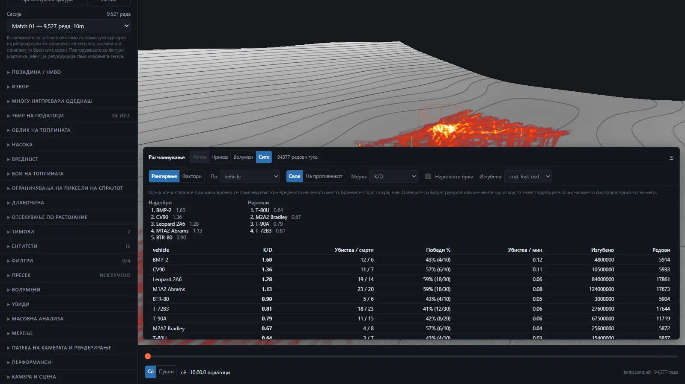
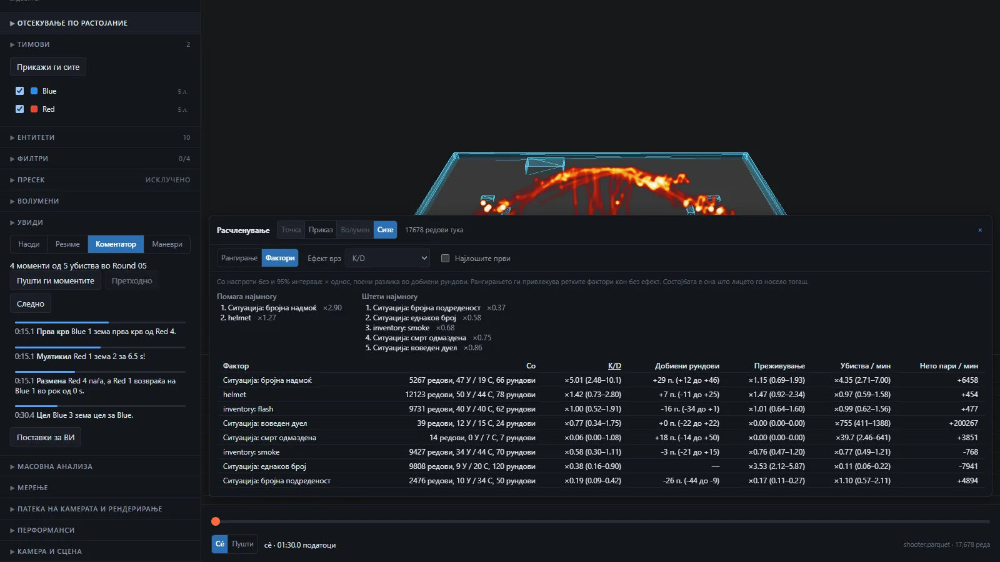

# Расчленување: кој и што најдобро дава каде

**Расчленувањето** одговара на едно прашање: на ова место, кое возило, играч или оружје дава најдобри резултати? Користете го за да го најдете тенкот што победува кај мостот, или да видите дали навистина помага носењето на шлем.

Ги рангира случувањата на едно место (избрана точка, приказот, волумен или сè прикажано) по која и да е категорија и го мери секој фактор на состојбата со и без него.

## Пробајте {#try-it}

1. Вчитајте натпревар со убиства и смрти и отворете **Волумени**.
2. Нацртајте волумен околу местото што ве интересира и изберете го.
3. Притиснете **Расчленување…** под Статистика.
4. Под **По** изберете *Возило*, и изберете ја мерката *K/D* (убиства по смрт).
5. Прочитајте ја листата, најдобрите први. Притиснете **Најлошите први** за да ја свртите. Кликнете на име за да го филтрирате приказот на него; кликнете пак за да го пуштите.

## Отворете го {#open-it}

| Од | Област со која почнува |
|---|---|
| **Расчленување…** во [Волумени](volumes.md) (Статистика) | избраниот волумен |
| **Расчленување тука** на картичката за избор, по клик на точка | сфера околу таа точка (**Радиус**, стандардно 3% од големината на податоците) |
| делот за поделба **Разлика** | приказот |

Заглавието ја менува областа: **Точка**, **Приказ** (што камерата го видела при последното броење; **Преброј повторно** по поместување), **Волумен** (изберете еден) или **Сите**. Бројот се прави во позадина; редот на статусот вели колку редови има во областа.

## Рангирање {#ranking}

Изберете по што да се рангира и мерка:

| Мерка | Што е |
|---|---|
| A, B | редови на секоја страна од мапата на разликата, поделени како што ги дели топлината |
| A / B, A - B, A / (A + B) | двата слоја една наспроти друг |
| K/D | убиства наспроти смрти |
| Победа % | победени рунди (или натпревари), каде податоците кажуваат кој победил |
| Убиства / мин | убиства по минута присутни (празнините на примероците на движењето) |
| Заработено, Изгубено, Нето пари | збирови на колоните `earn_*` и `cost_*`; избирач ја одбира валутата |

Убиствата, смртите, присуството, победите и парите ги броят сите редови што приказот ги покажува на местото, на која и да е страна од поделбата или на ниедна.

Односите и стапките се повлекуваат кон вредноста на целото место каде бројките се мали, па 2 убиства во 1 живот не го прават врвот на листата. Броевите се прикажани покрај нив.

Можете да рангирате по групи, играчи и натпревари, по која и да е категориска колона (возило, оружје, страна, вид набавка, агент или комплет), по која и да е бројчана колона во опсези (оклоп, вредност на опремата), по **класата** на колоната за оружје (пушка, снајперист, SMG, пиштол...) и колку парчиња **помош** содржи колона со листа, како `inventory`.

**Своето** рангира по сопствената вредност на редот. **На противникот** рангира по вредноста на другата страна: оружјето на жртвата при убиство, оружјето на убиецот при смрт (треба колона `other` / `victim` што ги именува).

## Состојбата во тоа време {#state-at-the-time}

Вредноста на редот е своја, освен ако редот не бележи ниедна (редот на настан без опрема) или е смрт (чија колона за оружје може да го именува оружјето на убиецот); тогаш е она што истата личност последно го носела порано во натпреварот.

## Фактори: со наспроти без {#factors-with-against-without}

Префрлете се од **Рангирање** на **Фактори**, изберете **Ефект врз**, и прочитајте *Најмногу помага* и *Најмногу штети*:

Ефектот на секој фактор врз K/D, победени рунди, преживување (минути по смрт), убиства во минута и нето пари во минута, со интервал од 95%: односите како x, победените рунди како разлика во поени. Рангирањето го повлекува секоја проценка кон без ефект според својата сопствена неизвесност, па реткиот фактор треба јасен ефект за да се рангира високо; прикажаниот интервал е неповлечениот.

Податоците со рунди ги додаваат **ситуациите** при блиска борба ([Блиска борба и рунди](close-quarters.md)), пресметани еднаш по податочно множество: *заслепен* (`state_flashed` на редот, или непријателски блесок во рок од 15 m во последните 3 s), *смртта е разменета*, *отворен дуел*, и *пробојна надмоќ*, *еднакви бројки* или *пробојна слабост* (живи играчи на страната на редот наспроти непријателот). Смртта се брои во ситуацијата во која била жртвата непосредно пред неа.

Најмногу 256 фактори се мерат во еден премин.

## За програмерите {#for-developers}

### Повлекување на мали примероци {#pulling-small-samples}

Вредноста за рангирање е `(n + m*r0) / (d + m)`: `n` и `d` се бројките, `r0` е односот на целото место, а `m` е тежината на тој приор.

### За авторите на конвертори: именување на колони на фактори {#for-converter-authors-naming-factor-columns}

Конверторот додава фактор со именување на неговата колона:

| Колона | Фактор |
|---|---|
| `state_<name>` број | вклучено додека не е нула (`state_scoped`, `state_suppressor`) |
| `state_<name>` категорија | по еден фактор за секоја вредност (`state_ammo` = AP, HE...) |
| `active_<name>` | исто, за нешто што е вклучено или користено неодамна: способност, ултимејт, направа, засилување (`active_ult`, `active_stim`) |
| колона со листа (`inventory`, `loadout`, `perks`, `abilities`, `attachments`, `modules`, `buffs`, `debuffs`, `upgrades`, или име `state_`/`active_` што завршува на `s`) | по еден фактор за секоја ставка од вредност `a\|b\|c` |
| веќе вообичаени знаменца за опрема (`helmet`, `defuser`, `armor`, `scoped`, `airborne`, `duck`, `flashed`...) | вклучено додека не е нула |
| `ammoType`, `shellType`, `ammoName` | последниот испален залог |

Резултати: колона `won` со 0/1 (страната на редот ја победила рундата или натпреварот) и колона `round`. Пари: `earn_<currency>` и `cost_<kind>_<currency>`; приход само по вид (`earn_round_cs2`, точните награди за рунда на конверторот) ја заменува само приходната компонента на моделот на трошоци за тој вид (`round` ги опфаќа и поставувањата и разоружувањата), а моделот ги цени останатите.

Мапирањето ги вчитува овие колони само, покрај сопствената листа на датотеката: секоја `state_*`, `active_*`, `won`, `round` и колона со листа, освен оние што статистиките на датотеката Parquet ги покажуваат дека држат една вредност низ сè (секоја вчитана колона чини 4 бајти по ред).
