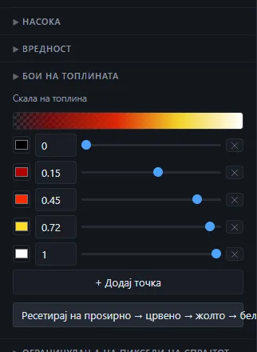

# Боја и експозиција

Овие контроли одлучуваат која количина топлина добива која боја. **Точка на заситување** е колку топлина се брои како бело-жешка.

## Брзи поправки {#quick-fixes}

- Сè е бело: зголемете ја **Точката на заситување** или притиснете **Автоматска експозиција од полето**.
- Ништо не се гледа: намалете ја **Точката на заситување** или притиснете **Автоматска експозиција од полето**.
- Се гледаат само неколку единечни точки: зголемете ја **Минималната топлина**.

Секоја контрола на оваа страница дејствува кога топлината се претвора во боја, па секое влечење на која и да е од нив веднаш ја исцртува сликата и **никогаш не ја започнува акумулацијата одново**.

## Точка на заситување {#saturation-point}

**Точка на заситување** (дел Облик на топлината): акумулираната топлина што се пресликува на врвот од скалата на бои (со *Линеарниот* одзив; за другите видете подолу). Логаритамски лизгач 0,1-4000, рачката за влечење оди до 10 000 000, бидејќи акумулираната топлина расте со бројот на редови. Стандардно 24; при секое вчитување прво се добива **аналитичка проценка**, па потоа **измерена** од сликата.

Погрешното поставување е разликата помеѓу топлинска мапа и празен (или бел) екран, а не може поуздано да се пресмета: телеметријата се групира толку силно - појавување, врата, тесно грло - што односот помеѓу врвната и просечната густина се менува за цел ред на големина помеѓу податочните множества и помеѓу аглите на камерата.

## Автоматска експозиција {#auto-exposure}

**Автоматска експозиција од полето** го мери полето што сенчилото всушност го произвело. Ги игнорира празните пиксели, ја зема 98-от перцентил од осветлените и ја става на 85% од патот до точката на заситување, така што врвот од скалата се чува за вистинските врвови.

Панелот тогаш покажува *измерено X% од кадарот; 98-от перцентил R е поставен блиску до врвот на скалата*. Со *Заситувачкиот* одзив, вредност на 85% од точката на заситување паѓа на околу 69% од скалата, а не на 85%.

Исто така работи **автоматски**:

- 8 рендерирани кадри по вчитување на податочно множество;
- 8 кадри по промена на [филтрите](filters.md) (филтрирањето на секоја позиција до стотина настани ја менува густината за редови на големина);
- 8 кадри по префрлање меѓу точкаста [топлина](heat.md) и [топлина по линија](line-heat.md) или промена на тоа кои патеки ги црта топлината по линија, бидејќи линијата остава многу помалку топлина по примерок отколку спрајтот.

Кога ништо не е осветлено, автоматското мерење ја остава заситеноста непроменета; копчето паѓа назад на аналитичката проценка и вели *нема што да се мери - се користи аналитичката проценка*.

### Следи го погледот {#follow-the-view}

**Следи го погледот** (дел Облик на топлината, стандардно вклучено) повторно мери секогаш кога камерата ќе застане, така што регионот во кој летате го користи целиот опсег на скалата на бои, наместо скалата измерена за целата мапа. Мали промени се занемаруваат, а скалата се менува глатко, не скокнува. Работи во четирите режими на топлина, а не во преклопувањето на фигури.

Исклучете го за да ја заклучите скалата и да споредувате места на иста скала. Влечењето на **Точката на заситување** рачно исто така ја заклучува.

## Одзив на густината {#density-response}

**Одзив на густината** - како *k* (топлина / заситување) се пресликува на скалата:

| Одзив | Формула | Употреба |
|---|---|---|
| **Заситувачки** (стандардно) | t = 1 - e^(-k) | Се приближува кон врвот од скалата асимптотски, како што се собираат проѕирните спрајтови. Ништо никогаш не се засекува во рамна бела боја, па е безбедниот стандард за непознати податоци. |
| **Линеарна** | t = k | Единственото пресликување каде еднаква боја значи еднаков број. Користете го за споредба на две податочни множества или два временски прозорци. |
| **Логаритамска** | t = log₂(1 + 7k) / 3 | Ја збива долгата опашка, така што една екстремна жешка точка престанува да ја спласнува сета останата содржина до дното на скалата. Ги осветлува ретките области. |

## Минимална топлина {#minimum-heat}

**Минимална топлина** (стандардно исклучено, 0-100%): секој пиксел што носи било каква топлина се крева најмалку на овој дел од скалата. Зголемете ја, а радиусот на спрајтот намалете, за да видите *каде некогаш нешто се случило* - единечните податочни точки стануваат јасно видливи, наместо да седат тик над проѕирното. Оставете ја исклучена кога ја проценувате густината, бидејќи намерно го спласнува дното на скалата. Прагот (k > 0,0001) ги задржува вистински празните пиксели празни.

## Уредникот на скалата {#the-ramp-editor}

Во делот **Бои на топлината**. Неговата ознака кажува за што е скалата: *Скала на топлина* во Топлина и Линии, *Позитивна (тимови што собираат)* во Разлика, *Скала на проѕирност (бојата доаѓа од групата)* во [Топлина по тимови](team-heat.md), каде се користи само нејзината алфа.



Горната лента ја прикажува скалата. Под неа, по една редица за секоја точка:

| Дел | Значење |
|---|---|
| Боја | Бојата на точката (избирачот на бои на прелистувачот). |
| Број | Положбата на точката по скалата, од 0 до 1 (0 = нема топлина). |
| Лизгач | Проѕирноста на точката, 0-100%. |
| ✕ | Ја брише точката; неактивно кога остануваат само две. |

**+ Додај точка** додава точка на половина пат меѓу последните две, со бојата и проѕирноста на последната. **Ресетирај на проѕирно → црвено → жолто → бело** го враќа стандардното.

Точките може да се дадат во кој било редослед; се подредуваат кога се гради скалата. **Алфата** е она што ја меша топлината со сцената, затоа нултиот крај на стандардната скала е целосно проѕирен.

### Стандардните скали {#the-default-ramps}

| Позиција | Позитивна (Топлина, Линии, Разлика +) | Негативна (Разлика −) |
|---|---|---|
| 0,00 | црна, алфа 0 | црна, алфа 0 |
| 0,15 | rgb(180, 0, 0), алфа 0,55 | rgb(0, 170, 60), алфа 0,55 |
| 0,45 | rgb(255, 40, 0), алфа 0,85 | rgb(0, 190, 200), алфа 0,85 |
| 0,72 | rgb(255, 220, 40), алфа 0,95 | rgb(40, 80, 255), алфа 0,95 |
| 1,00 | бела, алфа 1 | rgb(170, 60, 255), алфа 1 |

## Додека се движи камерата {#while-the-camera-moves}

Кога камерата се движи, акумулацијата се почнува одново секој кадар. Со **Цртај го секој ред во секој кадар** вклучено (стандардно), секој движечки кадар е сè уште точен; со исклучено, движечкиот кадар покажува една земена проценка - посветли, по тежина пропорционални груписувања - која се приближува кон поглавната вистинска слика кога ќе застанете. Тоа е очекувано; видете [Акумулација](accumulation.md).

## За програмерите {#for-developers}

### Композитниот премин {#the-composite-pass}

Откако топлината е акумулирана, вредноста на секој пиксел се претвора во боја во еден композитен премин ([`COMPOSITE_FS`](https://github.com/Holdi601/3DHeat/blob/main/src/render/webgl2/shaders.ts)). Чекорите се:

```
k = |heat| / saturation point
t = response(k)                         clamped to 0..1
if minimum heat > 0 and k > 0.0001:  t = minimum + (1 - minimum) × t
colour, alpha = ramp(t)                  (the negative ramp when heat < 0, Difference only)
pixel = mix(scene, colour, alpha)
```

### Аналитичката проценка {#the-analytic-estimate}

**Аналитичката проценка** ([`estimateSaturation`](https://github.com/Holdi601/3DHeat/blob/main/src/data/calibrate.ts)) претпоставува дека редовите се рашироко распоредени низ X-Z отпечатокот на податоците: просечна топлина = редови × (π r² / површина на отпечатокот) × 1/3 × интензитет во центарот (1/3 е просекот по дискот на линеарна скала), помножено со претпоставен однос врв-спрема-просек 25, стегнато на 0,1-1 000 000. Треба да биде само до ред на големина точна.

### Мерење {#metering}

[`exposure.ts`](https://github.com/Holdi601/3DHeat/blob/main/src/render/exposure.ts):

1. целта на топлината се чита назад од GPU-то, на најмногу 40 000 вредности (подузорок);
2. празните пиксели (топлина ≤ 0,0001) се отфрлаат - поголемиот дел од полето на топлина е празен, а просекот со нив би сè потценил, како мерач на камера насочен кон црно позадина;
3. 98-от перцентил од осветлените пиксели е референцата;
4. точката на заситување станува референца / 0,85, така што референцата е на 85% од патот до точката на заситување, а врвот од скалата се чува за вистинските врвови.

### Табелата на бои {#the-colour-table}

Скалата се печати во табела 256 × 2 RGBA (позитивната скала во првиот ред, негативната во вториот) ([`buildColorLut`](https://github.com/Holdi601/3DHeat/blob/main/src/render/colors.ts)). Боите се интерполираат во линеарна светлина и се чуваат како sRGB; проѕирноста се интерполира линеарно.
