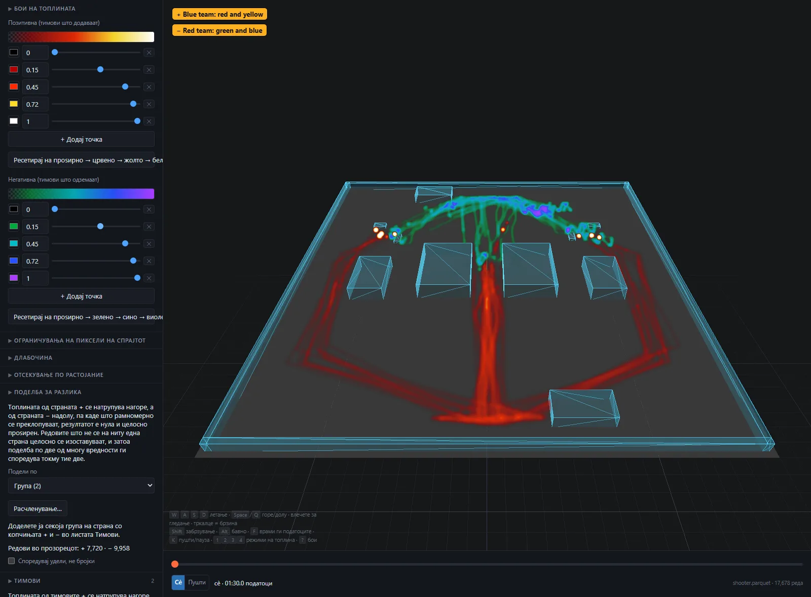

# Разлика

Црвено каде била повеќе од тим A, зелено-сино каде била тимот B, ништо каде биле еднакви.

**Разлика** (копче 2) е топлина со знак. Редовите од една популација додаваат топлина; редовите од друга ја одземаат. Каде што двете се преклопуваат рамномерно, резултатот е нула и целосно проѕирен; каде една доминира, се прикажува во боите на таа страна - по основно топло (проѕирно → црвено → жолто → бело) за страната **+** и ладно (проѕирно → зелено → сино → виолетово) за страната **−**.

## Како се користи {#how-to-use-it}

1. Притиснете `2` (или изберете **Разлика** во лентата за режими).
2. Отворете **Поделба за разлика** во страничната лента.
3. Изберете што да **Подели по**: обично *Групи*.
4. Ставете една група (или вредност) на **+**, а друга на **−**.
5. Прочитајте ги боите: топло значи страната +, ладно значи страната −. Панелот предупредува ако една страна нема редови (видете [Пораки што може да ги видите](#messages-you-may-see)).

*Кои* две популации се целото прашање, па поделбата може да биде која било задржана колона, не само групи. Редовите што паѓаат на **ниедна** страна се **испуштаат**, не се броат како нула: тоа е она што прави поделба над две од многу вредности да ги споредува точно тие две, и се составува со [филтрите](filters.md) - филтрирајте до една мапа, па поделете го тоа по верзија.

Режимот бара две страни: колона на група со најмалку две групи, или поделба по колона задржана за филтрирање. Кај податоци со помалку од две групи, вчитувањето започнува со поделба по колона - прво колоната *Source file* од вчитување од неколку датотеки, инаку првата колона на категорија со две вредности, инаку првата нумеричка колона со распон - па *споредбата на две вчитувања* работи и на податоци без групи. Само податоци без ниедно не го оставаат режимот недостапен; исто така и поделба по колона што на едната страна нема ништо.

## Панелот Поделба за разлика {#the-difference-split-panel}

Се прикажува во режимот Разлика, под панелите за топлина.

**Подели по** нуди:

| Опција | Прикажано како | Правило на поделба |
|---|---|---|
| Групи | *Група (N)* (кога има колона на група) | Секоја група на +, − или ниедна, поставена во [списокот на тимови](teams-list.md) |
| Колона на категорија | *колона (N вредности)* | Вредности на +, − или ниедна |
| Нумеричка колона | *колона (нумеричка)* | Опсег на вредности за секоја страна |
| Датотеката на потекло | *Source file - споредба на две вчитувања* (кога се вчитани неколку датотеки) | Датотеки на +, − или ниедна |

Се нудат само колони задржани под *Задржи за филтрирање* при вчитување.

### Споредувај удели, не бројки {#compare-shares-not-counts}

**Споредувај удели, не бројки** (по основно исклучено) ја тежи секоја страна со еден делено со нејзиниот број редови, па страна со пет пати повеќе редови не победува само по бројки. Бојата тогаш покажува каде секоја страна е сразмерно почеста од другата. Користете го кога двете страни имаат многу различни количини податоци, на пример две сесии со различно траење.

### Пораки што може да ги видите {#messages-you-may-see}

Панелот предупредува кога сликата не е вистинска разлика:

| Порака | Значење |
|---|---|
| *N + / M −* (или *N + / M − / K не се користи*) | Колку вредности се на секоја страна (и на ниедна). |
| Ниеден ред во прозорецот не е на страната **+** | Се црта само страната **−**. Поместете го прозорецот на временската линија или променете ја поделбата. |
| Ниеден ред во прозорецот не е на страната **−** | Се црта само страната **+**. |
| Ниедна вредност не е на ниедна страна | Разликата не црта ништо. Ставете барем една вредност на **+** или **−**. |
| *колоната* не може да се подели на овој начин | Избраната колона не одговара на поделбата. Изберете ја колоната повторно. |
| Колоната за поделба не се вклопи во меморијата на GPU за N од M делови | Тие редови не се цртаат. Зголемете го буџетот за GPU под Перформанси → Буџети на ресурси, или вчитајте помалку редови. |

### По група {#by-group}

Панелот само упатува на [списокот на тимови](teams-list.md), каде секоја група има копче **+** и **−**. При секое вчитување првата половина од групите (заокружено нагоре) се става на +, остатокот на −; **Подели рамномерно** во списокот на тимови го прави истото повторно. Група што е на ниедна страна, или скриена со своето квадратче, не придонесува ништо.

### По вредности на категорија {#by-category-values}

| Дел | Значење |
|---|---|
| `a + / b − / c не се користи` | Колку вредности се на секоја страна и на ниедна. |
| **Исчисти** | Ја става секоја вредност на ниедна страна. |
| Список на вредности | Секоја вредност со копче **+** и **−** (кликнете го активното повторно за да го извадите од таа страна). Празна вредност се наведува како *(недостасува)*. |
| Белешка за граница | Се наведуваат само првите 200 вредности: *Се прикажуваат првите 200 од N вредности. Колона толку широка подобро е прво да се стеснат со филтер, или да се подели по опсег ако вредностите се подредени.* |

Изборот на колоната ја става нејзината прва вредност на + и втората на −. Кога ниедна страна нема ниедна вредност, поделбата се враќа на групи наместо да прикажува празна слика. *Source file* работи на истиот начин, по една вредност на датотека - така се споредуваат два извози, две тест-извршувања или две верзии.

### По опсег {#by-range}

| Дел | Значење |
|---|---|
| Совет | Минималната и максималната вредност на колоната. |
| **Позитивен опсег (+)**, **од** / **до** | Редовите со вредност во овој опсег, вклучително на двата краја, додаваат. |
| **Негативен опсег (−)**, **од** / **до** | Редовите во овој опсег одземаат. |
| **Подели на средината** | Ја поставува + на [минимум, средина] и − на [средина, максимум] - исто така го прави и изборот на колоната. |

Вредност во двата опсега се смета за +. Опсезите не мора да ја покриваат колоната; вредностите во ниедниот се испуштаат. *Првите две минути наспроти последните две* е поделба по опсег на колона слична на време.

## Бои {#colours}

Делот **Бои на топлината** во овој режим прикажува два уредници на скали: **Позитивна (тимови што додаваат)** и **Негативна (тимови што одземаат)**, секој со свое копче за враќање (*Врати на проѕирно → црвено → жолто → бело*, *Врати на проѕирно → зелено → сино → виолетово*). Составениот приказ ја зема апсолутната вредност на нето топлината преку [точката на заситеност и одѕивот](colour-and-exposure.md), и ја избира негативната скала таму каде нетото е под нула. Видете [Боја и експозиција](colour-and-exposure.md#the-ramp-editor).

Користете го одѕивот *Линеарна* густина кога важи големината на разликата: тоа е единствениот одѕив каде еднаква боја значи еднакво бројно.

## За програмери {#for-developers}

Секој ред добива знак од +1, -1 или 0 во shader-от на темињата ([`POINT_HEAT_VS`](https://github.com/Holdi601/3DHeat/blob/main/src/render/webgl2/shaders.ts)); 0 го отфрла редот пред да се нацрта кој било фрагмент.

- По група, знакот доаѓа од табела на групи од 4.096 записи, индексирана по идентификаторот на групата на редот (идентификаторот на групата се носи во четвртиот канал на позициската текселка на редот).
- По категорија, знакот доаѓа од втора табела од 4.096 записи, пополнета по вредност на категорија, а вредноста на редот се чита од текстурата за филтрирање на колоната; вредност надвор од крајот на табелата се отфрла на двата backend-а.
- По опсег, вредноста на редот се споредува со двата опсези.

Промената на поделбата ја рестартира акумулацијата.

**Скриените групи остануваат скриени со секоја поделба.** Под поделба по колона табелата на групите веќе не носи знаци; таа држи 1 за прикажана група и 0 за скриена ([`frameSignTables`](https://github.com/Holdi601/3DHeat/blob/main/src/render/filterTables.ts)), а двете табели стигнуваат до shader-от заедно - два реда на една текстура со знаци на WebGL2, две половини на едно складиште-бафер на WebGPU. Ред се црта само кога неговата група е прикажана *и* неговата вредност на колоната е на една страна. Затоа група непоштиклирана во [списокот на тимови](teams-list.md), или испуштена со фокусот на страната во јазичето Натпревар, не придонесува ништо, без оглед на начинот на поделба на разликата.
