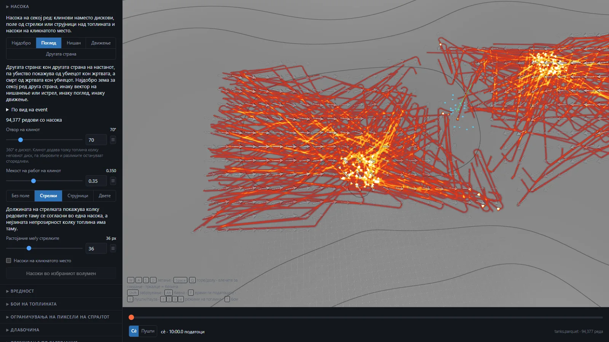

# Насочена топлина

Обичната топлина кажува **каде** се случуваат работите. Насочената топлина кажува и **во која насока**: во која насока гледале луѓето, нишанеле, се движеле, или каде била другата страна на борбата.

Обичен спрајт е цел диск (360 степени). Со **Отвор на клинот** од 70 степени, истиот спрајт станува тесен клин што покажува во која насока бил свртен редот, и ја додава истата вкупна топлина.

## Како се користи {#how-to-use-it}

1. Вчитајте податоци со насока во нив (видете [Што му дава на редот насока](#what-gives-a-row-a-direction)).
2. Изберете **Топлина**, **Разлика** или **Топлина по тимови** во лентата со режими.
3. Отворете го делот **Насока** во страничната лента.
4. Изберете **извор** (која насока да се користи), па вклучете го цртањето:
   - намалете го **Отворот на клинот** под 360° за да го нацртате секој ред како клин што покажува во својата насока наместо диск;
   - изберете **Поле** за да нацртате стрелки или струјници преку топлината;
   - штиклирајте **Насоки на кликнатото место** и кликнете на топлината за да добиете поларен графикон на тоа место.

Редот на статусот кажува колку редови имаат насока од избраниот извор.

## Поставки {#settings}

| Поставка | Стандардно | Што прави |
|---|---|---|
| Извор: **Најдобри**, **Приказ**, **Нишан**, **Движење**, **Другата страна** | Најдобри | Која насока ја добива секој ред. *Најдобри* зема, по ред, другата страна, инаку нишанот, инаку приказот, инаку движењето. |
| **По вид на настан** | како погоре | Различен извор за секој вид настан, на пример *Другата страна* за убиства и *Приказ* за позиции. Се прикажува кога податоците имаат колона за настани со најмногу 40 вредности. |
| **Отвор на клинот** | 360° | 360° е нормалниот диск (исклучено). Помало е потесен клин. Клинот додава толку топлина колку и дискот, па збировите и разликите остануваат споредливи. |
| **Мекост на работ на клинот** | 0,35 | 0 е клин со остар раб, 1 е мек вентилатор. |
| **Поле**: Без поле, Стрелки, Струјници, Двете | Без поле | Стрелки: должината на стрелката е колку редовите таму се согласуваат на еден правец, а нејзината непроѕирност колку топлина има таму. Стрелките се прикажуваат само таму каде има топлина. |
| **Растојание меѓу стрелките** | 28 px | Растојание меѓу стрелките на екранот. |
| **Анимирај ги струјниците** | вклучено | Струјниците текат додека е вклучено. |
| **Насоки на кликнатото место** | исклучено | Кликнете на топлината за да ги видите насоките таму (подолу). |
| **Насоки во избраниот волумен** | | Истиот графикон за сè што е внатре во избраниот [волумен](volumes.md). |

## Поларниот графикон на едно место {#the-polar-chart-at-a-spot}

Со **Насоки на кликнатото место** вклучено, кликнете на топлината. Редовите блиску до таа точка (во рок од 1,5 радиуси на спрајтот) се собираат во роза од 24 парчиња по 15°:

- **портокалови** листови: излезни насоки (кон каде покажуваат редовите);
- **сини** листови: влезни насоки (од каде дошле);
- **површината** на листот расте со неговиот број; стрелка ја покажува главната насока;
- линиите под графикот ги даваат главниот азимут, колку силно редовите се согласуваат (R, од 0 до 1), распонот во степени и бројот на редови.

0° е горе на графикот, што е светски −Z (север за снимки од Tacview). Местото е исто така означено во 3D приказот со стрелка и прстен.

## Што му дава на редот насока {#what-gives-a-row-a-direction}

| Извор | Треба во податоците |
|---|---|
| Приказ | колона за јав (пресликана како насока на гледање): `yaw`, `heading`, `azimuth`, `view_yaw`, `rot_z` |
| Нишан | парови броеви како `aim_x`/`aim_y`, `shot_x`/`shot_y`, `fire_x`/`fire_y`, `hit_dir_x`/`hit_dir_y` (незадолжително `…_z`) |
| Движење | ништо дополнително: чекорот од претходниот примерок на истата личност (најмногу 10 s порано, иста сесија) |
| Другата страна | колона што ја именува другата страна на настанот (`other`, `victim`, `target`, `killer`, `attacker`, `shooter`, `other_player` ...) чии вредности се имиња на личности; убиство покажува од убиецот кон жртвата, смрт од жртвата кон убиецот |

## Совети {#tips}

- Клиновите треба одредена големина на екранот; под неколку пиксели повторно се цртаат како дискови.
- Користете *Другата страна* на редовите за убиство за да видите **од каде** биле добиени борбите, и *Приказ* на редовите за позиција за да видите **каде луѓето гледаат**.
- Со **Разлика**, клиновите на двете страни покажуваат во своите насоки, па спорните линии на оган се истакнуваат.
