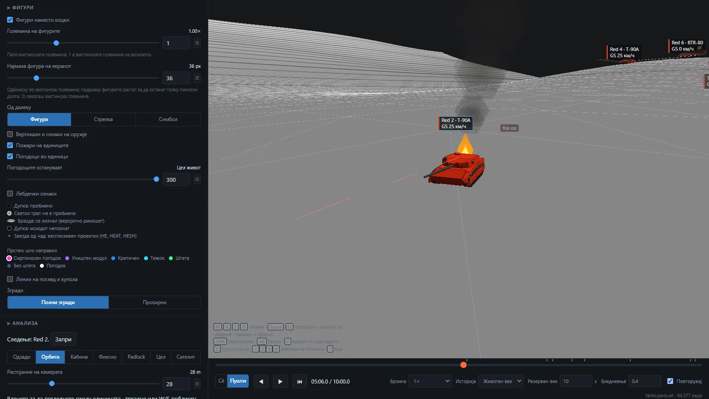

# Фигури

**Фигура** е мал 3D модел на тоа што навистина е една единица: тенк, млазен авион, брод, војник. [Повторувањето](match-replay.md) ја црта секоја единица како нејзина фигура во вистинска големина, наместо обична кутија.

Има околу 2 000 именувани возила, авиони, бродови, оружја и војници, сите изградени од самиот прегледувач.

## Што е во каталогот {#what-is-in-the-catalogue}

| Домен | Примери |
|---|---|
| Луѓе | војник стоечки, клечечки, испружен; снајперист, противтенковски, медицинар, екипаж |
| Копно | тенкови, борбени возила на пешадија, противвоздушна одбрана, артилерија, камиони и автомобили, возови и трамваи |
| Воздух | ловци, јуришни авиони, бомбардери, транспортни, хеликоптери, од бипланови до современи млазници |
| Море | воени бродови по класа, носачи на авиони, подморници, чамци, трговски бродови |
| Оружје | ракети, ракети со погон, бомби, торпеда, светлечки ракети и мамци |
| Ознаки | чад, блесок и огнени гранати, поставени бомби, знамиња, појавувања, патни точки |

## Како се прават фигурите {#how-the-figures-are-made}

- **Изградени од објавени димензии.** Повеќето фигури се направени од сопствениот градител на фигури на прегледувачот, од јавни броеви: должина, ширина, висина, тркала на патот, купола и топ, крилја и опашка. Нивната форма потоа се дотерува според јавни фотографии, цртежи и објавени димензии. Не се користат модели од ниедна игра.
- **Бесплатни модели.** Неколку фигури користат бесплатни 3D модели (CC0 или CC BY) каде што се повистинити, понекогаш комбинирани со изградениот труп. Авторите на делата CC BY се наведени на [Заслуги за фигурите](figure-credits.md); делата CC0 не бараат наведување и не се наведени таму.
- Секоја фигура има полна, груба и далечна верзија (нивоа на детали, LOD), за да може илјадници да се нацртаат одеднаш.

## Која фигура добива една единица {#which-figure-a-unit-gets}

Прегледувачот ги гледа сопствените колони на податоците:

1. **Имиња** - колоните наречени *Name*, *Vehicle*, *Unit*, *Unit type*, *Model*, *Aircraft*, *Plane*, *Tank*, *Ship*, *Craft*, *Loadout*, *Kit* или *Figure* - се споредуваат со каталогот: точно, преку околу 4 000 алијаси (идентификатори на единици од неколку игри), по најдолгиот познат почеток (`F-16C_50` е F-16C), или по најкраткото име на фигура што почнува така.
2. Име чија фигура не одговара на **типот** на единицата не се користи (камион именуван *Typhoon* не е ловецот).
3. **Типови** - колоните наречени *Type*, *Class*, *Kind*, *Category*, *Icon*, *Role* или *Domain* - даваат фигура по класа: ознаки на Tacview (`Air+FixedWing`, `Ground+Heavy+Armor+Vehicle+Tank`, `Sea+Watercraft+Warship`, `Weapon+Missile`), мапски икони, или обични зборови (тенк, хеликоптер, пешадија).
4. Податоци без ниедно од двете се податоци за луѓе: сите се војници.

Значи, најлесниот начин да добиете точни фигури е колона `vehicle` со вистинските имиња, или колона `type` со ознаки на Tacview.

**Мојата единица се прикажува како кутија или војник.** Додајте колона `vehicle` со вистинското име, или колона `type` со ознака на Tacview. Задржете глушец над единицата за да видите кое име било совпаднато. Податоци што имаат такви колони, но ништо не кажуваат за единицата, ја остават како кутија; податоци без ниедна се црта како војници.

## Поставки {#settings}

Делот **Фигури** на страничната лента на повторувањето ја поставува големината, најмалата големина на екранот, во што стануваат далечните единици (фигура, стрелка, симбол) и ефектите што се цртаат на нив. Видете [Повторување на натпревар](match-replay.md#figures). Чад, оган и други ефекти со време: [Фигури во преклопот](figure-replay.md).

## Незадолжителен локален пакет фигури {#an-optional-local-figure-pack}

Можете да чувате незадолжителен пакет со ваши фигури на вашиот компјутер. Неговите фигури го заземаат местото на фигурите од каталогот со исти имиња. Тој никогаш не е дел од репозиториумот или објавена верзија; без него ништо не се менува.
