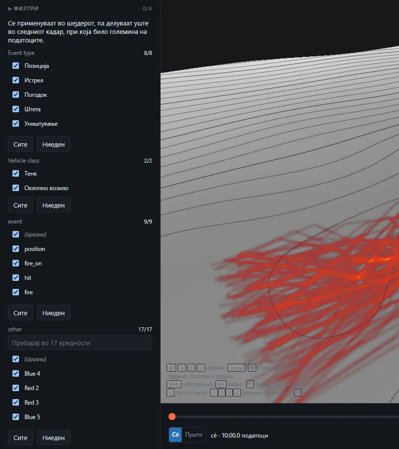
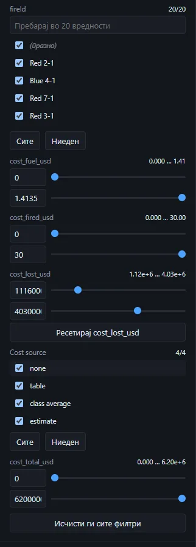

# Филтри

**Филтри** ги скрива редовите што не ве интересираат, како една класа возила или еден вид настан, и сликата се ажурира веднаш. Панелот ги наведува колоните зачувани при вчитување под *Задржи за филтрирање* ([Мапирање на колони](column-mapping.md)), плус *Source file* кога се вчитани повеќе датотеки.

## Пробајте {#try-it}

1. Вчитајте збир на податоци и отворете **Филтри** во страничната лента.
2. Под **Класа на возило**, исклучете *Tank*. Сликата се менува веднаш.
3. Притиснете **Исчисти ги сите филтри** за да го поништите.

Првите редови се колоните на прегледувачот (подолу). Редовите после нив доаѓаат од вашата датотека.

## Колони што ги додава прегледувачот {#columns-the-viewer-adds}

При вчитување прегледувачот составува четири свои колони и ги наведува **прво**, со имиња и вредности на вашиот јазик, за истиот филтер да работи за секоја игра и секој извор на податоци:

| Колона | Вредности | Се составува од |
|---|---|---|
| **Тип на настан** | 23 видови: Позиција, Испукан истрел, Лансирање (ракета, проектил, бомба), Погодок, Промашај (оружјето завршило далеку од цел), Експлозија, Оштетување, Убиство, Смрт, Уништено, Пад, Катапултирање / искокнување, Појава, Исчезнување, Полетување, Слетување, Допир со земја, Застанување на земја, Повторно вооружување / гориво, Заземање / цел, Мамец, Порака, Друго | колона по име `event`, `events`, `event_type` или `event_name`; секоја игра со свои зборови (`shot`, `burst`, `fired`, `struck`, `flare`, `plant` ...) се мапира на овие видови. Целата табела: [Типови и класи на настани](ref-event-types.md). |
| **Играч или ВИ** | Играч, ВИ | колона `ai`, `is_ai`, `bot` или `actor`; инаку `is_player` / `human`; инаку ид на сметка (`user_id`, `steam_id`; празно или 0 е AI); за снимки од Tacview, дали објектот има пилот |
| **Класа на возило** | 17 класи: Ловец, Јуришен авион, Бомбардер, Останати авиони, Хеликоптер, Тенк, Оклопно возило, Противвоздушна одбрана, Артилерија, Камион / автомобил, Брод, Подморница, Пешадија, Оружје, Мамец, Градба, Друго | името на возилото или единицата (споредено со [каталогот на фигури](figures.md)) и колоните за тип |
| **Класа на цел** | истите класи | возилото на другата страна (`other_vehicle`, `target_vehicle`, `victim_type` ...) |

Веднаш по нив доаѓаат [колоните за исход](data-formats.md#outcome-columns), каде што податоците ги имаат: **Исход од рундата** и **Исход од мечот** (*Било кој*, *Добиено*, *Изгубено*) и **Како заврши рундата**, со вредностите на вашиот јазик. Филтрирајте по нив или поделете ја топлината по нив како [мапа на удел на победи](win-rate.md).

Се наведуваат само видовите што се јавуваат. Колоните со вредности (`cost_*`, `earn_*`, `net_*` и *Cost source*, видете [Тежинење на вредности](value-weighting.md)) се филтрираат како секоја бројна колона: на пример, исклучете *estimate* под *Cost source* за да ги задржите само редовите со цена.

Листа на категории со повеќе од 12 вредности добива поле за пребарување (*Search n values*) и копче **Само овие** што дозволува точно вредностите што одговараат.

Кои колони може да се филтрираат се одлучува при вчитување, зашто тогаш мора да се прочитаат. Без зачувана колона панелот тоа го кажува и упатува на *Keep for filtering*.

## Бројни колони (опсег) {#numeric-columns-range}

| Дел | Значење |
|---|---|
| Име, и `min ... max` | Колоната и тековниот опсег (целиот опсег на колоната додека не е поставен филтер). |
| Прв ред: поле за број и лизгач | Долната граница. Влечењето на лизгачот над горната граница ја турка горната со него. |
| Втор ред: поле за број и лизгач | Горната граница. Влечењето под долната ја турка и неа. |
| **Ресетирај *колона*** | Го отстранува овој филтер. |

Лизгачите ја покриваат најмалата до најголемата вредност на колоната во 1.000 чекори; полињата за број прифаќаат било која вредност. Ред поминува кога неговата вредност е во опсегот, вклучувајќи ги двата краја. Големите вредности се прикажуваат во експоненцијален запис (`1.23e6`).

## Категориски колони {#category-columns}

| Дел | Значење |
|---|---|
| Име, и `allowed/total` | Колоната и колку од нејзините вредности се дозволени. |
| Список на вредности | Поле за штиклирање по вредност; празна вредност се прикажува како *(празно)*. |
| **Сите** / **Ниедна** | Дозволи секоја вредност / ниедна вредност. |

Дозволувањето на секоја вредност го отстранува филтерот.

## Правила {#rules}

- **Четири филтри одеднаш.** Заглавјето прикажува `active/4`. Петти филтер не се применува, и панелот тоа го кажува. Избор во [Ентитети](entities.md) (или фокусот на играч во картичката Меч) користи еден од четирите. Филтер што ја опфаќа целата колона не користи ниеден.
- **Категориска колона има најмногу 4.096 вредности**; поширока не се зачувува при вчитување.
- **Филтрите се комбинираат со AND**, и со видливоста на тимовите, поделбата за разлика, временскиот прозорец, отстранувањето по растојание и [пресекот](slice.md).
- **Промената на филтер го рестартира акумулирањето и ја мери повторно експозицијата** по неколку рамки, зашто филтрирањето може многу да ја промени густината ([Боја и експозиција](colour-and-exposure.md#auto-exposure)).
- **Исчисти ги сите филтри** ги отстранува сите филтри по колона. Видливоста на тимовите и изборите на играчи поставени на друго место остануваат.
- Филтрите по колона ги менуваат режимите на топлина. Тие не ги менуваат фигурите на [повторувањето со фигури](box-replay.md), кои ја следат видливоста на тимовите и изборот во Ентитети. Изборот во Ентитети ги менува и двете.
- Во [топлината по линија](line-heat.md) филтерот се проверува на редот на кој завршува секој сегмент.
- При секој нов збир на податоци, сите филтри се исчистуваат.

## За развивачи {#for-developers}

**Слотови.** Секој активен филтер зафаќа еден од четирите GPU слотови ([`MAX_FILTER_SLOTS`](https://github.com/Holdi601/3DHeat/blob/main/src/render/types.ts)), текстура од 4 бајти по ред. Слотовите се доделуваат на филтрите по редоследот на последната промена ([`filterSlots`](https://github.com/Holdi601/3DHeat/blob/main/src/render/filterTables.ts), споделено од shader-от и двата панели). Над четири, порака вели *Only the first 4 filters are applied. Clear one - the rest are being ignored, not silently combined*, а имињата на дополнителните филтри гласат *column (not applied)*. Филтрите се извршуваат по ред во vertex shader-от, па промената на праг не бара повторно парсирање ни повторно прикачување.

**Филтри што панелот не ги прикажува.** Уште два вида постојат во состојбата на апликацијата ([`FilterSpec`](https://github.com/Holdi601/3DHeat/blob/main/src/state/types.ts)):

- филтер за **групи**, поставен од картичката Меч кога фокусира една страна. Ги скрива другите групи во секој режим, вклучително и поделба за [разлика](difference.md) по колона.
- филтер за **лица** (`persons`), поставен од панелот [Ентитети](entities.md) и од картичката Меч кога фокусира еден играч. Ги ограничува повторувањето со фигури и режимите на топлина. Во топлината е категориски филтер над ид-овите на лица и зафаќа еден од четирите слотови. Неговата маска содржи 65.536 ид-а ([`FILTER_MASK_CAPACITY`](https://github.com/Holdi601/3DHeat/blob/main/src/render/types.ts)); лице над тоа не се црта во топлината додека е активен, дури и да е избрано. Повторувањето со фигури сè уште ги прикажува.
