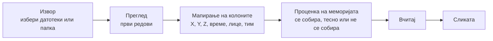

# Внесување податоци

Пред 3DHeat да може нешто да нацрта, му треба табела: секој ред кажува каде било нешто и, ако го имате, кога и кој. Овој дел покажува како една датотека станува слика. Немате уште податоци? Пробајте ги [демо податоците](demo-data.md).

**Направете го ова сега:**

1. Во страничната лента Топлинска мапа отворете **Извор** и притиснете **Датотеки…** (или спуштете датотека или папка на зоната за спуштање).
2. Погледнете го **Мапирање на колоните**: кутиите обично се веќе пополнети.
3. Проверете дека **Проценка на меморијата** вели *се собира*.
4. Притиснете **Вчитај**.

Сè што ја прикажува картичката Топлинска мапа доаѓа од еден **збир на податоци**: табела со редови, секој со позиција и, по избор, време, лице, група, сесија, насока на гледање и било кој број дополнителни колони зачувани за филтрирање. Овој дел објаснува како се прави еден збир на податоци.

## Патеката од датотеки до слика {#the-path-from-files-to-picture}

1. **Изберете датотеки** во панелот **Извор** - една, неколку, дрво од папки или со спуштање. Прифаќаат Parquet, CSV, Tacview, GPS патеки и уште; целата комплетна листа е во [Формати на податоци](data-formats.md#files). Видете [Вчитување датотеки](loading-files.md).
2. **Преглед.** Се отвора првата датотека од изборот: нејзините имиња на колони, првите 50 редови, кои колони изгледаат нумерички, и (Parquet) логичкиот тип на секоја колона и сопствените упатства за читање на датотеката, записот `heat3d` во подножјето.
3. **Автоматско мапирање.** Колоните се доделуваат на улоги - X, Y, Z, време, лице, сесија, група, насока на гледање - а неколку се зачувуваат за филтрирање. Секое погодување се прикажува во панелот **Мапирање на колоните** и може да се промени. Видете [Мапирање на колони](column-mapping.md) и [Оски, единици и време](axes-units-and-time.md).
4. **Броење.** Бројот на редови на секоја датотека се чита (точно од подножјата на Parquet, проценето за CSV), па панелот може да каже пред да се вчита нешто колку меморија е потребна и дали ќе стане. Ако не стане, предлага да се вчита секој *N*-ти ред. Видете [Меморија и буџети](memory-and-budgets.md).
5. **Вчитување.** Работник во заднина ги парсира само мапираните колони на секоја датотека - неколку датотеки истовремено, до буџетот на [нишки за парсирање](memory-and-budgets.md#parser-threads) - и ги спојува, по редоследот на изборот, во еден збир на податоци: еден заеднички речник на лица, групи и сесии за сите датотеки, едно заедничко време на почеток, сите редови подредени по време. Видете [Сесии, лица и групи](sessions-persons-groups.md).
6. **Прикачување.** Главната нишка за една рамка објавува „Се прикачуваат N редови на GPU“, па ги пакува редовите во меморијата на GPU во рамките на буџетот за GPU. Видете [Задржување во меморијата на GPU](gpu-memory.md).
7. **Прва слика.** Камерата ги вметнува податоците во кадар, радиусот на спрајтот и заситувањето се поставуваат според обемот и бројот на редови на податоците, а по 8 прикажани рамки заситувањето се мери од самата слика ([Боја и експозиција](colour-and-exposure.md)).

## Барања, проверени пред вчитување {#requirements-checked-before-a-load}

| Потреба | Што се случува без неа |
|---|---|
| **Најмалку две од X / Y / Z** | Вчитувањето се одбива. Со точно две, третата оска е 0 и податоците се цртаат како рамна површина во 3D сцената - што сака топлинска мапа одозгора. |
| Колона за време | По избор. Без неа временската линија е исклучена, прегледот останува во режимот **Сите**, а страничната лента тоа го кажува. |
| Колона за лице | По избор. Потребна е за [преклопот со фигури](box-replay.md) (фигура за секое лице), [топлина по линија](line-heat.md) (патеката на секое лице), интерполација, траги и историјата **Животен век**. |
| Колона за група | По избор. Потребна е за [топлина по тим](team-heat.md) и за режимот [разлика](difference.md) (најмалку две групи). |

Режимот што вчитаните податоци не може да го поддржат е засивен во лентата со режими; задржувањето на глувчето над него кажува зошто.

## Без ваши податоци {#without-your-own-data}

Панелот **Збир на податоци** (под **Извор**) има [синтетички генератор](synthetic-generator.md) што произведува збир на податоци со облик на battle-royale со која било големина, корисен за пробување на прегледувачот и за тестирање што може да поднесе машината.

## Страници во овој дел {#pages-in-this-section}

- [Вчитување датотеки](loading-files.md) - избирачи, папки, спуштање, спојување на повеќе датотеки, правилото за датотеки со движење, напредок и откажување
- [Мапирање на колони](column-mapping.md) - секое поле од панелот за мапирање, како автоматското мапирање погодува, совети `heat3d`
- [Оски, единици и време](axes-units-and-time.md) - горна оска, превртувања, скала на единици, единици за време, насока на гледање
- [Сесии, лица и групи](sessions-persons-groups.md) - што прави секое, границите, заеднички имиња, големина на ентитетите, панелот Збир на податоци
- [Синтетички генератор](synthetic-generator.md)
- [Меморија и буџети](memory-and-budgets.md) - модел на отпечаток, проверка за вклопување, децимација, граница за сортирање, буџети за ресурси
