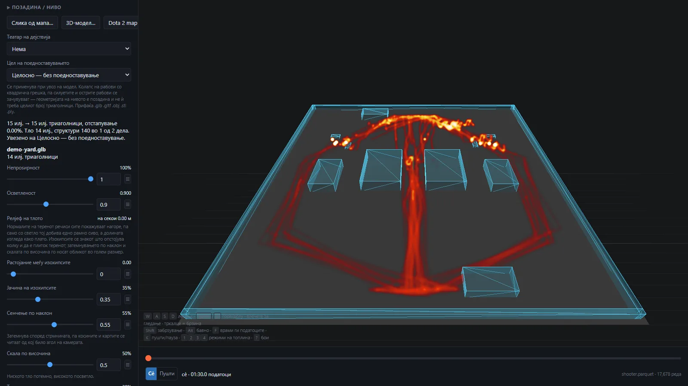

# Топлина

Топлината ги обојува местата каде се случиле многу работи: црвено каде се случило малку, бело-жешко каде се случило многу. Одговара на прашањето „каде се случува ова и колку“.

**Топлина** (копче 1) е стандардниот режим. Секој видлив [ред](glossary.md) придонесува со тркалезен [спрајт](glossary.md) свртен кон камерата; преклопените спрајти се собираат во бафер со плутечка запирка; збирот се пресликува преку скала на бои - стандардно проѕирно → црвено → жолто → бело - и се црта врз сцената.

Сликата ја покажува топлината од рунда на стрелец на ниво со згради: жешките точки се во собите и на скалите, не само на земјата.

## Како да се користи {#how-to-use-it}

1. Вчитајте податоци и притиснете `1` (или изберете **Топлина** во лентата со режими).
2. Ако сè е бело или празно, притиснете **Автоматска експозиција од полето** во делот **Облик на топлината**.
3. Менувајте го **Радиусот на спрајтот** додека соседните точки не се спојат во појаси: помалото покажува единечни места, поголемото покажува области.
4. Отворете **Бои на топлината** за да ги промените боите, или **Длабочина** за да ги крие брда и ѕидови топлината зад нив.

Истите панели го обликуваат [Разлика](difference.md), [Топлина по тимови](team-heat.md) и [Топлина по линија](line-heat.md); се разликуваат по тоа што се додава (со знак, обоено или по линии), а не по начинот.

## Панелите и нивните стандардни вредности {#the-panels-and-their-defaults}

Секоја контрола се објаснува на својата страница; колоната Подробности води до неа. Лизгачите имаат поле за внесување до себе и рачка за влечење (малата рачка десно: влечете горе или долу, подалеку е побрзо, Shift за фино); каде што патеката на лизгачот завршува пред вистинската граница, рачката може да ја помести над неа до *горната граница на лизгањето* наведена овде. Вредностите означени *при вчитување* се пресметуваат повторно за секое ново податочно множество.

### Облик на топлината (отворено) {#heat-shape-open}

| Контрола | Стандардно | Опсег (горна граница на лизгањето) | Подробности |
|---|---|---|---|
| **Радиус на спрајтот** | 6 m; при вчитување опсег / 120 | 0,05-2000 m, логаритамски (50 000) | [Облик на спрајт](sprite-shape.md#sprite-radius) |
| **Интензитет во центарот** | 1 | 0-10 (1000) | [Облик на спрајт](sprite-shape.md#centre-and-edge-intensity) |
| **Интензитет на работ** | 0 | -2-10 (1000) | [Облик на спрајт](sprite-shape.md#centre-and-edge-intensity) |
| **Облик на преодот** | *Опаѓање* | *Опаѓање* / *Крива* | [Облик на спрајт](sprite-shape.md#ramp-shape-falloff-or-curve) |
| **Опаѓање** (само за Опаѓање) | 1,6 | 0,1-8 (64) | [Облик на спрајт](sprite-shape.md#falloff) |
| **Мазен преод** (само за Опаѓање) | вклучено | | [Облик на спрајт](sprite-shape.md#falloff) |
| Уредник на крива (само за Крива) | претставка *Smooth* | | [Облик на спрајт](sprite-shape.md#the-curve-editor) |
| **Точка на заситување** | 24; при вчитување проценка, па измерена | 0,1-4000, логаритамски (10 000 000) | [Боја и експозиција](colour-and-exposure.md#saturation-point) |
| **Минимална топлина** | исклучено (0) | 0-100% | [Боја и експозиција](colour-and-exposure.md#minimum-heat) |
| **Одзив на густината** | *Заситувачки* | *Заситувачки* / *Линеарна* / *Логаритамска* | [Боја и експозиција](colour-and-exposure.md#density-response) |
| **Автоматска експозиција од полето** | | копче | [Боја и експозиција](colour-and-exposure.md#auto-exposure) |
| **Следи го погледот** | вклучено | | Повторно ја мери експозицијата секој пат кога камерата ќе застане, така што регионот во кој летате го користи целиот опсег на бои. Мали промени се занемаруваат, а скалата се менува глатко. Исклучете го, или влечете ја **Точката на заситување**, за да ја заклучите скалата и да споредувате места на иста скала. [Боја и експозиција](colour-and-exposure.md#follow-the-view) |
| **Иста густина при секое зумирање** | вклучено | | Боја значи ист број редови по површина на земјата колку и да сте блиску. Спрајт што ограничувањата на пиксели го зголемуваат (далеку) или го смалуваат (блиску) ја задржува топлината што би ја додала неговата вистинска големина, па сликата експонирана од далеку не избледува кога летате во неа. Исклучено, ограничен спрајт ја додава целата своја тежина при ограничената големина. [Облик на спрајт](sprite-shape.md#pixel-clamps) |
| **Израмни на рамнината на тлото** | исклучено | | [Облик на спрајт](sprite-shape.md#flatten-onto-ground-plane) |

### Бои на топлината (затворено) {#heat-colours-closed}

| Контрола | Стандардно | Подробности |
|---|---|---|
| Примероци на групи и **Раздвојување на боите** (само Топлина по тимови) | 1,4 | [Топлина по тимови](team-heat.md) |
| Уредник на **Скала на топлина** (*Позитивна (тимови што собираат)* во Разлика, *Скала на проѕирност* во Топлина по тимови) | проѕирно → црвено → жолто → бело | [Боја и експозиција](colour-and-exposure.md#the-ramp-editor) |
| **Ресетирај на проѕирно → црвено → жолто → бело** | | |
| Скала **Негативна (тимови што одземаат)** (само Разлика) | проѕирно → зелено → сино → виолетово | [Разлика](difference.md#colours) |

### Ограничувања на пиксели на спрајтот (затворено) {#sprite-pixel-clamps-closed}

| Контрола | Стандардно | Опсег (горна граница на лизгањето) | Подробности |
|---|---|---|---|
| **Мин. радиус во пиксели** | 1 px | 0-16 (512) | [Облик на спрајт](sprite-shape.md#pixel-clamps) |
| **Макс. радиус во пиксели** | 96 px | 2-1024, логаритамски (8192) | [Облик на спрајт](sprite-shape.md#pixel-clamps) |

### Длабочина (отворено) {#depth-open}

| Контрола | Стандардно | Подробности |
|---|---|---|
| **Скриј зад теренот** | вклучено | [Длабочина и отстранување](depth-and-culling.md#hide-behind-terrain) |
| **Скриено зад геометријата** | 0,8 (*80% потемнето*) | [Длабочина и отстранување](depth-and-culling.md#hidden-behind-geometry) |

### Отстранување по растојание (затворено) {#distance-culling-closed}

| Контрола | Стандардно | Опсег (горна граница на лизгањето) | Подробности |
|---|---|---|---|
| **Блиску** | исклучено (0) | 0,5-5000 m, логаритамски, долниот дел од патеката = исклучено (200 000) | [Длабочина и отстранување](depth-and-culling.md#distance-culling) |
| **Далеку** | исклучено (0) | 1-200 000 m, логаритамски, дното = исклучено (10 000 000) | [Длабочина и отстранување](depth-and-culling.md#distance-culling) |
| **Сечи по рамнина** | вклучено | | [Длабочина и отстранување](depth-and-culling.md#distance-culling) |
| **Сечи го и нивото** | вклучено | | [Длабочина и отстранување](depth-and-culling.md#distance-culling) |

Копчиња: `[` и `]` ја турка далечната граница навнатре и навън, `\` ја вклучува и исклучува ([Длабочина и отстранување](depth-and-culling.md#keyboard)).

### Насока и Вредност {#direction-and-value}

Уште два дела се под Облик на топлината. **Насока** ја црта секоја редица како клин и додава стрелки: видете [Насочена топлина](directional-heat.md). **Вредност** ја пондерира топлината според тоа колку чинел или заработил секој ред: видете [Пондерирање на вредности](value-weighting.md).

## Што се зачувува {#what-is-saved}

Поставките за топлина погоре не се чуваат меѓу сесиите: повторното вчитување на страницата ги враќа стандардните. Две работи се чуваат во прелистувачот: последната брзина на репродукција (`heat3d.speed`, видете [Временска линија](timeline.md)) и поставките за далечните фигури на [преклопот на фигури](box-replay.md) (стил на симболи, големина, ознаки на погодоци и слично). Исто така се чуваат јазикот, [инвертираните оски на светот](camera.md#invert-world-axis), запаметените имиња на автомобилите во табот Трки и [библиотеката на нивоа](level-library.md). Целата листа е на [Зачувани поставки](ref-settings-storage.md).
