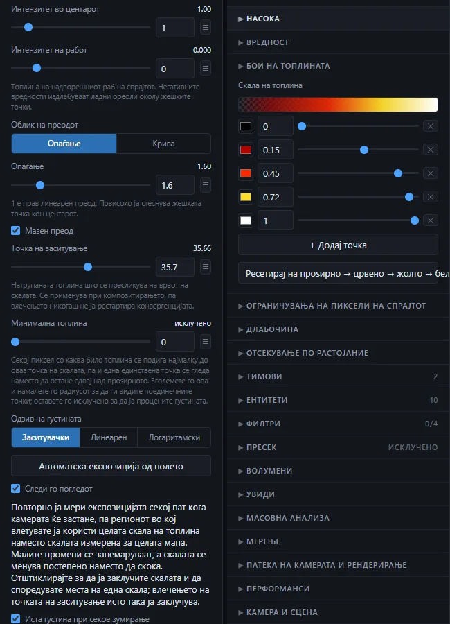

# Топлина

Топлината ги обојува местата каде се случило многу работи: црвено каде се случило малку, бело-вжарено каде се случило многу. Одговара на „каде се случува ова и колку“.

**Топлина** (копче 1) е стандардниот режим. Секој видлив [ред](glossary.md) придонесува со заоблен [спрајт](glossary.md) свртен кон камерата; преклопените спрајти се собираат во бафер со плутечка запирка; збирот се пресликува преку скала на бои - по стандард проѕирно → црвено → жолто → бело - и се црта врз сцената.

Сликата ја покажува топлината од рунда на стрелец на ниво со згради: жешките точки се во соби и на скалите, не само на земјата.

## Како да се користи {#how-to-use-it}

1. Вчитајте податоци и притиснете `1` (или изберете **Топлина** во лентата со режими).
2. Ако сè е бело или празно, притиснете **Автоматска експозиција од полето** во делот **Облик на топлината**.
3. Менувајте го **Радиус на спрајтот** додека соседните точки не се спојат во појаси: помалото покажува единечни места, поголемото покажува области.
4. Отворете **Бои на топлината** за да ги промените боите, или **Длабочина** за да ги крие брда и ѕидови топлината зад нив.

Истите панели го обликуваат [Разлика](difference.md), [Топлина по тимови](team-heat.md) и [Топлина по линија](line-heat.md); се разликуваат по тоа што се додава (потпишано, обоено или по линии), а не по начинот.

## Панелите и нивните стандардни вредности {#the-panels-and-their-defaults}

Секоја контрола подолу се пресликува во параметар на shader, па промената не чини ништо освен повторно цртање. Лизгачите имаат поле за внесување до себе и рачка за влечење (малата рачка десно: влечете горе или долу, подалеку е побрзо, Shift за фино); каде што патеката на лизгачот завршува пред вистинската граница, рачката може да ја помести над неа до *горната граница на движење* наведена овде. Вредностите означени *при вчитување* се пресметуваат повторно за секој нов dataset.

### Облик на топлината (отворено) {#heat-shape-open}

| Контрола | Стандардно | Опсег (горна граница на движење) | Подробности |
|---|---|---|---|
| **Радиус на спрајтот** | 6 m; при вчитување обем / 120 | 0.05-2000 m, логаритамски (50,000) | [Облик на спрајтот](sprite-shape.md#sprite-radius) |
| **Интензитет во центарот** | 1 | 0-10 (1000) | [Облик на спрајтот](sprite-shape.md#centre-and-edge-intensity) |
| **Интензитет на работ** | 0 | -2-10 (1000) | [Облик на спрајтот](sprite-shape.md#centre-and-edge-intensity) |
| **Облик на преодот** | *Falloff* | *Falloff* / *Curve* | [Облик на спрајтот](sprite-shape.md#ramp-shape-falloff-or-curve) |
| **Опаѓање** (само за Falloff) | 1.6 | 0.1-8 (64) | [Облик на спрајтот](sprite-shape.md#falloff) |
| **Мазен преод** (само за Falloff) | вклучено | | [Облик на спрајтот](sprite-shape.md#falloff) |
| Уредник на крива (само за Curve) | пресет *Smooth* | | [Облик на спрајтот](sprite-shape.md#the-curve-editor) |
| **Точка на заситување** | 24; при вчитување проценка, па измерено | 0.1-4000, логаритамски (10,000,000) | [Боја и експозиција](colour-and-exposure.md#saturation-point) |
| **Минимална топлина** | исклучено (0) | 0-100% | [Боја и експозиција](colour-and-exposure.md#minimum-heat) |
| **Одзив на густината** | *Заситувачки* | *Заситувачки* / *Линеарен* / *Log* | [Боја и експозиција](colour-and-exposure.md#density-response) |
| **Автоматска експозиција од полето** | | копче | [Боја и експозиција](colour-and-exposure.md#auto-exposure) |
| **Следи го погледот** | вклучено | | Повторно ја мери експозицијата секогаш кога камерата ќе застане, па регионот во кој летате ја користи целата скала на бои. Мали промени се занемаруваат и скалата се лизга. Исклучете го, или влечете **Точка на заситување**, за да ја заклучите скалата и да споредувате места на една скала. [Боја и експозиција](colour-and-exposure.md#follow-the-view) |
| **Иста густина при секое зумирање** | вклучено | | Бојата значи ист број редови по површина на земјата, без разлика колку сте блиску. Спрајт што ограничувањата на пиксели го зголемуваат (далеку) или намалуваат (блиску) ја задржува топлината што би ја додала неговата вистинска големина, па сликата изложена од далеку не избледува кога летате во неа. Исклучено, ограничен спрајт ја додава целата тежина со ограничената големина. [Облик на спрајтот](sprite-shape.md#pixel-clamps) |
| **Израмни на рамнината на тлото** | исклучено | | [Облик на спрајтот](sprite-shape.md#flatten-onto-ground-plane) |

### Бои на топлината (затворено) {#heat-colours-closed}

| Контрола | Стандардно | Подробности |
|---|---|---|
| Примероци на групи и **Раздвојување на боите** (само за Топлина по тимови) | 1.4 | [Топлина по тимови](team-heat.md) |
| Уредник на **Скала на топлина** (*Позитивна (тимови што додаваат)* во Разлика, *Скала на непрозирност (бојата доаѓа од групата)* во Топлина по тимови) | проѕирно → црвено → жолто → бело | [Боја и експозиција](colour-and-exposure.md#the-ramp-editor) |
| **Ресетирај на проѕирно → црвено → жолто → бело** | | |
| Скала **Негативна (тимови што одземаат)** (само за Разлика) | проѕирно → зелено → сино → виолетово | [Разлика](difference.md#colours) |

### Ограничувања на пиксели на спрајтот (затворено) {#sprite-pixel-clamps-closed}

| Контрола | Стандардно | Опсег (горна граница на движење) | Подробности |
|---|---|---|---|
| **Мин. радиус во пиксели** | 1 px | 0-16 (512) | [Облик на спрајтот](sprite-shape.md#pixel-clamps) |
| **Макс. радиус во пиксели** | 96 px | 2-1024, логаритамски (8192) | [Облик на спрајтот](sprite-shape.md#pixel-clamps) |

### Длабочина (отворено) {#depth-open}

| Контрола | Стандардно | Подробности |
|---|---|---|
| **Скриј зад теренот** | вклучено | [Длабочина и отстранување](depth-and-culling.md#hide-behind-terrain) |
| **Скриено зад геометријата** | 0.8 (*80% затемнето*) | [Длабочина и отстранување](depth-and-culling.md#hidden-behind-geometry) |

### Отстранување по растојание (затворено) {#distance-culling-closed}

| Контрола | Стандардно | Опсег (горна граница на движење) | Подробности |
|---|---|---|---|
| **Блиску** | исклучено (0) | 0.5-5000 m, логаритамски, долниот крај на патеката = исклучено (200,000) | [Длабочина и отстранување](depth-and-culling.md#distance-culling) |
| **Далеку** | исклучено (0) | 1-200,000 m, логаритамски, долниот крај = исклучено (10,000,000) | [Длабочина и отстранување](depth-and-culling.md#distance-culling) |
| **Сечи по рамнина** | вклучено | | [Длабочина и отстранување](depth-and-culling.md#distance-culling) |
| **Сечи го и нивото** | вклучено | | [Длабочина и отстранување](depth-and-culling.md#distance-culling) |

Копчиња: `[` и `]` ја туркаат далечната граница внатре и надвор, `\` ја вклучува/исклучува ([Длабочина и отстранување](depth-and-culling.md#keyboard)).

### Насока и Вредност {#direction-and-value}

Уште два дела се под Heat shape. **Насока** црта секој ред како клин и додава стрелки: видете [Насочена топлина](directional-heat.md). **Вредност** ја мери топлината според тоа колку чинел или заработил секој ред: видете [Тежинење на вредности](value-weighting.md).

## Што се зачувува {#what-is-saved}

Поставките за топлина погоре не се чуваат меѓу сесиите: повторното вчитување на страницата ги враќа стандардните. Две работи се чуваат во прелистувачот: последната брзина на репродукција (`heat3d.speed`, видете [Временска линија](timeline.md)) и поставките за фигури на [преклопот со фигури](box-replay.md) (стил на симболите, големина, ознаки за погодоци и слично). Исто така јазикот, [обратените светски оски](camera.md#invert-world-axis), запаметените имиња на возила од картичката за трки и [библиотеката на нивоа](level-library.md). Целата листа е на [Зачувани поставки](ref-settings-storage.md).
