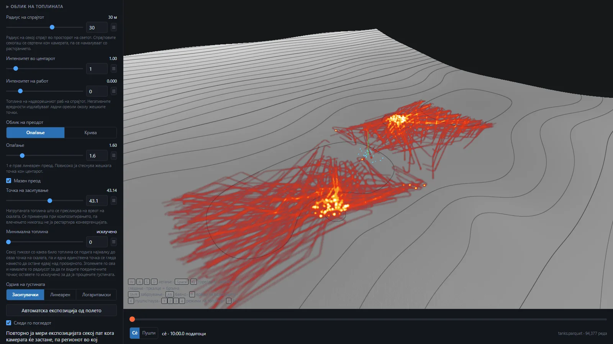
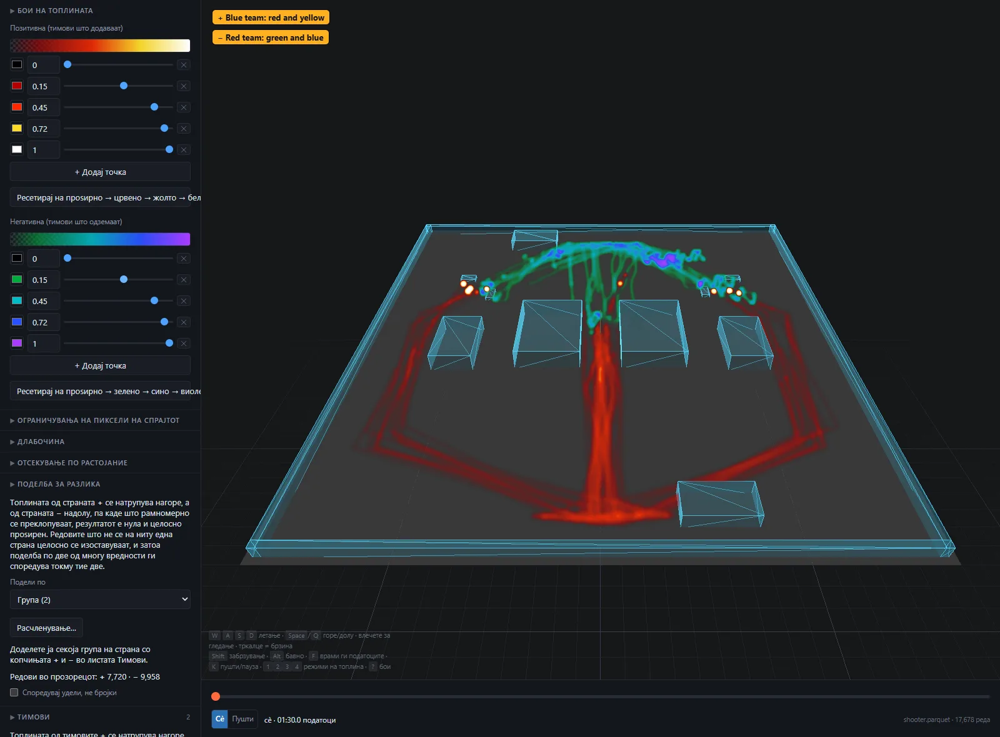
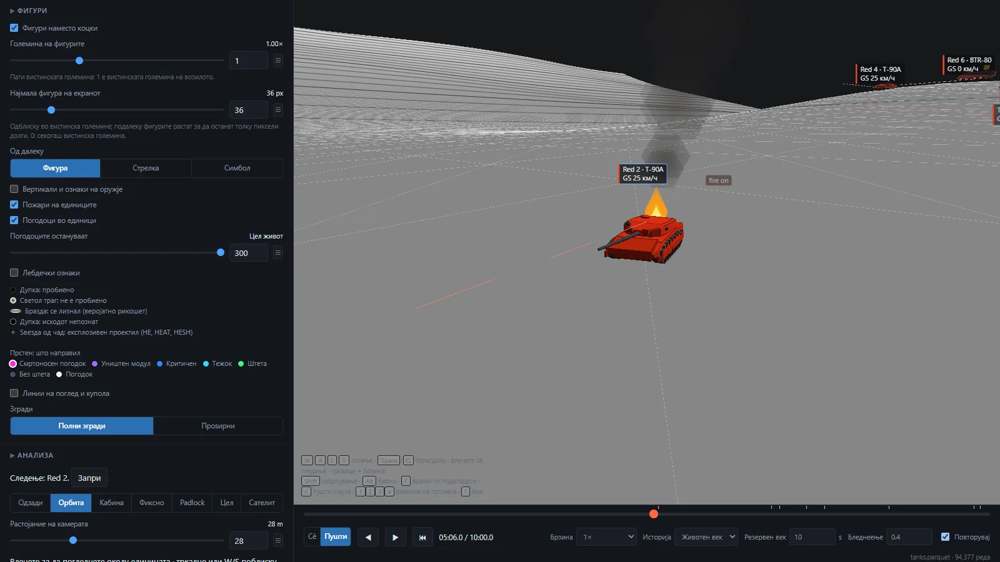
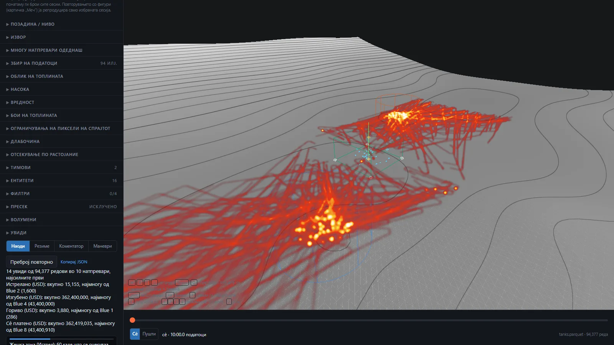
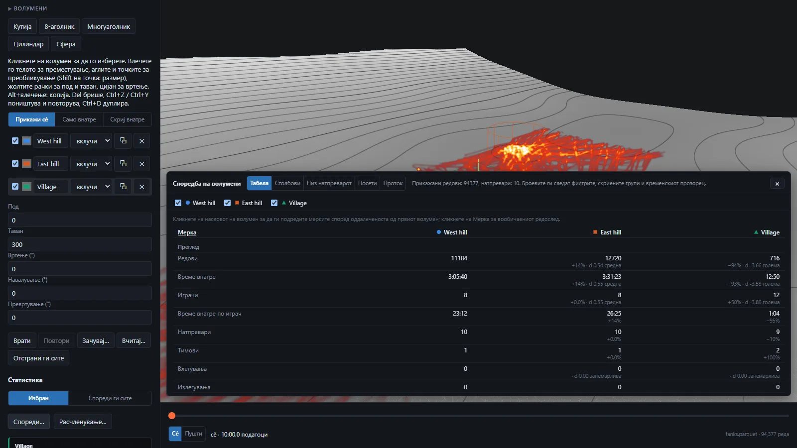
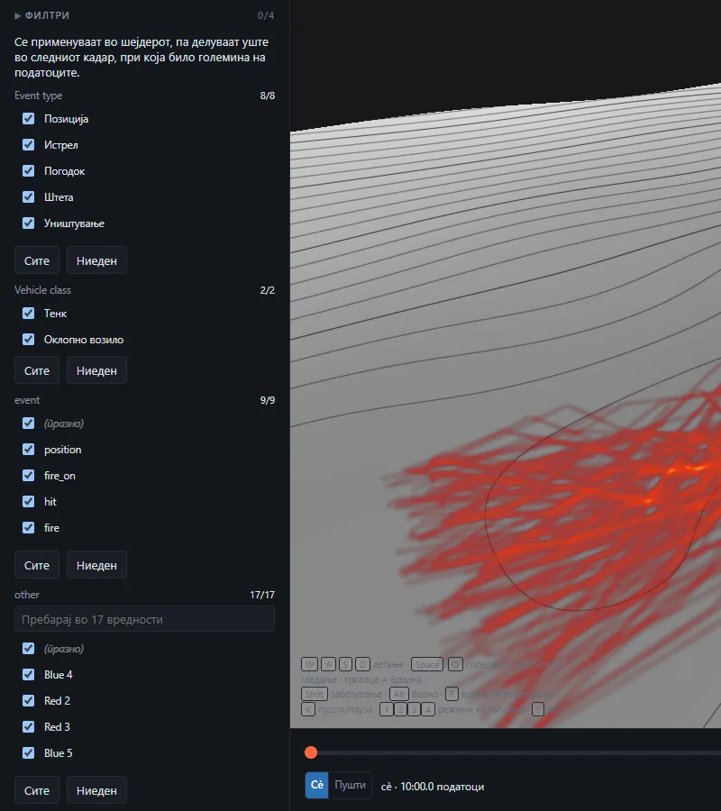
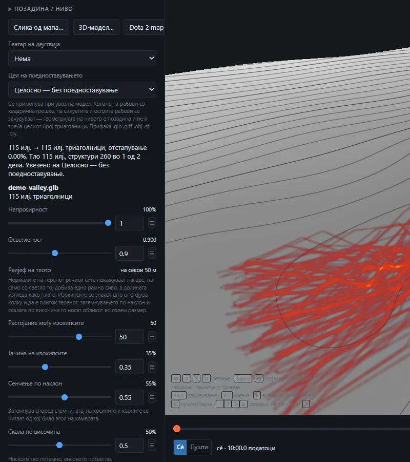

# 3DHeat

3DHeat покажува каде се случиле работите во една игра - каде оделе играчите, каде се бореле и каде паднале - како светлечки бои низ кои можете да летате, или како мали 3D фигури што го повторуваат натпреварот.

Вчитајте ги позициите - CSV, Parquet, снимки од Tacview, конвертирани повторувања, една датотека, папка или илјадници натпревари - и погледнете ги како **топлинска мапа низ која можете да летате**, како **фигури што го повторуваат натпреварот**, како линии по патиштата што ги следеле луѓето, или како една популација наспроти друга. Сам наоѓа што се издвојува, и работи целосно во вашиот прелистувач: ништо не се прикачува никаде. 3DHeat и сите негови алатки се бесплатни и со отворен код под [MIT лиценцата](https://github.com/Holdi601/3DHeat/blob/main/LICENSE).



**Први пат тука?** Направете ги [демо податоците](demo-data.md) и следете ги нивните седум чекори. Секоја слика на оваа страница е направена со нив.

## Што прави {#what-it-does}

| | |
|---|---|
|  | **[Режими на топлина](heat-modes.md)** - топлина, [разлика](difference.md) (црвено каде едната страна била повеќе, зелено-сино каде била другата), [топлина по тим](team-heat.md), [топлина по линија](line-heat.md); [насочена топлина](directional-heat.md) со клинови, полиња со стрелки и поларни графикони; топлина [измерена по вредност](value-weighting.md): колку чинат оружјата, возилата и горивото. |
|  | **[Повторување на натпревар](match-replay.md)** - секоја единица како [фигура](figures.md) за она што е, НАТО или руски симболи од далеку, ракети и трасери, ознаки за погодоци, урнатини, пожари, куполи, цели, тактички камери во стилот на Tacview и тактички приказ; [многу натпревари одеднаш](many-matches.md). |
|  | **[Увиди](insights.md)** - силни позиции, смртоносно тло, стапици при појавување, засеци и истакнати играчи, пронајдени и рангирани со докази; напишан извештај, по желба со ВИ по ваш избор; коментатор за еден натпревар; [лещата на знаењето](knowledge.md). |
|  | **[Волумени](volumes.md)** - цртајте кутии, призми, цилиндри и сфери, филтрирајте до нив, броете што се случува внатре, извезете го и споредувајте места едно до друго; [разложување](breakdown.md) на тоа кој и што е најдобро на едно место. |
|  | **[Филтри](filters.md)** - по тип на настан, играч или ВИ, класа на возило, вредност, која било колона, во графичката картичка при која било големина на податоци. |
|  | **[Нивоа](levels.md)** - слики на мапи, 3D нивоа направени со [алатките за податоци](#related-repositories), симплификација, [позадината на светот](world-backdrop.md) со вистински терен за податоци од лет. |

Исто така: картичката [Анализа на трки](race-analysis.md) за кругови од тркачки игри, картичката [Меч](match-analysis.md) за резимеа на Counter-Strike 2, [табла за тактики](tactics-board.md) за планови на ниво, [анализа на погодоци](hit-analysis.md) по возило, [масовна анализа](mass-analysis.md) на илјадници натпревари, [патеки на камерата и видео](camera-path-and-video.md), [40 јазици](languages.md), [метрички или империјални единици](settings.md).

## Картичките {#the-tabs}

Картичките се на врвот на страничната лента, под името, единиците и менито за јазик.

| Картичка | За што е |
|---|---|
| **Топлинска мапа** | Која било табела со позиции: режимите на топлина, преклопот со фигури, филтрите, волумените, увидите, нивоата, мерењето и видеото. |
| **Анализа на трки** | Два или повеќе кругови на една патека: каде се губи време, зошто, и што да се промени. |
| **Меч** | Повторувањето на натпревар со фигури и резимеа на натпревари од Counter-Strike 2. |
| **Тактика** | Планови на ниво: фигури, патеки, фрлено помошно средство, области и белешки во чекори што се пуштаат. |
| **Возила** | Каде била погодена секоја единица, од кого и со што. |

## Инсталација и стартување {#install-and-run}

3DHeat е бесплатен за користење, менување и споделување (MIT лиценца), и бесплатна е секоја алатка наведена под [Поврзани репозиториуми](#related-repositories).

### Windows, на лесен начин {#windows-the-easy-way}

Коренот на репозиториумот содржи три batch датотеки.

| Датотека | Што прави |
|---|---|
| `start.bat` | Ја стартува прегледувачот. Го наоѓа Node.js дури и кога не е на `PATH` (бара во `%ProgramFiles%\nodejs`, `%ProgramFiles(x86)%\nodejs` и `%LOCALAPPDATA%\Programs\nodejs`), а кога Node.js недостасува, нуди да ја инсталира LTS верзијата со `winget install -e --id OpenJS.NodeJS.LTS`. При прво стартување прашува пред да ги симне зависностите (околу 300 MB во `node_modules\` во папката, ништо на ниво на систем). Не стартува ако нешто веќе слуша на портата 5273, и упатува на `restart.bat`. Кога папката е git checkout без локални промени и постои понова верзија, прашува дали да се ажурира (Y/N; ако нема одговор во 60 s, ја задржува оваа верзија; видете [Ажурирања](updates.md)). Потоа го стартува dev серверот на `http://127.0.0.1:5273/` и го отвора прелистувачот. **Прозорецот е серверот**: оставете го отворен, затворете го или притиснете Ctrl+C за да се запре. |
| `restart.bat` | Го извршува `stop.bat quiet`, а потоа `start.bat`. Потребен е само по промена на `vite.config.ts`, додавање зависност или кога серверот ќе запне - промените во изворниот код се вчитуваат веднаш. |
| `stop.bat` | Запира што било што слуша на портата 5273, по ид на процесот пронајден преку `netstat`, никогаш по име на сликата, па другите процеси на Node.js на машината остануваат нетакнати. Чека околу две секунди да се ослободи сокетот. Со аргументот `quiet` не застанува на крајот. |

### Рачно (кој било OS) {#by-hand-any-os}

```bash
git clone --recursive https://github.com/Holdi601/3DHeat.git
cd 3DHeat
npm install
npm run dev      # http://127.0.0.1:5273
```

Папката `exporters/` ги содржи посебните алатки за податоци како git submodules, секоја своја репозиториум; по обично clone извршете `git submodule update --init`. Самиот прегледувач не ги бара за да работи. `exporters/ext/` ги содржи опционалните конвертори (War Thunder, World of Tanks, World of Warships, Squad повторувања; мапи за DCS и IL-2), држени одвоено за да проблем со еден од нив не влијае на ништо друго.

Ниту една игра со податоци не доаѓа со ова: нивоата, мапите и снимките се направени на вашата машина со алатките, од игри што ги поседувате.

### npm скрипти {#npm-scripts}

| Скрипта | Што извршува |
|---|---|
| `npm run dev` | Vite dev серверот на портата 5273, врзан за `127.0.0.1`. |
| `npm run build` | Проверка на типови (`tsc --noEmit`) и production пакет во `dist/`. |
| `npm run preview` | Служи production пакетот. |
| `npm run typecheck` | Само проверката на типови. |
| `npm test` / `npm run test:watch` | Единечни и интеграциони тестови (vitest). |
| `npm run smoke` | Ја пушта вистинската апликација во headless Chromium и проверува дали платното има обоени пиксели; сликите на екранот се зачувуваат во `tools/.smoke/`. Очекува dev серверот да работи. |
| `npm run smoke:f16` | Истиот пакет со `?heat=f16`, со што се форсира патеката на half-float акумулација (видете [Half-float акумулација](half-float-accumulation.md)). |
| `npm run bench` | Бенчмарк на внесување, запишува `tools/.smoke/ingest-bench.json`. |
| `npm run test:heavy` | Тестови што бараат големи вистински датотеки со податоци; сами се прескокнуваат кога датотеките ги нема. |
| `npm run inspect -- <file.parquet>` | Ја печати шемата на Parquet датотеката и неколку редови (`tools/inspect-parquet.mjs`). |

### Што додава dev серверот {#what-the-dev-server-adds}

Прегледувачот е статична веб страница, но dev серверот (видете `vite.config.ts`) додава две локални рути што статичко објавување на `dist/` ги нема:

- `/__host/memory` ја пријавува инсталираната и слободната RAM меморија на машината и, каде што може да ја прочита, меморијата на графичката картичка (од `nvidia-smi`, или на Windows од регистарскиот запис на видео адаптерот). Со ова [буџетите за меморија](memory-and-budgets.md) користат вистински бројки наместо ограничените претпоставки на прелистувачот.
- `/__heat3d/update` проверува дали checkout-от заостанува и може да го повлече напред ([Ажурирања](updates.md)).

Серверот се врзува само за `127.0.0.1`, па ниедната рута не е достапна од мрежата. Отворете го како `http://127.0.0.1:5273`: `localhost` може да се разреши во IPv6 loopback `::1`, каде што ништо не слуша. Не испраќа COOP/COEP заглавија за изолација меѓу извори: ништо во прегледувачот не користи `SharedArrayBuffer`, а работниците ги предаваат податоците со пренос, за што не е потребно.

## Барања за прелистувач и GPU {#browser-and-gpu-requirements}

- **Прелистувач со WebGPU или WebGL2.** Прво се пробува WebGPU (Chrome и Edge го имаат); без него се користи WebGL2 backend. WebGL2 мора да нуди `EXT_color_buffer_float` (цртање во float текстури), инаку прегледувачот прикажува „Cannot initialise the renderer.“ Видете [Двата backend-а](backends.md). Прегледувачот се развива и тестира во Chromium; другите прелистувачи не се проверени.
- **Вклучено хардверско забрзување.** Кога прелистувачот црта на CPU (SwiftShader, llvmpipe, Microsoft Basic Render Driver и слично), црвен банер на врвот од страничната лента тоа го кажува и како да се поправи. Видете [Откривање софтверско рендерирање](software-rendering.md).
- **Дискретна GPU помага, но не е задолжителна.** И двата backend-а бараат адаптер со високи перформанси. Количината податоци што може да се чуваат на GPU е буџет што можете да го видите и промените ([Меморија и буџети](memory-and-budgets.md)).
- **Изборни функции** користат дополнителни API-ја на прелистувачот: прикажувањето видео бара WebCodecs `VideoEncoder` со VP9 или VP8 ([Патека на камерата и видео](camera-path-and-video.md)); симплификација на мрежи за нивоа бара WebAssembly; спуштање папки користи File and Directory Entries API; библиотеката на нивоа користи IndexedDB; геимпадите користат Gamepad API.

## Мапа на документацијата {#documentation-map}

**Почеток**: [Демо податоци](demo-data.md) · [Внесување податоци](getting-data-in.md) ([вчитување датотеки](loading-files.md), [мапирање на колони](column-mapping.md), [оски, единици и време](axes-units-and-time.md), [сесии, лица и групи](sessions-persons-groups.md), [Tacview](tacview-acmi.md), [конвертори](converters.md), [.3dheat](container.md), [меморија и буџети](memory-and-budgets.md))

**Види**: [Режими на топлина](heat-modes.md) ([топлина](heat.md), [облик на спрајт](sprite-shape.md), [боја и експозиција](colour-and-exposure.md), [длабочина и отстранување](depth-and-culling.md), [разлика](difference.md), [топлина по тим](team-heat.md), [топлина по линија](line-heat.md), [повторување во кутија](box-replay.md), [насочена топлина](directional-heat.md), [тежинење на вредности](value-weighting.md)) · [Временска линија](timeline.md) · [Нивоа](levels.md) ([слики на мапи](map-images.md), [3D нивоа](model-levels.md), [изглед](level-appearance.md), [библиотека](level-library.md), [позадина на светот](world-backdrop.md), [нејзините извори](world-backdrop-sources.md)) · [Камера](camera.md) ([геимпад](gamepad.md), [тастери](keyboard-reference.md)) · [Патека на камерата и видео](camera-path-and-video.md)

**Анализа**: [Филтри и алатки](filters-and-tools.md) ([филтри](filters.md), [тимови](teams-list.md), [ентитети](entities.md), [пресек](slice.md), [мерење](measure.md), [волумени](volumes.md), [разложување](breakdown.md)) · [Увиди](insights.md) ([лебдечка леќа на знаењето](knowledge.md)) · [Масовна анализа](mass-analysis.md)

**Повторување**: [Повторување на натпревар](match-replay.md) · [Многу натпревари одеднаш](many-matches.md) · [Фигури](figures.md) ([во преклопот со фигури](figure-replay.md), [заслуги](figure-credits.md)) · [Паритет со Tacview](tacview-parity.md) · [Анализа на погодоци](hit-analysis.md)

**Други картички**: [Анализа на трки](race-analysis.md) ([методот](race-analytics.md), [други игри](other-games.md)) · [Анализа на натпревар](match-analysis.md) · [Табла за тактики](tactics-board.md) ([брзини](tactics-speeds.md))

**Прегледувачот**: [Речник](glossary.md) · [Поставки, единици и тастери](settings.md) · [Јазици](languages.md) · [Ажурирања](updates.md) · [Внатрешно рендерирање](rendering-internals.md) ([backend-и](backends.md), [акумулација](accumulation.md), [земање примероци и буџети](sampling-and-budgets.md), [half-float](half-float-accumulation.md), [меморија на GPU](gpu-memory.md), [софтверско рендерирање](software-rendering.md), [перформанси и статистики](performance-and-stats.md)) · [Формати на податоци](data-formats.md) · [Референца](reference.md) · [Одржување на документацијата](maintaining.md)

## Поврзани репозиториуми {#related-repositories}

Прегледувачот ги чита податоците; овие алатки ги прават. Секој е свој јавен репозиториум (MIT) со своја документација. Ниедна не испорачува податоци од игри: нивоата, мапите и снимките се направени на вашата машина, од игри што ги поседувате.

| Репозиториум | Што прави | Корисно за |
|---|---|---|
| [3DHeat-GameFiles](https://github.com/Holdi601/3DHeat-GameFiles) | Чита патеки и нивоа од архивите што ги испорачуваат игрите (Forza Horizon, BeamNG, Assetto Corsa Rally; читачи за Unreal, Unity, Frostbite и Source 2) како glTF | 3D ниво под вашата топлина или повторување |
| [3DHeat-GameCapture](https://github.com/Holdi601/3DHeat-GameCapture) | Снима телеметрија од кругови од интерфејсите што ги објавуваат тркачките игри, и ги обновува нивоата од видео на игра | кругови за Анализа на трки; ниво каде што датотеките не можат да се читаат |
| [3DHeat-UnrealExporter](https://github.com/Holdi601/3DHeat-UnrealExporter) | Додаток за Unreal Editor што го извезува нивото како една glTF датотека | нивоа од вашите Unreal проекти |
| [3DHeat-CS2](https://github.com/Holdi601/3DHeat-CS2) | Демо снимки од Counter-Strike 2 во табели за топлинска мапа и резимеа на натпревари, мапи на CS2 во геометрија | топлина за CS2, повторувања и картичката Меч |
| [3DHeat-Watcher](https://github.com/Holdi601/3DHeat-Watcher) | Ја снима вашата игра во позадина од она што игрите го објавуваат: телеметрија, интеграции на состојбата на игрите, дневници, повторувања | ваша статистика без да правите ништо рачно |
| [3DHeat-Ext-WarThunder](https://github.com/Holdi601/3DHeat-Ext-WarThunder) | Повторувања од War Thunder (`.wrpl`) во табели: патеки на воздух и на тло, испаљувања, погодоци, убиства, куполи, цели | повторувања од War Thunder, ознаки за погодоци и увиди |
| [3DHeat-Ext-WoT](https://github.com/Holdi601/3DHeat-Ext-WoT) | Повторувања од World of Tanks во табели: позиција на секое возило, смрти и убиства | топлина и повторувања за World of Tanks |
| [3DHeat-Ext-WoWs](https://github.com/Holdi601/3DHeat-Ext-WoWs) | Повторувања од World of Warships во табели: позиција на секој брод и потонувања | топлина и повторувања за World of Warships |
| [3DHeat-Ext-Squad](https://github.com/Holdi601/3DHeat-Ext-Squad) | Демо снимки од Squad сервери во табели: позиција, тим и одред на секој играч | топлина и повторувања за Squad |
| [3DHeat-Ext-DCS](https://github.com/Holdi601/3DHeat-Ext-DCS) | Терени на DCS World од вашата инсталација во нивоа: тло, патишта, градови, аеродроми, полиња, вода | DCS и снимки од Tacview на нивниот вистински терен |
| [3DHeat-Ext-IL2](https://github.com/Holdi601/3DHeat-Ext-IL2) | Мапи на IL-2 Great Battles во нивоа | снимки од IL-2 на нивната мапа |

## Распоред на изворниот код, накратко {#source-layout-briefly}

| Папка | Содржина |
|---|---|
| [`src/data/`](https://github.com/Holdi601/3DHeat/tree/main/src/data) | Избор на датотеки, внесување CSV и Parquet, автоматско мапирање, валидација, модел на меморија, градител на збирка податоци, парсирање на модели, класификација, симплификација, библиотека на нивоа |
| [`src/render/`](https://github.com/Holdi601/3DHeat/tree/main/src/render) | Циклусот на кадри (`engine.ts`), земање примероци, двата backend-а, камера, геимпад, мерење, патека на камерата, снимање видео |
| [`src/state/`](https://github.com/Holdi601/3DHeat/tree/main/src/state) | Состојбата на апликацијата (`store.ts`) со сите стандардни вредности, домените типови (`types.ts`), кривата на спрајтот |
| [`src/ui/`](https://github.com/Holdi601/3DHeat/tree/main/src/ui) | Панелите на страничната лента, временската линија, преклопите |
| [`src/race/`](https://github.com/Holdi601/3DHeat/tree/main/src/race), [`src/match/`](https://github.com/Holdi601/3DHeat/tree/main/src/match) | Картичките Анализа на трки и Меч |
| [`src/i18n/`](https://github.com/Holdi601/3DHeat/tree/main/src/i18n) | Преводи |
| [`src/insights/`](https://github.com/Holdi601/3DHeat/tree/main/src/insights) | Увиди: детектори, извештај, коментатор, ВИ провајдери, лебдечка леќа на знаењето |
| [`src/mass/`](https://github.com/Holdi601/3DHeat/tree/main/src/mass) | Масовна анализа на многу натпревари |
| [`src/volumes/`](https://github.com/Holdi601/3DHeat/tree/main/src/volumes) | Волумени, нивната статистика, извоз и споредба |
| [`src/breakdown/`](https://github.com/Holdi601/3DHeat/tree/main/src/breakdown) | Разложување и фактори |
| [`src/overlay/`](https://github.com/Holdi601/3DHeat/tree/main/src/overlay) | Преклопот за многу натпревари |
| [`src/figures/`](https://github.com/Holdi601/3DHeat/tree/main/src/figures) | Каталогот на фигури и неговиот градител |
| [`src/vehicle/`](https://github.com/Holdi601/3DHeat/tree/main/src/vehicle) | Анализа на погодоци (картичка Возила) |
| [`src/tactics/`](https://github.com/Holdi601/3DHeat/tree/main/src/tactics) | Табла за тактики |
| [`src/world/`](https://github.com/Holdi601/3DHeat/tree/main/src/world) | Позадина на светот |
| [`src/units/`](https://github.com/Holdi601/3DHeat/tree/main/src/units) | Единици за мерење |
