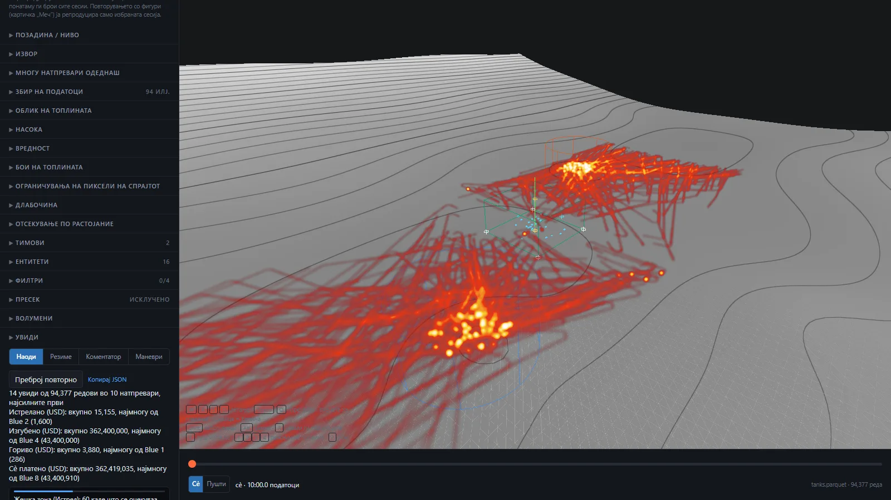
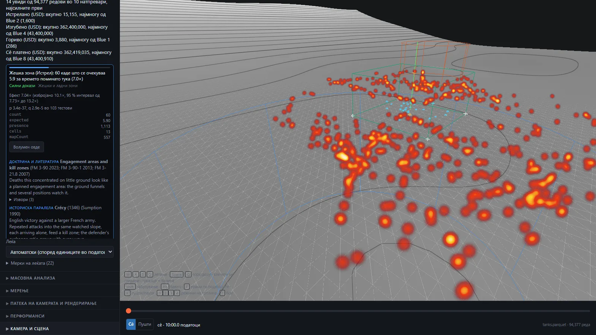
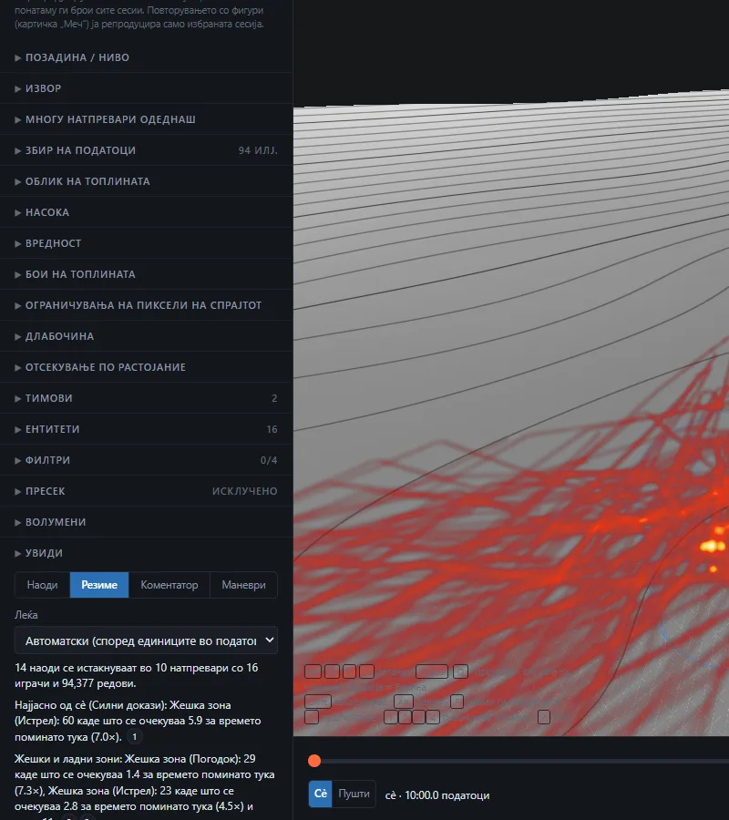
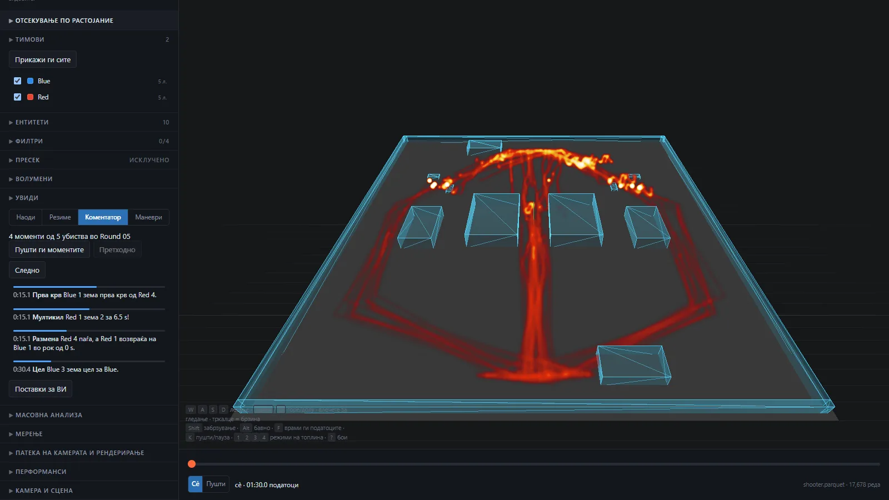

# Увиди

**Увиди** ги прегледува вчитаните податоци за она што се издвојува - силни позиции, смртоносно тло, стапици при појавување, засеци и играчи далеку над соиграчите - и ви кажува, од најјаките кон послабите, со докази. Со него за една минута учите каде натпреварот бил добиен или изгубен. Потоа може да напише извештај, а во еден повторен натпревар може да делува како коментатор што скока до големите моменти.

Сè се брои во вашиот прелистувач. Ништо не го напушта вашиот компјутер, освен ако не вклучите надворешна ВИ (видете [Надворешна ВИ](#external-ai)).

Делот **Увиди** е во страничната лента на картичките Топлинска мапа и Меч. Има три јазичиња: **Наоди**, **Резиме** и **Коментатор**.

## Наоди {#findings}

1. Вчитајте податоци и отворете **Увиди**. Притиснете **Најди увиди** („Counting… n%“ го покажува напредокот).
2. Прочитајте ја листата. Секој наод има лента на јачина, реченица, колку се добри доказите (*Силни докази*, *Добри докази* или *Некои докази*), кој детектор го нашол, и класата на возилото кога е важно.
3. **Кликнете на наод**: прегледувачот ги применува неговите филтри, ја лета камерата до местото и скока до времето, и ги отвора деталите: ефектот со својот 95% интервал, вредностите p и q, пребројаните докази и **Волумен овде**, што црта [волумен](volumes.md) околу местото.
4. **Врати филтри** ги враќа вашите филтри. **Копирај JSON** го копира целиот извештај.

Бројењето ги користи тековните филтри, скриените групи и избраниот натпревар во целиот временски опсег. Кога подоцна ќе ги промените филтрите, белешка тоа го кажува; притиснете **Преброј повторно**.

Редовите на врвот од листата (на пример вкупните пари) го сумираат целиот збир на податоци пред наодите.

### Детекторите {#the-detectors}

| Детектор | Што наоѓа | Потреби во податоците |
|---|---|---|
| **Силни позиции** | Места со многу подобри шанси за убиство наспроти смрт од остатокот на мапата, и *безбедно тло* каде малку умираат за времето поминато таму | настани за убиства и смрти |
| **Жешки и ладни зони** | Места каде некој вид настан (истрели, погодоци, заземања ...) се јавува многу повеќе или помалку отколку што предвидува времето поминато таму | колона за настани |
| **Отворен терен и заклон** | Смрти на отворено наспроти блиската геометрија на нивото, и бавно наспроти брзо движење | смрти; 3D ниво за геометријата |
| **Спаун-точки** | Силни појавувања, стапици при појавување, безбедни појавувања, време до прв контакт | време и лица |
| **Класа по место** | Класа на возило, или играчи наспроти ВИ, кои се многу подобри или полоши во едно подрачје | убиства плус колона за класа на возило или играч/ВИ |
| **Играчи** | Играчи што убиваат или умираат многу повеќе или помалку од другите во истата класа | лица и убиства |
| **Тесни грла и бокови** | Засеци (многу повеќе премини отколку околното тло) и бочни патишта (ретко користени, но водат до убиства) | лица |
| **Вредност** | *Скапо тло* и *Тло што заработува* | [колони со вредности](value-weighting.md) |
| **Што ги одлучи рундите** | Што ги одвојуваше добиените од изгубените рунди и играчите што додале или чинеле најмногу веројатност за победа (види [Кој победи](#who-won-what-decided-the-rounds)) | рунди, убиства и смрти, и [колоните за исход](data-formats.md#outcome-columns) (`won`) |

Детекторите што не можат да работат на податоците се наведени на дното со причината.

### Како се рангираат наодите {#how-findings-are-ranked}

Секое место или група се споредува со остатокот на мапата (точни биномни тестови или тестови на стапка). Стапката на лажни откритија се држи на 5% (Benjamini-Hochberg). Случајноста може да изгледа како шема; ова ги држи лажните алармите ниско: меѓу прикажаните наоди, се очекува најмногу околу еден на дваесет да е случајност. Ефектите од малку настани се влечат кон „нема ефект“ пред рангирањето. Се наведуваат најмногу 60 наоди, и секој детектор добива неколку места при врвот.

### Кој победи: што ги одлучи рундите {#who-won-what-decided-the-rounds}

Каде што податоците кажуваат кој ја добил секоја рунда ([колоната за исход](data-formats.md#outcome-columns) `won`: CS2, Rainbow Six Siege, War Thunder ...), Увидите се вртат околу резултатот. За секоја страна ги делат рундите според тоа што се случило во нив и ги споредуваат уделите на победи:

| Фактор | Рундите на страната со него | ... и без него |
|---|---|---|
| Отворачки дуел | страната го направила првото убиство | страната прва загинала |
| Купување | нејзиното купување било подобро од она на другата страна | полошо |
| Разменета прва смрт | нејзината прва смрт била разменета во рок од 5 s | не била разменета |
| Поставување | страната поставила бомба | без поставување |
| Помагала | повеќе гранати од нејзината вообичаена рунда | помалку |
| Ран контакт | првиот дуел дошол пред медијаната на времето во натпреварот | подоцна |
| Држено место | играч стоел на местото 5 s или подолго | никој |
| Рано достигнато место | играч стигнал таму во првите 25 s (маршрутата) | никој |

Секоја споредба е разлика на два удела на победи со нејзиниот интервал од 95% (Newcombe), Fisher-овото точно p и q над сите испробани фактори (Benjamini-Hochberg). Гранка со помалку од 8 рунди е означена со *малку рундови*. Оние под стапката на лажни откритија од 5% стануваат наоди; најсилните се рангираат над наодите на другите детектори (наод за исходот тежи 1,35 пати повеќе од наод со ист ефект и докази).

Измислен пример од 40 рунди:

> **T** доби 79% од 19-те рунди во кои го држеше **Mid**, наспроти 24% од 21 без тоа (55 поени, 95% од 26 до 74) - q 0,004.

Ја следи и **веројатноста за победа** во рундата - шансата што ја имала секоја страна во секој миг, според живите играчи, поставувањето и часовникот: прилагодена на рундите кога ги има 30 или повеќе, инаку од фиксен априорен модел (и текстот кажува од кој). Од неа произлегуваат **пресвртните моменти** (убиствата и поставувањата што најмногу ја поместиле шансата) и **додадената веројатност за победа** на секој играч: убиствата и поставувањата што ги направил се бројат за него, неговите смрти против него, во вредност на рунди низ натпреварот, просечно по рунда со интервал, тестирано наспроти нула. Местата добиваат ист биланс: која страна добила најмногу во дуелите водени таму.

На податоците им требаат рунди, убиства и смрти со двете страни и колоната `won`; именувани места (`place`) за држените места, колона `buy` за купувањето.

## Извештај {#debrief}

Јазичето **Резиме** ги запишува наодите во краток текст: вовед, најјасниот наод, еден за тактиката, еден за балансот, потоа - каде што податоците кажуваат кој победил - што ги одлучи рундите, остатокот групиран по детектор, и колку се засновани на послаби докази.

Што ги одлучи рундите доаѓа во четири пасуси: резултатот и од каде доаѓаат веројатностите за победа; најсилните фактори со нивните бројки, интервал и q (кога ниеден не ја поминува стапката на лажни откритија, текстот вели *ништо од тоа сè уште не е сигурно* и сепак ги именува најсилните); трите најголеми пресвртни моменти; и играчите што додале и чинеле најмногу веројатност за победа, со местата што добиле најмногу. Измислен пример:

> T доби 23, а CT доби 17 од 40 рунди со познат исход (T: 58%, 95% од 42% до 72%). Веројатностите за победа доаѓаат од модел прилагоден на овие рунди.
>
> Што ги одвојуваше добиените од изгубените рунди: T доби 79% од 19-те рунди во кои го држеше Mid, наспроти 24% од 21 без тоа (55 поени, 95% од 26 до 74) (q 0,004), ...
>
> Пресвртни моменти: рунда 17 на 48 s, убиство од CT на местото B ја промени нејзината шанса од 31% на 58%, и таа ја доби рундата, ...

Секој пасус има нумерирани копчиња што ги прикажуваат неговите наоди. **Копирај текст** го копира.

Вграденот наратор работи офлајн, на вашиот јазик. Изборникот **Леќа** над него (видете [Лебдечката леќа на знаењето](knowledge.md)) одлучува која литература ја цитираат пасусите.

### Надворешна ВИ {#external-ai}

**Поставки за ВИ** дозволува модел на вештачка интелигенција по ваш избор да го напише извештајот:

| Поставка | Значење |
|---|---|
| **Давател** | Anthropic (Claude), OpenAI (ChatGPT), OpenRouter, Ollama (локален), LM Studio (локален), llama.cpp сервер (локален), или било која крајна точка (endpoint) компатибилна со OpenAI |
| **Основен URL**, **Модел** | Се пополнува од провајдерот; **Прикажи модели** го прашува серверот |
| **API клуч** | Се праќа само до базната URL. Никогаш не се бележи, никогаш не се зачувува во прикази, извози или датотеки `.3dheat`. Повеќето локални сервери не бараат ниеден. |
| **Запомни го клучот во овој прелистувач** | Исклучено по стандард: клучот се заборава кога страницата ќе се затвори |
| **Користи надворешна ВИ** | Исклучено по стандард |
| **Испраќај имиња на играчи** | Исклучено по стандард: играчите се испраќаат како P1, P2 ... |

Потоа напишете незадолжително прашање и притиснете **Напиши со ВИ**. Се праќаат само наодите и нивните бројки - никогаш редовите од вашите податоци. Одговорот се пушта постепено; цитираните наоди стануваат копчиња. Каде што податоците кажуваат кој победил, на моделот му се кажува да почне со тоа што ги одлучи рундите, со интервалот и q на секоја бројка, и да каже кога факторот се потпира на малку рунди или кога веројатностите за победа доаѓаат од априорниот модел.

## Коментатор {#caster}

За **еден натпревар** (изберете еден ако има повеќе вчитани), **Коментатор** ги наоѓа моментите вредни за гледање: прва крв, повеќекратни убиства, размени, клучни борби, промени на целите, враќања, истакнати играчи, далечни истрели и **пресвртни моменти** - убиствата што најмногу ја поместиле шансата на една страна да ја добие рундата (според играчите што останале живи на секоја страна, во рунди без повторно појавување).

Каде што податоците кажуваат кој ја добил секоја рунда, тоа го кажува секој момент: *„Ана го урива Бен: шансата на T да ја добие рундата се менува од 38% на 62% - и ја добиваат рундата.“* Моментот на страната што потоа победила вреди повеќе кога коментаторот избира кои моменти да ги задржи, а враќањето се брои во добиени рунди.

- Кликнете на момент: прегледот преминува на повторувањето, скока до непосредно пред него, ја лета камерата таму и го следи играчот.
- **Пушти ги моментите** пушта секој до крајот и продолжува; **Претходно** / **Следно** се движат низ нив.
- Со вклучена надворешна ВИ, **Коментар од ВИ** пишува коментар од листата на моменти (видови, времиња, имиња или псевдоними, тимови, класи, растојанија).

Потребни се лица и настани за убиство/смрт (или заземање); колона `other`/`victim` овозможува размени и далечни истрели.

## Лебдечка леќа на знаењето {#knowledge-lens}

Наод може да се чита преку **леќа** од утврдено знаење: воена доктрина, воздушна и поморска борба, урбани операции, дизајн на игри и е-спорт (или *Auto*, избрано од единиците во податоците). Отворен наод потоа ја покажува најблиската ставка за **доктрина и литература** и **историска паралела**, со референци, а **Мерки на леќата** ги пресметува мерките од таа литература врз податоците (Lanchester-ови вклопувања, односи на размена, односи на сили, полиња на гаѓање, клучен терен, размени, иницијатива). Резимето и ВИ-упатството ги вклучуваат. Сè за тоа: [Лебдечката леќа на знаењето](knowledge.md).

Мерките на леќата исто така мерат како се однесуваат играчите како толпа и како група - порамнување и кружење, водење по патишта, ленти и трага, згуснатост, водачи и следбеници, заостанати, точката на прекин под загуби, ризик по изгубен живот, низи, согласност за куповини и одговор на дојдовен оган - секое споредено со свој нулти модел: [Колективно однесување](collective-behaviour.md).

## Податоци што ги прават увидите корисни {#data-that-makes-insights-work}

- позиции со **време**, колона за **лице** и колона за **тим**;
- колона за **настани** со убиства и смрти (`kill`, `death`), и други (`hit`, `fire`, `capture` ...);
- колона за **другата страна** (`other`, `victim`) за размени и насоки;
- колона за **возило** или **тип** за класи; колона `ai` за играчи наспроти ВИ;
- колона за **сесија** / **натпревар** / **рунда** кога има повеќе натпревари.

[Демо податоците](demo-data.md) ги имаат сите.
