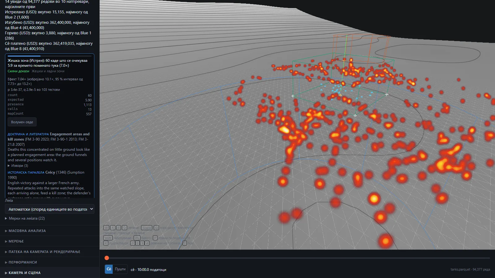

# Лебдечката леќа на знаењето

Кога [Увиди](insights.md) нешто ќе најде, овој дел го објаснува со идеи од воената историја, дизајнот на игри и аналитиката на спортот, и го именува книгата или трудот од кој потекнува. Користете го за да научите *зошто* една шема е важна, не само дека постои.

## Пробајте го {#try-it}

1. Вчитајте податоци и отворете **Увиди**, па притиснете **Најди увиди**.
2. Кликнете на наод за да го отворите.
3. Прочитајте **Доктрина и литература** и **Историска паралела**; целосните наводи се склопени под нив.
4. Променете ја **Леќа** (на пример на *Воена доктрина*) за истиот наод да го прочитате низ друг корпус на литература.

## Како функционира {#how-it-works}

Панелот Увиди ги оценува своите наоди како што би ги оценил професионален аналитичар: преку воена доктрина и исследување на операции, историски сражења и литературата за дизајн на игри, дизајн на нивоа и аналитика. Ова го прави офлајн, од курирана база на знаење во прегледувачот, а истиот материјал го предава на надворешен модел кога тој пишува резиме.

## Што го покажува панелот {#what-the-panel-shows}

- **Леќа** избира кој корпус на литература се чита наодите: *Автоматски* (според видовите единици во податоците: авиони, бродови, копнени возила, пешадија), *Воена доктрина*, *Воздушна борба*, *Поморска*, *Урбана*, *Дизајн на игра и баланс*, *Е-спорт*. Записите надвор од избраната леќа се испуштаат.
- Секој отворен наод го покажува својот најблизок запис од **доктрина и литература** и својата најблиска **историска паралела**, со целосните наводи склопени под нив.
- **Мерки на леќата** ги наведува мерките на анализата на операции пресметани по истите редови (подолу), секоја со своето значење и својата литература.
- **Резимето** додава редови за водечките наоди и мерките на леќата: „Доктрина и литература: ..." и „Историска паралела: ...", секоја со цитати автор-година и наводите склопени под неа.
- **Напиши со ВИ** ги испраќа најрелевантните записи (резиме, поука, наодите со кои се поврзани, целосните наводи) со извештајот, и го моли моделот да ги citira по ид - `{concept.lanchester-square}` - и да не користи други извори.

Ознаките се преведени; самото знаење е на англиски.

## Мерки на леќата {#lens-metrics}

Се пресметуваат во работникот за увиди, во истото минување низ редовите како и детекторите (`src/insights/lensMetrics.ts`). Секоја се испушта кога податоците не можат да ја носат.

| Мерка | Што мери | Потребно |
|---|---|---|
| Ланчестеров фит | Загубите на секоја страна по 20 s, регресирани на силите на двете страни во живот (Поасон, грешки на квази-веродостојност); експонентите на непријателската и сопствената сила, тестирани наспроти квадратниот закон (нишан) и линеарниот закон (површинска ватра) | време, тимови, убиства и смртни случаи |
| Однос на размена | Убиства по смрт по страна и по место; уделот на смртните случаи на најсмртоносното копно што зафаќа 5% од времето што е потрошено, наспроти уделот што само случајноста го дава со толку смртни случаи; Џини на смртните случаи наспроти времето; Моранов I на стапките на смрт | убиства и смртни случаи |
| Локален однос на сили | Сопствени и непријателски единици живи во опсегот на ангажман на секое убиство (опсегот поставен од податоците: двапати медијаната на растојанието до најблискиот непријател); уделот на убиствата од локално надмоќната страна, и нејзиниот вишок наспроти она што самите бројки го предвидуваат | време, тимови, лица |
| Полиња на оган | Видливи области на најзафатените места на убиство на површина со 2,5D пречки (геометрија на нивото до висината на ѕидот, или скршнатото тло) наспроти просечното место, и ранг-корелацијата на видот и уделот на убиствата | позиции; вчитано ниво го прави попрецизно; не за воздух |
| Енергетска состојба | Специфична енергија (висина плус висината што брзината би ја купила) на воздушните убијци и воздушните жртви, споредена со статистиката на Ман-Витни | класи авиони, време, висина |
| Клучен терен | Колку често е секое место меѓу трите најзафатени места на убиство во еден натпревар | неколку натпревари |
| Меѓусебна поддршка (размени) | Смртни случаи одговорени со убиство на соиграч во опсегот на ангажман и 5 s | време, тимови |
| Прв удар | Ангажмани - убиства групирани по натпревар, по 20 s мирување и по три опсези на ангажман растојание - освоени од страната што прва постигнала | време, тимови |
| Модел на салво | Хјузовата салво-равенка вклопена во периоди од 20 s кога бродовите се во контакт: бродови извадени од борба по напаѓачки брод, и спасени по бранителски брод; Ланчестеров фит само на бродовите | класи бродови, време, тимови |
| Борбена ефикасност | Убиства по единица-час во акција на секоја страна и односот на двете најголеми (вредност на борбената ефикасност во смисла на Дупи) со нејзиниот 95% интервал, и уделот на секоја страна во убиствата при еднакви локални бројки | време, тимови |
| Опсези на ангажман | Растојание до најблискиот непријател при убиства, при лансирања и при првиот исстрел на секој живот (откривање до ангажман), по вид на единица | време, тимови; лансирања таму каде податоците ги имаат |
| Синџир на убиство | Секунди од последното лансирање на убијцата до убиството, и од нејзиниот прв исстрел во борбата до убиството | време; лансирања или настани на оган |
| Концентрација или распрснување | Во секој период од 20 s, распространетоста на двете најголеми страни и уделот на убиствата што ги зема поцврстата | време, тимови |
| Излети | По страна: излети (полетувања, или појавувања на авиони), слетувања, изгубени авиони и убиства од авиони; стапка на загуба и убиства по излет | класи авиони; полетувања или појавувања |

Податоците со рундови додаваат мерки за блиска борба и е-спорт - веројатност за победа во рунд, вредност на дејствата, отворувачки дуели, размени, напаѓач наспроти бранител, нишан, вкрстен оган, помош, предност на човек, клачови, поставувања, по поставување на бомбата, фатални фунели и влијание на играчот: видете [Блиска борба и рундови](close-quarters.md).

Патеките и тимовите додаваат мерки за колективно однесување од науката за толпи, колективно движење, однесувачка економија и воена психологија - усогласеност и кружење, стадо по рута, коридори и траги, натрупување, водачи и следбеници, заостанати, точка на кршење, ризик по загуби, серии, договор за купување и потиснување, секоја наспроти својот нулти модел: видете [Колективно однесување](collective-behaviour.md).

Оружјето, мамците и зградите не се бројат како единици. Кога редовите на оружје го именуваат својата единица-лансер (колона `Shooter` или `Launcher`, како податоците изведени од Tacview), лансирањето се припишува на таа единица, совпаѓајќи се по име или по идентификатор на објектот.

## Како наодите се среќаваат со литературата {#how-findings-meet-the-literature}

Записите и наодите се среќаваат преку **таксономија на обрасци** (`src/insights/knowledge/patterns.ts`): концентрација, локална надмоќ, нишански и површински оган, тесни места, зони на убиство, полиња на оган, обратна падина, обиколување, меѓусебна поддршка, енергетска предност, притисок при појавување, баланс и така натаму. Секој вид детектор и секоја мерка на леќата кажува кои обрасци ги покажуваат нејзините бројки (`src/insights/lens.ts`); секој запис на знаење кажува на кои обрасци се однесува, со тежина. Релеватноста на записот за еден наод е тежинското преклопување, размерено според тоа колку добро доменот на записот (копно, воздух, море, урбан) одговара на податоците и според сопствената сила на наодот. Образложението што се прикажува е бројките на наодот во една реченица, проследена со поуката на записот.

## Каталог {#catalogue}

Секој образец, поим, метод, историски случај, принцип на дизајн и студија, со библиографијата: видете [Каталогот на знаењетото](knowledge-catalogue.md).

## За програмери {#for-developers}

### Додавање записи {#adding-entries}

1. Изберете ја датотеката според видот: `concepts.ts` и `concepts-more.ts`, `methods.ts`, `cases.ts`, `cases-land.ts`, `cases-air-sea.ts`, `cases-esports.ts`, `design.ts` (принципи на дизајн) или `studies.ts` во `src/insights/knowledge/`.
2. Дајте му нов ид `<type>.<slug>` (никогаш не користете повторно), неговите леќи, домени и обрасците на кои се однесува со тежини 0..1. Додајте образец во `patterns.ts` само кога наод може да го покаже, и мапирајте го од наод или мерка во `lens.ts`.
3. Резимето и поуката напишете **со свои зборови**. Цитати само од дела во јавен домен (`pd: true` во наводот), и кратки.
4. Цитирајте: секое ново дело додајте го во `refs.ts` со автори, година, наслов и издавач (списание со волумен и страници); URL или DOI таму каде има јавен запис.
5. Пуштете `npx vitest run src/insights/lens.test.ts` (единствени ид-а, познати обрасци, наводи што се разрешуваат, цитати од јавен домен, случаи со датум и исход) и `node tools/knowledge-doc.mjs` за да го освежите [каталогот](knowledge-catalogue.md).
