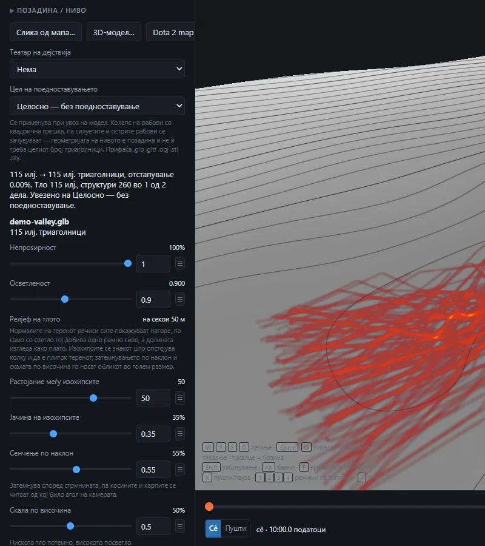

# Нивоа и геометрија на позадината

Ниво е 3D местото каде се одиграла играта - мапа, град, патека. Ставете едно зад вашите податоци и можете да видите *каде* е топлината. Панелот **Позадина / ниво** (видете [Речник](glossary.md) за „ниво“) дава три видови контекст:

- **слика од мапа**, геореференцирана со две сидра - видете [Слики на мапи](map-images.md);
- **3D ниво** - `.glb`, `.gltf`, `.obj`, `.stl` или `.ply` - поделено на терен, структури и вода и поедноставено при увоз - видете [3D нивоа](model-levels.md) и [Изглед на нивото](level-appearance.md).
- **позадина на светот** - за снимка што кажува каде на земјата е (ACMI-датотека од Tacview), вистинскиот терен, патишта, вода, аеродроми и згради, преземени од отворени податоци - видете [Позадина на светот](world-backdrop.md).

Без вчитано ништо, сцената е темна со мрежа и обоени оски (**Решетка** и **Оски** во [Камера и сцена](camera.md)), а панелот вели *Ништо не е вчитано - сцената покажува мрежа и оски. Додајте слика од мапа или мрежа на ниво за да ѝ дадете контекст на топлината.*

Нивото го делат сите три табови: патека вчитана во табот Анализа на трки е истото ниво што го прикажува топлинската мапа.

## Ставете ниво зад вашите податоци {#put-a-level-behind-your-data}

1. Прво вчитајте ги податоците ([Внесување податоци](getting-data-in.md)), за нивото да се прилагоди на нив.
2. Отворете **Позадина / ниво** во страничната лента.
3. Притиснете **Слика од мапа…** за слика или **3D-модел…** за 3D ниво, и изберете ја датотеката. За снимка од вистинскиот свет, користете **Вистинскиот свет како позадина** или **Театар на дејствија**.
4. Почекајте линијата на напредокот да заврши. Голем модел прво се поедноставува (видете **Цел на поедноставувањето** подолу).
5. Притиснете **F** во приказот за да го врамите сè. Користете ги **Непроѕирност** и **Осветленост** додека топлината не се истакне од нивото.
6. Притиснете **Зачувај во библиотеката** ако ќе го користите нивото повторно ([Библиотека на нивоа](level-library.md)).

## Што му прави нивото на топлината {#what-a-level-does-for-the-heat}

- Тоа **засенчува**: податочните точки зад него се затемнуваат по површина, а точките зад теренот се скриени ([Длабочина и отстранување](depth-and-culling.md)). Без ниво нема засенчување.
- Го **сече** [Пресекот](slice.md) и, со *Сечи го и нивото*, [отстранувањето по растојание](depth-and-culling.md#distance-culling), заедно со топлината.
- Е единственото нешто што го замаглува [длабочината на полето](camera.md#depth-of-field), освен мрежата и кутиите.
- 3D-ниво ја **проширува далечната рамнина на камерата** кога е поголемо од податоците: блиската и далечната рамнина се калибрираат од податочното множество, а извезена мапа долга неколку километри инаку би била целосно зад далечната рамнина и би оставила празен приказ. Далечната рамнина станува 3 × хоризонталниот опсег на нивото кога е поголем, блиската рамнина се поместува со неа (најмалку далеку / 100 000) за да се зачува прецизноста на длабочината од која зависи засенчувањето, а брзината на летање се зголемува на најмалку опсег / 12. Таа секогаш само се проширува, никогаш не се стеснува.

## Панелот, одозгора надолу {#the-panel-top-to-bottom}

| Дел | Подробности |
|---|---|
| **Слика од мапа…**, **3D-модел…** | Вчитајте едно; ќе го замени тековното ниво. |
| **Вистинскиот свет како позадина**, **Заборави ги плочките на картата** | Само за податочно множество со географска референца: изградете го вистинското место под него како ниво, или избришете ги преземените плочки. [Позадина на светот](world-backdrop.md) |
| **Цел на поедноставувањето** | Буџетот на триаголници за следниот увоз на модел: *Полно - без поедноставување* (стандардно), *Високо - 8M*, *Средно - 3M*, *Ниско - 800k*, *Силуета - 100k*. [3D нивоа](model-levels.md#simplification) |
| Напредок и **Откажи** | Додека се декодира или увезува. |
| Белешка за увозот | Триаголници пред и после, поделбата на теренот / структурите / водата, степенот на детал што е користен. |
| Име и големина | `ширина×висина px · x × z m/px` за слика, `N триаголници (од M)` за модел. |
| **Непроѕирност**, **Осветленост** | И за двата вида. |
| Контроли за слика | **Обезбојување**, **Преврти север/југ**, **Поставување** (две сидра), **Прилагоди кон границите на податоците**, **Висина**. [Слики на мапи](map-images.md) |
| Контроли за модел | Релјеф на теренот, вода, триаголници на теренот, жичен модел, текстура, снимена боја, структури, класификација на деловите. [Изглед на нивото](level-appearance.md) |
| **Зачувај во библиотеката**, **Отстрани** | [Библиотека на нивоа](level-library.md); Отстрани го исфрла нивото. |
| **Библиотека** | Нивоа зачувани во овој прелистувач. [Библиотека на нивоа](level-library.md) |

## Страници во овој дел {#pages-in-this-section}

- [Слики на мапи](map-images.md)
- [3D нивоа](model-levels.md) - формати, делови, класификација, поедноставување, текстури
- [Изглед на нивото](level-appearance.md) - секоја контрола за 3D-ниво
- [Библиотека на нивоа](level-library.md)
- [Позадина на светот](world-backdrop.md) - вистинскиот свет под снимката, од отворени податоци

Како да се извадат нивоата од игри и мотори е работа на посебните алатки за извоз (видете [README](https://github.com/Holdi601/3DHeat/blob/main/README.md) на репозиториумот); договорот во кој пишуваат е сумиран во [3D нивоа](model-levels.md#the-exporter-contract).
