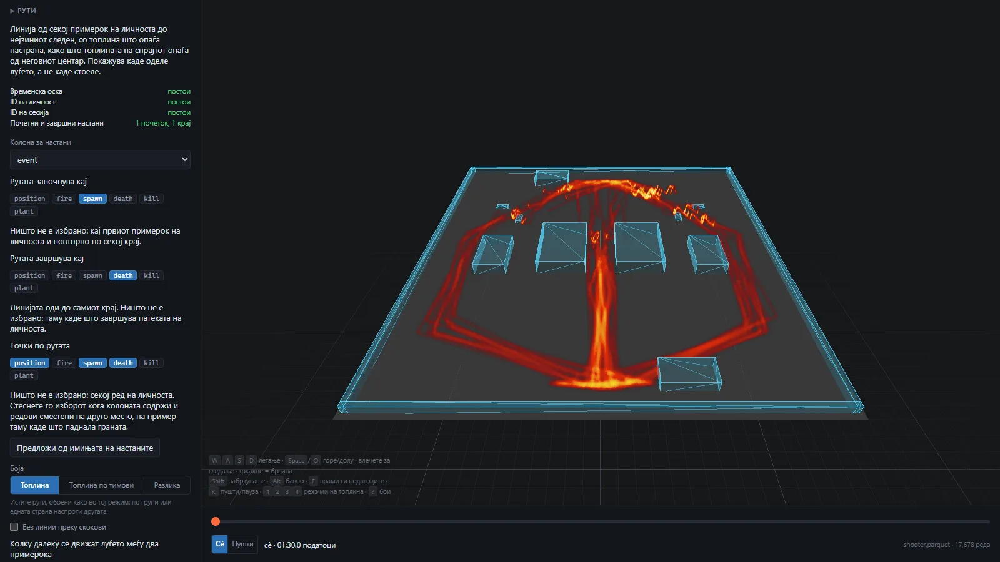

# Топлина по линија

Топлината ја покажува каде стоеле луѓето. Линиите ги покажуваат патеките што ги поминале.

**Линии** (копче 4) е топлина по линија: линија од секој примерок на [лице](glossary.md) до неговиот следен, распрсната со истото опаѓање што го има [спрајтот](glossary.md) - преку линијата наместо околу точка. Таа ја покажува каде луѓето *одат*, а не каде *стојат*: коридор поминат еднаш е исто толку видлив колку соба во која некој се кампувал, а ретките примероци на брз играч се спојуваат во непрекината рута, наместо во испрекината патека. Потребни се колона за лице и колона за време.

## Како се користи {#how-to-use-it}

1. Притиснете `4` (или изберете **Линии** во лентата за режими).
2. Отворете **Рути** и проверете ја зелената листа: оската на времето и ID на лице мора да се присутни.
3. Притиснете **Предложи од имињата на настаните** за да се пополни каде почнуваат и завршуваат рутите.
4. Прочитајте го редот со статистика: „N рути, M од нив стигнуваат до крај".
5. Ако линиите скокаат преку мапата, приспособете го **Најдолгиот чекор** (видете [Границата на скокот](#the-jump-limit)).

Линијата има смисла само меѓу почеток и крај, па панелот **Рути** вели што ја ограничува една рута. Сè од [Правилата на една рута](#the-rules-of-a-route) па натаму е детал што можете да го прескокнете.

## Панелот Рути {#the-routes-panel}

Прикажан над панелите за топлина во режимот Линии.

### Што ги има податоците {#what-the-data-has}

Листа за проверка, зелена кога е присутно, килибарна кога не е:

| Ред | Состојби |
|---|---|
| **Оска на времето** | *присутна* / *недостасува - потребна* |
| **ID на лице** | *присутен* / *недостасува - потребен* |
| **ID на сесија** | *присутен* / *нема - сите редови се една сесија* |
| **Почетни и завршни настани** | *N почетоци, M краеви* / *нема избрано - цели патеки* (зелено само со колона на настани и барем еден почеток и еден крај) |

### Контроли {#controls}

| Контрола | Значење |
|---|---|
| **Колона за настани** | Колона на категорија чии вредности се настани (појавување, смрт, позиција, ...). *Нема - цели патеки*: патеката на секое лице во секоја сесија е една рута, прекината таму каде патеката има празнина. Се нудат само колони задржани за филтрирање при вчитување. |
| **Рутата започнува кај** | Вредности на настани што ја започнуваат рутата (појавување, повторно појавување, спуштање). Ниедна избрана: рутата почнува кај првиот примерок на лицето, и повторно по секој крај. |
| **Рутата завршува кај** | Вредности на настани што ја завршуваат рутата (смрт, извлекување, телепортирање). Линијата оди до самиот ред на крајот. Ниедна избрана: рутата завршува таму каде патеката на лицето завршува. |
| **Точки по рутата** | Вредности на настани чии редови лежат по рутата. Ниедна избрана: секој ред на лицето. Стеснете го кога колоната содржи и редови поставени на друго место, како каде паднал фрлен предмет. |
| **Предложи од имињата на настаните** | Ги пополнува трите листи од имињата на вредностите (подолу). |
| **Боја** | *Топлина*, *Топлина по тимови* или *Разлика*. Истите рути во бојата на тој режим: секоја група во својата нијанса, или една страна наспроти другата, со листата на групи, поделбата и скалите што работат како во тие режими. По основно *Топлина*. Топлината по тимови и разликата бараат колона на група. |
| **Без линии преку скокови** / **Најдолг чекор** | Следниот примерок на лицето што е подалеку од ова е повторно појавување, телепортирање или паѓање, а не место до кое отишло, па ниедна линија не ги спојува двете. Се пополнува при вчитување кога податоците покажуваат јасна празнина (подолу), и е исклучено кога не покажуваат. Работи со или без колона на настани. |
| Редот со статистика | `N рути, M од нив стигнуваат до крај, K сегменти`, се ажурира неколку пати во секунда. |

Секоја листа е ред од чипови за вклучување, по еден за вредност, најчестите прво; ако се задржи покажувачот над чип, се прикажува неговиот број редови. Најмногу 120 вредности се нудат (*уште N вредности не се прикажани*).

Изборот на друга колона за настани ја применува предлогот кога предлогот ја избира истата колона, а инаку започнува со празни листи.

### Предлогот {#the-suggestion}

При секое вчитување, и на **Предложи од имињата на настаните** ([`suggestLineSettings`](https://github.com/Holdi601/3DHeat/blob/main/src/data/lines.ts)):

- **Колона за настани:** првата задржана колона на категорија именувана `event`, `eventname` или `eventtype`; инаку `kind`, `type` или `action`; инаку која било што содржи *event*, *kind*, *action* или *type*.
- **Почетоци:** вредности што содржат *spawn, deploy, join, enter, start, begin, respawn, revive, land/landed/landing, drop* - освен ако исто така не се совпаѓаат со збор за крај.
- **Крајови:** вредности што содржат *death, died, dead, kill/killed, eliminat…, extract, evac, teleport, leave, left, disconnect, quit, exit, end, finish, downed* - освен вредностите `kill` и `kills` (убиството е нешто што го прави убиецот, а не крај на неговата рута).
- **Точки:** вредности што се точно *position, location, player location, move, movement, tick, sample* или *pos*; кога се најдени некои, почетоците и крајевите се додаваат и на точките. Кога не се најдени ниедни, точките остануваат празни (секој ред).

### Границата на скокот {#the-jump-limit}

Таму каде луѓето скокаат, должините на чекорите паѓаат во две групи со речиси ништо меѓу нив: она што лице го поминува меѓу два примероци, и ширината на мапата. При вчитување ([`suggestMaxJump`](https://github.com/Holdi601/3DHeat/blob/main/src/data/lines.ts)) чекорите се броат по удвојување на нивниот квадрат на должината, до 16 милиони, а границата оди во средината на првиот опсег над медијаната што е широк барем едно удвојување на должината, држи под 0,02% од чекорите по сандаче и има чекори над себе. Без таков опсег ништо не се сече, бидејќи нема начин да се разликува скок од брз автомобил; вклучувањето на границата рачно тогаш почнува од една десетина од дијагоналата на податоците.

Графикот над границата ја покажува вистинската должина на чекорите, со линија на границата: сталбовите десно од неа не се цртаат. И двете оски се логаритамски, бидејќи скоковите можат да бидат една стотинка од чекорите и илјада пати подолги. Поминете со глувчето над столб за неговиот опсег и удел; кликнете на графикот за да ја поставите границата таму. Под него, уделот на чекорите над границата.

## Правилата на една рута {#the-rules-of-a-route}

Редовите се поминуваат по редослед на времето, по лице ([`buildLines`](https://github.com/Holdi601/3DHeat/blob/main/src/data/lines.ts)):

1. Редовите на [заедничко име](sessions-persons-groups.md#names-worn-by-several-things-at-once) се прескокнуваат во целост.
2. Кога се избрани точки, ред што не е ниту почеток, ниту крај, ниту точка се прескокнува.
3. Редовите се следат по лице по сесија, па лице чии сесии се преплетуваат по редослед на времето има по една рута во секоја. Рутата се затвора кога претходниот ред немал наследник (неговото [траење](sessions-persons-groups.md#person) е „нема"): рутата никогаш не преминува граница на сесија или празнина за која вчитувањето одлучило дека нема следен примерок. На која рута е еден ред се пресметува еднаш и се чува, 4 бајти по ред, па промената на најдолгиот чекор не го повторува тој дел.
4. **Почеток** ред затвора секоја отворена рута и отвора нова таму.
5. Кога се избрани почетоци, ред надвор од рута се занемарува. Без почетоци, кој било не-крај ред надвор од рута отвора една.
6. Секој друг ред во рута додава **сегмент** од претходниот ред на рутата до овој.
7. **Крај** ред што ја продолжува рутата ја затвора по својот сегмент; таа рута се брои како *стигнува до крај*.
8. Чекор подолг од **Најдолгиот чекор** ја затвора рутата таму каде била, а нова рута почнува на далечниот крај, освен ако тој ред не е крај. Низ него не се црта линија, а редот со статистика го брои.

Секој сегмент се чува на својот *крајен* ред, па сегментите остануваат по редослед на времето, а [временската линија](timeline.md) прозорец, примерувачот, [филтрите](filters.md), видливоста на групите и знакот на разликата сите работат со нив како со точки. Филтерот затоа се применува на редот каде завршува сегментот.

## Репродукција {#playback}

Во режимот **Сите** секоја рута се црта цела. Во режимот **Пушти** секое лице е точка што се движи меѓу своите примероци и ја црта својата рута зад себе:

- сегмент што почнува по главата за репродукција не се црта;
- сегментот во кој е лицето во средина се црта до неговата интерполирана позиција, со крајна капа на челото;
- топлината се стуткува во **опашката**: со историјата *Кумулативно* опашката е неограничена и целата досегашна рута останува; со *Прозорец* се стуткува до ништо во текот на *Распонот* (стандардно 30 s). Со *Траење* опашката е исто *Распонот*, а во режимот Линии временската линија го прикажува полето *Распон* и за таа историја (наместо *Резервно траење* и *Стуткување*, кои топлината по линија не ги користи).

Додека се репродуцира, секој кадар се црта цел, а не се собира, бидејќи челата се движат на секој кадар, а подвижниот просек би ја размачкал секоја во траг.

## За програмери {#for-developers}

### Меморија {#memory}

Рутите се градат на главната нишка кога ќе се влезе во режимот Линии (или кога ќе се променат поставките за рути) и се ослободуваат кога ќе се напушти: 5 бајти по ред во меморијата и 8 бајти по ред на GPU (почетната позиција на секој сегмент, квантизирана на 16 бита по оска во граничната кутија на податоците, и неговите знаменца).

### Како се црта линија {#how-a-line-is-drawn}

И двата backend-а го црта секој сегмент од својот крајен ред како **18 темиња** ([`lineHeatVs`](https://github.com/Holdi601/3DHeat/blob/main/src/render/webgl2/shaders.ts) и неговиот WGSL близнак):

- Половината на ширината на секој крај е [радиусот на спрајтот](sprite-shape.md#sprite-radius) на растојанието на тој крај, со примените пиксел-граници. Линија потесна од 2,5 px се црта 2,5 px широка со својата топлина намалена да одговара, па тенките линии ниту исчезнуваат, ниту се расветлуваат.
- Топлината се опаѓа **преку** линијата со истата скала како кај спрајтот - опаѓање или крива, интензитет во средината и на работ.
- Тркалезни капи се цртаат **само** таму каде рутата почнува или завршува, па спојниците меѓу последователните сегменти не се претвораат во низа бисери.
- Геометријата се гради во простор на екранот и таму се интерполира линеарно, така што опаѓањето останува центрирано на линијата без оглед како навлегува во длабочината. Сегмент што ја пресекува блиската рамнина се сече таму, а не се исфрла.

Топлината по точки и топлината по линија внесуваат многу различни количини топлина по ред, па заситеноста повторно се мери кога ќе се префрлите меѓу нив ([Боја и експозиција](colour-and-exposure.md#auto-exposure)).
