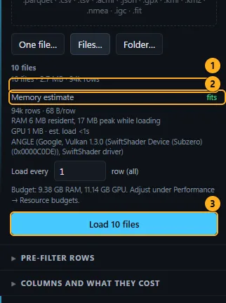

# Вчитување датотеки

Оваа страница покажува како да ѝ ги дадете вашите датотеки на 3DHeat и што прави со нив. Испуштете папка и таа ги бира датотеките што содржат позиции и ги спојува во една слика.

1. Отворете **Извор** на врвот од страничната лента на Топлинската мапа.
2. Испуштете датотеки или папка на зоната за испуштање или притиснете **Датотеки…** или **Папка…**.
3. Прочитајте го редот за изборот и **Проценката на меморијата** (видете ја сликата подолу).
4. Притиснете **Вчитај**.

*Откако ќе испуштите папка, 3DHeat ви кажува што нашол и дали се вклопува.*

Датотеките се вчитуваат во панелот **Извор** на врвот од страничната лента на јазичето Топлинска мапа. Сè што е избрано одеднаш станува **една** збирка на податоци.

## Избор на датотеки {#choosing-files}

| Контрола | Што прави |
|---|---|
| **Пуштете датотеки или папка тука** (зоната за испуштање) | Испуштете која било мешавина од датотеки и папки. Папките се претресуваат рекурзивно. Кликот на зоната за испуштање го отвора истиот избирач како **Датотеки…**. |
| **Една датотека…** | Избирач на датотеки за една датотека. |
| **Датотеки…** | Избирач на датотеки што прифаќа неколку датотеки. |
| **Папка…** | Избирач на папка (избирачот `webkitdirectory` на прелистувачот); се нуди секоја датотека во дрвото на папката. |

Избирачите ги прифаќаат типовите датотеки од [списокот на датотеки што можат да се вчитаат](data-formats.md#files). Накратко: `.parquet`/`.pq` се читаат како Parquet, `.csv`/`.tsv`/`.txt` како текст со разделувачи, `.acmi` (Tacview), OCAP `.json`/`.json.gz` и GPS-форматите (GPX, KML, KMZ, NMEA, IGC, FIT) минуваат низ сопствените читачи, а контејнерите `.3dheat` за натпревари се вчитуваат како табелите што ги содржат ([Една датотека за натпревар](container.md)). Контејнер што не може да се прочита се прескокнува како *не е csv/parquet датотека*.

Испуштените папки се претресуваат до длабочина од 12 нивоа и највеку 20.000 датотеки, како заштита од јамки на симболички врски и бесконечни дрвја.

## Кои датотеки се задржуваат {#which-files-are-kept}

Пред да се прочита што било, изборот се филтрира ([`filterDataFiles`](https://github.com/Holdi601/3DHeat/blob/main/src/data/filePick.ts)):

- Датотека со друг наставок се прескокнува: *не е csv/parquet датотека*.
- Датотека од 0 бајти се прескокнува: *празна (0 бајти)*.
- **Придружните датотеки на конверторите** - сировите податоци што конверторот ги чува покрај табелата на натпревар, `<match>.messages.parquet`, `.events.parquet`, `.raw.parquet` и другите наведени во [Конверторите чуваат сè](converters.md) - се прескокнуваат: *придружна датотека на конвертор*. За да отворите една, изберете ја или испуштете ја сама (или само придружни датотеки): избор од само придружни датотеки ги вчитува како која било табела. JSON-датотеките покрај табелата (`.match.json`, `.course.json`, `.level.json`, `.meta.json`, `.summary.json`, `.session.json` и `.hints.json`) никогаш не се нудат како позиции.
- **Правилото за датотеките за движење.** Ако која било датотека во изборот е именувана `movement*.parquet`, `movement*.csv` (и другите наставоци) - `movement.parquet`, `movement_1.parquet` и така натаму - тогаш секоја друга податочна датотека се прескокнува: *не е датотека за движење, а оваа папка има датотеки за движење*. Извозите на телеметријата често содржат една табела со позиции покрај десетици табели без позиции, а само првата може да се нацрта. Папка без ниедна датотека за движење ги вчитува сите свои податочни датотеки. Пример: папка со `movement_1.parquet`, `kills.parquet` и `shop.parquet` го вчитува `movement_1.parquet`; другите две се наведени како прескокнати. Пример: папка со `movement_1.parquet`, `kills.parquet` и `shop.parquet` го вчитува `movement_1.parquet`; другите две се наведени како прескокнати.
- Задржаните датотеки се подредуваат по нивната патека во изборот, па истата папка секогаш дава иста збирка и исти бои.

Панелот потоа го покажува изборот (името на една датотека, или `папка (N датотеки)` со најдолгата заедничка папка), бројот на датотеки, нивната вкупна големина и вкупниот број редови - точно кога сите датотеки се Parquet, а означено со `≈` кога која било е CSV. Прескокнатите датотеки се наведени со нивната причина, првите четири по име.

## Читање на шемата {#reading-the-schema}

**Првата** датотека од изборот се отвора за да се опише шемата („Читање на шемата"): нејзините имиња на колони, нејзините први 50 податочни редови, кои колони изгледаат нумерички и, за Parquet, логичкиот тип на секоја колона и записот `heat3d` во футерот. Папка со извези на една табела ја дели истата шема, па една датотека ги претставува сите. Потоа се мери секоја датотека („Броење редови"): футерот на Parquet го дава точниот број со едно мало читање; бројот на CSV се проценува од просечната должина на редот во неговите први мегабајт.

Панелот [Мапирање на колони](column-mapping.md) се отвора со автоматски погодените мапирања, а [проценката на меморијата](memory-and-budgets.md) се појавува над копчето **Вчитај**.

## Пораки пред вчитувањето {#messages-before-loading}

Под изборот, панелот ги наведува, од [`validateMapping`](https://github.com/Holdi601/3DHeat/blob/main/src/data/validate.ts):

- **Грешки** (црвено) - вчитувањето не може да почне: помалку од две оски на позиција, истата колона на две оски, мапирана колона што не е во датотеката, колона на позиција што не изгледа нумеричка, колона на време чии примерени вредности се текст додека единицата е број (секој ред би се читал како NaN и би паднал на време 0), колона на време поставена на ISO-8601 а ниедна од примерените вредности не се претвора во датум, размер на единица 0.
- **Предупредувања** (килибарно) - ќе се вчита, но веројатно не како што е наменето: колона на група што зема различна вредност на повеќето примерени редови (па е идентификатор, не група), колона на време `DATE` (секој ред на еден ден го дели истиот момент), насока на гледање поставена без нејзините колони.
- **Белешки** - што значи мапирањето: цртање на рамнина кога една оска не е мапирана, нема временска линија без колона на време, нема патеки без колона на лице, а без колона на група - една боја за сè и разлика што може да се дели само по колона задржана за филтрирање.

## Вчитување {#loading}

Копчето **Вчитај** чита *Вчитај датотека*, *Вчитај N датотеки* или *Вчитај N датотеки (1 од K)* кога е поставен [чекор на децимација](memory-and-budgets.md#decimation). Чита *Преголемо - намалете или децимирајте* и е исклучено кога [проверката на вклопувањето](memory-and-budgets.md#the-fit-check) вели дека вчитувањето нема да стане; исто така е исклучено додека мапирањето има грешки или друго вчитување работи.

Додека се вчитува, панелот го покажува тековниот чекор (со `[датотека/датотеки]` пред него кога има неколку датотеки), редовите прочитани досега, лента на напредокот и **Откажи**. Откажи го прекинува работникот за внесување, а со него и сите работници за парсирање што ги започнал.

Страницата продолжува да црта додека се вчитува, бидејќи работата се одвива во позадина. Го гледате тековниот чекор, прочитаните редови, лентата на напредокот и **Откажи**. По последната датотека, панелот ги покажува чекорите *Редовите се ставаат по редослед на времето*, *Колоните се преуредуваат (n од m)*, *Се мери опфатот*, *Се градат списокот на учесниците*, *Се сумираат сесиите* и *Се пресметуваат траењата*, а потоа *Се префрлаат N редови на GPU* за еден кадар, така што долго префрлување никогаш не се меша со замрзнување.

### Како функционира {#how-it-works}

Вчитувањето се извршува во Web Worker ([`ingestWorker.ts`](https://github.com/Holdi601/3DHeat/blob/main/src/data/ingestWorker.ts)). Со неколку датотеки и повеќе од една [нишка за парсирање](memory-and-budgets.md#parser-threads), до толку датотеки се парсираат **истовремено**, секоја во свој работник за парсирање ([`parseWorker.ts`](https://github.com/Holdi601/3DHeat/blob/main/src/data/parseWorker.ts)), колку што буџетот на RAM дозволува; сè уште се спојуваат една по една, по редоследот на изборот, па збирката е иста како при вчитување една по една. Додека неколку се во тек, редот на напредокот го именува датотеката што последна јавила, а лентата и бројот на редови ги собираат сите датотеки во тек. Со една нишка, или една датотека, датотеките се парсираат една по една во самиот работник за внесување. Се читаат само колоните што ги именува мапирањето: немапирана колона на Parquet-датотека не чини ништо; CSV се скенира бајт по бајт, но се декодираат само мапираните полиња.

## Неколку датотеки стануваат една збирка {#several-files-become-one-dataset}

Кога се вчитуваат повеќе од една датотека ([`ingestFiles.ts`](https://github.com/Holdi601/3DHeat/blob/main/src/data/ingestFiles.ts), [`builder.ts`](https://github.com/Holdi601/3DHeat/blob/main/src/data/builder.ts)):

- **Еден список.** Лицата, групите, сесиите и вредностите на категориите се речници заеднички за сите датотеки, па истиот играч во два извоза е едно лице со една патека.
- **Едно време на почеток.** Времињата се чуваат како 64-битни секунди при спојувањето и се префрлаат на најраното време на *целиот* избор, па се чуваат како 32-битни секунди од тој почеток. Четири извоза од четири попладнија се ставаат во својот вистински редослед, не еден врз друг.
- **Еден редослед по време.** Редовите од сите датотеки се подредуваат по време со радикс-сортирање (видете [границата на сортирањето](memory-and-budgets.md#the-sort-ceiling)).
- **Колона `Source file`.** Секој ред памети од која датотека дошол, како колона на категорија по име `Source file`. Се појавува во [Филтри](filters.md) и како *Source file - споредба на две вчитувања* во [поделбата на разликата](difference.md). Вчитување од една датотека не ја добива - константна колона би чинела 4 бајти по ред за да не кажува ништо.
- **Недостасувачки колони.** Датотека што нема една од *колоните за филтри* едноставно не придонесува со вредности за неа. Датотека што нема мапирана колона *улога* (X, време, лице, ...) паѓа со *датотеката нема колона „име"*; при вчитување од неколку датотеки таа датотека се прескокнува и другите се вчитуваат, а прескокнатите датотеки се наведени на збирката. Вчитување од една датотека што паѓа ја пријавува грешката.
- **Предупредување за недостиг.** Кога вчитаните редови се помалку од 95% од редовите избројани претходно, збирката носи предупредување со уделот што недостасува - од нечитливи датотеки или од редови без употреблива позиција, кои се исфрлаат при влезот.

## По вчитувањето {#after-loading}

Новата збирка ја заменува секоја претходна. При секое вчитување ([`setDataset`](https://github.com/Holdi601/3DHeat/blob/main/src/state/store.ts)):

- сите филтри и видливоста на групите се бришат;
- поделбата на разликата по група се враќа на почеток: првата половина од групите (заокружено нагоре) позитивна, останатите негативни;
- радиусот на спрајтот се поставува на хоризонталниот опфат / 120, а заситеноста на аналитичка проценка; големината на коцката, должината на зракот за гледање, брзината на летање и блиските/далечните рамнини се поставуваат според опфатот (видете [Сесии, лица и групи](sessions-persons-groups.md#entity-size));
- сесијата на повторувањето на кутијата се поставува на сесијата со најмногу редови;
- патеките на топлинската линија се погодуваат одново ([Топлина по линија](line-heat.md));
- режимот на приказ се враќа на **Топлина** ако тековниот режим не е поддржан од новите податоци; временската линија се враќа на **Сите** без колона на време, а историјата на **Кумулативно** без траења;
- глувчето за репродукција се паркира на почетокот и репродукцијата застанува;
- камерата го врамува целиот збир на податоци од стандардната насока (гледа по -Z, навалена надолу за околу 36°).

Панелот **Збир на податоци** потоа го покажува името на збирката (изборот, бројот на редови и датотеки и чекорот на децимација кога е користен), `N тимови · N лица · Ns опфат` и секое предупредување што го произвел вчитувањето, килибарно, додека збирката е вчитана. **Исфрли** во тој панел ја отстранува збирката.
