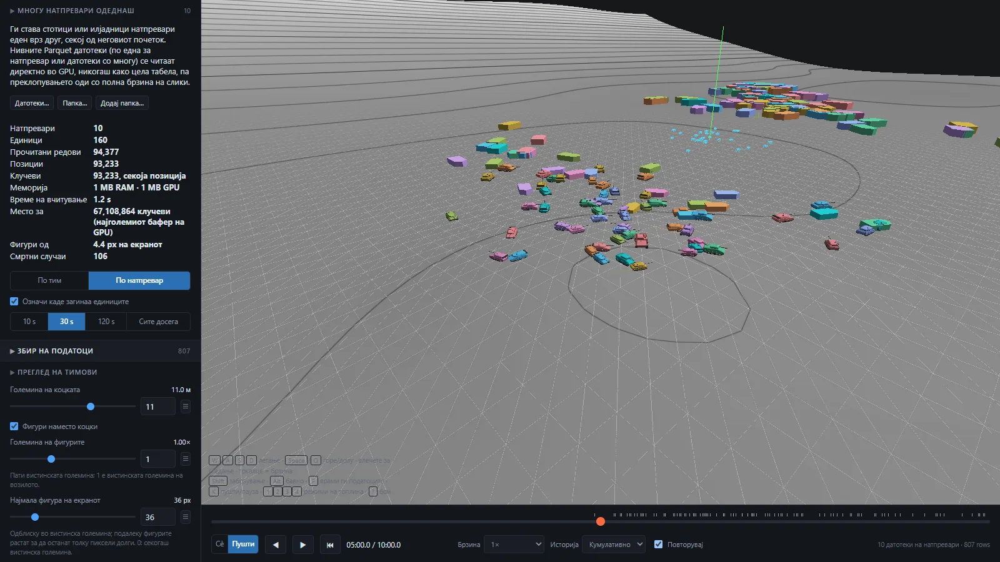

# Многу натпревари одеднаш

**Многу натпревари одеднаш** пушта многу натпревари еден врз друг, па гледате каде обично одат играчите од секој натпревар. Користете го за да споредите стотици или илјадници натпревари во една слика.

Секој натпревар почнува од свое почетно време, а неговите единици се движат како фигури. Датотеките одат директно во графичката картичка и не се гради целосна табела, па се пушта непречено таму каде обично вчитување би ја исцрпило меморијата.

## Како да се користи {#how-to-use-it}

1. Отворете **Многу натпревари одеднаш** во страничната лента Топлинска мапа.
2. Притиснете **Датотеки…** (изберете многу датотеки), **Папка…** (папка и нејзините подпапки) или **Додај папка…** (додајте во она што е вчитано).
3. Прегледувачот преминува на преклопот со фигури и започнува од почетокот. Притиснете **Пушти**.

Секоја датотека е еден натпревар (или држи неколку). Parquet датотеки и контејнери [`.3dheat`](container.md) работаат. Датотеката треба колона за позиција, време и единица; колоните за име, тип и страна се зачувуваат. Другите датотеки, и помошните датотеки на конвертори (лет, пораки, настани, разговор, цели), се прескокнуваат. За обична табела видете [Внесување податоци](getting-data-in.md).

## Поставки {#settings}

| Поставка | Што прави |
|---|---|
| **По тим** / **По натпревар** | Боење по страна, или една боја по натпревар. |
| **Означи каде загинаа единиците** | Ознака каде умрела секоја единица, 10 s, 30 s, 120 s, или сите досега. |

Панелот покажува колку натпревари, единици, редови и позиции се прочитани, колку меморија е користена и времето на вчитување. *Простор за* е колку уште позиции би можела да прими графичката картичка. *Фигури од* е големината на екранот под која единица се црта како мала стрелица наместо својата фигура.

Изгледот на фигурите ги користи истите контроли како [повторувањето на натпревар](match-replay.md#figures): **Големина на фигурите**, **Најмала фигура на екранот** и **Од далеку**.

## Совети {#tips}

- Кога сè не би се вклопило во меморијата, позициите се прочистуваат (се задржува само по една позиција на секои неколку метри) и панелот тоа го кажува.
- Режимите на топлина работат и на податоците на преклопот.
- За статистика над илјадници натпревари без нивно цртање, видете [Масовна анализа](mass-analysis.md).
