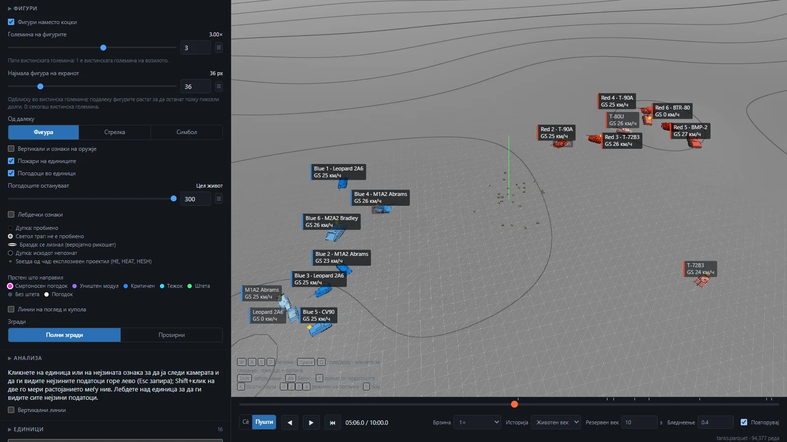
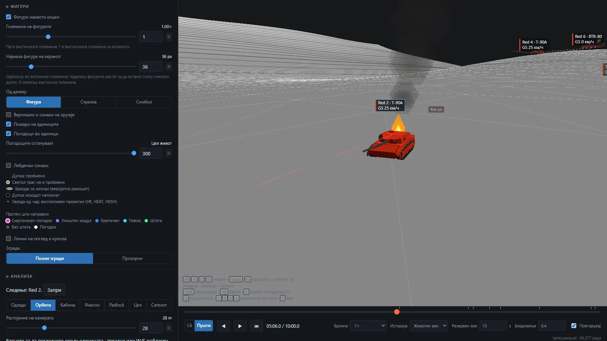
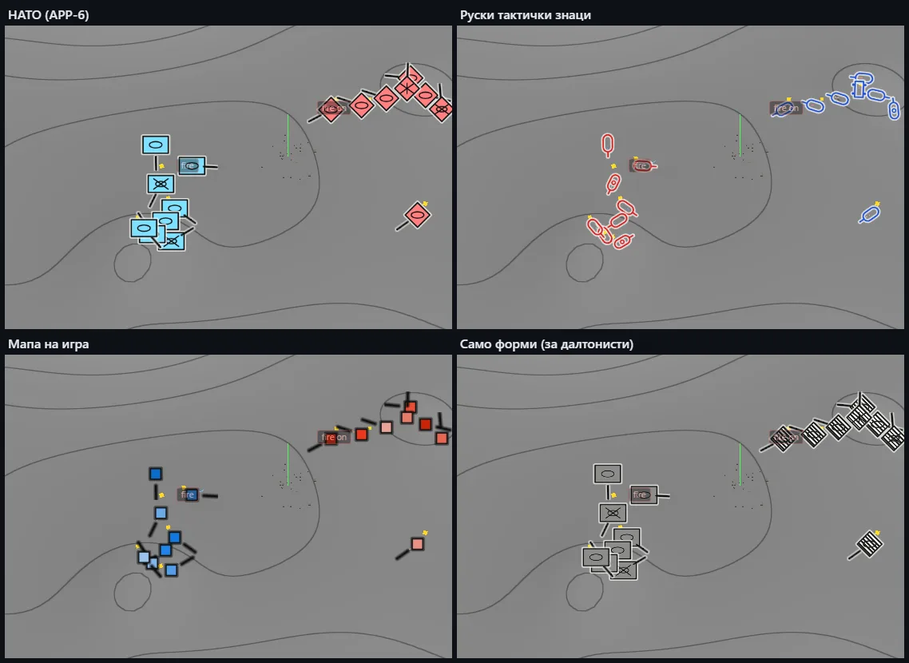

# Повторување на натпревар

Повторувањето е филм од натпреварот, со секој играч нацртан како она што го возел. Користете го за повторно да гледате борба, да следите една единица и да видите кој кого погодил.

Истрелите, погодоците, пожарите и остатоците се цртаат на единиците и целите на нивото. Камерите, ознаките и тактичкиот приказ ви помагаат да ја читате борбата. Ако го знаете Tacview, [Паритет со Tacview](tacview-parity.md) покажува каде е секоја негова алатка.

## Започнете повторување {#start-a-replay}

1. Вчитајте снимка со **Извор → Датотеки…** или со спуштање на панелот Извор (која и да е табела со колона **личност** и колона **време**, датотека од Tacview, конвертирано повторување, [`.3dheat`](container.md) натпревар). Видете [Внесување податоци](getting-data-in.md).
2. Отворете го табот **Натпревар** и изберете **Повторување со фигури**, или изберете **Преклопување фигури** во лентата со режими на табот Топлинска мапа.
3. Под **Натпревари во повторувањето** изберете еден натпревар, сите одеднаш, или неколку.
4. Притиснете **Пушти** на временската линија (или `K`). Влечете ја временската линија за да скокнете.

Фигурите ги заменуваат кутиите за секоја единица чие име или вид е познат (видете [Фигури](figures.md)). Податоците без колона за име или вид се цртаат како војници.

## Фигури {#figures}

| Поставка (дел **Фигури**) | Стандардно | Што прави |
|---|---|---|
| **Фигури наместо коцки** | вклучено | Исклучено црта обични кутии. |
| **Големина на фигурата** (пати вистинската големина) | 1 | 1 е вистинска големина; од 0,25 до 20 пати (логаритамска скала). Поголемо помага од далеку. |
| **Најмала фигура на екранот** | 36 px | Далечните фигури растат за да останат толку долги, од 0 до 200 px; 0 задржува вистинска големина. |
| **Од далеку**: Фигура, Стрелка, Симбол | Фигура | Во што се претвора далечна единица. |
| **Симболи** | NATO (APP-6) | NATO (APP-6), руски тактички знаци, икони од **Мапа на игра**, или **Само форми (за далтонисти)**. |
| **Големина на симбол**, **Моја страна**, **Непријателска / Неутрална**, **Ознаки за курс** | 28 px (12 до 64), автоматски, непријателска, вклучено | Како изгледаат симболите и која страна е пријателска. |
| **Вертикални линии** | вклучено | Линија од секоја единица право надолу до теренот, за висините да се читаат во 3D. |
| **Вертикали и ознаки на оружје** | исклучено | Линии до теренот и ознаки на ракети и бомби. |
| **Пожари на единиците** | вклучено | Пламен од моментот кога единицата ќе се запали до гаснењето. |
| **Погодоци на единиците** | вклучено | Ознаки каде удрил истрелот (подолу). **Погодоците остануваат**: од 1 до 300 секунди, или **Цел живот**. **Лебдечки ознаки**: ознаки нацртани над површината. |
| **Линии на поглед и купола** | исклучено | Испрекинато: каде го гледа играчот; полно: каде покажува топот. |
| **Зграды** | полно | Цврсти или проѕирни згради, кога нивото ги прикажува. |

### Симболи од далеку {#symbols-at-a-distance}

Кога една единица би била помала од **Најмала фигура на екранот**, може да стане симбол што останува читлив. Обликот ја кажува видот (на пример заоблена кутија со ознака на гасеници за оклопно возило); бојата ја кажува страната. Отворете го менито **Симболи** за да го промените стилот.

### Ознаки за погодоци, остатоци и пожари {#hit-marks-wrecks-and-fires}

- **Ознаките на погодоците** се на површината каде истрелот се судрил, во размер на фигурата. Нивниот изглед кажува што се случило: дупка (продрел), светла прска (не продрел), бразда (се одбил), чадна ѕвезда (експлозивен залог). Обоен прстен кажува што направил: погодок што убива, модул уништен, критичен, тежок, штета, без штета, погодок. Задржете го покажувачот над ознаката за името на рундата.
- Уништената единица се црта **изгорена** како остаток од смртта до повторното појавување или отстранувањето; нејзиниот симбол е прецртан.
- **Пожарите** горат на единицата од моментот кога ќе се запали до гаснењето.
- **Куполите** се свртуваат кон она каде податоците кажуваат дека покажува топот (или, без тоа, каде гледа играчот).

### Оружје, мамки и трасери {#weapons-decoys-and-tracers}

Со **Оружје, истрели и погодоци** вклучено (дел Преглед на тимови): ракетите, рактетите, бомбите и торпедата летаат како свои фигури со чадна трага; куршумите и граната се трасери; ударите и експлозиите блеснуваат. Трасер нацртан **испрекинато** е пресметан од погодок, бидејќи податоците немале истрел. Сигналните ракети и плевата се цртаат како мамки; се кријат од списокот на единици освен ако не е штиклирано *Мамки и гранати*.

## Камери {#cameras}

Кликнете на единица или на нејзината ознака за да ја **следите**; делот **Повторување** нуди **Одзади**, **Орбита**, **Кабина** (со приказ на главата, `H`), **Фиксно**, **Padlock**, **Цел** и **Сателит**. `V` ги минува, **Растојание на камерата** одредува колку далеку. Esc запира.

- **Приказ од две единици**: изберете **Цел** (или Ctrl/Alt-клик на единица) за да ја гледате од следената; **Замени** ги разменува.
- **Мерка**: Shift-клик на две единици за азимутот, растојанието и разликата во висината меѓу нив.
- **2D карта** (`M`): агол или цел приказ, со траги и имиња.
- **Обележувачи** (`B`): зачувајте го моментот и камерата; убиствата, смртите и ознаките на снимката исто така се наведени.
- **Настани**: секој настан по редослед во времето; кликот скока таму. `Page Up` / `Page Down` скокаат меѓу настаните; **Пауза на настан** запира на секој.

## Тактички приказ {#tactical-display}

Делот **Тактички приказ** црта, за ниедна единица, избраните, сите, или еден вид (авиони, копнени, бродови, оружја): вектори на брзина и патеката пред неа, линии на носот и подигнувањето, радарски конуси, заклучувања, врски со податоци, зони и линии на ангажман, линии на видот, каде играчите гледаат (конуси на видот), нишанот на топот и снимената камера.

### Стил на приказот {#display-style}

`T` (или прекинувачот **Прикажи како тактички приказ**) го префрла изгледот во стил на радарски екран: сјај, рабови, контурни линии, мрежа за мерење, линии на скенирање, прстени на растојание, лествици на висината, панели со убиства и настани, и **Режисер** што сам ја движи камерата до настаните.

## Цели {#objectives}

Кога натпреварот доаѓа со своите цели, делот **Цели** ги црта на нивото: зони за заземање (со сопственик и напредок на заземањето), појавувања, аеродроми, области и цели за бомбардирање, секој слој се вклучува и исклучува, со ознаки. Се гледаат низ теренот. Кога се вчитани повеќе режими на игра, **Режим** ги филтрира натпреварите по режим. Целите доаѓаат од датотеката на натпреварот на конверторот покрај снимката или внатре во [`.3dheat`](container.md) контејнерот.

## Ознаки и статистики {#labels-and-statistics}

- **Ознаки**: правила по вид (**Избрани**, **Авиони**, **Копнени**, **Бродови**, **Оружја**, **ВИ**): дали се прикажани, кои вредности, и **Приоритет** за тоа кој ќе добие место кога ознаките се преклопуваат. **Раздвојувај ги ознаките** ја поместува ознаката до својата единица кога би покрила друга, а ја остава надвор таму каде нема место. **Големина на ознаките** е од 60 до 250%. **Назад на име, возило, висина и брзина** ги враќа правилата.
  - Копнените единици почнуваат со име, возило и брзина.
  - Авионите почнуваат со име, возило, висина и брзина.
  - Бродовите почнуваат со име, возило, брзина и насока.
  - Задржете го покажувачот над единица за да ги видите сите вредности што ги има.
- **Статистики**: по тим и единица: убиства, смрти, истрели, погодоци, однос на погодоци, полетувања, слетувања, време во воздух, највисока брзина, висина и G, растојание. Извоз во CSV.
- **Графикони**: вредностите на единица низ времето, две единици споредени, или една вредност наспроти друга.

## Многу натпревари одеднаш {#many-matches-at-once}

За да ставите стотици или илјадници натпревари еден врз друг, видете [Многу натпревари одеднаш](many-matches.md). Детали за фигурите (чад, пожар, други временски ефекти): [Фигури во преклопот](figure-replay.md). Список на особини на Tacview: [Паритет со Tacview](tacview-parity.md), подстраница на оваа.
