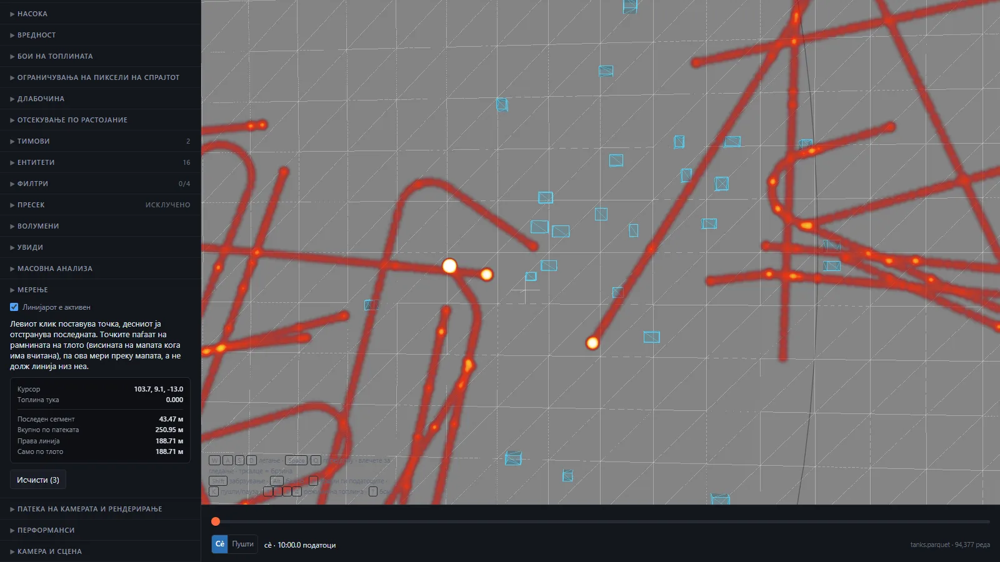

# Мерка

**Мерка** го претвора глувчето во линијар и ви кажува колку е зафатено местото под курсорот. Користете ја за да дознаете колку се оддалечени две места или колку сообраќај има едно место.

## Пробајте {#try-it}

1. Отворете **Мерка** во страничната лента и штиклирајте **Линијарот е активен**.
2. Кликнете лево на три места на мапата. Секој клик става точка.
3. Прочитајте **Вкупно по патеката** (должината на целата патека) и **Последен сегмент** (последниот дел).
4. Кликнете десно за да ја отстраните последната точка, или притиснете **Исчисти (3)** за да ги отстраните сите.

| Дејство | Ефект |
|---|---|
| Лев клик | Става точка таму каде курсорот ја допира рамнината на теренот. Клик што се поместил повеќе од 4 пиксели помеѓу притисокот и пуштањето е влечење на камерата, не точка. |
| Десен клик | Ја отстранува последната точка. |
| Движење | Положбата на курсорот и топлината под него се ажурираат во живо. |

Камерата продолжува да работи додека линијарот е вклучен: влечењето сè уште гледа наоколу, тастатурата сè уште лета. Додека линијарот е вклучен, тој ги прима сите кликови, па [избор со клик](camera.md#click-to-pick) чека додека не се исклучи.

**Рамнината на теренот** е [висината на сликата на мапата](map-images.md) кога е вчитана слика на мапа, инаку најниската Y вредност на податоците (0 без неа). Точките се сместуваат на неа, па линијарот мери преку мапата, не по линија низ неа. Со 3D ниво, рамнината е сè уште најниската Y на податоците, не површината на нивото - за точка на вистинската површина, исклучете го линијарот и кликнете ја ([избор со клик](camera.md#click-to-pick)), што ги чита координатите од триаголниците на самото ниво.

## Очитувања {#readouts}

| Ред | Значење |
|---|---|
| **Курсор** | Светски X, Y, Z на точката под курсорот, на рамнината. |
| **Топлина тука** | Колку топлина има на пикселот под курсорот. Поголема бројка значи повеќе сообраќај на тоа место. Тоа е вредноста што ја добива скалата на бои пред точката на заситување да ја подели, па можете да ја споредите со [Точката на заситување](colour-and-exposure.md#saturation-point). |
| **Последен сегмент** | Растојание од последната точка до курсорот (или помеѓу последните две точки). |
| **Вкупно по патеката** | Должина на полилинијата низ секоја точка и курсорот. |
| **Права линија** | 3D растојание од првата точка до курсорот (или последната точка). |
| **Само по тлото** | Истото, само на X и Z. |
| **Исчисти (N)** | Ги отстранува сите точки. |

Растојанијата се прикажуваат во сантиметри под 1 единица, во метри под 1 000, во километри над тоа - при претпоставка дека една светска единица е метар ([Оски, единици и време](axes-units-and-time.md#unit-scale)). Координатите се светски координати, и кога оската е [превртена за приказ](camera.md#invert-world-axis).

Точките и линијата меѓу нив се црта како преклопување во прегледот, со големина според растојанието на мрежата. Точките на линијарот не се зачувуваат во погледите; остануваат кога вчитувате други податоци.

## За програмери {#for-developers}

**Топлина тука** се чита од GPU најмногу на секои 120 ms, бидејќи читање на еден пиксел го запира цевководот. Го користи истиот пат како `engine.readHeatProbe()`: се дели со засилувањето со кое бил напишан кадарот, па на патеката акумулација half-float (`?heat=f16`) е во истите единици како на 32-битна цел ([Акумулација со half-float](half-float-accumulation.md)).
