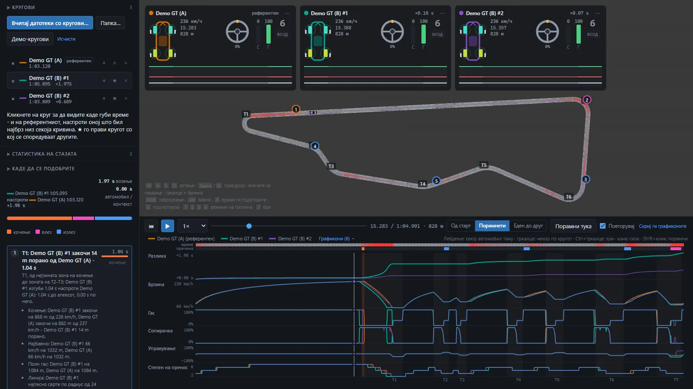

# Анализа на трки

Ја возевте истата патека два пати. Картичката **Анализа на трки** ги пушта двете возења заедно во 3D, покажува каде еден круг бил побавен и ви кажува зошто. Уште немате кругови? Притиснете **Демо-кругови**.

Картичката ги споредува два или повеќе круга од една патека. Платното, камерата и вчитаниот модел на патеката (**Позадина / ниво**) ги дели со топлинската мапа; сè друго е свое: своја страничната лента и своја лента под прегледот. Зборовите *круг*, *референца* и *врв на завојот* се во [речникот](glossary.md).

Оваа страница е мапа на картичката. Секој дел има своја страница:

| Страница | Што опфаќа |
|---|---|
| [Вчитување кругови](race-loading-laps.md) | секој формат на датотека, папки и патеки, имиња на автомобили, демо кругови, листата на кругови, референцата и фокусот |
| [Повторување и 3D сцена](race-replay-and-scene.md) | лентата за транспорт, трите режими на повторување, порамнување на автомобилите, камерата на гонење, линии, мапи, автомобили, ознаки, огледални светови |
| [Графикони и HUD](race-charts-and-hud.md) | графиконите по растојание, изборникот на графикони, задржување и зумирање, картичките на автомобилите, табелата на канали |
| [Настани за контрола на возилото](race-control-events.md) | блокирања, лизгање на тркалата, преуправливост, вртења, недоуправливост, удари, судири, ABS/TC, рачна кочница, воздух - како се открива секое, со секој праг |
| [Анализа завој по завој](race-corner-analysis.md) | порамнување по растојание, завоји и отсечоци, временската сметка на завојот, секоја причина и редоследот во кој се испробуваат, обликот на линијата и советот |
| [Профили на возила и споредба](race-car-profiles.md) | што може секој автомобил, мерено од неговите кругови; *Cars compared*; што автомобилот одлучува во секој завој |
| [Статистика на патеката](race-course-statistics.md) | многу кругови од една патека: грешки по завој и по вид, мапа на грешки, извоз на топлинска мапа, граници на перформансите |
| [Анализа на трки: методот](race-analytics.md) | истражувањето зад правилата, со извори |
| [Други тркачки игри](other-games.md) | што прегледувачот прави со кругови од секоја игра: лизгање и занесување пресметани каде игра не ги испраќа, огледални светови, дополнителни канали |

## Екранот {#the-screen}

**Страничната лента**, одозгора надолу (делови може да се свиткаат):

1. **Кругови** - вчитување, листа, прикажување/скривање, референца, фокус, гонење.
   Видете [Вчитување кругови](race-loading-laps.md).
2. **Статистика на стазата** - се појавува само од три вчитани круга.
   Видете [Статистика на патеката](race-course-statistics.md).
3. **Каде да се подобрите** - наодите за фокусираниот круг, завој по завој.
   Видете [Анализа завој по завој](race-corner-analysis.md).
4. **Кривина по кривина** (или *Corner by corner - class X* со неколку класи) - најбрзиот круг низ секој завој и неговата линија. Се прикажува со два или повеќе круга.
5. **Контрола на автомобилот** - блокирањата, лизгањата, потиснувањата и удари на фокусираниот круг.
   Видете [Настани за контрола на возилото](race-control-events.md).
6. **Споредба на автомобилите** (или **Автомобилот** со еден автомобил) - видете [Профили на возила и споредба](race-car-profiles.md).
7. **Приказ** - која мапа е насликана на патеката и што се црта.
   Видете [Повторување и 3D сцена](race-replay-and-scene.md).
8. Споделените панели **Ниво** и **Камера и сцена** (модел на патеката, инверзија на оските, камера) - документирани со топлинската мапа и [Камера](camera.md).

**Прегледот** ги прикажува патеката, возените линии, мапата, автомобилите, ознаките закачени на патеката, и до шест картички за автомобили горе лево (видете [Графикони и HUD](race-charts-and-hud.md)). Без вчитани кругови пишува „No laps loaded - Drop two or more lap files here, or load the demo laps from the sidebar.“

**Лентата под прегледот** ја содржи лентата за транспорт на повторувањето и, освен ако не е скриена, графиконите по растојание.

## Брз почеток {#quick-start}

1. Отворете ја картичката **Анализа на трки** (покрај **Топлинска мапа** на врвот од страничната лента).
2. Внесете кругови. Притиснете **Демо-кругови** за да видите што картичката прави со три измислени круга. За свои кругови, прво снимете ги ([формати на датотеки и снимачи](race-loading-laps.md#file-formats)), па притиснете **Вчитај датотеки со кругови…** или **Папка…**, или спуштете датотеки или папки на прегледот.
3. Најбрзиот целосен круг станува референца; најбавниот друг круг е фокусиран. Кликнете на кој било круг во листата за да го фокусирате; ★ го прави кругот референца.
4. Прочитајте **Каде да се подобрите**. Кликнете на наод: автомобилите се порамнуваат 40 m пред него, камерата го вклопува, повторувањето го минува, а мерењата се отвораат.
5. Задржете глувче над графиконите за да ги поместите сите автомобили до тој метар; Shift+клик за да ги порамнете таму.

## Тастатура {#keyboard}

Додека картичката Анализа на трки е отворена:

| Копче | Прави |
|---|---|
| **K** | пушта / паузира повторувањето |
| **Home** | назад на почетокот на повторувањето |
| бројчани копчиња | ништо (во топлинската мапа менуваат режими) |

Копчињата напишани во поле за текст или паѓачко мени се занемаруваат. Копчињата за камера работат како во топлинската мапа (**W A S D**, **Празно место** нагоре, **Q** надолу, **Shift** побрзо, **Alt** побавно, глувчето за гледање; сите во [Камера](camera.md)); **F** ги вклопува вчитаните кругови (како што го прави вчитувањето кругови).

## Многу кругови {#many-laps}

- Сите вчитани кругови се анализираат и броат; десетици траат една или две секунди.
- Над **8** круга (`SHOW_ALL_UP_TO`), додадените кругови се цртаат само кога се референцата, фокусираниот круг или најдобриот круг од класата на фокусираниот круг. *Show all* / *Only those looked at* ги менуваат.
- Над **10** видливи автомобили (`PLAIN_PAST`), круговите што не се гледаат (не фокусот, не гонениот автомобил ниту референцата) се цртаат со линии прочистени до точка на секои 6 m наместо 1,5 m, и обични автомобили.
- Графиконите цртаат најмногу **8** круга; HUD-от прикажува најмногу **6** картички.
- Статистиката на патеката се појавува од **3** круга.

Подробности: [Статистика на патеката](race-course-statistics.md#performance-with-many-laps).

## Стандардни поставки на прегледот {#default-view-settings}

| Поставка | Стандардно |
|---|---|
| Мапа | Time map |
| Driven lines, Cars, Tyres & suspension, Labels, Track from the laps | вклучено |
| Сите вредности на картичките | исклучено |
| Големина на автомобилот | 1× |
| Графикони | прикажани |
| Режим на повторување | From the line |
| Брзина на повторување | 1× |
| Повторувај | вклучено |

Ништо од ова не се зачувува; повторно вчитување почнува од стандардните. Што се памети во прелистувачот: јазикот, и имињата на автомобилите научени од датотеките со кругови (видете [Вчитување кругови](race-loading-laps.md#car-names)).

## За развивачи {#for-developers}

### Што се случува кога ќе се вчитаат кругови {#what-happens-when-laps-are-loaded}

Секогаш кога ќе се промени множеството кругови, референцата или јазикот, целата анализа се прави повторно (`analyse` во [`src/race/analysis.ts`](https://github.com/Holdi601/3DHeat/blob/main/src/race/analysis.ts)):

1. Изведените канали се додаваат на секој круг каде игра не ги испраќа: агол на занесување, лизгање на тркалата од брзините на тркалата, во воздух, слободно тло, брзина на вртење ([`derive.ts`](https://github.com/Holdi601/3DHeat/blob/main/src/race/derive.ts)).
2. Референцата се избира и секој круг се проектира на својата патека и се поново земаат примероци на секои 2 m ([`align.ts`](https://github.com/Holdi601/3DHeat/blob/main/src/race/align.ts)).
3. Се одредува дали светот на играта е огледален од круговите ([`handedness.ts`](https://github.com/Holdi601/3DHeat/blob/main/src/race/handedness.ts)).
4. Завоите се наоѓаат на референцата и се групираат во отсечоци од една кочна зона до следната ([`segments.ts`](https://github.com/Holdi601/3DHeat/blob/main/src/race/segments.ts)).
5. По автомобил: неговата обвивка (влечење, кочење, забрзување по брзина), неговиот профил, неговите криви на гумите ([`envelope.ts`](https://github.com/Holdi601/3DHeat/blob/main/src/race/envelope.ts), [`profile.ts`](https://github.com/Holdi601/3DHeat/blob/main/src/race/profile.ts), [`control.ts`](https://github.com/Holdi601/3DHeat/blob/main/src/race/control.ts)).
6. По круг и отсечок: што направил (точка на кочење, најбавна точка, полн гас, ...) и линијата што ја возел ([`line.ts`](https://github.com/Holdi601/3DHeat/blob/main/src/race/line.ts)).
7. По круг: неговите настани за контрола на возилото, секој споредено со кругот со кој се споредува таму.
8. По круг и отсечок: временската сметка спрема кругот со кој се споредува и наодот со зборови.
9. Картата на времето и картата на причините по круг.

Текстовите се произведуваат на тековниот јазик; промената на јазикот ја пушта анализата повторно (и ги преименува демо круговите). Грешка во анализата се прикажува под копчињата **Кругови** како порака за грешка, а круговите остануваат вчитани.

### Изворни датотеки {#source-files}

| Датотека | Улога |
|---|---|
| `src/race/adapters.ts`, `ibt.ts` | читање на датотеки со кругови |
| `src/race/lap.ts`, `carNames.ts`, `synthetic.ts` | типот на кругот, имиња, демо кругови |
| `src/race/derive.ts`, `handedness.ts` | изведени канали, огледални светови |
| `src/race/align.ts`, `segments.ts`, `line.ts` | оска на растојание, завоји, линии |
| `src/race/analysis.ts` | споредени завоји, причини, наоди |
| `src/race/envelope.ts`, `profile.ts` | што може еден автомобил |
| `src/race/control.ts`, `impacts.ts` | контрола на автомобилот, удари и судири |
| `src/race/stats.ts` | многу кругови |
| `src/race/replay.ts`, `scene.ts`, `glyph.ts`, `geometry.ts` | повторување и цртање |
| `src/race/schema.ts`, `graphs.ts` | табелата на канали, редовите на графиконите |
| `src/ui/race/*` | страничната лента, графиконите, HUD-от, ознаките |
| `src/state/raceStore.ts` | состојбата на картичката и часовникот на повторувањето |
