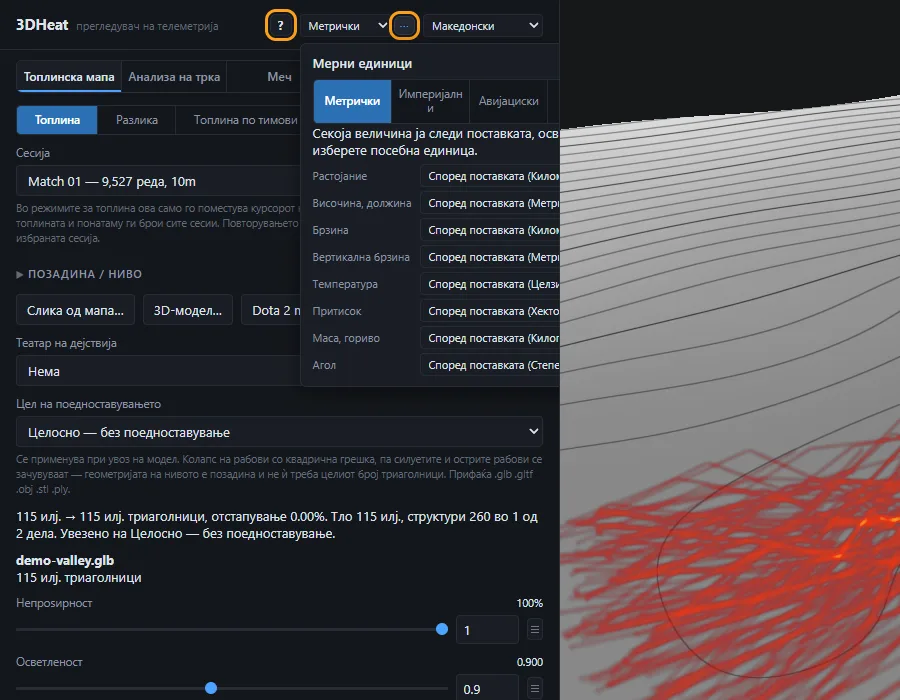
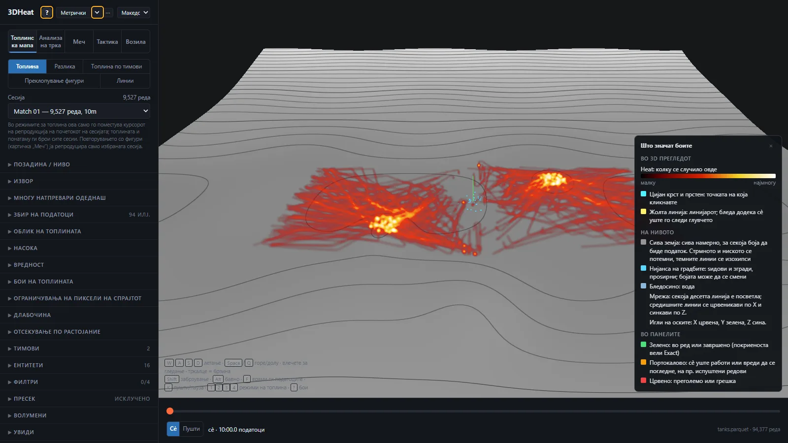
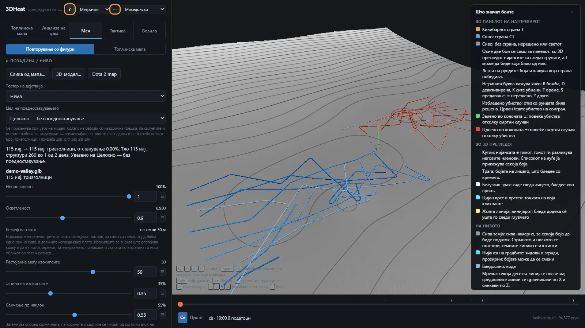

# Поставки, единици и тастери

Малите контроли на врвот од страничната лента ја менуваат начинот на кој прегледувачот комуницира со вас: јазикот, единиците (метри или стапки, km/h или јазли) и режим на помош што ги објаснува боите. Вашите избори се паметат во вашиот прелистувач.

## Заглавјето {#the-header}

На врвот од страничната лента:

| Контрола | Што прави |
|---|---|
| **?** | Режим на помош: што значи секоја боја (исто и `?` или `F1`) |
| Мени **Единици** | Метрички, Империјални, Авијација или Наутички |
| Копче **...** до **Единици** | Го отвора „Choose a unit for each quantity“: по едно паѓачко мени за секоја величина |
| Мени **Јазик** | Јазикот на прегледувачот: [40 јазици](languages.md), или јазикот на прелистувачот |

Бројките што ги внесувате во поле може да користат точка или запирка (`0.35` или `0,35`). Прегледувачот ги чита двете и ги прикажува бројките онака како што ги пишува јазикот на прегледувачот.

## Единици {#units}

1. Изберете пресет во менито **Единици**. Сите величини се префрлаат заедно.
2. За да промените само една величина, кликнете на копчето **...** до неа и изберете единица за таа величина. Менито потоа покажува `*` после пресетот.
3. Величина што не сте ја поставиле го следи пресетот. Изберете „As preset“ за да се вратите.

| Величина | Метрички (стандардно) | Империјални | Авијација | Наутички |
|---|---|---|---|---|
| Растојание | km | mi | NM | NM |
| Висина, должина | m | ft | ft | m |
| Брзина | km/h | mph | kt | kt |
| Вертикална брзина | m/s | ft/min | ft/min | m/s |
| Температура | °C | °F | °C | °C |
| Притисок | hPa | inHg | hPa | hPa |
| Маса, гориво | kg, l | lb, gal | lb, gal | t, m³ |
| Агол | степени | степени | степени | степени |

Други единици што можете да ги изберете за една величина: растојание km, mi, NM; брзина km/h, m/s, kt, mph; вертикална брзина m/s, ft/min, m/min; температура °C, °F, K; притисок hPa, inHg, mmHg, psi; маса kg, lb, t; агол степени или NATO mils (6400 на круг). Единиците се исти насекаде во прегледувачот: етикетите, картичките, графиконите, статистиката.

## Режим на помош {#help-mode}

Притиснете `?` или `F1`, или кликнете на копчето **?**. Се прикажува *What the colours mean*: легенди за 3D прегледот, скалите на топлината, боите на тимовите, боите на нивото, статусните бои на панелите, панелот на натпреварот и прегледот на трката. Останува вклучен додека не го исклучите. Во картичката Match објаснува и боите на панелот на натпреварот.

## Што го памети прелистувачот {#what-the-browser-remembers}

Овие поставки се чуваат во вашиот прелистувач меѓу посетите (ништо не се праќа никаде):

- јазикот, единиците и режимот на помош;
- поставките за фигурите, симболите, ознаките, камерата и тактичкиот приказ на повторувањето;
- брзината на репродукција и огледалото;
- обележувачи по снимка, волумени по збир на податоци, слоеви на цели;
- поставките за надворешна ВИ (клучот само ако го штиклирате *Remember*).

Поставките за топлина, филтрите и режимот почнуваат од почеток при секое вчитување. Целата, генерирана листа: [Зачувани поставки](ref-settings-storage.md).

## Тастери што прегледувачот ги задржува од прелистувачот {#keys-the-viewer-keeps-from-the-browser}

Сесијата со големи податоци трае да се вчита, па прегледувачот го спречува прелистувачот случајно да ја отфрли:

- `Ctrl`/`Cmd` + букви што би печателе, зачувале, отвориле, вчитале повторно, затвориле или отвориле нови прозорци не прават ништо надвор од полињата за текст; `F1`, `F3`, `F5`, `F6` и `F7` не прават ништо.
- Затворањето или повторното вчитување на картичката со податоци или ниво вчитано прашува прво.
- Во цел екран прегледувачот ги заклучува тастерите што ги користи (W, T, N, S, R, P, Q, Esc), за прелистувачот да не ги земе.

Точната листа: [Тастатурни кратенки во прелистувачот](ref-browser-keys.md). Сите тастери на прегледувачот: [Референца за тастатура и глушец](keyboard-reference.md).
