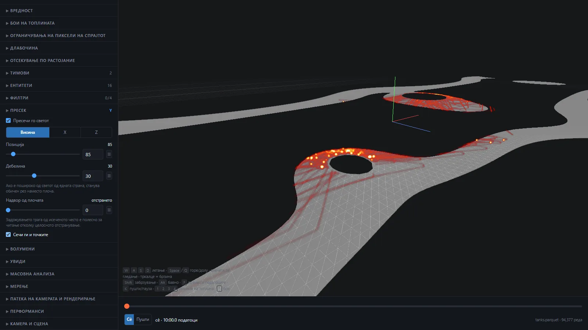

# Пресек

**Пресек** го сече светот како парче торта, за да можете да гледате во зградите. Користете го кога ѕидовите ја кријат интересната топлина, на пример за да видите еден кат од зграда.

## Пробајте {#try-it}

1. Вчитајте ниво и малку податоци, и отворете **Пресек**.
2. Штиклирајте **Пресечи го светот**. Оската е **Висина**.
3. Влечете ја **Позиција** горе и долу: плочата се движи низ нивото.
4. Направете ја **Дебелината** тенка за план на кат, или широка за „сè под ова“.
5. Држете ја **Надвор од плочата** на 0 за да го отстраните остатокот, или зголемете ја за да задржите слаб трага.



Плочата сече **геометрија на нивото и точки со податоци заедно** - сечењето само на нивото би оставило топлината да лебди таму каде некогаш била нејзината зграда. Таа е спротивност на [длабинската оклузија](depth-and-culling.md): кога нивото правилно го скрива она што е зад него, и внатрешноста на зградата е скриена. Панелот се прикажува кога има што да се пресече (збир на податоци или 3D ниво); неговото заглавие ја покажува оската додека е вклучено, а *исклучено* инаку.

```
side view         Position = where the slab is
 ----------       Thickness = how tall the slab is
 | floor 3 |
 |=========|  <--- slab (kept)
 | floor 2 |  <--- outside: removed (or faint)
 | floor 1 |
 ----------
```

## Контроли {#controls}

| Контрола | Стандардно | Значење |
|---|---|---|
| **Пресечи го светот** | исклучено | Ја вклучува плочата. Додека позицијата е уште на почетната 0 и дебелината на почетната 500, вклучувањето ги поместува на средината на оската и на 15% од нејзиниот опсег. |
| Оска | **Висина** | *Висина* (Y), *X* или *Z*. Промената на оската ја поместува плочата на средината на новата оска. |
| **Позиција** | средината | Центар на плочата, во светски единици, низ опсегот на оската (500 чекори). |
| **Дебелина** | 15% од опсегот | Од 1/500 од опсегот до двојниот опсег, во логаритамски чекори. Чита *надвор од светот* штом е широка колку опсегот: едната страна тогаш поминува надвор од светот и е обично сечење, а не плоча. |
| **Надвор од плочата** | 0, *отстрането* | Колку од она што лежи надвор останува видливо, 0-100%. Слаб трага од отсеченото често е полесно за читање отколку целосно отстранување. |
| **Сечи ги и точките** | вклучено | Исклучено ја остава топлината цела, па се гледа низ сечењето - корисно за гледање што е над и под плочата. |

Опсегот на оската е оној на 3D нивото кога е вчитано, инаку оној на податоците.

Пресекот е независен од [отсекувањето по растојание](depth-and-culling.md#distance-culling), кое сече по правецот на гледање наместо по оска на светот; двете се комбинираат. Секоја промена на поставките на пресекот ја рестартира акумулацијата на топлината.

## За програмери {#for-developers}

Плочата се проверува за позицијата на секој ред во светот во vertex shader-от: ред надвор од неа го има придонесот помножен со вредноста *Надвор*, па при 0 се отфрла пред да се нацрта кој било фрагмент. Shader-ите на нивото ја применуваат истата проверка на секој фрагмент на теренот, конструкциите и водата.
