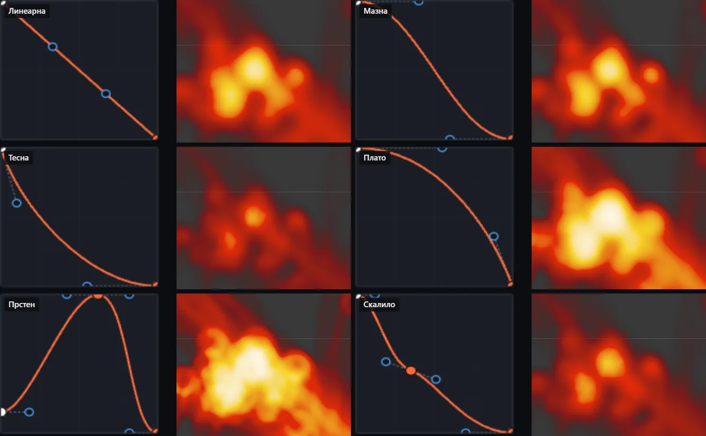

# Облик на спрајт

Секој ред се црта како тркалезен спрајт што секогаш е свртен кон камерата. Неговата големина и профилот од центарот до работ - **преодот** - одлучуваат дали жешката точка се чита како остра точка, мек облак, диск или прстен. Овие контроли се во делите **Облик на топлината** и **Ограничувања на пиксели на спрајтот** на страничната лента, и се применуваат на [Топлина](heat.md), [Разлика](difference.md), [Топлина по тимови](team-heat.md) и, како половина на ширината на линијата, на [Топлина по линија](line-heat.md).

Промената на која и да е од нив ја започнува акумулацијата одново (полето мора да се исцрта со новиот облик).

Замислете секоја точка како мека плочка светлина. Мала плочка ги покажува единечните места; голема плочка ги споива соседите во облак. Обликот одлучува колку е мек работ.



## Радиус на спрајтот {#sprite-radius}

Радиусот на спрајтот во **единици на светот** (означени како метри). Стандардно 6, а при секое вчитување - хоризонталниот опсег на податоците / 120, доволно голем за соседните примероци по патека да се спојат во појас, а не да изгледаат како влас. Логаритамски лизгач 0,05-2000, рачката за влечење оди до 50 000.


Работите подалеку изгледаат помали, па спрајтот се смалува на екранот со растојанието. Под паралелната проекција е ист секаде, што е дел од причината зошто паралелниот приказ е вистинскиот за споредба на жешки точки ([Камера](camera.md#projection)).

## Ограничувања на пиксели {#pixel-clamps}

**Ограничувања на пиксели на спрајтот** (стандардно затворено) го ограничуваат радиусот на екранот по претворањето погоре.

| Контрола | Стандардно | Опсег (лизгање) | Зошто |
|---|---|---|---|
| **Мин. радиус во пиксели** | 1 px | 0-16 (512) | Податоците далеку да не исчезнат под еден пиксел. |
| **Макс. радиус во пиксели** | 96 px | 2-1024, логаритамски (8192) | Заштитата од преклопување. Спрајт што покрива N пиксели чини N операции на мешање, па радиусот без ограничување блиску до камерата е она што брз кадар го прави бавен. Над висината на видниот прозорец веќе ништо не ограничува. |

**Иста густина при секое зумирање** (во делот Облик на топлината, стандардно вклучено) работи со ограничувањата. Спрајт што ограничувањето го прави поголем (далеку) или помал (блиску) ја задржува топлината што би ја додал неговата вистинска големина, па боја значи ист број редови по површина на земјата при секое зумирање. Кога е исклучено, ограничен спрајт ја додава целата своја тежина при ограничената големина, а сликата се менува додека летате подблиску.

## Интензитет во центарот и на работ {#centre-and-edge-intensity}

Топлината што ја додава спрајтот во својот точен центар (**Интензитет во центарот**, стандардно 1, 0-10, лизгање 1000) и на својот работ (**Интензитет на работ**, стандардно 0, -2-10, лизгање 1000). Вредноста на преодот *t* (1 во центарот, 0 на работ, обликувана со опаѓањето или со кривата подолу) меша помеѓу нив (формулата е под [За програмерите](#for-developers)).

**Негативниот интензитет на работ** прави работ да одзема, што исцрта ладен ореол околу секоја жешка точка и ги изостри групите една од друга. Видливоста вклучува [затемнување](depth-and-culling.md) и [пресекот](slice.md); исчезнувањето е [Животниот век](timeline.md#history); знакот е ±1 во [Разлика](difference.md).

## Облик на преодот: Опаѓање или Крива {#ramp-shape-falloff-or-curve}

**Облик на преодот** пребарува меѓу два начина на обликување на *t* низ спрајтот. Со *d* растојанието од центарот (0) до работ (1):

### Опаѓање {#falloff}

Се покажува кога е избрано *Опаѓање* (стандардно).

- **Опаѓање** (стандардно 1,6, 0,1-8, лизгање 64): `t = (1 - d) ^ falloff`. 1 е права линеарна скала; повисоко ја влече топлината кон центарот и ја стеснува жешката точка; под 1 ја израмнува во диск.
- **Мазен преод** (стандардно вклучено): применува S-крива smoothstep на *t*, така што спрајтот се раствора на работ наместо да завршува со видлив раб.

### Уредник на крива {#the-curve-editor}

Се покажува кога е избрано *Крива*. Буквален пресек на спрајт: растојание од центарот низ (*центар* од лево, *работ* од десно), топлина нагоре. Кривата е парче-по-парче кубична Безиеова крива низ контролни точки, секоја со две рачки.

| Дејство | Ефект |
|---|---|
| Двоен клик на графикот | Додава точка на тоа растојание (задржана меѓу 0,02 и 0,98), на кривата и со нејзиниот наклон таму, па додавањето ништо не менува додека не ја влечете. |
| Влечење на точка | Ја поместува. Висините се задржуваат меѓу 0 и 1. |
| Влечење на мал круг | Ја свиткува отсечката до него (ја поместува таа рачка). |
| Alt-клик или десен клик на точка | Ја отстранува. Двете крајни точки не може да се отстранат. |
| Копче за претставка | Ја заменува кривата со претставката. |

Крајните точки се фиксни во центарот и на работ; нивната висина сè уште е ваша.

**Претставки** ([`curve.ts`](https://github.com/Holdi601/3DHeat/blob/main/src/state/curve.ts)):

| Претставка | Облик | Употреба |
|---|---|---|
| **Linear** | Права од 1 до 0 | Исто како *Опаѓање* 1 со исклучено *Мазен преод*. |
| **Smooth** | S-крива | Стандардната крива; она што *Мазен преод* го дава при опаѓање 1. |
| **Tight** | Стрмно јадро, долга слаба опашка | Ретки податоци. |
| **Plateau** | Рамна, па брзо опаѓање | Се чита како диск, а не како плочка. |
| **Ring** | 0,15 во центарот, 1 на 62% од радиусот, 0 на работ | Празен спрајт: покажува каде поминуваат патеките, а не каде застануваат. |
| **Shelf** | Двостепено опаѓање, 0,45 на 35% | Го одделува густото јадро од околината. |

## Израмни на рамнината на тлото {#flatten-onto-ground-plane}

**Израмни на рамнината на тлото** (стандардно исклучено) ја занемарува висината на секој ред и ја црта сета топлина на една висина - најниската Y на податочното множество - класичната топлинска мапа од 2D карта. Кога е вклучено, затемнувањето по длабочина и **Скриј зад теренот** се исклучуваат (секоја точка би седела точно на површината со која се проверува), а делот Длабочина тоа го кажува.

## За програмерите {#for-developers}

### Формули {#formulas}

Радиус на екранот во пиксели: `radius × P[1][1] / w × висина на видниот прозорец / 2`, каде `P` е матрицата на проекцијата, а `w` е длабочината на видот на точката.

Топлината што ја додава спрајтот:

```
heat added = mix(edge, centre, t) × sample weight × sign × fade × visibility
```

### Кривата {#the-curve}

Рачките се стегаат хоризонтално на својот сопствен отсечок, па кривата секогаш е функција на растојанието: влечењето на рачка далеку по следната точка ја израмнува до неа, наместо да ја пресклопи назад, што би ја направило резултатот зависен од тоа кој корен го најде решавачот.

### Како се црта кривата {#how-the-curve-is-drawn}

Кривата се печати во табела од 256 записи секогаш кога ќе се промени, се вчитува како текстура од 16-битни плутечки броеви, и се зема по фрагмент со линеарно филтрирање и половина текселско внатрешно поместување, така што двата краја остануваат точни. Решавањето на Безиеова крива по x бара итерација, а тоа нема место во најжешкото сенчило на програмата; земањето од табелата е и поевтино од `pow()` што го користи опаѓањето. 16-битни, а не 8-битни, затоа што 8 бита се гледаат како зрнеста лента кога илјадници спрајтови ќе се соберат; 16-битен половина-плутечки е филтрабилен во основниот WebGL2, каде 32-битниот бара проширување.
