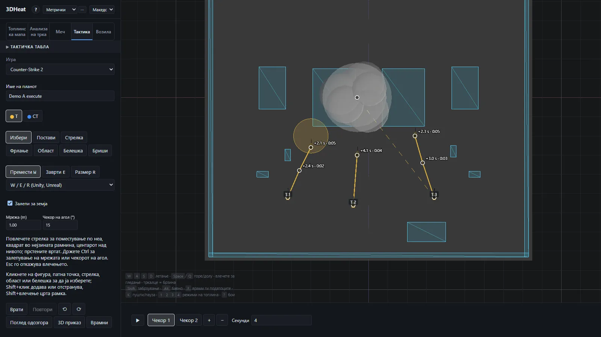

# Табла за тактики

Картичката **Тактика** е табла за цртање за план на тим: ставате мали фигури на мапа, цртате стрелки каде одат и притискате пуштање за да го гледате тоа да се случи. Користете ја за да планирате рунда или напад пред да играте. Ја споделува платното, камерата и [нивото](levels.md) со другите картички и ништо друго; планот не е податок и не црта топлина.

## Вашиот прв план {#your-first-plan}

1. Отворете ја картичката **Тактика**. Изберете **Игра** (на пример Counter-Strike 2) и, за Valorant, притиснете **Вчитај ги мапите на Valorant** и изберете **Мапа**. Или прво вчитајте [ниво](levels.md).
2. Изберете **Страна** (тоа ја поставува бојата) и притиснете **Поглед одозгора**.
3. Изберете **Постави**, изберете фигура во **Фигури** (користете **Пребарај фигури** за да најдете една) и кликнете на мапата. Поставете две или три.
4. Изберете **Стрелка**, кликнете на фигура, кликнете по патот по кој треба да оди, и притиснете **Enter** за да ја завршите стрелката.
5. Притиснете **+** под прегледот за да додадете чекор 2. Секоја фигура почнува таму каде што завршила нејзината стрелка. Цртајте повеќе стрелки таму.
6. Притиснете **▶** (или `K`) за да го пуштите планот од прикажаниот чекор до крајот.
7. Именувајте го планот во **Име на планот** и притиснете **Зачувај**.

## Почнување план {#starting-a-plan}

| Контрола | Што прави |
|---|---|
| **Игра** | Ги бира страните и фигурите што ги нуди палетата: Counter-Strike 2 (T, CT; играчи и помошни средства), Valorant (Attack, Defense; играчи и генерички способности), Battlefield, Squad, Arma (пешадија, копнени возила, авиони, чамци), DCS / War Thunder / IL-2 (млазници, авиони со перка, хеликоптери, противвоздушна одбрана, копно, бродови, оружја) и Друго. План што веќе има фигури ги задржува своите страни кога играта се менува. |
| **Име на планот** | Името под кое се зачувува планот. |
| **Мапа**, **Вчитај ги мапите на Valorant** | Кога е избран Valorant: **Вчитај ги мапите на Valorant** ја добива листата на мапи од [valorant-api.com](https://valorant-api.com); **Мапа** потоа ја става минимапата на избраната мапа како ниво, вклопена одозгора. Сликата се презема кога ќе се избере и никогаш не се испорачува. Белешката на Riot се прикажува додека е на екран (видете подолу). |
| **Страна** | Страната на која и припаѓа следната фигура, стрелка или област; ја зема бојата на страната. |

Без ниво, таблата е рамна површина на тлото. Вчитајте ниво под **Ниво** за да планирате на вистинска мапа: мапа на CS2 извезена со алатката за CS2, ниво од библиотеката, или слика на мапа.

## Алатки {#tools}

| Алатка | Клик | Белешки |
|---|---|---|
| **Избери** | Фигура, точка на патот, стрелка, област или белешка ја избира. | Shift+клик додава или отстранува; Shift+влечење црта кутија околу она што треба да се додаде. Изборот добива трансформирачки гизмо (видете подолу); `Delete` или `Backspace` го брише. `M` ја поместува избраната фигура на следниот клик. |
| **Постави** | Ја става избраната фигура. | Фигурата се избира во палетата **Фигури** (со **Пребарај фигури**). Кога ништо не е избрано, `R` ја врти следната фигура за 15° пред да се стави (`Shift+R` во другата насока). |
| **Стрелка** | Секој клик додава точка; Enter, двоен клик или десен клик ја завршува, Esc ја отфрла. | **Движење**, **Напад** (поширока глава) или **Набљудување** (тенка линија на висина на очи). Стрелка започната на фигура е патот на таа фигура во овој чекор: пуштена, фигурата по него оди, а следниот чекор почнува таму каде завршила. |
| **Фрлање** | Фрлачот, па каде слетува. | Испрекинат лак од едното до другото, а избраното помошно средство (чад, блесок, молотов, ...) се појавува таму каде слетува и останува од овој чекор натаму. |
| **Област** | Средината, па работ. | Диск во бојата на страната. |
| **Белешка** | Каде оди белешката; бара нејзиниот текст. | Се прикажува како игличка, а нејзиниот текст над неа. |
| **Бриши** | Фигура, стрелка, област или белешка. | Ја отстранува од овој чекор натаму; во нејзиниот прв чекор, ја отстранува. |

**Врати** и **Повтори** (`Ctrl+Z`; `Ctrl+Y` или `Ctrl+Shift+Z`) минуваат низ секоја промена. Линија под планот покажува колку фигури, стрелки и чекори има. **Поглед одозгора** гледа право надолу (ортографски), **3D приказ** се враќа на перспектива, **Врамни** го вклопува планот, или нивото кога планот е празен.

**Големина на фигурите** ги скалира сите фигури на таблата; 1× е вистинска големина, која одозгора е неколку пиксели за една личност.

## Поместување, вртење и скалирање {#moving-turning-and-scaling}

Сè на таблата може да се помести како во 3D уредник: фигури, помошни средства, ознаки, поединечни точки на патот и цели стрелки, области и белешки. Она што е избрано добива гизмо на својата средина:

| Режим | Копчиња | Рачки |
|---|---|---|
| **Премести** | W (или G) | Стрелка по оска (X црвена, Y зелена и нагоре, Z сина) се поместува по неа; квадрат се поместува преку својата рамнина; средината се поместува над нивото под покажувачот. |
| **Заврти** | E (или R) | Прстен по оска се врти околу неа. Прстените на една фигура се нејзиниот сопствен yaw, pitch и roll; група се врти околу оските на светот, околу својата средина. |
| **Размер** | R (или S) | Ја шири или собира изборот од својата средина по оска или на сите страни; радиусот на областа расте со него. |

**Копчиња** преминува помеѓу W / E / R (Unity, Unreal) и G / R / S (Blender); копчињата го избираат режимот само кога нешто е избрано, а инаку ја летаат камерата. Значи `R` значи **Размер** со копчињата W / E / R и **Заврти** со G / R / S кога нешто е избрано, а ја врти следната фигура за ставање кога ништо не е. Сите копчиња на таблата се наведени во [референцата за тастатура](keyboard-reference.md#tactics-board). Држете **Ctrl** при влечење за да го поместувањето го прицврстите на **Решетка** (метри) или вртењето на **Angle step**. **Залепи за земја** (вклучено по стандард) ги става поместените луѓе, возила, ознаки, точки на патот и области на површината на нивото; авионите и хеликоптерите ја задржуваат висината, а влечењето по стрелката Y никогаш не се прицврстува. Влечењето на рачка никогаш не ја поместува камерата. **Esc** го откажува влечењето, а секоја промена е еден чекор на Undo.

Точките на патот се прикажуваат како точки на стрелките од прикажаниот чекор: кликнете на една за да ја изберете, влечете ја за да ја поместите, Delete за да ја извадите. Делот **Избрано** го покажува местото на изборот во метри, yaw, pitch и roll на фигура во степени и радиусот на областа, секое со внесување.

## Тајминг {#timing}

Патеката на фигурата е временски одмерена: секој отсечок трае колку неговата должина над нивото - земена на површината на секои неколку метри, па брдо или скали меѓу две точки се броат - со брзината на својот режим на движење за таа фигура во таа игра, плус секое **wait** на точката на патот. Пешадијата пузи, чучне, оди (тивко), трча или спринтира; возилата и чамците се движат бавно, предвидливо, нормално или брзо; авионите и хеликоптерите летаат бавно, крстарачки, со борбена брзина или максимално. Режим што играта го нема (CS2 нема спринт) зема најблискиот што го има. Како падината ја забавува зависи од игра: во CS2 и Valorant се брои само хоризонталното растојание, како во играта; воените симулатори ја забавуваат пешадијата нагоре (функцијата за пешачење на Tobler) и возилата според наклонот.

Брзините доаѓаат од табели по игра со нивните извори (видете [Брзини на движење](tactics-speeds.md)): CS2 според оружјето во рака, од дефинициите на оружјата на играта; Valorant според оружје; Battlefield, Squad, Arma и воздушните игри според тип и класа на возило. **Се движи како** избира профил на фигура (оружје, тип возило); **Сопствена (m/s)** преминува кој било режим за таа фигура. Режимите се именувани како што ги прикажува таблата: *Лазење*, *Чучење*, *Одење (тивко)*, *Трчање*, *Спринт*; *Претпазливо*, *Нормално*, *Rush*; *Бавно*, *Крстарење*, *Борба*, *Максимум*.

Секоја точка на патот го прикажува времето од претходната и времето од почетокот на планот („+3.9 s · 0:12“). Патеката на избраната фигура ги наведува сите отсечоци со нивниот режим, должина и време, чекањето и пристигнувањето. **Пристигнувања** под **Тајминг** ја става секоја фигура со патека на една временска линија, првото пристигнување на врвот. Со **Play in real time** (по стандард вклучено) чекор трае додека не пристигне најбавната патека, а секоја фигура се движи со својата брзина; **Секунди** тогаш е најкратката должина на чекорот. **Единици на ниво по метар** кажува во што е нивото: 39.37 за мапи на CS2 (единици на играта), 1 за мапи во метри.

## Споредба со податоци од натпревари {#compare-with-match-data}

**Вчитај датотеки на мечеви…** ги чита табелите на натпреварите на CS2 за мапата (Parquet датотеките од алатката за CS2, колку сакате; само потребните колони, во заднина); **Користи вчитани податоци** ги зема податоците вчитани во прегледувачот. Потоа:

- **Најрано пристигнување на картата** ја боји мапата според времето од почетокот на рундата кога играч прв пат стигнал на секое место - копчето **Најбрзо** го покажува најбрзото од сите рунди, **Типично (медијана)** средната рунда - зелено рано до црвено доцна, за една или за двете страни. Покажува што е можно кога.
- Избраната патека се споредува со она што го постигнале играчите од нејзиниот почеток (или од почетокот на рундата) до нејзиниот крај, секој крај е диск со зададен радиус: „Fastest observed 14.2 s, p10 15.0 s, median 18.3 s over 41 runs; your plan 15.1 s“.
- Брзините со кои играчите навистина се движеле - трчање, одење, чучнување, од колоните за одење и чучнување на табелите - во m/s.

## Чекори {#steps}

Лентата под прегледот ги содржи чекорите. Планот почнува со еден; **+** додава уште еден, а секоја фигура почнува таму каде завршила нејзината патека во последниот чекор; **−** го брише прикажаниот. **Секунди** е колку трае прикажаниот чекор кога се пушта. **▶** (K) пушта од прикажаниот чекор до крајот: фигурите со патека ја одат, фигурите преместени на ново место во следниот чекор се лизгаат таму, останатите стојат. Додека е прикажан чекор, местото на секоја фигура во следниот се црта како бледа сенка, а стрелките на последниот чекор бледо под овој.

## Зачувување {#saving}

Делот **Датотека** ги содржи **Зачувај**, **Отвори** и **Исчисти**. **Зачувај** го запишува планот како `<name>.h3dplan.json` (обичен JSON: страни, чекори, фигури со место по чекор, стрелки, области, белешки); **Отвори** го чита назад. Датотека од друга верзија, или што не е план, се одбива со причината. **Исчисти** го празни планот; Врати го враќа.

## Фигури {#figures}

Секоја фигура ја прави самиот прегледувач: едноставни облици до објавената големина на видот, со особините што ја разликуваат од соседите - патните тркала и куполата на тенк, топовите, ракетите и радарите на возило за противвоздушна одбрана, планот на крилото, опашката и моторите на авион, роторите и кратките крилја на хеликоптер. Ништо не е земено од игра. Дизајн што го измислила некоја игра се прикажува како генеричка фигура на својата класа. Видете [Фигури](figures.md#which-figure-a-unit-gets) за тоа како податоците ја наоѓаат својата фигура.

## Белешката на Riot {#riots-notice}

Мапите на Valorant се прикажуваат според политиката „Legal Jibber Jabber“ на Riot Games, која им дозволува на бесплатните проекти на заедницата да ги користат и бара оваа белешка каде било што се појавуваат: *3DHeat was created under Riot Games' "Legal Jibber Jabber" policy using assets owned by Riot Games. Riot Games does not endorse or sponsor this project.* Способностите на таблата се генерички облици, не уметност на Riot.
