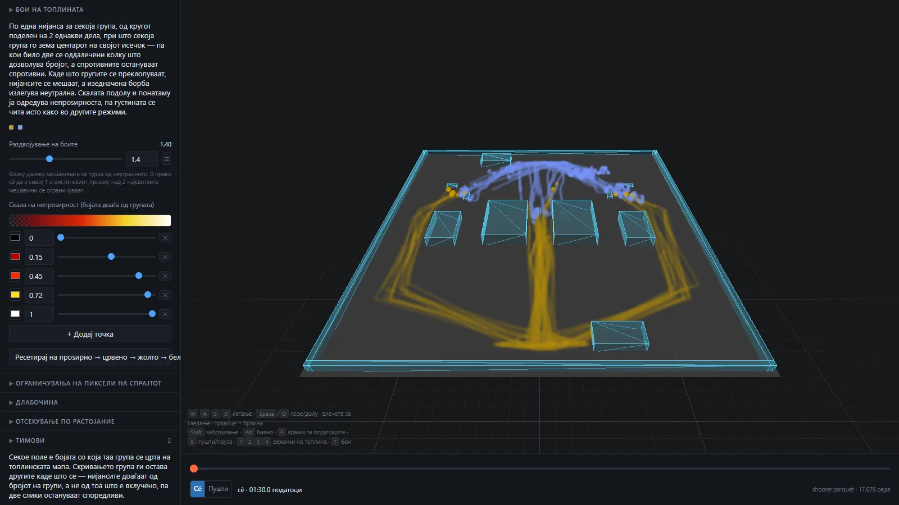

# Топлина по тимови

Топлина по тимови покажува каде била секоја екипа, секоја во своја боја. Каде екипите се преклопуваат, бојите се мешаат.

**Топлина по тимови** (копче 3) е полето на густина од [Топлина](heat.md), со секоја [група](glossary.md) дадена своја нијанса. Каде групите се преклопуваат, нивните нијанси се мешаат; рамноправна борба излегува неутрална. Непроѕирноста и понатаму ја носи густината точно како во другите режими, па сликата одговара на *колку* и *чија* истовремено. Потребна е колона за група.

Не е [преклопот со фигури](box-replay.md): тој црта по една фигура за секое лице; ова е поле на топлина обоено од истата колона.

## Како да се користи {#how-to-use-it}

1. Притиснете `3` (или изберете **Топлина по тимови** во лентата со режими).
2. Отворете **Бои на топлината**. Примероците ја покажуваат бојата на секоја група; задржете глушец над примерокот за името на тимот.
3. Ако сè изгледа сиво, зголемете го **Раздвојување на боите**.
4. Исклучете група во [Листата на тимови](teams-list.md) за да ја извадите; другите бои остануваат на своето место.

## Контроли {#controls}

Во делот **Бои на топлината**:

| Контрола | Стандардно | Значење |
|---|---|---|
| Примероци | | Бојата на секоја група, за првите 12 групи, па *+N уште*. Задржете глушец за името на групата и бојата. |
| **Раздвојување на боите** | 1.4 | Колку далеку се турка мешавината од неутралното, 0-4. 0 прави сè сиво; 1 е вистинскиот просек; над околу 2 најсветлите мешавини излегуваат од прикажливиот опсег и се стегаат по канал, што ја менува нивната нијанса. |
| **Скала на непроѕирност (бојата доаѓа од групата)** | стандардната скала на топлина | Овде се користи само **алфата** на скалата: проѕирно каде нема ништо, непроѕирно на врвот. Нејзините бои се занемарени. |

Група чија ознака значи „без група“ (`0`, празна, `none`, `unknown`, `null` или `-1`) се црта сива.

Сите други контроли за топлина - облик, заситување, одѕив, минимална топлина, длабочина, отстранување - работат како во [Топлина](heat.md).

[Листата на тимови](teams-list.md) ја покажува бојата на топлината по тимови на секоја група како нејзин примерок во овој режим. Скривањето на група ја остава бојата на секоја друга група на своето место: нијансите доаѓаат од вкупниот број групи, а не од она што е вклучено, па две слики остануваат споредливи.

## За програмери {#for-developers}

### Палетата {#the-palette}

Од [`colors.ts`](https://github.com/Holdi601/3DHeat/blob/main/src/render/colors.ts):

- Бојите живеат на рамнината **Oklab** на фиксна светлина (0,7) и хрома (0,115), па секоја група е подеднакво светла, а црвена група не изгледа потопла од сина.
- Со *n* групи, кругот на нијанси е поделен на *n* еднакви делови, а група *i* го зема **центарот** на својот дел, `(i + 0,5) / n` од вртење. Две било кои групи се толку далеку колку што бројот дозволува, а спротивните остануваат спротивни без оглед на бројот.
- Се користат најмногу **16** различни нијанси. Со повеќе групи, идентификаторите се распоредуваат со повторено преполовување (идентификатори со обратни битови: 0, ½, ¼, ¾, ⅛, …), така што соседните идентификатори не делат нијанса; групите над 16 нужно делат.
- Група чија ознака значи „без група“ - `0`, празна, `none`, `unknown`, `null` или `-1`, без разлика на големите и малите букви - се црта **неутрално сива** наместо да земе парче од кругот. Само првата таква ознака во списокот на групи се третира вака.

Стандардното раздвојување е 1,4, а не 1, бидејќи при 1 мешавина од пет рамномерно распоредени нијанси *е* сива: точно и нечитливо. Малку над 1 ги држи изедначените случаи чесни, а ја прави поделбата 60/40 видлива.

### Како работи {#how-it-works}

Целта на топлината има четири канали во овој режим. Секој спрајт ја додава својата густина *v* на првиот канал, а *v* × Oklab координатите *a* и *b* на групата на вториот и третиот. При композитот мешавината на пикселот е просек пондериран со густината: *a* = G / R, *b* = B / R, скалиран со раздвојувањето на бојата и претворен во sRGB на светлината на палетата. Делењето со акумулираната густина ја држи нијансата независна од тоа колку податоци има, и затоа секоја контрола за густина продолжува да дејствува само на непроѕирноста.

Целта со четири канали чини четири пати повеќе меморија на GPU отколку целта со еден канал при иста резолуција.
