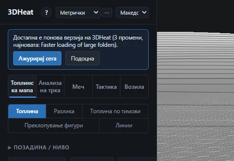

# Ажурирања

Прегледувачот ви кажува кога постои понова верзија, и се ажурира сам само кога ќе речете да. Ништо не се менува на вашиот компјутер без ваш одговор.

## Ажурирајте го прегледувачот {#update-the-viewer}

1. **Во страницата.** Кога постои понова верзија, под името на врвот од страничната лента се појавува кутија: „A newer version of 3DHeat is available“. Кликнете **Ажурирај сега**. Страницата се вчитува повторно сама кога ќе заврши. **Подоцна** ја крие кутијата додека не ја вчитате повторно страницата.
2. **Ако вели да го извршите restart.bat**, затворете го прозорецот на серверот (црниот прозорец што го отвори `start.bat`) и двоен клик на `restart.bat`.
3. **Кога ќе го стартувате прегледувачот.** И `start.bat` проверува. Ако постои понова верзија, прашува **Update now? [Y/N]**. Притиснете `Y` за да се ажурира. Притиснете `N`, или почекајте 60 секунди без одговор, за да ја стартувате верзијата што ја имате.



Примерок со ваши сопствени промени никогаш не се ажурира автоматски; кутијата само кажува дека чека ажурирање, и вели да ги commit-нете или stash-нете промените и да извршите `git pull`. Примерок што не е инсталиран со git (на пример zip датотека) не прикажува ништо.

Проверката работи вака, чекор по чекор:

```
страница ---(после 4 s, па на секои 6 h)---> dev сервер ---> git fetch
   зад?  не  -> ништо не се прикажува
         да  -> ваши сопствени промени или commit-и?  да -> само ви кажува
                                                     не -> [Update now] -> git pull
                                                        -> повторно вчитување, или „run restart.bat“
```

## Безбедносните правила {#the-safety-rules}

- **Само fast-forward** (`git pull --ff-only`): ажурирањето никогаш не спојува,
  не прави rebase и не пишува преку ништо.
- **Без локални промени**: примерок со непотврдени промени во следените датотеки
  (`git status --porcelain --untracked-files=no` не е празно) никогаш не се ажурира
  автоматски - туѓата работа не е на ажурирањето да ја пребрише. Само му се
  кажува дека чека ажурирање. Непроследените датотеки (податоци, извози) не
  се бројат како промени.
- **Без локални commit-и**: примерок со commit-и што upstream-от ги нема („diverged“)
  не се ажурира - fast-forward не може да го доведе до тоа, а спојувањето е за
  `git pull` рачно. Страницата и `start.bat` го кажуваат истото, со истите зборови,
  а `start.bat` ја стартува верзијата што ја има.
- **Само од самата страница**: барањето на dev серверот за ажурирање мора да носи
  посебно заглавие и, кога прелистувачот испраќа `Origin`, да дојде од истиот
  домаќин како серверот (подолу).
- Само git checkout со upstream гранка некогаш се ажурира; сè друго
  (копија без `.git`, без инсталиран git, статичка верзија) се остава на мира
  и не кажува ништо.

## Што прави start.bat {#what-startbat-does}

`start.bat` (двоен клик; прозорецот е серверот) ги прави овие по редослед:

1. Го наоѓа Node.js - на `PATH`, или во `%ProgramFiles%\nodejs`,
   `%ProgramFiles(x86)%\nodejs` или `%LOCALAPPDATA%\Programs\nodejs` - и
   нуди да го инсталира со `winget install -e --id OpenJS.NodeJS.LTS` кога
   недостасува (прашува, Y/N; после тоа прозорецот мора повторно да се отвори
   за Windows да го земе новиот `PATH`).
2. **Ажурирања**, кога git е инсталиран и папката има `.git`:
   - `git fetch --quiet` (нема мрежа или нема upstream: тивко се прескокнува);
   - брои `git rev-list --count HEAD..@{u}`; ништо зад: ништо не се вели;
   - локални промени: „A newer version of 3DHeat is available (N changes), but
     this copy has local changes, so it is not updated. Commit or stash them,
     then run git pull.“ - и ја стартува верзијата што ја има;
   - сопствени commit-и (`git rev-list --count @{u}..HEAD` не е 0): „A newer
     version of 3DHeat is available (N changes), but this copy has commits of
     its own that the newest version does not, so it is not updated. Update it
     with git pull.“ - и ја стартува верзијата што ја има;
   - инаку „A newer version of 3DHeat is available (N changes).“ и прашањето **Update now? [Y/N]**. `N`, или без одговор 60 секунди, испишува „Not updated; starting the version you have.“ и ја стартува верзијата што ја има. При `Y`: „Updating...“, вели дали се менуваат `package.json` или `package-lock.json`,
     извршува `git pull --ff-only` (ако и тоа не успее - на пример мрежата:
     „The update did not go through; starting the version you have.“), потоа `git submodule update --init`
     (закачените алатки, видете [Одржување на документацијата](maintaining.md#the-tools-under-exporters)), потоа `npm install` кога се менуваат датотеките на пакетот и постои `node_modules`, и „Updated.“
3. Одбива да стартува втор сервер: кога нешто веќе слуша на портата
   **5273**, тоа го кажува и упатува на `restart.bat` / `stop.bat`.
4. При првото стартување (нема `node_modules`), прашува пред да ги симне
   зависностите (околу 300 MB во `node_modules\`, ништо на ниво на систем).
5. Го стартува dev серверот на `127.0.0.1:5273` (`--strictPort`) и го отвора
   прелистувачот кога е подготвен.

`restart.bat` го запира серверот (по портата) и повторно го извршува `start.bat`, па го прашува истото. `stop.bat` само го запира.


## За развивачи {#for-developers}

### Додека работи: рутата за ажурирање {#while-it-runs-the-update-route}

Dev серверот (Vite додаток `heat3d-self-update` во `vite.config.ts`) ја служи рутата
`/__heat3d/update`. Постои само на dev серверот - не во статичка верзија
и не во `vite preview`.

**`GET /__heat3d/update`** одговара дали примерокот заостанува:

```json
{ "checkout": true, "upstream": "origin/main", "behind": 3, "ahead": 0, "dirty": false, "latest": "насловот на најновиот commit" }
```

- `checkout: false` кога папката не е git checkout;
- извршува `git fetch --quiet` **најмногу на секои 30 минути** (барањата помеѓу тоа
  одговараат според последното преземање);
- `behind` / `ahead` од `git rev-list --count HEAD..@{u}` / `@{u}..HEAD`,
  `dirty` од `git status --porcelain --untracked-files=no`, `latest` насловот на
  најновиот commit на upstream-от;
- без upstream гранка, `upstream: null` и `behind: 0`.

**`POST /__heat3d/update/apply`** го доведува примерокот до ажурно состојба:

1. Одбиено со `403 { ok: false, reason: "forbidden" }` освен ако барањето нема
   заглавие `X-Heat3d-Update: 1` и, кога носи `Origin`, неговиот домаќин не е
   `Host` на барањето. Меѓусајтовна форма не може да испрати посебно заглавие без
   CORS preflight, а овој сервер никогаш не го дава тоа.
2. Ништо за работа (не е checkout, нема upstream, не заостанува):
   `{ ok: true, updated: false }`.
3. Локални промени: `{ ok: false, reason: "dirty" }`; локални commit-и:
   `{ ok: false, reason: "diverged" }`.
4. Инаку: ги наведува датотеките што се менуваат (`git diff --name-only HEAD @{u}`),
   `git pull --ff-only` (тајм-аут 2 min), `git submodule update --init`
   (грешката се занемарува), `npm install` кога се менуваат `package.json` или
   `package-lock.json` (тајм-аут 15 min), и одговара
   `{ ok: true, updated: true, restart }` - `restart` кажува зошто
   работечкиот сервер не може да го земе ажурирањето: `"dependencies"` кога
   повторно се инсталирани, `"config"` кога се менува само датотека `vite.config`,
   `false` кога ништо не треба рестартирање.
5. Неуспешна git или npm команда одговара `{ ok: false, reason: "<грешката,
   до 300 знаци>" }`.

Одговорите се JSON со `Cache-Control: no-store`. Серверот слуша само на
`127.0.0.1`, па рутата не е достапна од мрежата.

### Известувањето во страницата {#the-notice-in-the-page}

`UpdateBanner`, под името на врвот од страничната лента:

- Ја прашува рутата **4 секунди** откако ќе се вчита страницата (не во првите
  секунди: страницата има збир на податоци за вчитување и GPU за стартување) и повторно
  **на секои 6 часа** додека страницата е отворена.
- Не прикажува **ништо** кога нема таква рута (статичка верзија), папката не е
  checkout, или нема ништо поново - известување при секое стартување е нешто
  на што луѓето научуваат да не обрнуваат внимание.
- Зад, без локални промени: „A newer version of 3DHeat is available (N
  changes, the newest: <насловот>).“ со **Ажурирај сега** и **Подоцна**
  (*Later* ја крие додека страницата не се вчита повторно).
- Зад, со локални промени: истата реченица и „This copy has local
  changes, so it is not updated automatically; commit or stash them, then
  run git pull.“ - без копче.
- **Ажурирај сега** праќа до `/apply` („Updating...“). Потоа:
  - „Updated. The page reloads.“ - и се вчитува повторно 1,5 s подоцна (серверот
    веќе ги служи новите датотеки);
  - кога зависностите се повторно инсталирани: „Updated. Its dependencies
    changed: close the server window and run **restart.bat** to finish.“;
  - кога се менуваат само поставките на серверот: „Updated. Its server settings
    changed: close the server window and run **restart.bat** to finish.“;
  - ништо за донесување на крај (`updated: false` - примерокот е донесен
    во меѓувреме, на пример од `start.bat`): „Nothing to update: this copy is already
    the newest version.“ - и без повторно вчитување;
  - одбиено: реченицата за *dirty*, или „This copy has commits of its own that
    the newest version does not; update it with git pull.“, или „The update
    did not go through: <reason>“.
