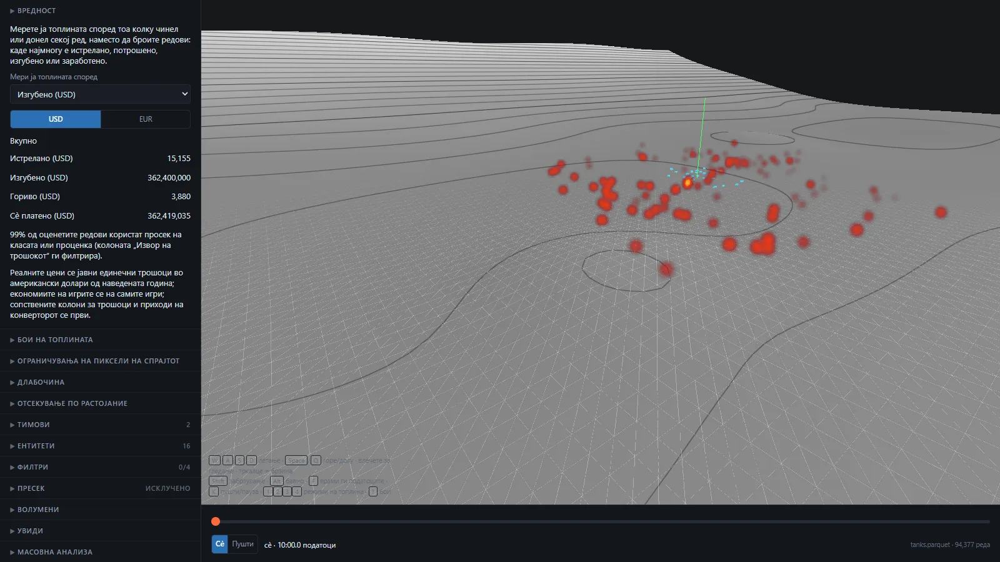

# Тежинење на вредности

Секој истрел, муниција, изгубено возило и литар гориво има цена. Прегледувачот пресметува колку чини или колку заработило секој ред и може да ја тежи топлината според неа, па мапата го покажува **каде отишле парите** наместо каде се редовите.

## Како да се користи {#how-to-use-it}

1. Вчитајте податоци со настани (истрели, убиства, смртни случаи) и имиња на возила или оружје.
2. Отворете **Вредност** во страничната лента на Топлината.
3. Изберете **Мери ја топлината според**, на пример *Изгубено (USD)*. Топлината сега ја собира цената на секој ред наместо 1.
4. Прочитајте **Вкупно**: збирот на секоја колона со вредност за она што се прикажува (важат филтрите и временскиот прозорец).
5. Каде што цените се вистински пари, се појавува прекинувач **USD / EUR**.

Изберете го празниот прв запис од менито за повторно да ги броите редовите.

## Што може да се мери {#what-can-be-weighed}

Колоните со вредност се додаваат при вчитување, по една за секој вид и валута:

| Вид | Редови на кои се наоѓа | Како се цени |
|---|---|---|
| **Истрелано** | истрели и лансирања | оружјето, инаку просек за видот муниција |
| **Потрошено** | купување, појавување | парични колони на играта (на пример, менито за купување во шутер) |
| **Изгубено** | смрти, уништувања | сопственото возило, инаку просекот на неговата класа |
| **Уништен** | убиства | целното возило |
| **Нанесена штета** | погодоци | удел од вредноста на целта |
| **Гориво** | позиции | потрошено гориво, од колона за гориво или проценето од класата и времето |
| **Сè платено** | | истрелано + потрошено + изгубено + гориво |
| **Заработено** | награди | наградните колони на играта (`earn_…`) |
| **Нето** | | заработено минус платено; се црта како топлина со знак (позитивна рампа каде е заработено повеќе, негативна каде е платено повеќе) |

Имињата на колоните се `cost_<kind>_<currency>`, `earn_<currency>` и `net_<currency>`. Конверторот што ја знае валутата на самата игра (на пример, конвертор на повторување што пишува во кредитите на играта) има предност над вградените табели со цени.

## Табелите со цени {#the-price-tables}

| Табела | Валута |
|---|---|
| Реална воена: ракети, бомби, муниција, мерки за противдејство, авиони, хеликоптери, копнени возила, бродови, гориво | USD (EUR = USD × 0,92, фиксното `EUR_PER_USD` во [`cost.ts`](https://github.com/Holdi601/3DHeat/blob/main/src/data/cost.ts); не е жива стапка) |
| Менија за купување во шутери и награди за убиства | кредитите на играта |
| Игри со тенкови и бродови | кредитите на играта |
| Стратешки игри (повеќе ресурси) | по една колона за ресурс плус една здружена |
| Воени игри | поени |

Играта се препознава од имињата во податоците. Цените од реалниот свет доаѓаат од јавни извори (буџетски документи, енциклопедии) или се означени како проценки; не се прилагодени за инфлација. Генерираната листа на табелите е на [Табели со вредности](ref-value-tables.md).

## Проценки {#estimates}

Дополнителната колона за категорија **Извор на цената** вели како е цена секој ред: `table`, `class average`, `estimate` или `none`. Делот Вредност покажува кој дел од редовите со цена се просеци или проценки. За да останат само точно поцртани редови, исклучете *estimate* и *class average* под **Извор на цената** во [Филтри](filters.md).

## Каде другаде се гледа вредноста {#where-else-value-shows}

- [Увиди](insights.md): наодите *Скапо тло* и *Тло што заработува*.
- [Разложување](breakdown.md): Заработено, Изгубено и Нето пари по тим, играч или оружје.
- [Волумени и споредба](volumes.md): колони со вредност во статистиките и споредбата.
