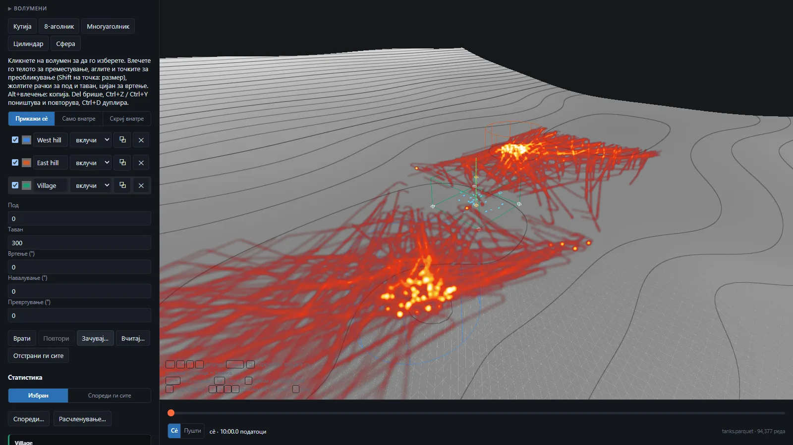
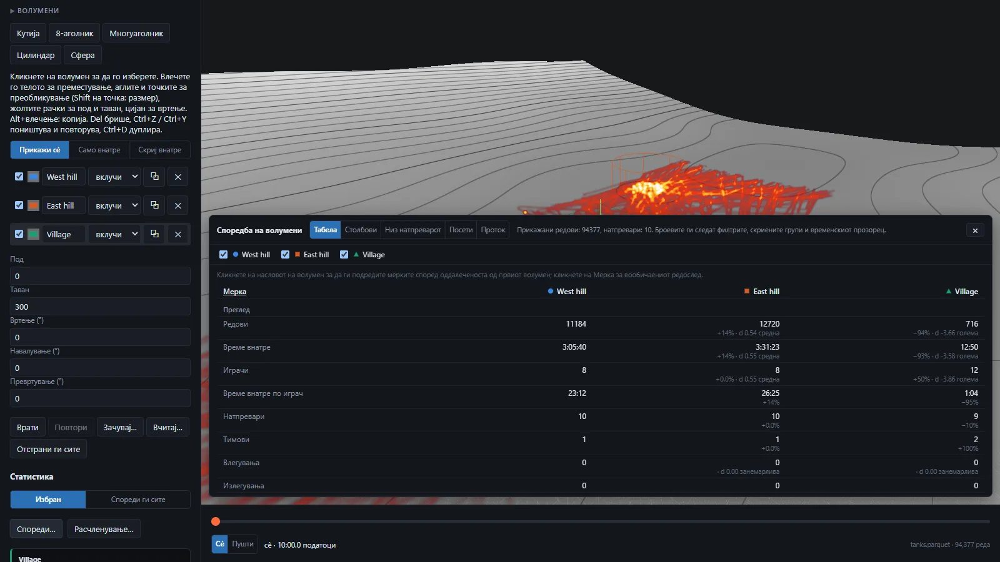
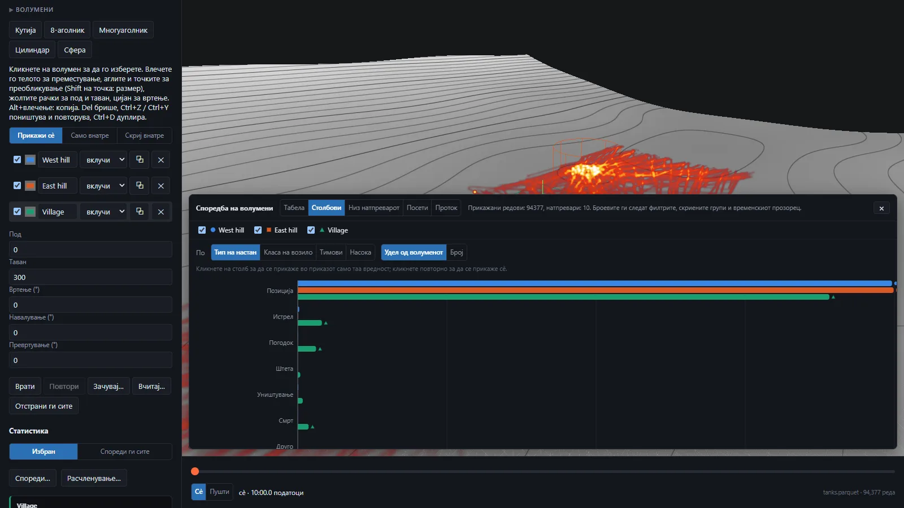

# Волумени и споредба

**Волуменот** е невидлива кутија (или цилиндар, или сфера) што ја цртате околу едно место, за да прашате: што се случило внатре? Користете го за да броите убиства кај мост, за да споредите две брда, или за да покажете само активноста во едно подрачје.

```
 поглед одозгора         цртате облик ->  прегледувачот брои
 +------------+           што е внатре:
 |   ( A )    |            редови, играчи, убиства, време ...
 |        [B] |           Споредете A со B, едно до друго.
 +------------+
```



Волумените мерат што се случува внатре, го филтрираат прегледот според нив, ги извезуваат нивните редови и можат да се споредуваат едно до друго. Видете и [речникот](glossary.md) за ред, лице и натпревар.

## Нацртајте волумен {#draw-a-volume}

1. Отворете **Волумени** во страничната лента.
2. Изберете алатка и цртајте во 3D прегледот или на 2D мапата. Подот и таванот почнуваат од податоците под нив. Esc откажува.
3. Кликнете на волуменот за да го изберете; неговата **Статистика** се појавува.

| Алатка | Како се црта |
|---|---|
| **Кутија** | Влечете правоаголник (Shift: квадрат). Со клик се става стандардна кутија. |
| **n-gon** | Влечете од центарот (Shift го држи правилен). *Агли* го поставува n, од 3 до 64 (стандардно 8, па копчето пишува **8-gon**). |
| **Многуаголник** | Кликнете на аглите; затворете со двоен клик, Enter или клик на првиот агол. Backspace го брише последниот агол. |
| **Цилиндар** | Влечете го радиусот. |
| **Сфера** | Влечете го радиусот; стои на земјата. |

## Уредување {#edit}

- Кликнете на волумен за да го изберете. Влечете го неговото тело за да го поместите, аглите за да го обликувате (Shift на агол скалира).
- **Жолтите** рачки ги поставуваат подот и таванот, **цијаната** рачка ја ротира.
- Alt+влечење копира, Del брише, Ctrl+Z / Ctrl+Y враќа и повторува, Ctrl+D дуплира. **Отстрани ги сите** брише сите волумени.
- Точни вредности: Под, Таван, Turn / Pitch / Roll (кутии), Радиус (сфери, цилиндри).

Секој ред на волумен има поле за прикажување, боја, име, **вклучи** или **исклучи**, дуплирање и бришење. Волумените се зачувуваат во прелистувачот за секој dataset, а **Зачувај…** / **Вчитај…** пишуваат и читаат датотека `volumes.json`.

## Филтрирање на прегледот {#filter-the-view}

| Филтер | Ефект |
|---|---|
| **Прикажи сè** (стандардно) | Волумените само мерат. |
| **Само внатре** | Топлината, повторувањето и [анализата на погодоци](hit-analysis.md) цртаат само она што е внатре во вклучените волумени и надвор од исклучените. |
| **Скриј внатре** | Спротивното. |

GPU филтерот зема најмногу 8 волумени со 64 точки на обрисот вкупно; знак "!" означува волумен над тоа. Статистиката и извозот сè уште го броят.

## Статистика {#statistics}

Областа **Статистика** ги следи филтрите, временскиот прозорец и скриените групи. *Избран* го прикажува избраниот волумен, *Спореди ги сите* ги става сите волумени едно до друго. Прикажува:

- **Редови внатре (прикажани)** и **Редови внатре (сите податоци)**, **Играчи**, **Тимови**, **Натпревари**, **Време внатре**, **Влегувања / излегувања**, **Врв на топлина**, **Просечна топлина**, **Волумен / основа** и хистограм **Кога**;
- **Удел на победи**, каде што податоците кажуваат кој победил ([колони за исход](data-formats.md#outcome-columns)): од рундите со играч внатре, рундата на секој играч бројана еднаш, уделот што неговата страна го добила - привлечен кон уделот во сè прикажано за 4 рунди, како што прави [расчленувањето](breakdown.md) - заедно со добиените и одиграните рунди и тој вкупен удел;
- по колона: категории со **Lift** (делот внатре поделен со делот во сите прикажани податоци), и броеви со опсег, медијана и 5-ти до 95-ти перцентил.

**Статистика како CSV / JSON** ги зачувува. **Извези ги податоците внатре** ги запишува редовите внатре како CSV или Parquet (*Само прикажаните редови* вклучено по стандард), еден волумен или сите, со колона што кажува кој волумен го држи секој ред.

## Споредба на волумени {#compare-volumes}

Со два или повеќе видливи волумени, притиснете **Спореди…**.

1. Нацртајте три волумени, на пример Западно брдо, Источно брдо и Село.
2. Притиснете **Спореди…** под Статистика.
3. Во **Табела**, прочитајте ја разликата на секоја вредност од првиот волумен.
4. Префрлете се на **Столбови** за да ги видите деловите како столбови.



| Преглед | Прикажува |
|---|---|
| **Табела** | Редови, време внатре, играчи, натпревари, тимови, влезови, излези, посети, должина на посетите, убиства, смрти, убиства по смрт, убиства во минута, време по играч, колони со вредности; групирано по настани, класа на возило, играч или ВИ, тим и насока. Секоја вредност ја покажува разликата од првиот волумен и големината на ефектот (занемарливо, мало, средно, големо). Кликнете на наслов на волумен за да подредите по растојание од првиот. |
| **Столбови** | Броеви или удели по настан, класа, актер, тим или насока. Кликнете на столбец за да го филтрирате прегледот до него. |
| **Низ натпреварот** | По еден график за секој волумен низ минутите на натпреварот: присуство, редови или убиства. Кликнете за да скокнете таму. |
| **Посети** | Box и violin графикони за тоа колку траат посетите (логаритамска скала). |
| **Проток** | Каде одат патеките откако ќе го напуштат секој волумен: матрица на премини или ленти на тек. |



## Совети {#tips}

- Почнете од наод: во [Увиди](insights.md), **Волумен овде** додава цилиндар околу местото на наодот.
- **Breakdown...** го отвара [Разложувањето](breakdown.md) за избраниот волумен: кој и што е најдобро внатре.
- [Насочената топлина](directional-heat.md) може да ги прикаже насоките внатре во избраниот волумен.
- [картичката Возила](hit-analysis.md#restrict-to-an-area) ги користи истите волумени како свој филтер за област.
