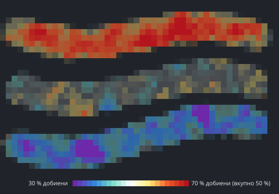

# Удел на победи: колку често победува место, пат или потег

Каде стои играчот, по кој пат оди, каде фрла гранати и други помагала - и колку често неговата страна потоа ја добива рундата. **Мапата на удел на победи** го бои секое место според уделот на редовите таму што припаѓаат на рунди што страната на редот ги добила, во однос на уделот во сè прикажано: топло каде што е поголем, ладно каде што е помал, ништо каде што е ист.

*Сликата покажува измислени податоци: три патеки на празно ниво, 68 %, 50 % и 33 % од нивните редови во добиени рунди.*

Потребни се податоци што кажуваат кој победил: [колоните за исход](data-formats.md#outcome-columns) (`won`, `matchWon`, `roundEndReason`). Ги пишуваат конверторите за CS2 и War Thunder; може да ги има секоја датотека.

## Пробајте {#try-it}

1. Вчитајте мечеви со колона за исход и притиснете `2` (**Разлика**).
2. Во **Поделба за разлика** притиснете **Удел на добиени рунди** (или **Удел на добиени мечеви**). Ги става добиените рунди на **+**, изгубените на **−** и го префрла панелот на **Удел на +**.
3. Читајте ги боите. Панелот го кажува вкупниот удел: *Вкупно 52,0 % од 1.200.000 редови се на +.*
4. Стеснете со [филтрите](filters.md): една страна (T или CT), еден тип настан (*Позиција* за тоа каде стоеле луѓето, *Истрел* или *Лансирање (ракета, проектил, бомба)* за тоа од каде пукале или фрлале), една купувачка, една мапа.

Место што е топло со редови *Позиција* е место чии држачи главно ја добивале рундата. Со редови *Уништување* тоа е место каде што убиствата што се случиле таму воделе до добиени рунди.

## Поставки {#the-settings}

| Поставка | Што прави | Стандардно |
|---|---|---|
| **Разлика** / **Удел на +** | самата разлика или уделот на страната + меѓу редовите на двете страни | Разлика |
| **Полна боја при** | колку над или под вкупниот удел местото се прикажува со полна боја, во процентни поени | ± 20 поени |
| **Најмалку редови за боење место** | место со помалку редови не се бои; постепено се појавува од половина од таа вредност | 12 |
| **Привлекување кон вкупниот удел (редови)** | секое место почнува со толку редови на вкупниот удел, па место со 3 реда, сите добиени, не се прикажува како 100 % | 12 |

Сите три делуваат на готовата слика: нивното поместување никогаш не го почнува собирањето одново.

Уделот може да биде од која било поделба, не само од победите: *Удел на +* со поделба по страна покажува каде Ts биле поголемиот дел од присуството, а со поделба по датотеки од две мапи каде редовите на едната датотека ги надминуваат редовите на другата.

## Редови, не рунди {#rows-not-rounds}

Мапата брои редови. Играч што стои на едно место дваесет секунди додава ред при секој примерок, сите од една рунда, па доказот на едно место се редовите блиску до него, не рундите. Затоа минимумот и привлекувањето се во редови и затоа се поголеми од она што го дава една рунда.

За самите рунди:

- **[Расчленување](breakdown.md)** на место, поглед или волумен: *Победи %* ја брои рундата на секој играч еднаш, со истото привлекување кон вкупниот удел на местото (4 рунди).
- Статистика на **[Волумени](volumes.md)**: *Удел на победи* - рундите со играч во волуменот, секоја еднаш, со привлекување кон уделот во сè прикажано, заедно со броевите.

## Филтри за исход {#outcome-filters}

Панелот [Филтри](filters.md) ги наведува колоните за исход веднаш по сопствените колони на прегледувачот: **Исход од рундата** и **Исход од мечот** (*Било кој*, *Добиено*, *Изгубено*) и **Како заврши рундата** (Елиминација, Бомбата експлодира, Бомбата е деактивирана, Времето истече, Предавање, Нерешено, Цел, Задржани зони, Изгубени поени, Изгубени сите возила), на јазикот на прегледувачот.

## За програмери {#for-developers}

Преминот на топлина запишува три збира во четириканалната цел што ја користи топлината на тимови: топлината `R = Σ|v|`, топлината на страната + `P` и `S = Σ v²/w`, каде `w` е тежината на преминот (тежина на земање примероци по засилување на рамката). Составувањето го чита уделот `P/R` (просек пондериран со јадрото) и бројот на редови на кои почива, `n = R²/S` (Кишова ефективна големина на примерок), го привлекува уделот кон вкупниот, `p = (n·P/R + m·r0)/(n + m)`, и го бои `p - r0` преку опсегот на рампите за разлика.

`n` го поништува секој фактор заеднички за редовите во пикселот - засилувањето на рамката, тежината на земање примероци, тежината на површината на скратен спрајт - па сликата е иста при секое зумирање и густина на примероци, а рамките од секој k-ти ред се спојуваат во целина без скокови на боите. Вкупниот удел доаѓа од броењата на страните на CPU, точен до десетинка процент; ништо не се чита назад од GPU. Пресметката и нејзините проверки: [`render/rateMap.ts`](https://github.com/Holdi601/3DHeat/blob/main/src/render/rateMap.ts) и неговиот тест.

Чини колку топлината на тимови: четириканалната цел го зголемува четирипати пропусниот опсег за мешање во преминот на топлина, само додека е вклучен *Удел на +*.
