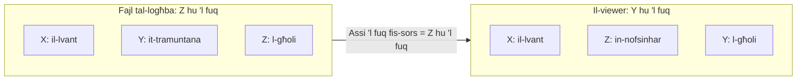

# Assi, unitajiet u ħin

Il-logħob u l-mappi ma jaqblux dwar liema triq hi 'l fuq, kemm hi twila unità, jew kif jinkiteb il-ħin. Din il-paġna turi t-tliet issettjar li jagħmlu d-dejta tiegħek tieqaf, tkun fid-daqs it-tajjeb u timxi fil-verġa t-tajba.

Jekk il-mappa tieqaf bħal ħajt minflok tinżel bħal art, aqleb **Assi 'l fuq fis-sors**.

Bl-**Assi 'l fuq fis-sors** ħażin, il-mappa tieqaf bħal ħajt; b'dak tajjeb tinżel bħal art.

## Id-dinja li fiha l-viewer jiddisinja {#the-world-the-viewer-draws-in}

Id-dinja tal-viewer hi **Y 'l fuq**: X u Z huma l-pjan tal-art, Y hu l-għoli. Ħafna magni tal-logħob huma **Z 'l fuq**: għalihom X u Y huma l-art u Z hu l-għoli. Xi magni huma wkoll imqalbin (left-handed). Il-mappa tgħid kif tbiddel l-assi tal-fajl f'dawk tal-viewer. (Tekniċi, il-viewer hu right-handed, il-konvenzjoni tat-three.js.)

### Assi 'l fuq {#up-axis}

**Assi 'l fuq fis-sors** fil-[Mappa tal-kolonni](column-mapping.md):

| Issettjar | Il-fajl (x, y, z) isir id-dinja (X, Y, Z) |
|---|---|
| *Z hu 'l fuq (magni tal-logħob ħafna)* - id-default | (x, **z**, **y**): iz-Z tal-fajl isir l-għoli u l-Y tal-fajl isir iz-Z tad-dinja |
| *Y hu 'l fuq (konvenzjoni tal-grafika)* | (x, y, z) mhux mibdul |

Għal dejta Z 'l fuq, it-tliet arrays jerġgħu jitgħalmu minflok ma jinkopjaw ([`remapAxesInPlace`](https://github.com/Holdi601/3DHeat/blob/main/src/data/ingest.ts)), u dan jiffranka mijiet ta' megabytes f'tagħbijiet kbar. L-indovinar isir mill-kampjun: min-naħa tal-kolonni Y u Z li għandha l-firxa iżgħar hi 'l fuq.

### Qlib {#flips}

**Qlib X**, **Qlib Y**, **Qlib Z** jinnegaw l-assi *tal-fajl* b'dak l-isem, qabel it-tgħalim mill-ġdid - għalhekk b'Z 'l fuq, *Qlib Y* jinnega dak li jispiċċa bħala Z tad-dinja. Qlib jibdel id-dejta mgħobbija: il-koordinati murija mill-[linjal](measure.md), mill-qtugħ u mill-pożizzjoni tal-kamera huma dawk maqlubin.

Biex tiddisinja dinja mqalbma b'mod korrett **mingħajr** ma tbiddel id-dejta, uża minflok **Kamera u xena → Qilleb l-assi tad-dinja** ([Kamera](camera.md#invert-world-axis)). Din hi l-aħjar għażla għal logħob li d-dinja tiegħu hi left-handed, għax kull koordinata li l-għodod juru tibqa' tal-logħba stess.

### Skala tal-unità {#unit-scale}

**Skala tal-unità** timmultiplika kull pożizzjoni. *1 (m)* iqiegħed 1, *0.01 (cm→m)* iqiegħed 0.01 (l-unitajiet tal-Unreal Engine huma ċentimetri, allura uża 0.01; l-unitajiet tal-Source-engine huma pulzieri, allura uża 0.0254; la wieħed u lanqas l-ieħor huma metri), u l-kaxxa taċċetta kull valur. Zero miktub jew valur li ma jkunx numru jinbidel b'1.

Il-viewer jikteb id-distanzi bil-metri (raġġ tal-sprite, distanzi tal-qtugħ, il-linjal, veloċità tat-tlugħ), u dan hu veru biss meta l-unità tad-dinja msaffra tkun metru. Ebda ħaġa ma tinkiser meta ma tkunx; it-tikketti jaqraw biss "m" għal kull unità li tkun.

## Il-ħin {#time}

### Unitajiet tal-ħin {#time-units}

Regola ta' qisien: valuri bħal 17000000000 (għaxar diġits jew iktar) huma timestamp ta' Unix; valuri bħal 0, 0.25, 0.5 huma sekondi mill-bidu.

| Unità tal-ħin (tikketta tal-menu) | Tinqara bħala | Il-ħin tal-arloġġ muri |
|---|---|---|
| *Sekondi (relattiv)* | valur × 1 s | le |
| *Millisekondi (relattiv)* | valur × 0.001 s | le |
| *Mikrosekondi (relattiv)* | valur × 10^-6 s | le |
| *Nanosekondi (relattiv)* | valur × 10^-9 s | le |
| *Timestamp ta' Unix (s)* | sekondi mill-1970-01-01 UTC | iva |
| *Timestamp ta' Unix (ms)* | millisekondi mill-1970-01-01 UTC | iva |
| *Stringa ta' data ISO-8601* | test bħal `2026-03-14T18:02:11.250Z`, imqassam bil-`Date.parse` tal-browser | iva |

B'unità assoluta (l-aħħar tlieta) s-sett tad-dejta jżomm l-istant tal-arloġġ tar-ringiela l-iktar bikrija tiegħu, u l-linja taż-żmien turi l-ħin attwali UTC tal-ġurnata (`HH:MM:SSZ`) ħdejn il-pjanċina.

**Kolonni `TIMESTAMP` u `DATE` ta' Parquet** jinfetħu f'istanti reali, għalhekk l-issettjar tal-unità tagħhom jiġi injorat u l-pannell jgħid hekk. Kolonna `DATE` hi ġurnata sħiħa: kull ringiela ta' ġurnata tqassam istant wieħed u t-tlugħ jaqbeż ġurnata b'ġurnata, li l-pannell jwissi dwaru.

**Stringi ISO-8601 jaħdmu fis-CSV u fil-Parquet bl-istess mod.** Kolonna ta' ħin bi test bl-unità ISO titqassam darba għal kull stringa distinta; jekk ma tinqara xejn, it-tagħbija tfalli b'*Ebda timestamp ISO-8601 li jinqara fil-kolonna taż-żmien immappjata.* - u l-mappa diġà tirrifjuta li tibda meta xejn mill-valuri kkampjunati ma jinqara. Kolonna `TIMESTAMP` ta' Parquet tinqara bħala timestamp kull ma tkun l-unità, u kolonna numerika ta' Parquet b'unità ISO tinqara bħala millisekondi ta' Unix. Kolonna ta' ħin bi test b'unità numerika tiġi rifjutata qabel it-tagħbija: kull valur jinqara bħala NaN.

### Kif jinħażen il-ħin {#how-time-is-stored}

Waqt li l-fajls jitħalltu, il-ħinijiet huma sekondi ta' 64-bit, għalhekk epoka assoluta żżomm id-dettall ta' taħt is-sekonda tagħha. Meta l-fajls kollha jkunu fil-post, l-iktar ħin bikri tal-għażla kollha isir 0 u kull ringiela tiħżen sekondi ta' 32-bit minnu. Float ta' 32-bit għandu 24 bit tal-mantissa: spazji sa madwar ġurnata u nofs jirrisolvu b'aktar minn 1/100 s, spazji ta' nofs sena sa madwar sekonda. Ringiela li l-ħin tagħha nieqes jew ma jkunx numru titqiegħed fuq 0, il-bidu.

Ir-ringiela mbagħad jitqassmu skont il-ħin, u dan hu li jagħmel il-linja taż-żmien irħisa: tieqa ta' ħin tinstab b'żewġ binary searches (ara [Sampling u l-bagħtiet](sampling-and-budgets.md)).

### Ħin li għadda vs arloġġ {#elapsed-time-versus-wall-clock}

Kolonna tal-ħin bħal `match_time` jew `round_time` tgħodd minn bidu kull partita stess. Li tagħżilha tqiegħed kull partita fuq assi komuni - tajba biex titqabbel dak li jiġri fil-minuta 3 ta' kull partita - u l-pannell jindika dan. Kolonna ta' arloġġ turi l-partiti fl-ordni li fih ġraw verament, u jingħaqdu fejn kienu jaqgħu fuq xulxin.

## Direzzjoni tal-ħares {#look-direction}

Id-direzzjoni tal-ħares tintuża biss mir-[replay tal-kaxxi](box-replay.md) (ir-raġġi minn kull kaxxa). Tinħażen bħala żewġ anglu, yaw u pitch, f'radjanti.

- **Kolonni ta' Yaw / pitch** jinqraw kif huma, mibdula minn gradi meta jintgħażel *Gradi*. Ma jiġux aġġustati għall-assi 'l fuq jew għall-qlib.
- **Kolonni ta' vettur tad-direzzjoni** jgħaddu mill-istess tgħalim mill-ġdid u qlib bħall-pożizzjonijiet, u mbagħad isiru yaw = atan2(x, -z) u pitch = atan2(y, √(x² + z²)) fl-assi tad-dinja, sabiex ir-raġġ jindika fejn il-kaxxa tħares anki f'dinja tas-sors imqalbin.

Jekk il-kolonni ta' yaw/pitch jidhru jindikaw fl-direzzjoni ħażina wara qlib, vettur tad-direzzjoni, jew angli aġġustati, dik hi l-korrezzjoni.
