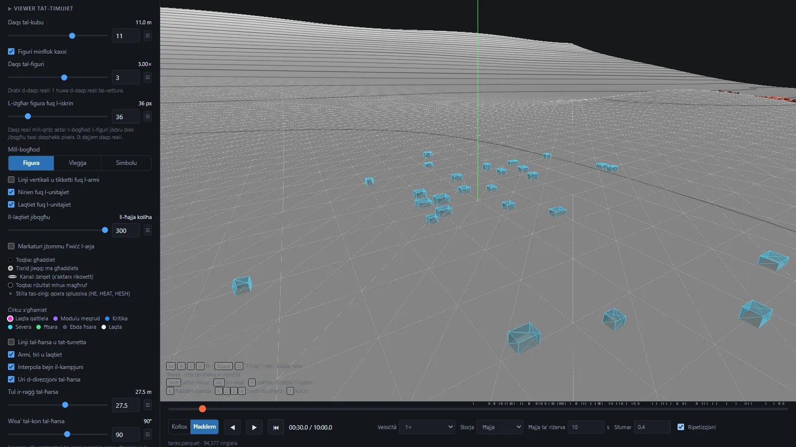

# Overlay tal-figuri (replay tal-kaxxi)

Film żgħir: figura waħda għal kull persuna, li timxi hekk kif jgħaddi l-ħin, b'traċċa warajha.

Il-modalità tissejjaħ **Overlay tal-figuri** fil-barra tal-modi. Din il-paġna kienet tissejjaħ "replay tal-kaxxi", għax qabel ma kienu jeżistu l-figuri kull persuna kienet kaxxa; "replay bil-figuri" u "replay tal-kaxxi" ifissru l-istess ħaġa. **Overlay tal-figuri** m'għandux tasta nummru: agħżilha fil-barra tal-modi. Hu jiġbed figura waħda (jew kaxxa) għal kull [persuna](glossary.md), li timxi tul il-[linja taż-żmien](timeline.md), b'raġġi tal-ħarsa u traċċi opzjonali. Hu playback u mhux densità: *min kien fejn, meta*. Jeħtieġ kolonna tal-persuna; mingħajr kolonna taż-żmien, kull kampjun jinġibed darba.

## Kif tuża {#how-to-use-it}

1. Tagħbi dejta b'kolonna tal-persuna u kolonna taż-żmien.
2. Agħżel **Overlay tal-figuri** fil-barra tal-modi.
3. Ibdel il-linja taż-żmien għal **Ħaddem** u agħfas ħaddem (`K`).
4. Iftaħ **Viewer tat-timijiet** biex tbiddel **Tul it-traċċa**, id-daqs tal-figuri jew ir-raġġi tal-ħarsa.

Ebda sħana ma tinġibed f'din il-modalità, u l-baġit adattiv tal-sprites ma jaħdimx.

B'default kull persuna tinġibed bħala l-figura ta' dak li hi, mhux bħala kaxxa - ara [Figuri](figures.md) għal liema figura tieħu unità, u [Replay tal-partita](match-replay.md) għat-tikketti, il-kamera li ssegwi, il-kejl bejn żewġ unitajiet u l-lista tal-avvenimenti.

## Il-pannell Viewer tat-timijiet {#the-team-viewer-panel}

Jidher minflok il-pannelli tas-sħana f'din il-modalità.

| Kontroll | Default | Firxa (jog) | Tifsira |
|---|---|---|---|
| **Figuri minflok kaxxi** | mixgħul | | Kull persuna bħala l-figura ta' dak li hi: suldat fuq siequ, it-tank jew l-inġenju tal-ajru li d-dejta tgħid. Dak li d-dejta ma tgħid xejn dwaru jibqa' kaxxa. |
| **Daqs tal-figuri** | 1× | | 1× hu d-daqs veru. |
| **L-iżgħar figura fuq l-iskrin** | 36 px | 0 = dejjem id-daqs veru | Id-daqs veru meta tkun viċin; iktar 'il bogħod il-figuri jikbru biex jibqgħu dan l-għadd ta' pixels twal. |
| **Armi, tiri u laqtiet** | mixgħul | | Armi fit-tlugħ bid-duħħan, traċċanti, impatti, laqtiet u qtil. Traċċanti miksubin minn laqta huma mitqugħin. |
| **Daqs tal-kubu** | id-daqs tal-entità, jew firxa / 500, meta titgħabba | 0.05-200 m, logaritmiku (5000) | It-tul tat-truf ta' kull kaxxa. Ara [daqs tal-entità](sessions-persons-groups.md#entity-size). |
| **Interpola bejn il-kampjuni** | mixgħul | | Bejn żewġ kampjuni tal-istess persuna fl-istess sessjoni, tqiegħed il-kaxxa proporzjonalment bejniethom. Qatt mhux mal-konfini ta' sessjoni. |
| **Uri d-direzzjoni tal-ħarsa** | mixgħul | | Raġġ minn kull kaxxa fid-direzzjoni tal-ħarsa tal-persuna (jeħtieġ [kolonni tal-ħarsa](axes-units-and-time.md#look-direction)). |
| **Tul ir-raġġ tal-ħarsa** | id-daqs tal-entità × 4, jew firxa / 200, meta titgħabba | 0.5-500 m, logaritmiku (20,000) | Juri meta d-direzzjoni tal-ħarsa tkun mixgħula. |
| **Tul it-traċċa** | 8 s | 0-300 s (86,400); 0 = mitfi | Sekondi ta' storja mrawma wara kull persuna. |
| **Pinġi kull kampjun mhux ipproċessat** | mitfi | | Kaxxa għal kull kampjun maħżun fil-qoxra minflok kaxxa interpolata waħda għal kull persuna. Jitnaqqas biex jibqa' interattiv. |

Il-hints fil-pannell jispjegaw li l-interpolazzjoni u t-traċċi jgħaqqdu kampjuni f'sessjoni waħda biss, u, meta t-tagħbija jkollha [ismijiet komuni](sessions-persons-groups.md#names-worn-by-several-things-at-once), kemm ismijiet jinġibdu bħala kampjuni waħedhom.

## Is-sessjoni li qed tiġi mħaddma {#the-session-being-played}

B'kolonna tas-sessjoni, il-magħżel **Sessjoni** fil-quċċata tal-barra tal-ġenb ([Sessjonijiet](sessions-persons-groups.md#the-session-picker)) jiddeċiedi liema partita titħaddem mill-ġdid. Dik l-iktar attiva tintgħażel meta titgħabba. Ringieli ta' dik is-sessjoni biss isiru kaxxi u traċċi, u l-linja taż-żmien timxi fuq il-firxa ta' dik is-sessjoni minflok tad-dataset kollu. *Is-sessjonijiet kollha* iħaddem kull sessjoni flimkien, u xorta ma jgħaqqadx kampjuni bejn sessjonijiet.

## X'jinġibed meta {#what-is-drawn-when}

Minn [`TrackCursor`](https://github.com/Holdi601/3DHeat/blob/main/src/data/tracks.ts):

**Kaxxi ħajjin** (modalità Ħaddem, kampjuni mhux ipproċessati mitfija). Għal kull persuna viżibbli, l-aħħar kampjun tagħha f'jew qabel il-pjanċina:

- Jekk il-persuna għandha kampjun ta' wara, dan ikun fl-istess sessjoni, u l-isem ma jkunx komuni, il-kaxxa titqiegħed bejn iż-żewġ kampjuni proporzjonalment għall-ħin, bil-yaw interpolat mit-triq l-iqsar u l-pitch lineari (meta *Interpola* ikun mixgħul).
- Inkella l-kaxxa tibqa' fl-aħħar kampjun għal **Ħajja ta' riżerva** tal-linja taż-żmien (default 10 s) u mbagħad titneħħa, sabiex il-plejers eliminati ma jibqgħux.

**Modalità Kollox** tinjora l-pjanċina u tiġbed kull kampjun fil-firxa bħala kaxxa.

**Kampjuni mhux ipproċessati** jiġbed kaxxa għal kull kampjun maħżun fit-tieqa: l-*Firxa* bl-istorja *Tieqa*, u kollox sal-pjanċina inkella. Mill-iktar 65,536 kaxxa; b'iktar kampjuni, jinġibed kull *k*-th.

**Traċċi** (meta t-tul tat-traċċa jkun iktar minn 0 u l-kampjuni mhux ipproċessati ma jinġibdux): linja bejn kull par ta' kampjuni konsekuttivi ta' persuna fl-aħħar *tul tat-traċċa* sekondi sal-pjanċina, li titbaxxa minn 80% opaċità sa transparenti maż-żmien. Traċċa tieqaf meta sessjoni tinbidel u ma tinġibdx għal ismijiet komuni. Mill-iktar 131,072 vertex; b'iktar, ringieli jitneħħew b'mod ugwali.

**Min hu viżibbli:** persuna tkun moħbija meta l-grupp tagħha ma jkunx immarkat fil-[Lista tat-timijiet](teams-list.md) (il-grupp tagħha hu dak tal-ewwel ringiela tagħha), meta filtru tal-grupp jeskludiha, jew meta l-pannell tal-[Entitajiet](entities.md) ikollu għażla li ma tinkludihiex. Il-[filtri](filters.md) tal-kolonni ma japplikawx għall-kaxxi.

## Kuluri {#colours}

Familja ta' tonalità waħda għal kull grupp u tonalità waħda għal kull membru, sabiex ħarsa waħda tgħidlek f'liema naħa hu wieħed ([`teamMemberColor`](https://github.com/Holdi601/3DHeat/blob/main/src/render/colors.ts)). It-tonalitajiet tal-gruppi jduru minn lista fissa ta' għaxra - blu, aħmar, aħdar, ambra, vjola, ċjan, maġenta, lime, oranġjo, indigo - u l-membri ta' grupp jinxterdu fuq dawl 42-76% u saturazzjoni 90-65%.

## Noti {#notes}

- L-overlay tal-figuri jerġa' jibni l-figuri tiegħu biss meta xi ħaġa tinbidel; frame mqabbad jerġa' jpitter l-aħħar wieħed.
- Il-linja *Kubi* tal-[overlay tal-istatistika](performance-and-stats.md) tgħodd il-kaxxi fuq l-iskrin.
- L-overlay tal-figuri jinġibed fl-istess xena tal-livell, għalhekk [il-fond tal-fokus](camera.md#depth-of-field) jagħmel il-kaxxi mċajpra imma qatt is-sħana.
