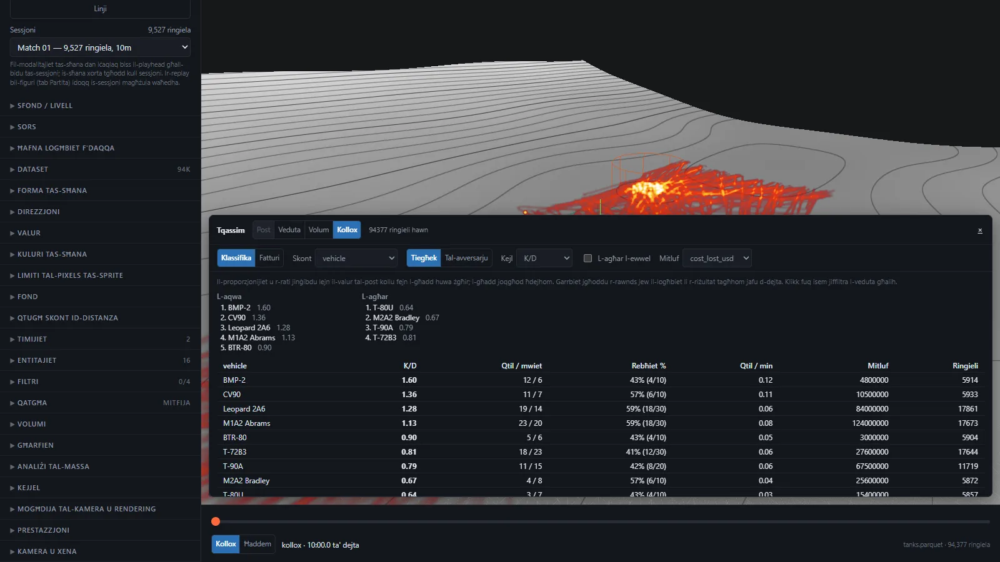
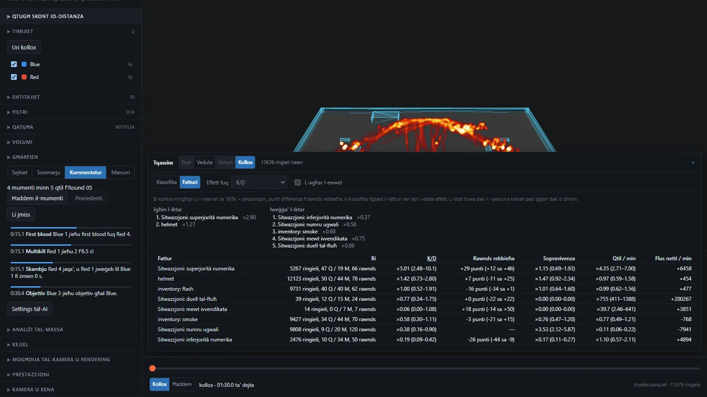

# Tqassim: min u xi jagħmel l-aħjar fejn

It-**Tqassim** iwieġeb mistoqsija waħda: f'dan il-post, liema vettura, plejer jew arma tagħmel l-aħjar? Uża dan biex issib it-tank li jirbaħ fil-pont, jew biex tara jekk il-ħelmijiet tassew jgħinu.

Jqassam dak li jiġri f'post wieħed (post magħżul, il-veduta, volum, jew kollox muri) skont kull kategorija, u jkejjel kull fattur tal-istat b'dak u mingħajru.

## Ipprova {#try-it}

1. Tagħbi partita b'qtil u mwiet, u iftaħ **Volumi**.
2. Ipitter volum madwar il-post li tgħożż u agħżlu.
3. Agħfas **Tqassim...** taħt Statistika.
4. Taħt **Skont**, agħżel *Vettura*, u agħżel il-kejl *K/D* (qtil għal kull mewt).
5. Aqra l-lista, l-aħjar l-ewwel. Agħfas **L-agħar l-ewwel** biex iddawwarha. Ikklikkja isem biex tfilter il-veduta għalih; ikklikkjah darba oħra biex titlaqh.

## Iftaħ {#open-it}

| Mnejn | Ir-reġjun li jibda bih |
| --- | --- |
| **Tqassim...** f'[Volumi](volumes.md) (Statistika) | il-volum magħżul |
| **Tqassim hawn** fuq il-kartellina tal-għażla, wara li tikklikkja punt | sfera madwar dak il-punt (**Raġġ**, default 3% tad-daqs tad-dejta) |
| il-pannell tal-qsim **Differenza** | il-veduta |

Il-kapitolu jibdel ir-reġjun: **Post**, **Veduta** (dak li l-kamera rat fl-aħħar għadd; **Għodd mill-ġdid** wara li tmexxi), **Volum** (agħżel wieħed) jew **Kollox**. Jgħodd fil-background; il-linja tal-istatus tgħid kemm ringieli hemm fir-reġjun.

## Klassifikazzjoni {#ranking}

Agħżel x'tiklassifika u kejl:

| Kejl | X'inhu |
| --- | --- |
| A, B | ringieli fuq kull naħa tal-mappa tad-differenza, maqsuma kif jinqasmu mis-sħana |
| A / B, A - B, A / (A + B) | iż-żewġ saffi kontra xulxin |
| K/D | qtil kontra mwiet |
| Win % | rounds (jew partiti) rebbieħa, fejn id-dejta tgħid min rebaħ |
| Qtil / min | qtil għal kull minuta preżenti (vojt tal-kampjuni tal-moviment) |
| Miksub, Mitluf, Flus netti | somom tal-kolonni `earn_*` u `cost_*`; għażla tagħżel il-munita |

Qtil, mwiet, preżenza, rebħiet u flus jgħoddu kull ringiela li l-veduta turi fil-post, fuq kwalunkwe naħa tal-qsim jew xejn.

Ratios u rati jiġbdu lejn il-valur tal-post kollu fejn l-għadd ikun żgħir, sabiex 2 qtil f'ħajja waħda ma jitlgħux fuq il-lista. L-għadd juri ħdejhom.

Tista' tikklassifika bil-gruppi u l-plejers u l-partiti, kull kolonna ta' kategorija (vettura, arma, naħa, tip ta' xiri, aġent jew kit), kull kolonna numerika f'firxiet (armatura, valur tal-loadout), il-**klassi** ta' kolonna ta' arma (rifle, sniper, SMG, pistol...) u kemm pezzi ta' **utility** iżomm kolonna ta' lista bħal `inventory`.

**Tiegħu** jiklassifika bil-valur tar-ringiela stess. **Tal-avversarju** jiklassifika bil-valur tal-parti l-oħra: l-arma tal-vittma fuq qtil, dik tal-qattiel fuq mewt (jeħtieġ kolonna `other` / `victim` li tismihom).

## L-istat fil-ħin {#state-at-the-time}

Il-valur ta' ringiela hu tiegħu stess sakemm ir-ringiela ma tirreġistra xejn (avveniment mingħajr tagħmir) jew hi mewt (li l-kolonna tal-arma tagħha tista' ssemmi l-arma tal-qattiel); allura hu dak li l-istess persuna ġarrbet l-aħħar fi ħdan il-partita qabel.

## Fatturi: bi kontra mingħajr {#factors-with-against-without}

Ibdel minn **Klassifikazzjoni** għal **Fatturi**, agħżel **Effett fuq**, u aqra *L-iktar jgħin* u *L-iktar jagħmel ħsara*:

L-effett ta' kull fattur fuq K/D, rebħiet ta' rounds, sopravivenza (minuti għal kull mewt), qtil għal kull minuta u flus netti għal kull minuta, b'intervall ta' 95%: ratios bħala x, rebħiet ta' rounds bħala differenza f'punti. Il-klassifikazzjoni tiġbed kull stima lejn l-ebda effett skont l-inċertezza tagħha stess, għalhekk fattur rari jeħtieġ effett ċar biex jogħla; l-intervall muri hu dak mhux imġebbed.

Dejta b'rounds iżżid il-**sitwazzjonijiet** tal-close-quarters ([Close quarters u rounds](close-quarters.md)), maħduma darba għal dataset: *immirat* (il-`state_flashed` tar-ringiela, jew flash ta' għadu fi 15 m fl-aħħar 3 s), *mewt mqabbla*, *duell tal-bidu*, u *man up*, *numri ugwali* jew *man down* (plejers ħajjin min-naħa tar-ringiela kontra l-għadu). Mewt titqies fis-sitwazzjoni li fiha kienet il-vittma ftit qabel.

Mill-iktar 256 fattur jitkejlu f'pass wieħed.

## Għall-iżviluppaturi {#for-developers}

### Tnaqqis ta' kampjuni żgħar {#pulling-small-samples}

Il-valur tal-klassifikazzjoni hu `(n + m*r0) / (d + m)`: `n` u `d` huma l-għadd, `r0` hu r-ratio tal-post kollu u `m` il-piż ta' dak il-prior.

### Għall-awturi ta' konvertituri: tismijiet tal-kolonni tal-fatturi {#for-converter-authors-naming-factor-columns}

Konvertitur iżid fattur billi jsemmi l-kolonna tiegħu:

| Kolonna | Fattur |
| --- | --- |
| `state_<isem>` numru | mixgħul waqt li hu mhux zero (`state_scoped`, `state_suppressor`) |
| `state_<isem>` kategorija | fattur wieħed għal kull valur (`state_ammo` = AP, HE...) |
| `active_<isem>` | l-istess, għal xi ħaġa mixgħula jew użata ftit ilu: abilità, ultimate, gadget, buff (`active_ult`, `active_stim`) |
| kolonna ta' lista (`inventory`, `loadout`, `perks`, `abilities`, `attachments`, `modules`, `buffs`, `debuffs`, `upgrades`, jew isem `state_`/`active_` li jispiċċa b'`s`) | fattur wieħed għal kull oġġett ta' valur `a\|b\|c` |
| flags tat-tagħmir diġà komuni (`helmet`, `defuser`, `armor`, `scoped`, `airborne`, `duck`, `flashed`...) | mixgħula waqt li mhux zero |
| `ammoType`, `shellType`, `ammoName` | l-munizzjon l-aħħar mitfugħ |

Riżultati: kolonna `won` ta' 0/1 (in-naħa tar-ringiela rebħet ir-round jew il-partita) u kolonna `round`. Flus: `earn_<munita>` u `cost_<tip>_<munita>`; dħul għal tip waħdu (`earn_round_cs2`, premjijiet eżatti tar-round tal-konvertitur) jissostitwixxi biss id-dħul tal-mudell tal-ispiża ta' dak it-tip (`round` jkopri wkoll plants u defuses), u l-mudell jipprezza l-bqija.

Il-mapping jgħabbi dawn il-kolonni waħdu, flimkien mal-lista tal-fajl stess: kull `state_*`, `active_*`, `won`, `round` u kolonna ta' lista, minbarra dawk li statistika tal-fajl Parquet turi li jżommu valur wieħed matul kollox (kull kolonna mgħobbija tiswa 4 bytes għal kull ringiela).
