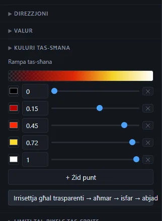

# Kulur u esponiment

Dawn il-kontrolli jiddeċiedu liema ammont ta' sħana jieħu liema kulur. **Punt tas-saturazzjoni** hu kemm sħana tgħodd bħala abjad jaħraq.

## Korrezzjonijiet malajr {#quick-fixes}

- Kollox abjad: oħloq **Punt tas-saturazzjoni**, jew agħfas **Espożizzjoni awtomatika mill-kamp**.
- Ma jidher xejn: naqqas **Punt tas-saturazzjoni**, jew agħfas **Espożizzjoni awtomatika mill-kamp**.
- Jidhru biss ftit tikek waħedhom: dawwar **Sħana minima** għal fuq.

Kull kontroll f'din il-paġna jaħdem meta s-sħana tinbidel f'kulur, allura meta tiġbed xi wieħed minnhom il-pittura terġa' tinbena immedjatament u **qatt ma terġa' tibda l-akkumulazzjoni**.

## Punt tas-saturazzjoni {#saturation-point}

**Punt tas-saturazzjoni** (taqsima Forma tas-sħana): is-sħana akkumulata li tilħaq it-tarf ta' fuq tar-rampa tal-kuluri (bir-rispons *Lineari*; ara hawn taħt għall-oħrajn). Slider logaritmiku 0.1-4000, il-maniglja tista' tiġbed sa 10,000,000, għax is-sħana akkumulata tikber mal-għadd tar-ringieli. Default 24; f'kull tagħbija, **stima analitika**, imbagħad **ikkejjel** mill-istampa.

Li tbiddel dan sewwa hija d-differenza bejn mappa tas-sħana u skrin vojt (jew abjad). Ma jistax jinstab b'mod affidabbli, għax it-telemetrija tingħaqad tant sew - spawn, bieb, punt ta' għeluq wieħed - li l-proporzjon bejn id-densità massima u l-medja jvarja b'ordni ta' manjitudni bejn settijiet tad-dejta u bejn angoli tal-kamera.

## Espożizzjoni awtomatika {#auto-exposure}

**Espożizzjoni awtomatika mill-kamp** tkejjel il-qasam li l-shader fil-fatt ipproduċa. Tinjora l-pixels vojta, tieħu l-98 perċentil tal-pixels imdawwlin u tqiegħdu fuq 85% tat-triq lejn il-punt tas-saturazzjoni, sabiex it-tarf tar-rampa jinżamm għall-picks reali.

Il-pannell imbagħad jaqra *ikkejjel X% tal-qafas; il-98 perċentil R imqiegħed qrib it-tarf tar-rampa*. Bir-rispons *Saturanti*, valur fuq 85% tal-punt tas-saturazzjoni jaqa' madwar 69% tar-rampa minflok 85%.

Jaħdem ukoll **awtomatikament**:

- 8 frames ippittrati wara li tinixtarr dejta;
- 8 frames wara li l-[filtri](filters.md) jinbidlu (il-filtrar ta' kull pożizzjoni sa mitt avveniment ibiddel id-densità b'ordnijiet ta' manjitudni);
- 8 frames wara li taqleb bejn is-sħana tal-punti u [is-sħana tal-linji](line-heat.md), jew tbiddel liema rotot is-sħana tal-linji tpitter, għax linja titfa' ħafna inqas sħana għal kull kampjun milli sprite.

Meta ma jkun hemm xejn imdawwal, it-tmexxija awtomatika tħalli s-saturazzjoni kif inhi; il-buttuna terġa' tmur għall-istima analitika u tgħid *xejn imdawwal biex jiġi kkejjel - ġiet użata l-istima analitika*.

### Segwi l-veduta {#follow-the-view}

**Segwi l-veduta** (taqsima Forma tas-sħana, default mixgħul) jerġa' jkejjel kull darba li l-kamera tieqaf, sabiex reġjun li tidħol fih juża r-rampa kollha tal-kuluri minflok l-iskala mkejla għall-mappa kollha. Bidliet żgħar jiġu injorati u l-iskala tiżdied bil-mod minflok taqbeż. Jaħdem fl-erba' modi tas-sħana, mhux fil-qoxra tal-figuri.

Itfi biex tiffissa l-iskala u tqabbel postijiet fuq skala waħda. Li tiġbed **Punt tas-saturazzjoni** b'idejk tiffissaha wkoll.

## Rispons tad-densità {#density-response}

**Rispons tad-densità** - kif *k* (sħana / saturazzjoni) jitqabbad mar-rampa:

| Rispons | Formula | Użu |
|---|---|---|
| **Saturanti** (default) | t = 1 - e^(-k) | Jersaq lejn it-tarf ta' fuq tar-rampa b'mod asintotiku, kif jagħmlu sprites trasparenti mimlija. Xejn ma jaqta' għal abjad ċatt, u dan hu d-default sigur fuq dejta mhux familjari. |
| **Lineari** | t = k | L-uniku tqabbid fejn l-istess kulur ifisser l-istess għadd. Uża dan biex tqabbel żewġ settijiet ta' dejta jew żewġ perjodi ta' żmien. |
| **Log** | t = log₂(1 + 7k) / 3 | Jikkompatta denb twil, sabiex hot spot estrem wieħed ma jibqax jaqleb kollox sal-qiegħ tar-rampa. Iqajjem iż-żoni skarsi. |

## Sħana minima {#minimum-heat}

**Sħana minima** (default mitfi, 0-100%): kull pixel li jġorr xi sħana jitla' għal mill-inqas dan il-punt tar-rampa. Dawwar dan għal fuq, u naqqas ir-raġġ tal-sprite, biex tara *fejn xi ħaġa qatt ġrat* - punti dejta singoli jsiru ċari minflok ma jibqgħu ftit fuq it-trasparenti. Itfiha meta tkun qed tiġġudika d-densità, għax iċċattja l-qiegħ tar-rampa b'mod intenzjonat. Il-limitu (k > 0.0001) iżomm il-pixels vojta vojta.

## Ir-editur tar-rampa {#the-ramp-editor}

Fit-taqsima **Kuluri tas-sħana**. It-tikketta tgħid għal xiex hi r-rampa: *Rampa tas-sħana* f'Sħana u Linji, *Pożittiva (timijiet li jiżdiedu)* f'Differenza, *Rampa tal-opaċità (il-kulur ġej mill-grupp)* f'[Sħana tat-timijiet](team-heat.md), fejn l-alfa biss tintuża.



Il-barra fuq nett turi minn qabel ir-rampa. Taħtha, ringiela waħda għal kull punt:

| Parti | Tifsira |
|---|---|
| Kwadru tal-kulur | Il-kulur tal-punt (l-għażel tal-kulur tal-browser). |
| Numru | Il-pożizzjoni tal-punt fuq ir-rampa, 0 sa 1 (0 = l-ebda sħana). |
| Slider | L-opaċità tal-punt, 0-100%. |
| ✕ | Ineħħi l-punt; mitfi meta jibqgħu biss tnejn. |

**+ Żid punt** iżid punt f'nofs it-triq bejn l-aħħar tnejn ta' punti, bil-kulur u l-opaċità tal-aħħar punt. **Irrisettja għal trasparenti → aħmar → isfar → abjad** iġib lura d-default.

Il-punti jistgħu jingħataw f'kwalunkwe ordni; jitqassmu meta tinbena r-rampa. L-**alfa** hi dik li tħallat is-sħana man-xena, u għalhekk it-tarf żero tar-rampa default hu trasparenti għal kollox.

### Ir-rampi default {#the-default-ramps}

| Pożizzjoni | Pożittiva (Sħana, Linji, Differenza +) | Negattiva (Differenza −) |
|---|---|---|
| 0.00 | iswed, alfa 0 | iswed, alfa 0 |
| 0.15 | rgb(180, 0, 0), alfa 0.55 | rgb(0, 170, 60), alfa 0.55 |
| 0.45 | rgb(255, 40, 0), alfa 0.85 | rgb(0, 190, 200), alfa 0.85 |
| 0.72 | rgb(255, 220, 40), alfa 0.95 | rgb(40, 80, 255), alfa 0.95 |
| 1.00 | abjad, alfa 1 | rgb(170, 60, 255), alfa 1 |

## Waqt li l-kamera tiċċaqlaq {#while-the-camera-moves}

Meta l-kamera tiċċaqlaq, l-akkumulazzjoni tibda mill-ġdid f'kull frame. Bl-**Ippittura kull ringiela f'kull frame** mixgħul (id-default) kull frame li jiċċaqlaq għadu eżatt; meta jintfa', frame li jiċċaqlaq juri stima waħda kkampjunata - tikek iktar brillanti, imkabbra skont il-piż - li tikkonverġi għall-istampa vera u lixxa meta tieqaf. Dan huwa mistenni; ara [Akkumulazzjoni](accumulation.md).

## Għall-iżviluppaturi {#for-developers}

### Il-passaġġ tal-kompożizzjoni {#the-composite-pass}

Wara li s-sħana tkun akkumulata, il-valur ta' kull pixel jinbidel f'kulur f'passaġġ wieħed ta' kompożizzjoni ([`COMPOSITE_FS`](https://github.com/Holdi601/3DHeat/blob/main/src/render/webgl2/shaders.ts)). L-passi huma:

```
k = |heat| / saturation point
t = response(k)                         clamped to 0..1
if minimum heat > 0 and k > 0.0001:  t = minimum + (1 - minimum) × t
colour, alpha = ramp(t)                  (the negative ramp when heat < 0, Difference only)
pixel = mix(scene, colour, alpha)
```

### L-istima analitika {#the-analytic-estimate}

**L-istima analitika** ([`estimateSaturation`](https://github.com/Holdi601/3DHeat/blob/main/src/data/calibrate.ts)) tassumi li r-ringieli jinxterdu fuq l-impronta X-Z tad-dejta: sħana medja = ringieli × (π r² / erja tal-impronta) × 1/3 × intensità taċ-ċentru (1/3 hi l-medja tad-disk ta' rampa lineari), imdawwal b'proporzjon assunt ta' picc għall-medja ta' 25, imqabbad għal 0.1-1,000,000. Trid biss tkun fl-istess ordni ta' manjitudni tal-valur tajjeb.

### Il-kejl {#metering}

[`exposure.ts`](https://github.com/Holdi601/3DHeat/blob/main/src/render/exposure.ts):

1. il-mira tas-sħana tinqara lura mill-GPU, subkampjunata għal mill-iktar 40,000 valur;
2. il-pixels vojta (sħana ≤ 0.0001) jitwarrbu - ħafna minn kamp ta' sħana huma vojta, u jekk jitħalltu flimkien jagħmlu kollox iktar skur, bħal kamera tal-kejl imwaħħla lejn sfond iswed;
3. il-98 perċentil tal-pixels imdawwlin hu r-referenza;
4. il-punt tas-saturazzjoni isir referenza / 0.85, allura r-referenza tqiegħed fuq 85% tat-triq lejn il-punt tas-saturazzjoni u t-tarf tar-rampa jinżamm għall-picks reali.

### It-tabella tal-kuluri {#the-colour-table}

Ir-rampa tinbena f'tabella RGBA ta' 256 × 2 (ir-rampa pożittiva fl-ewwel ringiela, in-negattiva fit-tieni waħda) ([`buildColorLut`](https://github.com/Holdi601/3DHeat/blob/main/src/render/colors.ts)). Il-kuluri jiġu interpolati fi dawl lineari u maħżuna bħala sRGB; l-opaċità tiġi interpolata b'mod lineari.
