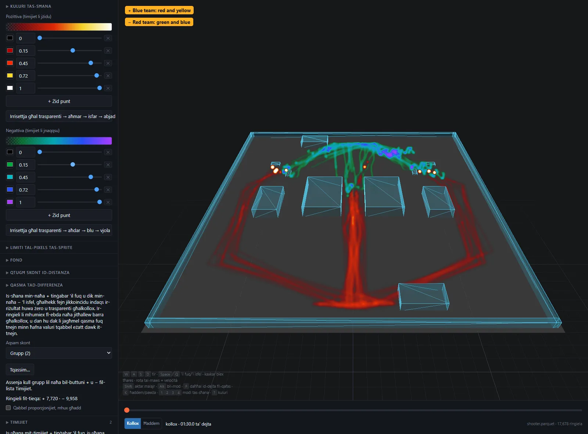

# Differenza

Aħmar fejn it-tim A kien iktar, aħdar-blu fejn kien it-tim B, u xejn fejn kienu ndaqs.

**Differenza** (ċavetta 2) hija sħana bi sinjal. Ringieli ta' popolazzjoni waħda jżidu sħana; ringieli ta' oħra jnaqqsuha. Fejn iż-żewġ popolazzjonijiet jaqblu indaqs, ir-riżultat huwa żero u kompletament trasparenti; fejn waħda tagħlab, juri bil-kuluri ta' dik in-naħa - bi default sħun (trasparenti → aħmar → isfar → abjad) għan-naħa **+** u frisk (trasparenti → aħdar → blu → vjola) għan-naħa **−**.

## Kif tuża dan {#how-to-use-it}

1. Agħfas `2` (jew agħżel **Differenza** fil-bar tal-modi).
2. Iftaħ **Qasma tad-differenza** fis-sidebar.
3. Agħżel x'tiqsem **Aqsam skont**: normalment *Gruppi*.
4. Poġġi grupp (jew valur) fuq **+** u ieħor fuq **−**.
5. Aqra l-kuluri: sħun ifisser in-naħa +, frisk ifisser in-naħa −. Il-panew jissenjala jekk xi naħa m'għandha l-ebda ringiela (ara [Messaġġi li tista' tara](#messages-you-may-see)).

*Liema* żewġ popolazzjonijiet huma l-mistoqsija kollha, għalhekk il-qasma tista' tkun kull kolonna miżmuma, mhux biss gruppi. Ringieli li jaqgħu **fl-ebda** naħa huma **mitfija**, mhux imqabbda bħala żero: dan huwa li jagħmel qasma fuq żewġ valuri minn ħafna tqabbel eżattament dawk iż-żewġ valuri, u jitqabbel mal-[filtri](filters.md) - iffiltra għal mappa waħda, imbagħad aqsam dik skont il-build.

Il-modalità teħtieġ żewġ naħat: kolonna ta' grupp b'mill-inqas żewġ gruppi, jew qasma fuq kolonna miżmuma għall-filtrar. Fuq dejta b'inqas minn żewġ gruppi, tagħbija tibda b'qasma ta' kolonna - l-ewwel il-kolonna *Source file* ta' tagħbija ta' diversi fajls, inkella l-ewwel kolonna ta' kategorija b'żewġ valuri, inkella l-ewwel kolonna numerika b'medda - sabiex *qabbel żewġ tagħbijiet* jaħdem fuq dejta mingħajr gruppi. Dejta mingħajr xejn minn dan biss tagħmel il-modalità ma tkunx disponibbli; hekk ukoll qasma ta' kolonna li titħalla b'xejn fuq naħa waħda.

## Il-panew Qasma tad-differenza {#the-difference-split-panel}

Juri fil-modalità Differenza, taħt il-panels tas-sħana.

**Aqsam skont** joffri:

| Għażla | Murija bħala | Regola tal-qasma |
|---|---|---|
| Gruppi | *Grupp (N)* (meta jkun hemm kolonna ta' grupp) | Kull grupp fuq +, − jew xejn, imqiegħed fil-[Lista tat-timijiet](teams-list.md) |
| Kolonna ta' kategorija | *kolonna (N valuri)* | Valuri fuq +, − jew xejn |
| Kolonna numerika | *kolonna (numeriku)* | Medda ta' valur għal kull naħa |
| Il-fajl ta' oriġini | *Source file - qabbel żewġ tagħbijiet* (meta nġabru diversi fajls) | Fajls fuq +, − jew xejn |

Jiġu offruti biss kolonni mitfugħa taħt *Żomm għall-iffiltrar* fil-ħin tat-tagħbija.

### Qabbel proporzjonijiet, mhux għadd {#compare-shares-not-counts}

**Qabbel proporzjonijiet, mhux għadd** (default mitfi) jiżen kull naħa b'wieħed fuq l-għadd ta' ringieli tagħha stess, sabiex naħa b'ħames darbiet iktar ringieli ma tirbaħx bin-numri biss. Il-kulur imbagħad juri fejn kull naħa hija iktar komuni proporzjonalment mill-oħra. Uża dan meta ż-żewġ naħat ikollhom ammonti ta' dejta differenti ħafna, pereżempju żewġ sessjonijiet ta' tul differenti.

### Messaġġi li tista' tara {#messages-you-may-see}

Il-panew iwissi meta l-istampa ma tkunx differenza vera:

| Messaġġ | Tfisser |
|---|---|
| *N + / M −* (jew *N + / M − / K ma nużawx*) | Kemm valuri jinsabu fuq kull naħa (u fuq xejn). |
| Ebda ringiela fil-kju mhi fuq in-naħa **+** | Biss in-naħa **−** titpinġa. Mexxi l-kju tal-linja taż-żmien jew ibdel il-qasma. |
| Ebda ringiela fil-kju mhi fuq in-naħa **−** | Biss in-naħa **+** titpinġa. |
| Ebda valur mhu fuq xi naħa | Id-differenza ma tpinġi xejn. Poġġi mill-inqas valur wieħed fuq **+** jew **−**. |
| *kolonna* ma tistax tinqasam b'dan il-mod | Il-kolonna magħżula ma tilqax mal-qasma. Agħżel il-kolonna mill-ġdid. |
| Il-kolonna tal-qasma ma daħlitx fil-memorja tal-GPU għal N minn M blokki | Dawk ir-ringieli ma jinġibdux. Żid il-baġit tal-GPU taħt Prestazzjoni → Baġits tar-riżorsi, jew tagħbi inqas ringieli. |

### Skont il-grupp {#by-group}

Il-panew jindika biss lejn il-[Lista tat-timijiet](teams-list.md), fejn kull grupp għandu buttuna **+** u **−**. Fuq kull tagħbija l-ewwel nofs il-gruppi (imqarrba 'l fuq) jitqiegħdu fuq +, il-bqija fuq −; **Aqsam indaqs** fil-Lista tat-timijiet jagħmel l-istess mill-ġdid. Grupp li ma jkunx fuq naħa, jew moħbi bil-checkbox tiegħu, ma jikkontribwixxix xejn.

### Skont il-valuri tal-kategorija {#by-category-values}

| Parti | Tfisser |
|---|---|
| `a + / b − / c ma nużawx` | Kemm valuri jinsabu fuq kull naħa u fuq xejn. |
| **Neħħi** | Iqiegħed kull valur fuq ebda naħa. |
| Lista tal-valuri | Kull valur b'buttuna **+** u **−** (ikklikkja l-attiva għal darb'oħra biex titneħħa minn dik in-naħa). Valur vojt jidher bħala *(nieqes)*. |
| Nota tal-limitu | Jiġu elenkati biss l-ewwel 200 valur: *Qed nurihom l-ewwel 200 minn N valur. Kolonna daqshekk wiesgħa aħjar tiġi ristretta b'filtru l-ewwel, jew maqsuma skont medda jekk il-valuri tagħha huma ordnati.* |

Meta tagħżel il-kolonna, l-ewwel valur tagħha jmur fuq + u t-tieni fuq −. Meta ebda naħa ma jkollha valur, il-qasma tirritorna għall-gruppi minflok ma turi qafas vojt. *Source file* jaħdem bl-istess mod, valur wieħed għal kull fajl - hekk jitqabblu żewġ esportazzjonijiet, żewġ testijiet jew żewġ build.

### Skont il-medda {#by-range}

| Parti | Tfisser |
|---|---|
| Ħajt | Il-minimu u l-massimu tal-kolonna. |
| **Medda pożittiva (+)**, **minn** / **sa** | Ringieli b'valur f'din il-medda, inklużi fiż-żewġ tarfijiet, jiżdiedu. |
| **Medda negattiva (−)**, **minn** / **sa** | Ringieli f'din il-medda jitnaqqsu. |
| **Aqsam fin-nofs** | Iqiegħed + fuq [minimu, nofs] u − fuq [nofs, massimu] - dak li jsir ukoll meta tagħżel il-kolonna. |

Valur f'iż-żewġ medda jitqies bħala +. Il-medda ma jridux jkopru l-kolonna kollha; valuri f'xejn minnhom jitħallew barra. *L-ewwel żewġ minuti kontra l-aħħar żewġ minuti* hija qasma ta' medda fuq kolonna bħal ħin.

## Kuluri {#colours}

Is-taqsima **Kuluri tas-sħana** turi żewġ editors tar-rampa f'dan il-mod: **Pożittiva (timijiet li jżidu)** u **Negattiva (timijiet li jnaqqsu)**, kull wieħed bil-buttuna tar-reset tiegħu (*Erġa' lura għal trasparenti → aħmar → isfar → abjad*, *Erġa' lura għal trasparenti → aħdar → blu → vjola*). Il-kompożit jieħu l-valur assolut tas-sħana netta permezz tal-[punt tas-saturazzjoni u r-rispons](colour-and-exposure.md), u jagħżel ir-rampa negattiva fejn in-netta hija taħt iż-żero. Ara [Kulur u esponiment](colour-and-exposure.md#the-ramp-editor).

Uża r-rispons tad-densità *Lineari* meta d-daqs tad-differenza jimporta: huwa l-uniku rispons fejn kulur ugwali jfisser għadd ugwali.

## Għall-iżviluppaturi {#for-developers}

Kull ringiela tieħu sinjal ta' +1, -1 jew 0 fil-vertex shader ([`POINT_HEAT_VS`](https://github.com/Holdi601/3DHeat/blob/main/src/render/webgl2/shaders.ts)); 0 jiċħad il-ringiela qabel ma jinġibed kwalunkwe fragment.

- Skont il-grupp, is-sinjal ġej minn tabella ta' grupp ta' 4,096 entry indiċizzata mill-id tal-grupp tar-ringiela (l-id tal-grupp jgħaddi fil-kanal ir-raba' tat-texel tal-pożizzjoni tar-ringiela).
- Skont il-kategorija, is-sinjal ġej minn tieni tabella ta' 4,096 entry, mimlija għal kull valur tal-kategorija, u l-valur tar-ringiela jinqara mit-texture tal-filtru tal-kolonna; valur wara t-tmiem tat-tabella jiġi miċħud fuq iż-żewġ backends.
- Skont il-medda, il-valur tar-ringiela jitqabbel mal-iż-żewġ medda.

Tibdil fil-qasma jerġa' jibda l-akkumulazzjoni.

**Gruppi moħbija jibqgħu moħbija f'kull qasma.** Taħt qasma skont kolonna t-tabella tal-gruppi ma tgħorrx aktar sinjali; iżżomm 1 għal grupp muri u 0 għal wieħed moħbi ([`frameSignTables`](https://github.com/Holdi601/3DHeat/blob/main/src/render/filterTables.ts)), u ż-żewġ tabelli jaslu lis-shader flimkien - żewġ nofs ta' texture tas-sinjal wieħed fuq WebGL2, żewġ nofs ta' buffer tal-ħażna wieħed fuq WebGPU. Ringiela tinġibed biss meta l-grupp tagħha jkun muri *u* il-valur tal-kolonna tagħha jkun fuq naħa. Għalhekk grupp li ma jkunx iċċekkjat fil-[Lista tat-timijiet](teams-list.md), jew imħalli barra mill-fokus tan-naħa tat-tab Match, ma jikkontribwixxi xejn kemm-il darba tinqasam id-differenza.
