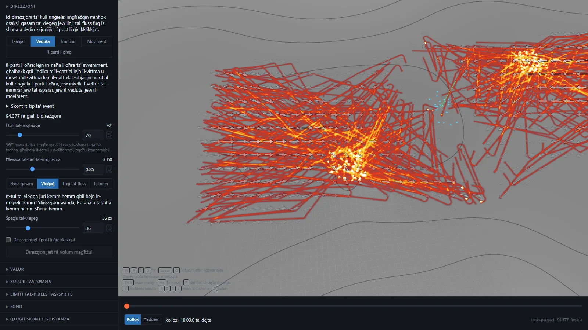

# Sħana direzzjonali

Is-sħana sempliċi tgħid **fejn** jiġru l-affarijiet. Is-sħana direzzjonali tgħid ukoll **liema triq**: f'liema direzzjoni kienu qed iħarsu n-nies, fejn kienu qed jimmiraw, jew fejn kienet il-parti l-oħra ta' ġlieda.

Sprite normali hu diska sħiħa (360 grad). B'**Ftuħ tal-imgħezqa** ta' 70 grad, l-istess sprite isir imgħezqa dejqa li tindika t-triq li kienet iffaċċjata biha r-ringiela, u jżid l-istess sħana totali.

## Kif tuża {#how-to-use-it}

1. Tagħbi dejta b'direzzjoni fiha (ara [X'jagħti direzzjoni lil ringiela](#what-gives-a-row-a-direction)).
2. Agħżel **Sħana**, **Differenza** jew **Sħana tat-timijiet** fil-barra tal-modi.
3. Iftaħ it-taqsima **Direzzjoni** fil-barra tal-ġenb.
4. Agħżel **sors** (liema direzzjoni tuża), imbagħad idrar it-tpitir:
   - naqqas **Ftuħ tal-imgħezqa** taħt 360° biex tpitter kull ringiela bħala imgħezqa li tindika t-triq tagħha minflok diska;
   - agħżel **Qasam** biex tpitter vleġeġ jew linji tal-fluss fuq is-sħana;
   - immarka **Direzzjonijiet f'post li ġie kklikkjat** u ikklikkja s-sħana biex tikseb grafiku polari ta' dak il-post.

Il-linja tal-istatus tgħid kemm ringieli għandhom direzzjoni mis-sors magħżul.

## Settings {#settings}

| Setting | Default | X'jagħmel |
|---|---|---|
| Sors: **L-aqwa**, **Veduta**, **Immirar**, **Moviment**, **Il-parti l-oħra** | L-aqwa | Liema direzzjoni tieħu kull ringiela. *L-aqwa* jieħu, għal kull ringiela, il-parti l-oħra, inkella l-immirar, inkella l-veduta, inkella l-moviment. |
| **Skont it-tip ta' avveniment** | kif fuq | Sors differenti għal kull tip ta' avveniment, pereżempju *Il-parti l-oħra* għal qtil u *Veduta* għal pożizzjonijiet. Jintwera meta d-dejta jkollha kolonna ta' avveniment b'mill-iktar 40 valur. |
| **Ftuħ tal-imgħezqa** | 360° | 360° hi d-diska normali (mitfija). Iżgħar hi imgħezqa iktar dejqa. Imgħezqa tiżid daqs kemm tiżid id-diska tagħha, għalhekk it-totali u d-differenzi jibqgħu jitqabblu. |
| **Ħlewwa tat-tarf tal-imgħezqa** | 0.35 | 0 hi imgħezqa b'tarf qawwi, 1 ventaljata artab. |
| **Qasam**: Ebda qasam, Vleġeġ, Linji tal-fluss, It-tnejn | Ebda qasam | Vleġeġ: it-tul ta' vleġġa juri kemm ir-ringieli hemm jaqblu fuq triq waħda, l-opaċità tagħha kemm hemm sħana. Vleġeġ jidhru biss fejn hemm sħana. |
| **Spazju tal-vleġeġ** | 28 px | Id-distanza bejn il-vleġeġ fuq l-iskrin. |
| **Animazzjoni tal-linji tal-fluss** | mixgħul | Il-linji tal-fluss jiċċaqilqu waqt li jkunu mixgħula. |
| **Direzzjonijiet f'post li ġie kklikkjat** | mitfi | Ikklikkja s-sħana biex tara d-direzzjonijiet hemm (hawn taħt). |
| **Direzzjonijiet fil-volum magħżul** | | L-istess grafiku għal kollox li hu ġewwa l-[volum](volumes.md) magħżul. |

## Il-grafiku polari f'post {#the-polar-chart-at-a-spot}

Bil-**Direzzjonijiet f'post li ġie kklikkjat** mixgħul, ikklikkja s-sħana. Ir-ringieli qrib dak il-punt (fi ħdan 1.5 raġġ sprite) jinġabru f'rożza ta' 24 biċċa ta' 15°:

- petali **oranġjo**: direzzjonijiet ta' barra (fejn jindikaw ir-ringieli);
- petali **blu**: direzzjonijiet ta' ġewwa (minn fejn ġew);
- **żona** ta' petal tikber mal-għadd tiegħu; vleġġa turi d-direzzjoni prinċipali;
- il-linji taħt il-grafiku jagħtu l-idwar prinċipali, kemm ir-ringieli jaqblu (R, minn 0 sa 1), it-tixrid f'gradi, u l-għadd ta' ringieli.

0° hu 'l fuq fuq il-grafiku, li hu −Z tad-dinja (it-tramuntana għal reġistrazzjonijiet ta' Tacview). Il-post jiġi wkoll immarkat fil-veduta 3D b'vleġġa u ċirku.

## X'jagħti direzzjoni lil ringiela {#what-gives-a-row-a-direction}

| Sors | Dak li jrid fid-dejta |
|---|---|
| Veduta | kolonna ta' yaw (immappjata bħala d-direzzjoni tal-ħarsa): `yaw`, `heading`, `azimuth`, `view_yaw`, `rot_z` |
| Immirar | pari ta' numri bħal `aim_x`/`aim_y`, `shot_x`/`shot_y`, `fire_x`/`fire_y`, `hit_dir_x`/`hit_dir_y` (`…_z` fakultattiv) |
| Moviment | xejn iktar: il-pass mill-kampjun preċedenti tal-istess persuna (l-iktar 10 s qabel, l-istess sessjoni) |
| Il-parti l-oħra | kolonna li ssemmi l-naħa l-oħra ta' avveniment (`other`, `victim`, `target`, `killer`, `attacker`, `shooter`, `other_player` ...) li l-valuri tagħha humaismijiet ta' persuni; qtil jindika mill-qattiel għall-vittma, mewt mill-vittma għall-qattiel |

## Tips {#tips}

- Il-wedges jeħtieġu ftit daqs fuq l-iskrin; taħt xi ftit pixels jerġgħu jinġibdu bħala diski.
- Uża *Il-parti l-oħra* fuq ringieli ta' qtil biex tara **minn fejn** rebħu l-ġlidiet, u *Veduta* fuq ringieli ta' pożizzjoni biex tara **fejn in-nies jgħossu**.
- Bil-**Differenza**, il-wedges taż-żewġ naħat jindikaw fid-direzzjonijiet tagħhom stess, għalhekk linji tan-nar kontestati joħorġu barra.
