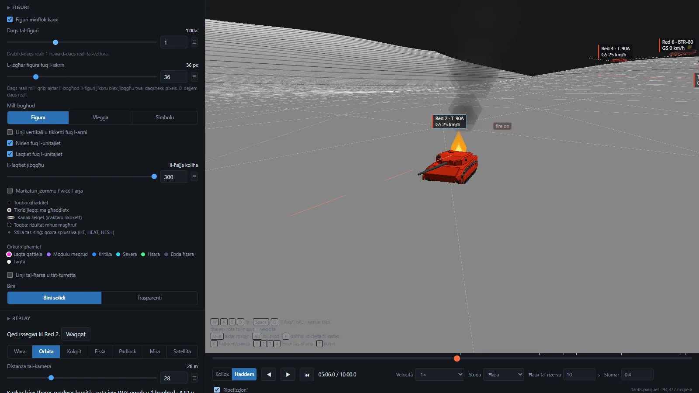

# Figuri

**Figura** hija mudell 3D żgħir ta' dak li unità tassew hija: tank, jet, bastiment, suldat. Il-[replay](match-replay.md) jpinġi kull unità bħala l-figura tagħha f'daqs reali, minflok kaxxa sempliċi.

Hemm madwar 2,000 vettura, ajruplan, bastiment, arma u suldat b'isem, kollha mibnija mill-viewer innifsu.

## Dak li hemm fil-katalogu {#what-is-in-the-catalogue}

| Qasam | Eżempji |
|---|---|
| Persuni | suldat wieqaf, qed jitgħawweġ, mistqarr; sniper, anti-tank, medic, crew |
| Art | tankijiet, vetturi tal-infanterija bil-gwerra, difiża mill-ajru, artillerija, trakkijiet u karozzi, ferrovija u trammijiet |
| Ajru | fighters, ajruplani tal-attakk, bombers, transporti, elikotteri, mill-biplanes sa jets moderni |
| Baħar | bastimenti tal-gwerra skont il-klassi, carriers, sottomarini, dgħajjes, merkantili |
| Armi | missili, razzi, bombi, torpedni, flares u chaff |
| Markers | grenades tad-duħħan, tal-flash u tan-nar, bombi mħawlin, bnadar, spawns, waypoints |

## Kif isiru l-figuri {#how-the-figures-are-made}

- **Mibnija minn dimensjonijiet ippubblikati.** Ħafna mill-figuri jsiru mill-builder tal-figuri tal-viewer stess minn numri pubbliċi: tul, wisa', għoli, roti tat-triq, torri u kanun, ġwienaħ u denb. Il-forma tagħhom imbagħad tiġi aġġustata kontra ritratti pubbliċi, disinji u dimensjonijiet ippubblikati. Ma jintuża l-ebda mudell ta' logħba.
- **Mudelli ħielsa.** Xi figuri jużaw mudelli 3D ħielsa (CC0 jew CC BY) fejn huma iktar veri, xi drabi flimkien mal-ġisem mibni. L-awturi ta' xogħlijiet CC BY huma kkreditati fuq [Krediti tal-figuri](figure-credits.md); xogħlijiet CC0 ma jeħtieġux kreditu u ma jidhrux hemm.
- Kull figura għandha verżjoni sħiħa, waħda approssimattiva u waħda għall-bogħod (livelli ta' dettall, LOD), biex jinġibdu eluf fl-istess ħin.

## Liema figura tingħata lil unità {#which-figure-a-unit-gets}

Il-viewer iħares lejn il-kolonni tad-dejta stess:

1. **Ismijiet** - kolonni msejħa *Name*, *Vehicle*, *Unit*, *Unit type*, *Model*, *Aircraft*, *Plane*, *Tank*, *Ship*, *Craft*, *Loadout*, *Kit* jew *Figure* - jitqabblu mal-katalogu: eżattament, permezz ta' madwar 4,000 alias (ID-ijiet tal-unitajiet ta' diversi logħob), bl-aktar bidu twil magħruf (`F-16C_50` huwa l-F-16C), jew bl-isem iqsar tal-figura li jibda bih.
2. Isem li l-figura tiegħu ma taqbilx mat-**tip** tal-unità ma jintużax (trakk imsejjaħ *Typhoon* mhuwiex il-fighter).
3. **Tipi** - kolonni msejħa *Type*, *Class*, *Kind*, *Category*, *Icon*, *Role* jew *Domain* - jagħtu figura tal-klassi: tags ta' Tacview (`Air+FixedWing`, `Ground+Heavy+Armor+Vehicle+Tank`, `Sea+Watercraft+Warship`, `Weapon+Missile`), ikoni tal-mappa, jew kliem sempliċi (tank, helicopter, infantry).
4. Dejta li m'għandha xejn minn dawn hija dejta ta' persuni: kulħadd huwa suldat.

Allura l-aktar mod faċli biex tikseb il-figuri t-tajbin huwa kolonna `vehicle` bl-ismijiet veri, jew kolonna `type` bi tags ta' Tacview.

**L-unità tiegħi tidher bħala kaxxa jew bħala suldat.** Żid kolonna `vehicle` bl-isem reali, jew kolonna `type` b'tag ta' Tacview. Ħalli l-mouse fuq l-unità biex tara liema isem intlaħaq. Dejta b'dawn il-kolonni iżda li ma tgħid xejn dwar unità tħalliha kaxxa; dejta mingħajr dawn tintwera bħala suldati.

## Settings {#settings}

Is-sezzjoni **Figures** tas-sidebar tar-replay tissettja d-daqs, id-daqs l-iżgħar fuq l-iskrin, dak li jsiru l-unitajiet tal-bogħod (figura, vleġġa, simbolu), u l-effetti mpinġija fuqhom. Ara [Replay tal-partita](match-replay.md#figures). Duħħan, nar u effetti oħra bil-ħin: [Figuri fl-overlay tal-figuri](figure-replay.md).

## Pakkett lokali fakultattiv tal-figuri {#an-optional-local-figure-pack}

Tista' żżomm pakkett fakultattiv tal-figuri tiegħek stess fuq il-magna tiegħek stess. Il-figuri tiegħu jieħdu post il-figuri tal-katalogu bl-istess ismijiet. Qatt ma jkun parti mir-repożitorju jew minn bini ppubblikat; mingħajru, xejn ma jinbidel.
