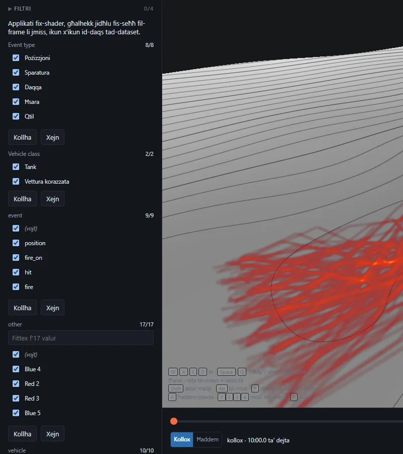
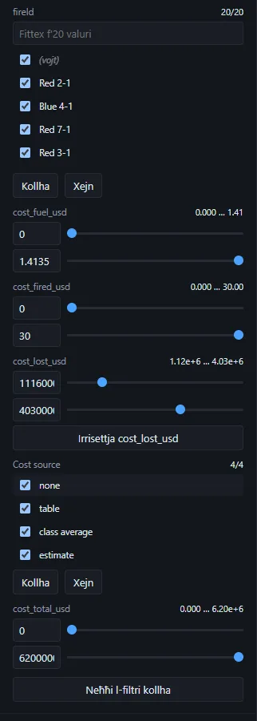

# Filtri

**Filtri** jaħbu l-ringieli li ma tkunx tixtieq, bħal klassi waħda ta' vettura jew tip wieħed ta' avveniment, u l-istampa taġġorna minnufih. Il-pannell jelenka l-kolonni miżmuma fil-ħin tat-tagħbija taħt *Żomm għall-filtrar* ([Immappjar tal-kolonni](column-mapping.md)), flimkien mal-*Fajl tas-sors* meta tkun tellajt diversi fajls.

## Ipprova {#try-it}

1. Għabbi dataset u iftaħ **Filtri** fis-sidebar.
2. Taħt **Klassi tal-vettura**, neħħi l-kaxxa ta' *Tank*. L-istampa tinbidel minnufih.
3. Agħfas **Neħħi l-filtri kollha** biex tirtira.

L-ewwel ringieli huma l-kolonni tal-viewer stess (hawn taħt). Dawk wara jiġu mill-fajl tiegħek.

## Il-kolonni li ż-viewer iżid {#columns-the-viewer-adds}

Fit-tagħbija l-viewer jaħdem erba' kolonni tiegħu stess u jelenkhom **l-ewwel**, bl-ismijiet u l-valuri fil-lingwa tiegħek, sabiex l-istess filtru jaħdem għal kull logħba u sors ta' data:

| Kolonna | Valuri | Maħduma minn |
|---|---|---|
| **Tip ta' avveniment** | 23 tip: Pożizzjoni, Tir sparat, Tnedija (missile, rocket, bomb), Laqta, Tfixkil (l-arma spiċċat qrib l-ebda mira), Splużjoni, Ħsara, Qtil, Mewt, Meqruda, Tkissir, Ħruġ mill-vettura / bail-out, Tqegħid, Tneħħija, Tlugħ, Nżul, Kuntatt mal-art, Waqfa fuq l-art, Rearm / refuel, Qbid / għan, Decoy, Messaġġ, Oħrajn | kolonna msejħa `event`, `events`, `event_type` jew `event_name`; il-kliem ta' kull logħba (`shot`, `burst`, `fired`, `struck`, `flare`, `plant` ...) jitqabbel ma' dawn it-tipi. It-tabella sħiħa: [Tipi u klassijiet ta' avvenimenti](ref-event-types.md). |
| **Plejer jew AI** | Plejer, AI | kolonna `ai`, `is_ai`, `bot` jew `actor`; inkella `is_player` / `human`; inkella ID tal-kont (`user_id`, `steam_id`; vojt jew 0 ifisser AI); għal reġistrazzjonijiet Tacview, jekk l-oġġett għandux pilota |
| **Klassi tal-vettura** | 17-il klassi: Ġellieda, Inġenju tal-attakk, Bomber, Inġenji oħra, Helicopter, Tank, Vettura blindata, Difiża tal-ajru, Artillerija, Trakk / karozza, Vapur, Sottomarin, Infanterija, Arma, Decoy, Struttura, Oħrajn | l-isem tal-vettura jew tal-unità (jitqabbel mal-[katalgu tal-figuri](figures.md)) u l-kolonni tat-tip |
| **Klassi tal-mira** | l-istess klassijiet | il-vettura tal-parti l-oħra (`other_vehicle`, `target_vehicle`, `victim_type` ...) |

Eżatt warajhom jiġu l-[kolonni tar-riżultat](data-formats.md#outcome-columns), fejn id-dejta għandha minnhom: **Riżultat tar-rawnd** u **Riżultat tal-partita** (*Kwalunkwe*, *Mirbuħ*, *Mitluf*) u **Kif intemm ir-rawnd**, bil-valuri tiegħu fil-lingwa tiegħek. Iffiltra fuqhom, jew aqsam is-sħana skonthom bħala [mappa tar-rata ta' rebħ](win-rate.md).

Jiġu elenkati biss it-tipi li jidhru. Il-kolonni tal-valur (`cost_*`, `earn_*`, `net_*` u *Sors tal-kost*, ara [Piż tal-valuri](value-weighting.md)) jistgħu jiġu ffiltrati bħal kwalunkwe kolonna numerika: pereżempju neħħi l-kaxxa ta' *estimate* taħt *Sors tal-kost* biex iżżomm biss ringieli bi prezz.

Lista ta' kategorija b'iktar minn 12-il valur tingħata kaxxa tat-tfittix (*Fittex n valuri*) u buttuna **Dawn biss** li tippermetti eżattament il-valuri li jaqblu.

Liema kolonni jistgħu jiġu ffiltrati jiġi deċiż fil-ħin tat-tagħbija, għax iridu jinqraw dak il-ħin. Jekk ma tkun miżmuma l-ebda kolonna, il-pannell jgħid hekk u jindika lejn *Żomm għall-filtrar*.

## Kolonni numeriċi (medda) {#numeric-columns-range}

| Parti | Tifsira |
|---|---|
| Isem, u `min ... max` | Il-kolonna, u l-medda attwali (il-medda sħiħa tal-kolonna sakemm ma jkun hemm l-ebda filtru). |
| L-ewwel ringiela: kaxxa tan-numri u slider | Il-limitu t'isfel. Jekk tigbed is-slider 'il fuq mil-limitu ta' fuq, jimxi miegħu wkoll il-limitu ta' fuq. |
| It-tieni ringiela: kaxxa tan-numri u slider | Il-limitu ta' fuq. Jekk tigbed 'il isfel mil-limitu t'isfel, jimxi wkoll dak. |
| **Neħħi *kolonna*** | Iwaqqa' dan il-filtru. |

Is-sliders jkopru mill-minimu sal-massimu tal-kolonna f'1,000 pass; il-kaxxi tan-numri jaċċettaw kwalunkwe valur. Ringiela tgħaddi meta l-valur tagħha jkun fil-medda, it-tnejn fit-truf inklużi. Valuri kbar jintwerew f'forma b'esponent (`1.23e6`).

## Kolonni ta' kategorija {#category-columns}

| Parti | Tifsira |
|---|---|
| Isem, u `allowed/total` | Il-kolonna, u kemm mill-valuri tagħha huma permessi. |
| Lista tal-valuri | Kaxxa għal kull valur; valur vojt jintwera bħala *(vojt)*. |
| **Kollox** / **Xejn** | Jippermetti kull valur / l-ebda valur. |

Meta tippermetti l-valuri kollha, il-filtru jitneħħa.

## Regoli {#rules}

- **Erba' filtri f'daqqa.** L-intestatura turi `attiv/4`. Ħames filtru ma jiġix applikat, u l-pannell jgħid hekk. Għażla fl-[Entitajiet](entities.md) (jew il-fokus tal-plejer fit-tab Partita) tuża wieħed mill-erba' wkoll. Filtru li jkopri l-kolonna kollha ma juża xejn.
- **Kolonna ta' kategorija għandha mill-iktar 4,096 valur**; waħda usa' ma tinżammx fil-ħin tat-tagħbija.
- **Il-filtri jingħaqdu bi AND**, u mal-viżibbiltà tat-timijiet, mal-qasma tad-differenza, mat-tieqa taż-żmien, mal-qtugħ tad-distanza u mal-[qatgħa](slice.md).
- **Tibdil f'filtru jerġa' jibda l-akkumulazzjoni u jerġa' jkejjel l-espożizzjoni ftit frames wara**, għax il-filtrar jista' jbiddel ħafna d-densità ([Kulur u esponiment](colour-and-exposure.md#auto-exposure)).
- **Neħħi l-filtri kollha** jneħħi kull filtru ta' kolonna. Il-viżibbiltà tat-timijiet u l-għażliet tal-plejers magħmula f'postijiet oħra jinżammu.
- Il-filtri tal-kolonni jibdlu l-modalitajiet tas-sħana. Ma jibdlux il-figuri tal-[replay tal-figuri](box-replay.md), li jsegwu l-viżibbiltà tat-timijiet u l-għażla tal-Entitajiet. L-għażla tal-Entitajiet tibdel it-tnejn.
- Fil-[sħana tal-linji](line-heat.md) filtru jiġi ttestjat fuq ir-ringiela li kull segment *jispiċċa* fiha.
- F'kull dataset ġdid, il-filtri kollha jitneħħew.

## Għall-iżviluppaturi {#for-developers}

**Slots.** Kull filtru attiv jieħu wieħed mill-erba' slots tal-GPU ([`MAX_FILTER_SLOTS`](https://github.com/Holdi601/3DHeat/blob/main/src/render/types.ts)), texture ta' 4 bytes għal kull ringiela. Is-slots jingħataw lill-filtri skont l-ordni tal-aħħar bidla ([`filterSlots`](https://github.com/Holdi601/3DHeat/blob/main/src/render/filterTables.ts), maqsum bejn l-shader u ż-żewġ pannelli). Wara erbgħa, tidher żball li jgħid *Qed tiġi applikata biss l-ewwel 4 filtri. Neħħi wieħed - il-bqija qed jiġu injorati, mhux imġemmgħa bil-moħbi*, u l-ismijiet tal-filtri extra jaqraw *kolonna (mhux applikat)*. Il-filtri jaħdmu għal kull ringiela fil-vertex shader, għalhekk tibdil fil-limitu ma jeħtieġx qari mill-ġdid tad-data u lanqas tqegħid mill-ġdid fuq il-GPU.

**Filtri li l-pannell ma juriex.** Hemm żewġ tipi oħra fl-istat tal-applikazzjoni ([`FilterSpec`](https://github.com/Holdi601/3DHeat/blob/main/src/state/types.ts)):

- filtru ta' **gruppi**, imwaħħal mit-tab Partita meta jiffoka naħa waħda. Jaħbi l-gruppi l-oħra fil-modalitajiet kollha, inkluża qasma ta' [differenza](difference.md) skont kolonna.
- filtru ta' **persuni**, imwaħħal mill-pannell [Entitajiet](entities.md) u mit-tab Partita meta jiffoka plejer wieħed. Jillimita r-replay tal-figuri u l-modalitajiet tas-sħana. Fis-sħana huwa filtru ta' kategorija fuq l-ID tal-persuni u jieħu wieħed mill-erba' slots. Il-maskra tiegħu tżomm 65,536 ID ([`FILTER_MASK_CAPACITY`](https://github.com/Holdi601/3DHeat/blob/main/src/render/types.ts)); persuna li tmur 'il hinn minn dan ma tinżilx fis-sħana waqt li jkun attiv, anke jekk magħżula. Ir-replay tal-figuri xorta juriha.
