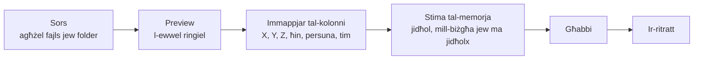

# Kif tidħol id-data

Qabel ma 3DHeat jista' jpinġi xi ħaġa, għandu bżonn tabella: kull ringiela tgħid fejn kien xi ħaġa u, jekk għandek dan, meta u min. Din it-taqsima turi kif fajl isir ritratt. Għadek ma għandekx data? Ipprova l-[data demo](demo-data.md).

**Agħmel dan issa:**

1. Fis-sidebar tal-Heatmap iftaħ **Sors** u agħfas **Fajls…** (jew ħott fajl jew folder fuq iż-żona tat-tqegħid).
2. Ara l-**Immappjar tal-kolonni**: il-kaxxi normalment diġà mimlija.
3. Ara li l-**Stima tal-memorja** tgħid *jidħol*.
4. Agħfas **Għabbi**.

Kollox li juri t-tab Heatmap ġej minn **dataset** wieħed: tabella ta' ringieli, kull waħda b'pożizzjoni u, jekk tkun hemm, ħin, persuna, grupp, sessjoni, direzzjoni tal-ħares u kwalunkwe numru ta' kolonni oħra miżmuma għall-filtrar. Din it-taqsima tispjega kif isir dataset.

## It-triq mill-fajls għall-ritratt {#the-path-from-files-to-picture}

1. **Agħżel fajls** fil-pannell **Sors** - fajl wieħed, diversi, siġra ta' folders, jew billi tħotthom. Parquet, CSV, Tacview, tracks ta' GPS u iktar jiġu aċċettati; l-lista sħiħa waħda hi f'[Formati tad-data](data-formats.md#files). Ara [Tagħbija tal-fajls](loading-files.md).
2. **Preview.** Jinfetaħ l-ewwel fajl tal-għażla: l-ismijiet tal-kolonni tiegħu, l-ewwel 50 ringiela, liema kolonni jidhru numeriċi, u (Parquet) it-tip loġiku ta' kull kolonna u l-istruzzjonijiet ta' qari tal-fajl stess, id-dħul `heat3d` fil-footer.
3. **Immappjar awtomatiku.** Il-kolonni jiġu assenjati lil ruħhom - X, Y, Z, ħin, persuna, sessjoni, grupp, direzzjoni tal-ħares - u ftit minnhom jinżammu għall-filtrar. Kull tbassir jidher fil-pannell **Immappjar tal-kolonni** u jista' jinbidel. Ara [Immappjar tal-kolonni](column-mapping.md) u [Assi, unitajiet u ħin](axes-units-and-time.md).
4. **Għadd.** L-għadd ta' ringieli ta' kull fajl jinqara (eżattament mill-footer ta' Parquet, stmat għal CSV), sabiex il-pannell ikun jista' jgħid qabel ma titħabbar xejn kemm memorja teħtieġ it-tagħbija u jekk tidħolx. Jekk ma tidħolx, jipproponi li titħabbar kull *N*-ija ringiela. Ara [Memorja u baġits](memory-and-budgets.md).
5. **Tagħbija.** Worker fl-isfond jaqra biss il-kolonni immappjati ta' kull fajl - diversi fajls f'daqqa, sa baġit tal-[threads tal-parser](memory-and-budgets.md#parser-threads) - u jgħaqqadhom, fl-ordni tal-għażla, f'dataset wieħed: dizzjunarju komuni wieħed ta' persuni, gruppi u sessjonijiet fuq il-fajls kollha, bidu komuni wieħed tal-ħin, u r-ringieli kollha ordnati skont il-ħin. Ara [Sessjonijiet, persuni u gruppi](sessions-persons-groups.md).
6. **Tqegħid fuq il-GPU.** Il-fil prinċipali jannunzja "Qed tiġi mqiegħda N ringiela fuq il-GPU" għal frame wieħed, imbagħad ipakkja r-ringieli fil-memorja tal-GPU fil-limitu tal-baġit tal-GPU. Ara [Residenza tal-memorja tal-GPU](gpu-memory.md).
7. **L-ewwel ritratt.** Il-kamera tiffrena d-data, ir-raġġ tas-sprite u s-saturazzjoni jiġu stabbiliti mill-estensjoni tad-data u l-għadd ta' ringieli, u wara 8 frames imlissa s-saturazzjoni tiġi mkejla mill-istampa stess ([Kulur u esponiment](colour-and-exposure.md)).

## Rekwiżiti, ikkontrollati qabel tagħbija {#requirements-checked-before-a-load}

| Bżonn | X'jiġri mingħajru |
|---|---|
| **Mill-inqas tnejn minn X / Y / Z** | It-tagħbija tiġi miċħuda. B'tnejn biss, l-assi t-tielet hu 0 u d-data tinżel bħala pjan ċatt fix-xena 3D - dak li tixtieq mappa tas-sħana mill-fuq. |
| Kolonna tal-ħin | Fakultattiva. Mingħajrha l-linja taż-żmien titfi, il-veduta tibqa' fil-modalità **Kollox**, u s-sidebar jgħid hekk. |
| Kolonna tal-persuna | Fakultattiva. Teħtiġha l-[sovrapposizzjoni tal-figuri](box-replay.md) (figura għal kull persuna), [is-sħana tal-linji](line-heat.md) (it-triq li kull persuna mxiet), l-interpolazzjoni, id-denb u l-istorja **Ħajja**. |
| Kolonna tal-grupp | Fakultattiva. Teħtieġha [is-sħana tat-tim](team-heat.md) u l-modalità [differenza](difference.md) (mill-inqas żewġ gruppi). |

Modalità li d-data mgħobbija ma tappoġġjahiex tkun griża fil-bar tal-modalitajiet; meta tgħaddi fuqha bil-mouse tgħid għalfejn.

## Mingħajr id-data tiegħek {#without-your-own-data}

Il-pannell **Dataset** (taħt **Sors**) għandu [ġeneratur sintetiku](synthetic-generator.md) li jagħmel dataset b'forma ta' battle-royale ta' kwalunkwe daqs, utli biex tipprova l-viewer u biex tittestja x'tista' tgħaddi minnu magna.

## Paġni f'din it-taqsima {#pages-in-this-section}

- [Tagħbija tal-fajls](loading-files.md) - l-għażliet tal-fajls, folders, ħott u tqegħid, għaqda ta' diversi fajls, ir-regola tal-fajl tal-moviment, progress u l-ikkanċellar
- [Immappjar tal-kolonni](column-mapping.md) - kull qasam tal-pannell tal-immappjar, kif l-immappjar awtomatiku jbassar, il-ħjiel `heat3d`
- [Assi, unitajiet u ħin](axes-units-and-time.md) - l-assi tal-fuq, il-qlib, il-iskala tal-unitajiet, unitajiet tal-ħin, direzzjoni tal-ħares
- [Sessjonijiet, persuni u gruppi](sessions-persons-groups.md) - x'jagħmel kull wieħed, il-limiti, ismijiet komuni, daqs tal-entitajiet, il-pannell Dataset
- [Ġeneratur sintetiku](synthetic-generator.md)
- [Memorja u baġits](memory-and-budgets.md) - il-mudell tal-impronta, il-kontroll tad-dħul, it-tnaqqis, il-limitu tat-tqassim, il-baġits tar-riżorsi
