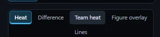

# Modi tas-sħana

Kull punt iżid ftit dwal, id-dwal jitħaxxnu flimkien, u l-massa tinpitta bil-kuluri. Il-modalitajiet huma ħames modi kif tpinġiha, u kull wieħed iwieġeb mistoqsija waħda.

Il-bar tal-modalitajiet fil-quċċata tal-sidebar tat-tab Heatmap jagħżel kif jinħadem [is-dataset](glossary.md). Iċ-ċwievet 1-4 jagħżlu Sħana, Differenza, Sħana tat-tim u Linji. Figuri fuq xulxin m'għandux ċavetta.

| Modalità | Mistoqsija li twieġeb |
|---|---|
| **Sħana** | Fejn ġara, u kemm? |
| **Differenza** | Liema naħa għamlitha iktar? |
| **Sħana tat-tim** | Ta' min kienet? |
| **Linji** | Liema triq ħadu n-nies? |
| **Figuri fuq xulxin** | Min kien fejn, u meta? |

| Modalità (tikketta fil-bar) | Ċavetta | Dak li jpinġi | Jeħtieġ |
|---|---|---|---|
| **Sħana** | 1 | Densità miżjuda: kull ringiela viżibbli tiżid sprite radjali li jħares lejn il-kamera. [Sħana](heat.md) | dataset |
| **Differenza** | 2 | Densità b'sinjal: populazzjoni waħda tiżdied, oħra tnaqqas. [Differenza](difference.md) | żewġ naħat: mill-inqas żewġ gruppi, jew qasma fuq kolonna miżmuma |
| **Sħana tat-tim** | 3 | Densità mikxufa skont il-grupp: tonalità għal kull grupp, imħallta fejn il-gruppi jaqgħu fuq xulxin. [Sħana tat-tim](team-heat.md) | kolonna ta' grupp |
| **Figuri fuq xulxin** | - | Figura (jew kaxxa) għal kull persuna, timxi tul il-linja taż-żmien: ir-replay. [Figuri fuq xulxin](box-replay.md), [Replay tal-partita](match-replay.md) | kolonna ta' persuna |
| **Linji** | 4 | Sħana tal-linji: linja minn kull kampjun ta' persuna sal-kampjun li jmiss, is-sħana titbaxxa lateralment. [Sħana tal-linji](line-heat.md) | kolonna ta' persuna u kolonna ta' ħin |

Modalità li d-data ma tappoġġjahiex tkun griża, u t-tooltip tagħha jgħid għalfejn, per eżempju *Mhux disponibbli - il-modalità Differenza teħtieġ żewġ gruppi jew kolonna miżmuma biex tqassam fuqha; din id-data għandha grupp wieħed.* Meta dataset ġdid ma jappoġġjax il-modalità attwali, il-veduta terġa' tmur għal **Sħana**.

Iċ-ċwievet 1-4 jiġu ttestjati kontra d-data bl-istess mod: ċavetta għal modalità griża ma tagħmel xejn.

## Liema pannelli juri kull modalità {#which-panels-each-mode-shows}

| Pannell | Sħana | Differenza | Sħana tat-tim | Figuri fuq xulxin | Linji |
|---|---|---|---|---|---|
| Rotot ([sħana tal-linji](line-heat.md)) | | | | | iva |
| Forma tas-sħana (b'**Segwi l-veduta** u **L-istess densità f'kull zoom**), Kuluri tas-sħana, Limiti tal-pixels tas-sprite, Fond, Qtugħ tad-distanza | iva | iva | iva | | iva |
| Direzzjoni ([sħana direzzjonali](directional-heat.md)), Valur ([piż tal-valuri](value-weighting.md)) | iva | iva | iva | | iva |
| Viewer tat-timijiet ([Figuri fuq xulxin](box-replay.md)) | | | | iva | |
| Qasma tad-differenza ([differenza](difference.md)) | | iva | | | |
| [Timijiet](teams-list.md), [Entitajiet](entities.md), [Filtri](filters.md), Sfond / livell, [Qatgħa](slice.md), [Kejl](measure.md), Mogħdija tal-kamera u r-render, Prestazzjoni, Kamera u xena | iva | iva | iva | iva | iva |

## Dak li kull modalità tas-sħana taqsam {#what-every-heat-mode-shares}

L-erba' modalitajiet tas-sħana (kollha ħlief il-figuri fuq xulxin) huma l-istess magna b'input differenti ([`engine.ts`](https://github.com/Holdi601/3DHeat/blob/main/src/render/engine.ts)):

1. **Liema ringieli.** It-[timeline](timeline.md) jagħżel medda kontinwa ta' ringieli ordnati skont il-ħin; [il-filtri](filters.md), il-viżibbiltà tal-gruppi, il-qasma tad-differenza, [il-qtugħ tad-distanza](depth-and-culling.md#distance-culling) u l-[qatgħa](slice.md) jiddeċiedu, għal kull ringiela, fil-vertex shader, jekk u kemm kull wieħed jikkontribwixxi.
2. **Splatting.** Kull ringiela li tikkontribwixxi tinżel bħala sprite (jew, fil-modalità Linji, bħala segment) f'**mira tas-sħana** b'numri b'virgola mobbli, u tiżid il-valur tar-rampa tagħha. Kampjun stratifikat tar-ringieli jinżel meta hemm iktar minn dak li frame wieħed jista' jlaħħaq bih, imkejjel biex jikkumpensa. Ara [Sampling u baġits](sampling-and-budgets.md).
3. **Akkumulazzjoni.** Sakemm xejn ma jinbidel, il-frames jingħaqdu sakemm kull ringiela tkun ikkontribwixxiet eżattament darba. Ara [Akkumulazzjoni](accumulation.md).
4. **Kompożizzjoni.** Il-valur akkumulat f'kull pixel jinqasam bil-**punt tas-saturazzjoni**, jinbena skont ir-**rispons tad-densità**, jitla' bil-**sħana minima**, u jitfittex fil-**rampa tal-kuluri**, li l-alfa tagħha tħallat mal-xena. Ara [Kulur u esponiment](colour-and-exposure.md).

Kull ħaġa fil-pass 4 tiġi applikata waqt il-kompożizzjoni, għalhekk it-trascinar ta' dawk il-kontrolli qatt ma jerġa' jibda l-akkumulazzjoni; kull ħaġa fil-passi 1-2 tagħmel dan.

## Paġni f'din it-taqsima {#pages-in-this-section}

- [Sħana](heat.md) - il-modalità sempliċi tas-sħana, u l-ħarsa ġenerali tal-pannelli tagħha
  - [Forma tal-isprite](sprite-shape.md) - raġġ, intensitajiet, tnaqqis, l-editur tal-kurva, limiti tal-pixels, l-iċċattjar
  - [Kulur u esponiment](colour-and-exposure.md) - editur tar-rampa, punt tas-saturazzjoni, espożizzjoni awtomatika, sħana minima, rispons tad-densità
  - [Fond u culling](depth-and-culling.md) - okklużjoni mill-livell, tħabbi wara t-terren, qtugħ tad-distanza
- [Differenza](difference.md) - il-qasma tad-differenza
- [Sħana tat-tim](team-heat.md)
- [Sħana tal-linji](line-heat.md) - triq
- [Figuri fuq xulxin](box-replay.md) - il-modalità tar-replay (il-fajl għadu jismu box replay)
- [Sħana direzzjonali](directional-heat.md)
- [Piż tal-valuri](value-weighting.md)
