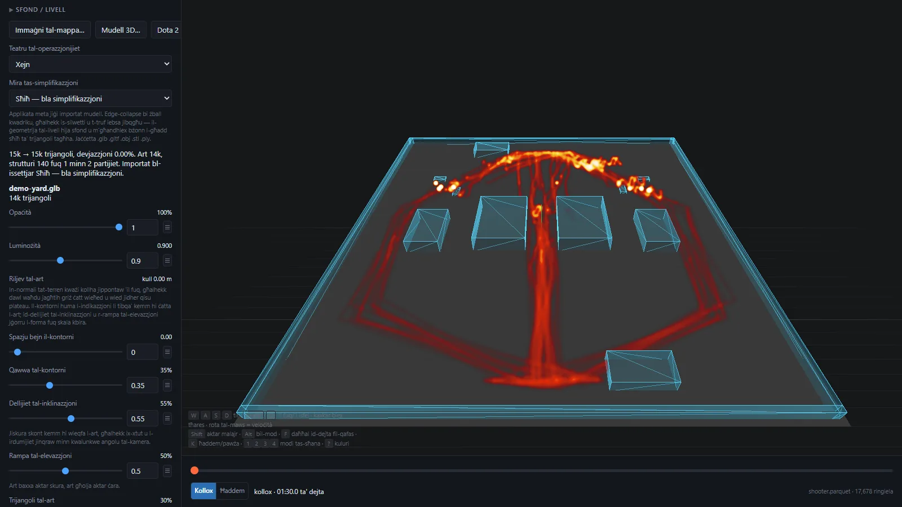
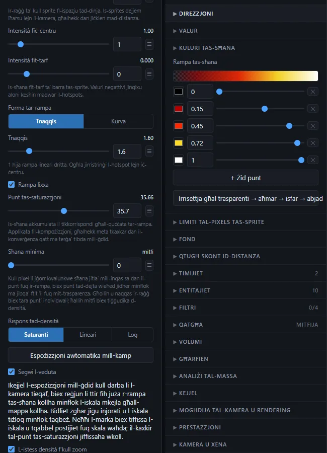

# Sħana

Is-sħana tpitter l-postijiet fejn ġraw ħafna affarijiet: aħmar fejn ġara ftit, abjad sħun fejn ġara ħafna. Twieġeb "fejn jiġri dan, u kemm".

**Sħana** (buttuna 1) hu l-modalità default. Kull [ringiela](glossary.md) viżibbli tikkontribwixxi [sprite](glossary.md) tond li jħares lejn il-kamera; sprites li jaqgħu fuq xulxin jiżdiedu f'buffer ta' floating-point; is-somma titqiegħed permezz ta' rampa ta' kuluri - b'default trasparenti → aħmar → isfar → abjad - u tinġibed fuq ix-xena.

L-istampa turi s-sħana ta' rawnd ta' shooter fuq livell b'bini: punti sħan jinsabu fl-kmamar u fuq l-iskali, mhux biss fuq l-art.

## Kif tuża {#how-to-use-it}

1. Tagħbi d-dejta u agħfas `1` (jew agħżel **Sħana** fil-barra tal-modi).
2. Jekk kollox ikun abjad jew vojt, agħfas **Espożizzjoni awtomatika mill-kamp** fit-taqsima **Forma tas-sħana**.
3. Ibdel **Raġġ tal-sprite** sakemm it-tikek ġirien jitgħaqqdu f'fasċi: iżgħar juri punti singoli, ikbar juri żoni.
4. Iftaħ **Kuluri tas-sħana** biex tbiddel il-kuluri, jew **Fond** biex tħalli l-għoljiet u l-ħitan jaħbu s-sħana warajhom.

L-istess pannelli jiffurmaw [Differenza](difference.md), [Sħana tat-timijiet](team-heat.md) u [Sħana tal-linji](line-heat.md); jiddifferixxu f'dak li jiżdied (b'sinjal, b'kulur, jew tul il-linji), mhux f'kif.

## Il-pannelli u d-defaults tagħhom {#the-panels-and-their-defaults}

Kull kontroll hu spjegat fuq il-paġna tiegħu; il-kolonna Dettalji tgħaqqad magħha. Is-sliders għandhom kaxxa miktuba ħdejhom u maniglja tal-ġbid (il-qabda ż-żgħira fuq il-lemin: iġbed 'il fuq jew 'l isfel, iktar 'il bogħod iktar mgħaġġel, Shift għal kontroll fin); fejn il-binarju tas-slider jieqaf qabel limitu reali, il-maniglja tista' tmur oltre sal-*soqfa tal-jog* imsemmija hawn. Il-valuri mmarkati *meta titgħabba* jerġgħu jinħesbu għal kull dataset ġdid.

### Forma tas-sħana (miftuħa) {#heat-shape-open}

| Kontroll | Default | Firxa (soqfa tal-jog) | Dettalji |
|---|---|---|---|
| **Raġġ tal-sprite** | 6 m; meta titgħabba estensjoni / 120 | 0.05-2000 m, logaritmiku (50,000) | [Forma tal-sprite](sprite-shape.md#sprite-radius) |
| **Intensità fiċ-ċentru** | 1 | 0-10 (1000) | [Forma tal-sprite](sprite-shape.md#centre-and-edge-intensity) |
| **Intensità fit-tarf** | 0 | -2-10 (1000) | [Forma tal-sprite](sprite-shape.md#centre-and-edge-intensity) |
| **Forma tar-rampa** | *Tnaqqis* | *Tnaqqis* / *Kurva* | [Forma tal-sprite](sprite-shape.md#ramp-shape-falloff-or-curve) |
| **Tnaqqis** (Tnaqqis biss) | 1.6 | 0.1-8 (64) | [Forma tal-sprite](sprite-shape.md#falloff) |
| **Rampa lixxa** (Tnaqqis biss) | mixgħul | | [Forma tal-sprite](sprite-shape.md#falloff) |
| Editur tal-kurva (Kurva biss) | preset *Lixxa* | | [Forma tal-sprite](sprite-shape.md#the-curve-editor) |
| **Punt tas-saturazzjoni** | 24; meta titgħabba stima, imbagħad ikkejjel | 0.1-4000, logaritmiku (10,000,000) | [Kulur u esponiment](colour-and-exposure.md#saturation-point) |
| **Sħana minima** | mitfi (0) | 0-100% | [Kulur u esponiment](colour-and-exposure.md#minimum-heat) |
| **Rispons tad-densità** | *Saturanti* | *Saturanti* / *Lineari* / *Log* | [Kulur u esponiment](colour-and-exposure.md#density-response) |
| **Espożizzjoni awtomatika mill-kamp** | | buttuna | [Kulur u esponiment](colour-and-exposure.md#auto-exposure) |
| **Segwi l-veduta** | mixgħul | | Ikejjel l-espożizzjoni mill-ġdid kull darba li l-kamera tieqaf, sabiex reġjun li tidħol fih juża r-rampa kollha tal-kuluri. Bidliet żgħar jiġu injorati u l-iskala tiżdied bil-mod. Itfih, jew iġbed **Punt tas-saturazzjoni**, biex tiffissa l-iskala u tqabbel postijiet fuq skala waħda. [Kulur u esponiment](colour-and-exposure.md#follow-the-view) |
| **L-istess densità f'kull zoom** | mixgħul | | Kulur ifisser l-istess għadd ta' ringieli għal kull erja ta' art, kemm tkun viċin. Sprite li l-limiti tal-pixels jikbru ('l bogħod) jew inaqqsu (viċin) iżomm is-sħana li d-daqs veru tiegħu iżid, allura stampa mkejla minn 'l bogħod ma titbaxxax meta tidħol fiha. Mitfi, sprite illimitat iżid il-piż sħiħ tiegħu fid-daqs illimitat tiegħu. [Forma tal-sprite](sprite-shape.md#pixel-clamps) |
| **Iċċattja fuq il-pjan tal-art** | mitfi | | [Forma tal-sprite](sprite-shape.md#flatten-onto-ground-plane) |

### Kuluri tas-sħana (magħluqa) {#heat-colours-closed}

| Kontroll | Default | Dettalji |
|---|---|---|
| Kwadri tal-gruppi u **Separazzjoni tal-kuluri** (Sħana tat-timijiet biss) | 1.4 | [Sħana tat-timijiet](team-heat.md) |
| Editur tal-**Rampa tas-sħana** (*Pożittiva (timijiet li jiżdiedu)* f'Differenza, *Rampa tal-opaċità* f'Sħana tat-timijiet) | trasparenti → aħmar → isfar → abjad | [Kulur u esponiment](colour-and-exposure.md#the-ramp-editor) |
| **Irrisettja għal trasparenti → aħmar → isfar → abjad** | | |
| Rampa **Negattiva (timijiet li jnaqqsu)** (Differenza biss) | trasparenti → aħdar → blu → vjola | [Differenza](difference.md#colours) |

### Limiti tal-pixels tas-sprite (magħluqa) {#sprite-pixel-clamps-closed}

| Kontroll | Default | Firxa (soqfa tal-jog) | Dettalji |
|---|---|---|---|
| **Raġġ minimu f'pixels** | 1 px | 0-16 (512) | [Forma tal-sprite](sprite-shape.md#pixel-clamps) |
| **Raġġ massimu f'pixels** | 96 px | 2-1024, logaritmiku (8192) | [Forma tal-sprite](sprite-shape.md#pixel-clamps) |

### Fond (miftuħa) {#depth-open}

| Kontroll | Default | Dettalji |
|---|---|---|
| **Aħbi wara t-terren** | mixgħul | [Fond u qtugħ](depth-and-culling.md#hide-behind-terrain) |
| **Moħbi wara l-ġeometrija** | 0.8 (*80% iktar dim*) | [Fond u qtugħ](depth-and-culling.md#hidden-behind-geometry) |

### Qtugħ skont id-distanza (magħluqa) {#distance-culling-closed}

| Kontroll | Default | Firxa (soqfa tal-jog) | Dettalji |
|---|---|---|---|
| **Viċin** | mitfi (0) | 0.5-5000 m, logaritmiku, isfel tal-binarju = mitfi (200,000) | [Fond u qtugħ](depth-and-culling.md#distance-culling) |
| **Bogħod** | mitfi (0) | 1-200,000 m, logaritmiku, isfel = mitfi (10,000,000) | [Fond u qtugħ](depth-and-culling.md#distance-culling) |
| **Aqta' f'pjan** | mixgħul | | [Fond u qtugħ](depth-and-culling.md#distance-culling) |
| **Aqta' l-livell ukoll** | mixgħul | | [Fond u qtugħ](depth-and-culling.md#distance-culling) |

Tasti: `[` u `]` iġibu l-limitu 'l bogħod 'il ġewwa u 'il barra, `\` jaqleb għalih ([Fond u qtugħ](depth-and-culling.md#keyboard)).

### Direzzjoni u Valur {#direction-and-value}

Żewġ taqsimiet oħra jinsabu taħt Forma tas-sħana. **Direzzjoni** tiġbed kull ringiela bħala kuna u żżid vleġġa: ara [Sħana direzzjonali](directional-heat.md). **Valur** jiżen is-sħana skont dak li kull ringiela kkostat jew qligħ: ara [Piż tal-valur](value-weighting.md).

## X'jinħażen {#what-is-saved}

Is-settings tas-sħana ta' hawn fuq ma jinħażnux bejn is-sessjonijiet: tgħabbija mill-ġdid tal-paġna terġa' tqiegħed id-defaults. Żewġ affarijiet jinżammu fil-browser: l-aħħar veloċità tal-playback (`heat3d.speed`, ara [Linja taż-żmien](timeline.md)) u s-settings tal-figuri 'l bogħod tal-[overlay tal-figuri](box-replay.md) (stil tas-simbolu, daqs, marki tal-laqtiet u oħrajn). Hekk huma wkoll il-lingwa, [l-assi tad-dinja maqlubin](camera.md#invert-world-axis), l-ismijiet tal-karozzi mfakkra fit-tab tal-ġirja u l-[librerija tal-livelli](level-library.md). Il-lista sħiħa hi fuq [Settings maħżuna](ref-settings-storage.md).
