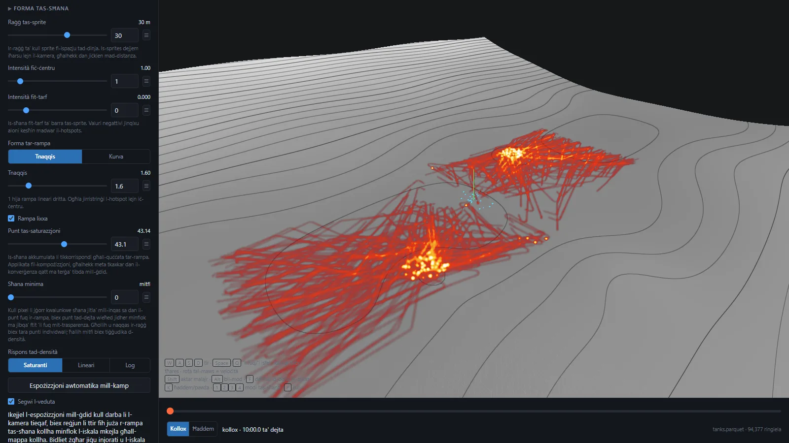
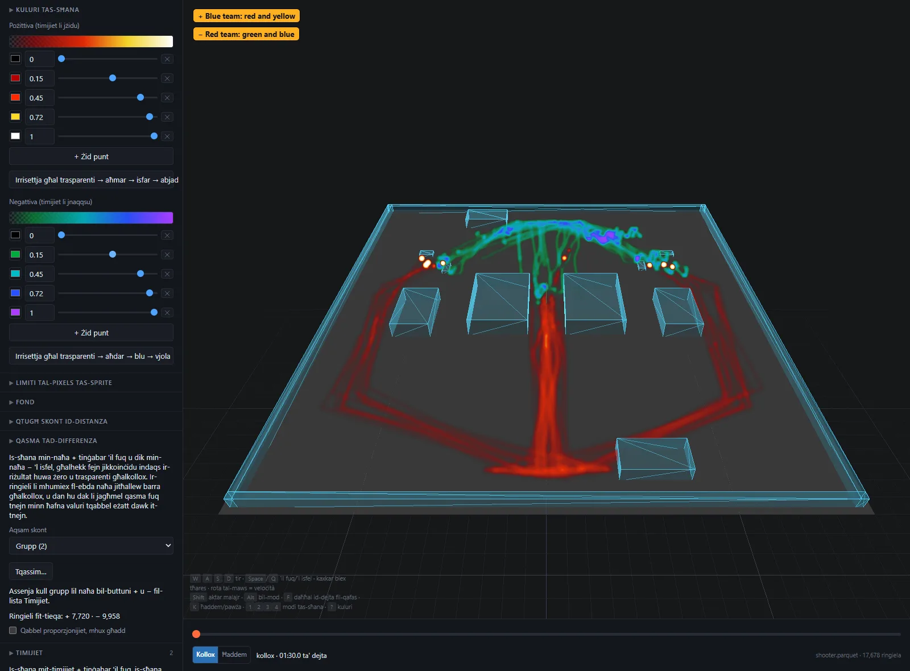
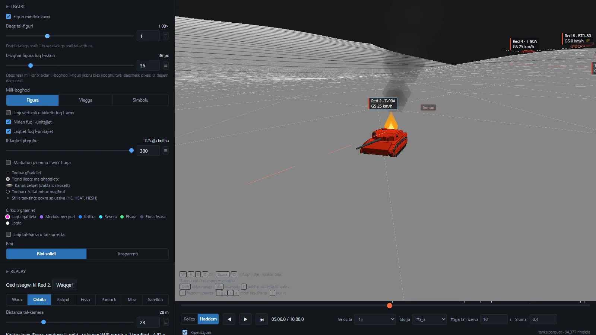
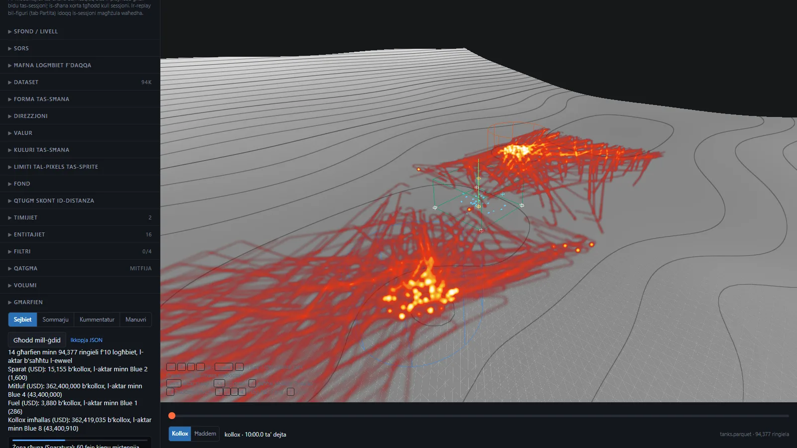
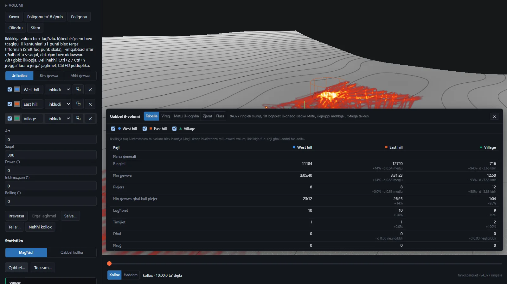
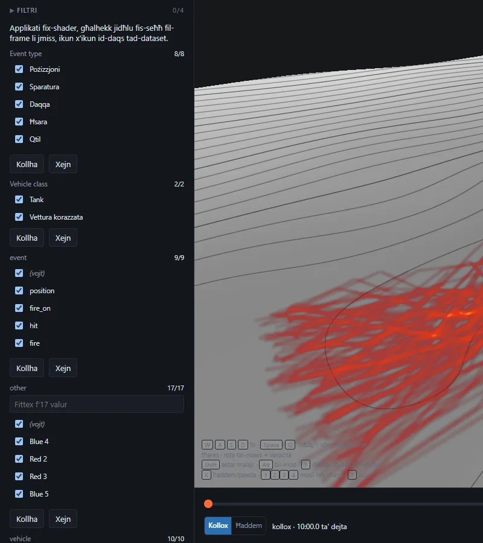
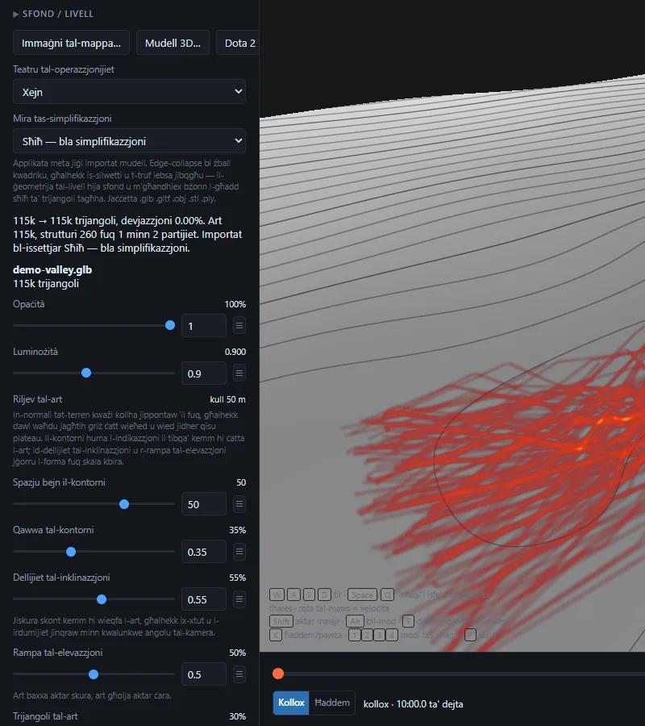

# 3DHeat

3DHeat juri fejn ġraw affarijiet f'logħba - fejn mexxew il-plejers, fejn ġġieldu u fejn waqgħu - bħala kuluri li tista' ttir fihom, jew bħala figuri 3D żgħar li jerġgħu jilagħbu l-partita.

Tagħbi pożizzjonijiet - CSV, Parquet, reġistrazzjonijiet Tacview, replays konvertiti, fajl wieħed, folder jew eluf ta' partiti - u araw bħala **sħana li tista' ttir fiha**, bħala **figuri li jerġgħu jilagħbu l-partita**, bħala linji tul it-toroq li ħadu n-nies, jew bħala popolazzjoni waħda kontra oħra. Jsib waħdu dak li jinqala' 'l barra, u jaħdem kollu fil-browser tiegħek: xejn ma jitgħabba x'imkien ieħor. 3DHeat u l-għodod kollha tiegħu huma b'xejn u open source taħt il-[liċenzja MIT](https://github.com/Holdi601/3DHeat/blob/main/LICENSE).



**Ġdid hawn?** Agħmel [id-data demo](demo-data.md) u segwi l-seba' passi tagħha. Kull ritratt fuq dan is-sit ittieħed b'hekk.

## X'jagħmel {#what-it-does}

| | |
|---|---|
|  | **[Modi tas-sħana](heat-modes.md)** - sħana, [differenza](difference.md) (aħmar fejn naħa waħda kienet iktar, blu-aħdar fejn l-oħra kienet), [sħana tat-tim](team-heat.md), [sħana tal-linji](line-heat.md); [sħana direzzjonali](directional-heat.md) b'kunjals, qasam ta' vleġġi u grafiċi polari; sħana [mkejla bil-valur](value-weighting.md): kemm jiswew l-armi, il-vetturi u l-fjuwil. |
|  | **[Replay tal-partita](match-replay.md)** - kull unità bħala l-[figura](figures.md) ta' dak li hi, simboli NATO jew Russi 'l bogħod, missili u traċċanti, marki tal-laqtiet, wrecks, nirien, turretti, għanijiet, kameras bi stil Tacview u wiri taktiku; [ħafna partiti f'daqqa](many-matches.md). |
|  | **[Għarfien](insights.md)** - pożizzjonijiet b'saħħa, art mortali, trappoli tal-bidu, konġestjonijiet u plejers li joqogħdu 'l fuq, misjuba u mqassma bl-evidenza; sommarju bil-miktub, jew bl-AI li tagħżel; kummentatur għal partita waħda; il-[lenti tal-għarfien](knowledge.md). |
|  | **[Volumi](volumes.md)** - ipitti kaxxi, prizmi, ċilindri u sfieri, iffiltra għalihom, għodd x'jiġri ġewwa, esportah, u qabbel postijiet ġenb ġenb; [qsim fid-dettall](breakdown.md) ta' min u x'jagħmel l-aħjar f'post. |
|  | **[Filtri](filters.md)** - bit-tip tal-avveniment, plejer jew AI, klassi tal-vettura, valur, kwalunkwe kolonna, fil-kard grafiku f'kull daqs ta' data. |
|  | **[Livelli](levels.md)** - immaġini tal-mappa, livelli 3D magħmula bl-[għodod tad-data](#related-repositories), tnaqqis, l-[isfond tad-dinja](world-backdrop.md) b'art reali għal data ta' titjir. |

Barra minn hekk: it-tab [Analiżi tat-tellieqa](race-analysis.md) għal ġirjiet ta' logħob tat-tellieqa, it-tab [Partita](match-analysis.md) għal sommarji ta' Counter-Strike 2, il-[Bord tat-tattika](tactics-board.md) għal pjanijiet fuq livell, [analiżi tal-kolpijiet](hit-analysis.md) għal kull vettura, [analiżi tal-massa](mass-analysis.md) ta' eluf ta' partiti, [mogħdijiet tal-kamera u vidjo](camera-path-and-video.md), [40 lingwa](languages.md), [unitajiet metriċi jew imperjali](settings.md).

## It-tabs {#the-tabs}

It-tabs jinsabu fil-quċċata tas-sidebar, taħt l-isem, l-unitajiet u l-menu tal-lingwa.

| Tab | Għal x'hu |
|---|---|
| **Heatmap** | Kwalunkwe tabella ta' pożizzjonijiet: il-modi tas-sħana, is-sovrapposizzjoni tal-figuri, filtri, volumi, għarfien, livelli, kejl u vidjo. |
| **Analiżi tat-tellieqa** | Żewġ ġirjiet jew iktar ta' kors wieħed: fejn jintilef il-ħin, għaliex, u x'jinbidel. |
| **Partita** | Ir-replay tal-figuri ta' partita, u sommarji ta' partiti ta' Counter-Strike 2. |
| **Tattika** | Pjanijiet fuq livell: figuri, toroq, utilità mitfugħa, żoni u noti f'passi li jaħdmu bħal playback. |
| **Vetturi** | Fejn ġiet imlaqqta kull unità, minn min u b'xiex. |

## Installazzjoni u tmexxija {#install-and-run}

3DHeat hu b'xejn biex tuża, tbiddel u taqsam (liċenzja MIT), u hekk ukoll kull għodda elenkata taħt [Repożitorji relatati](#related-repositories).

### Windows, il-mod sempliċi {#windows-the-easy-way}

Il-għerq tar-repożitorju fih tlett fajls batch.

| Fajl | X'jagħmel |
|---|---|
| `start.bat` | Jibda l-viewer. Isib Node.js anke meta mhuwiex fuq `PATH` (ifittex f'`%ProgramFiles%\nodejs`, `%ProgramFiles(x86)%\nodejs` u `%LOCALAPPDATA%\Programs\nodejs`), u meta Node.js ma jkunx hemm joffri li jinstalla l-verżjoni LTS b'`winget install -e --id OpenJS.NodeJS.LTS`. Fl-ewwel tmexxija jistaqsi qabel jniżżel id-dipendenzi (madwar 300 MB fi `node_modules\` ġewwa l-folder, xejn fuq is-sistema kollha). Jirrifjuta li jibda meta xi ħaġa diġà tisma' fuq il-port 5273, u jindika lejn `restart.bat` minflok. Meta l-folder ikun checkout ta' git bla bidliet lokali u tkun teżisti verżjoni iktar ġdida, jistaqsi jekk trid taġġorna (Y/N; jekk ma twieġibx f'60 s iżomm din il-verżjoni; ara [Aġġornamenti](updates.md)). Imbagħad iħaddem is-server tal-iżvilupp fuq `http://127.0.0.1:5273/` u jiftaħ il-browser. **It-tieqa hi s-server**: ħallihā miftuħa, għalqha jew agħfas Ctrl+C biex twaqqafha. |
| `restart.bat` | Iħaddem `stop.bat quiet`, imbagħad `start.bat`. Hu meħtieġ biss wara li tbiddel `vite.config.ts`, iżżid dipendenza, jew meta s-server ikun waqaf - bidliet fis-sors jerġgħu jitħabbru malajr. |
| `stop.bat` | Iwaqqaf kwalunkwe ħaġa li tisma' fuq il-port 5273, permezz tan-numru tal-process misjub bis-`netstat`, qatt b'isem tal-immaġni, sabiex processi oħra ta' Node.js fuq il-magna jibqgħu. Jistenna madwar tnejn s-sekondi biex is-socket jinħeles. Bl-argument `quiet` ma jieqafx fl-aħħar. |

### Bl-idejn (kwalunkwe OS) {#by-hand-any-os}


```bash
git clone --recursive https://github.com/Holdi601/3DHeat.git
cd 3DHeat
npm install
npm run dev      # http://127.0.0.1:5273
```

Il-folder `exporters/` fih l-għodod separati tad-data bħala submodules ta' git, kull wieħed repożitorju tiegħu; wara clone sempliċi ħaddem `git submodule update --init`. Il-viewer innifsu ma jeħtieġhomx biex jaħdem. `exporters/ext/` fih il-konvertituri fakultattivi (War Thunder, World of Tanks, World of Warships, replays ta' Squad; mapep ta' DCS u IL-2), miżmuma separati sabiex problema ma' wieħed minnhom ma taffettwa xejn ieħor.

Ebda data tal-logħob ma tiġi ma' xejn minn dan: il-livelli, il-mapep u r-reġistrazzjonijiet isiru fuq il-magna tiegħek bl-għodod, minn logħob li għandek.

### Skripts ta' npm {#npm-scripts}

| Skript | X'iħaddem |
|---|---|
| `npm run dev` | Is-server tal-iżvilupp ta' Vite fuq il-port 5273, marbut ma' `127.0.0.1`. |
| `npm run build` | Kontroll tat-tipi (`tsc --noEmit`) u bundle tal-produzzjoni fi `dist/`. |
| `npm run preview` | Iservi l-bundle tal-produzzjoni. |
| `npm run typecheck` | Il-kontroll tat-tipi waħdu. |
| `npm test` / `npm run test:watch` | Testijiet tal-unità u ta' integrazzjoni (vitest). |
| `npm run smoke` | Iħaddem l-app vera f'Chromium bla wiri u jiċċekkja li l-canvas għandu pixels bil-kulur tad-data; ir-ritratti jmorru f'`tools/.smoke/`. Jistenna li s-server tal-iżvilupp ikun qed jaħdem. |
| `npm run smoke:f16` | L-istess suite b'`?heat=f16`, li tiforza l-mogħdija tal-akkumulazzjoni b'half-float (ara [Akkumulazzjoni half-float](half-float-accumulation.md)). |
| `npm run bench` | Benchmark tal-ingest, jikteb `tools/.smoke/ingest-bench.json`. |
| `npm run test:heavy` | Testijiet li jeħtieġu fajls tad-data reali kbar; jaqbżu lilhom infushom meta l-fajls ma jkunux hemm. |
| `npm run inspect -- <file.parquet>` | Juri l-iskema ta' fajl Parquet u xi ringieli (`tools/inspect-parquet.mjs`). |

### X'iżid is-server tal-iżvilupp {#what-the-dev-server-adds}

Il-viewer hu paġna web statika, imma s-server tal-iżvilupp (ara `vite.config.ts`) iżid żewġ routes lokali li installazzjoni statika ta' `dist/` ma għandhiex:

- `/__host/memory` jirrapporta r-RAM installat u ħieles tal-magna u, fejn jista' jaqrah, il-memorja tal-kard grafiku (minn `nvidia-smi`, jew fuq Windows mid-dħul tar-reġistru tal-adapter tal-wiri). Dan jagħmel lill-[baġits tal-memorja](memory-and-budgets.md) jużaw figuri reali minflok stimi limitati tal-browser.
- `/__heat3d/update` jiċċekkja jekk il-checkout ikunx wara u jista' jgħaddih 'il quddiem ([Aġġornamenti](updates.md)).

Is-server jorbot biss ma' `127.0.0.1`, għalhekk ebda minn dawn ir-routes ma tintlaħaq min-network. Iftaħu bħala `http://127.0.0.1:5273`: `localhost` jista' jirrisolvi għal `::1` tal-IPv6, fejn ma jkun hemm xejn jisma'. Ma jibgħatx headers ta' COOP/COEP: xejn fil-viewer ma juża `SharedArrayBuffer`, u l-workers jgħaddu d-data tagħhom bit-trasferiment, li ma jeħtieġ xejn.

## Rekwiżiti tal-browser u tal-GPU {#browser-and-gpu-requirements}

- **Browser b'WebGPU jew WebGL2.** WebGPU tiġi ppruvata l-ewwel (Chrome u Edge għandhom din); mingħajrha tintuża l-backend WebGL2. WebGL2 trid toffri `EXT_color_buffer_float` (irrendering fuq textures float), inkella l-viewer juri "Ma nistax nibda r-renderer." Ara [Iż-żewġ backends](backends.md). Il-viewer hu żviluppat u ġie ttestjat f'Chromium; browsers oħra mhumiex ivverifikati.
- **Aċċelerazzjoni tal-hardware mixgħula.** Meta l-browser jpinġi fuq il-CPU (SwiftShader, llvmpipe, il-Microsoft Basic Render Driver u simili) banner aħmar fil-quċċata tas-sidebar jgħid dan u kif tissewwa. Ara [Identifikazzjoni tar-rendering bis-software](software-rendering.md).
- **GPU diskret jgħin, imma mhux meħtieġ.** It-tnejn il-backends jitolbu l-adapter ta' prestazzjoni għolja. Ammont id-data li tista' tinżamm fuq il-GPU huwa baġit li tista' tara u tbiddel ([Memorja u baġits](memory-and-budgets.md)).
- **Karatteristiċi fakultattivi** jużaw APIs oħra tal-browser: ir-rendering tal-vidjo jeħtieġ WebCodecs `VideoEncoder` b'VP9 jew VP8 ([Mogħdija tal-kamera u vidjo](camera-path-and-video.md)); it-tnaqqis tal-mesh tal-livelli jeħtieġ WebAssembly; it-tqegħid ta' folders juża l-File and Directory Entries API; il-librerija tal-livelli tuża IndexedDB; il-gamepads jużaw il-Gamepad API.

## Mappa tad-dokumentazzjoni {#documentation-map}

**Bidu**: [Data demo](demo-data.md) · [Kif tidħol id-data](getting-data-in.md) ([tagħbija tal-fajls](loading-files.md), [immappjar tal-kolonni](column-mapping.md), [assi, unitajiet u ħin](axes-units-and-time.md), [sessjonijiet, persuni u gruppi](sessions-persons-groups.md), [Tacview](tacview-acmi.md), [konvertituri](converters.md), [.3dheat](container.md), [memorja u baġits](memory-and-budgets.md))

**Ara**: [Modi tas-sħana](heat-modes.md) ([sħana](heat.md), [forma tal-isprite](sprite-shape.md), [kulur u esponiment](colour-and-exposure.md), [fond u culling](depth-and-culling.md), [differenza](difference.md), [sħana tat-tim](team-heat.md), [sħana tal-linji](line-heat.md), [replay tal-kaxxi](box-replay.md), [sħana direzzjonali](directional-heat.md), [piż tal-valuri](value-weighting.md)) · [Linja taż-żmien](timeline.md) · [Livelli](levels.md) ([immaġini tal-mappa](map-images.md), [livelli 3D](model-levels.md), [dehra](level-appearance.md), [librerija](level-library.md), [isfond tad-dinja](world-backdrop.md), [sorsi tiegħu](world-backdrop-sources.md)) · [Kamera](camera.md) ([gamepad](gamepad.md), [ċwievet](keyboard-reference.md)) · [Mogħdija tal-kamera u vidjo](camera-path-and-video.md)

**Analiżi**: [Filtri u għodod](filters-and-tools.md) ([filtri](filters.md), [timijiet](teams-list.md), [entitajiet](entities.md), [qatgħa](slice.md), [kejl](measure.md), [volumi](volumes.md), [qsim fid-dettall](breakdown.md)) · [Għarfien](insights.md) ([lenti tal-għarfien](knowledge.md)) · [Analiżi tal-massa](mass-analysis.md)

**Replay**: [Replay tal-partita](match-replay.md) · [Ħafna partiti f'daqqa](many-matches.md) · [Figuri](figures.md) ([fuq xulxin](figure-replay.md), [krediti](figure-credits.md)) · [Ekwivalenza ma' Tacview](tacview-parity.md) · [Analiżi tal-kolpijiet](hit-analysis.md)

**Tabs oħra**: [Analiżi tat-tellieqa](race-analysis.md) ([il-metodu](race-analytics.md), [logħob ieħor](other-games.md)) · [Analiżi tal-partita](match-analysis.md) · [Bord tat-tattika](tactics-board.md) ([veloċitajiet](tactics-speeds.md))

**Il-viewer**: [Glossarju](glossary.md) · [Settings, unitajiet u ċwievet](settings.md) · [Lingwi](languages.md) · [Aġġornamenti](updates.md) · [Id-dettalji tar-rendering](rendering-internals.md) ([backends](backends.md), [akkumulazzjoni](accumulation.md), [sampling u baġits](sampling-and-budgets.md), [half-float](half-float-accumulation.md), [memorja tal-GPU](gpu-memory.md), [software rendering](software-rendering.md), [prestazzjoni u statistiċi](performance-and-stats.md)) · [Formati tad-data](data-formats.md) · [Referenza](reference.md) · [Iż-żamma tad-dokumentazzjoni](maintaining.md)

## Repożitorji relatati {#related-repositories}

Il-viewer jaqra d-data; dawn l-għodod joħolquha. Kull wieħed huwa repożitorju pubbliku tiegħu (MIT) bid-dokumentazzjoni tiegħu. Ebda wieħed minnhom ma jġib data tal-logħob: il-livelli, il-mapep u r-reġistrazzjonijiet isiru fuq il-magna tiegħek, minn logħob li għandek.

| Repożitorju | X'jagħmel | Utli għal |
|---|---|---|
| [3DHeat-GameFiles](https://github.com/Holdi601/3DHeat-GameFiles) | Jaqra kursi u livelli mill-arkivji li l-logħob jgħaddi magħhom (Forza Horizon, BeamNG, Assetto Corsa Rally; qarrejja ta' Unreal, Unity, Frostbite u Source 2) bħala glTF | livell 3D taħt is-sħana jew ir-replay tiegħek |
| [3DHeat-GameCapture](https://github.com/Holdi601/3DHeat-GameCapture) | Jirreġistra telemetrija tal-ġirjiet mill-interfaces li l-logħob tat-tellieqa jippubblika, u jerġa' jibni livelli mill-vidjo tal-logħba | ġirjiet għal Analiżi tat-tellieqa; livell fejn ebda fajl ma jinqara |
| [3DHeat-UnrealExporter](https://github.com/Holdi601/3DHeat-UnrealExporter) | Plugin tal-Unreal Editor li jesporta livell bħala fajl glTF wieħed | livelli tal-proġetti tiegħek ta' Unreal |
| [3DHeat-CS2](https://github.com/Holdi601/3DHeat-CS2) | Demos ta' Counter-Strike 2 f'tabelli ta' sħana u sommarji ta' partiti, mapep ta' CS2 f'ġeometrija | sħana ta' CS2, replays u t-tab Partita |
| [3DHeat-Watcher](https://github.com/Holdi601/3DHeat-Watcher) | Jirreġistra l-logħba tiegħek fil-background minn dak li l-logħob jippubblika: telemetrija, integrazzjonijiet tal-istat tal-logħba, logs, replays | l-istatistika tiegħek stess mingħajr ma tagħmel xejn bl-idejn |
| [3DHeat-Ext-WarThunder](https://github.com/Holdi601/3DHeat-Ext-WarThunder) | Replays ta' War Thunder (`.wrpl`) f'tabelli: traċċi tal-ajru u tal-art, tiri, laqtiet, qtil, turretti, għanijiet | replays ta' War Thunder, marki tal-laqtiet u għarfien |
| [3DHeat-Ext-WoT](https://github.com/Holdi601/3DHeat-Ext-WoT) | Replays ta' World of Tanks f'tabelli: il-pożizzjoni ta' kull vettura, mewt u qtil | sħana u replays ta' World of Tanks |
| [3DHeat-Ext-WoWs](https://github.com/Holdi601/3DHeat-Ext-WoWs) | Replays ta' World of Warships f'tabelli: il-pożizzjoni ta' kull bastiment u l-affondar | sħana u replays ta' World of Warships |
| [3DHeat-Ext-Squad](https://github.com/Holdi601/3DHeat-Ext-Squad) | Demos tas-server ta' Squad f'tabelli: il-pożizzjoni ta' kull plejer, it-tim u s-squad | sħana u replays ta' Squad |
| [3DHeat-Ext-DCS](https://github.com/Holdi601/3DHeat-Ext-DCS) | Termini ta' DCS World mill-installazzjoni tiegħek għal livelli: art, toroq, bliet, ajruporti, għelieqi, ilma | DCS u reġistrazzjonijiet ta' Tacview fuq it-terren reali tagħhom |
| [3DHeat-Ext-IL2](https://github.com/Holdi601/3DHeat-Ext-IL2) | Mapep ta' IL-2 Great Battles f'livelli | reġistrazzjonijiet ta' IL-2 fuq il-mappa tagħhom |

## Il-layout tas-sors, qosor {#source-layout-briefly}

| Folder | Kontenut |
|---|---|
| [`src/data/`](https://github.com/Holdi601/3DHeat/tree/main/src/data) | Għażla tal-fajls, ingest ta' CSV u Parquet, immappjar awtomatiku, validazzjoni, mudell tal-memorja, bini tad-dataset, qari tal-mudelli, klassifikazzjoni, tnaqqis, librerija tal-livelli |
| [`src/render/`](https://github.com/Holdi601/3DHeat/tree/main/src/render) | Il-loop tal-frames (`engine.ts`), sampling, iż-żewġ backends, kamera, gamepad, kejl, mogħdija tal-kamera, reġistrazzjoni tal-vidjo |
| [`src/state/`](https://github.com/Holdi601/3DHeat/tree/main/src/state) | L-istat tal-applikazzjoni (`store.ts`) b'kull bażi, it-tipi tad-dominju (`types.ts`), il-kurva tal-isprite |
| [`src/ui/`](https://github.com/Holdi601/3DHeat/tree/main/src/ui) | Il-pannelli tas-sidebar, il-linja taż-żmien, l-overlays |
| [`src/race/`](https://github.com/Holdi601/3DHeat/tree/main/src/race), [`src/match/`](https://github.com/Holdi601/3DHeat/tree/main/src/match) | It-tabs Analiżi tat-tellieqa u Partita |
| [`src/i18n/`](https://github.com/Holdi601/3DHeat/tree/main/src/i18n) | Traduzzjonijiet |
| [`src/insights/`](https://github.com/Holdi601/3DHeat/tree/main/src/insights) | Għarfien: detectors, sommarju, kummentatur, fornituri tal-AI, il-lenti tal-għarfien |
| [`src/mass/`](https://github.com/Holdi601/3DHeat/tree/main/src/mass) | Analiżi tal-massa fuq ħafna partiti |
| [`src/volumes/`](https://github.com/Holdi601/3DHeat/tree/main/src/volumes) | Volumi, l-istatistika tagħhom, l-esportazzjoni u t-tqabbil |
| [`src/breakdown/`](https://github.com/Holdi601/3DHeat/tree/main/src/breakdown) | Tqassim u fatturi |
| [`src/overlay/`](https://github.com/Holdi601/3DHeat/tree/main/src/overlay) | L-overlay ta' ħafna partiti |
| [`src/figures/`](https://github.com/Holdi601/3DHeat/tree/main/src/figures) | Il-katalgu tal-figuri u l-bini tiegħu |
| [`src/vehicle/`](https://github.com/Holdi601/3DHeat/tree/main/src/vehicle) | Analiżi tal-kolpijiet (tab Vetturi) |
| [`src/tactics/`](https://github.com/Holdi601/3DHeat/tree/main/src/tactics) | Il-bord tat-tattika |
| [`src/world/`](https://github.com/Holdi601/3DHeat/tree/main/src/world) | L-isfond tad-dinja |
| [`src/units/`](https://github.com/Holdi601/3DHeat/tree/main/src/units) | Unitajiet tal-kejl |
