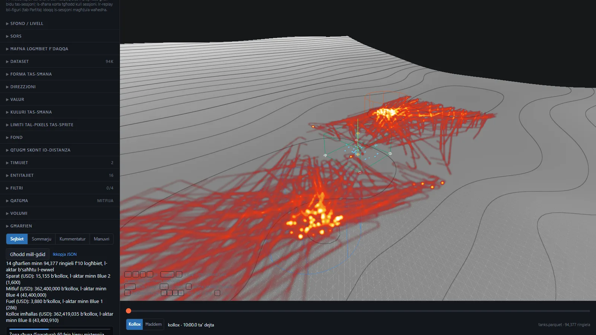
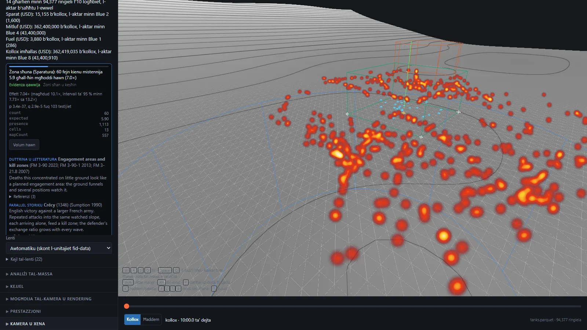
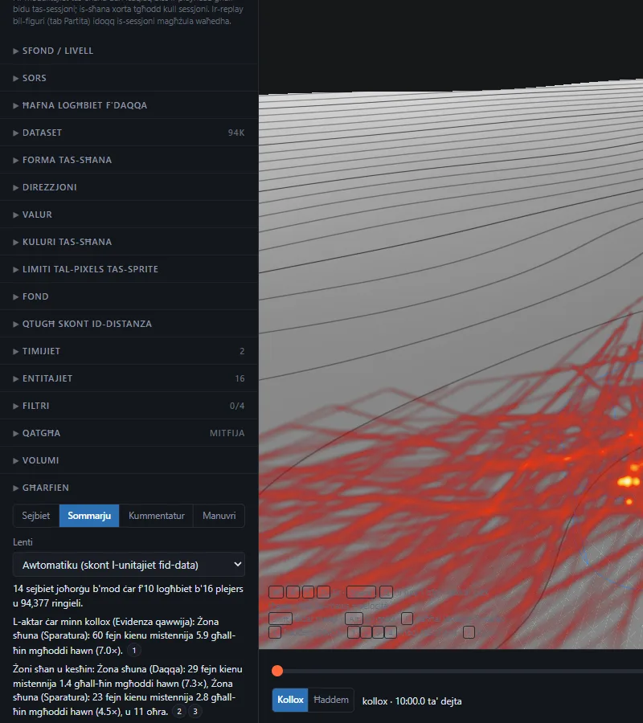
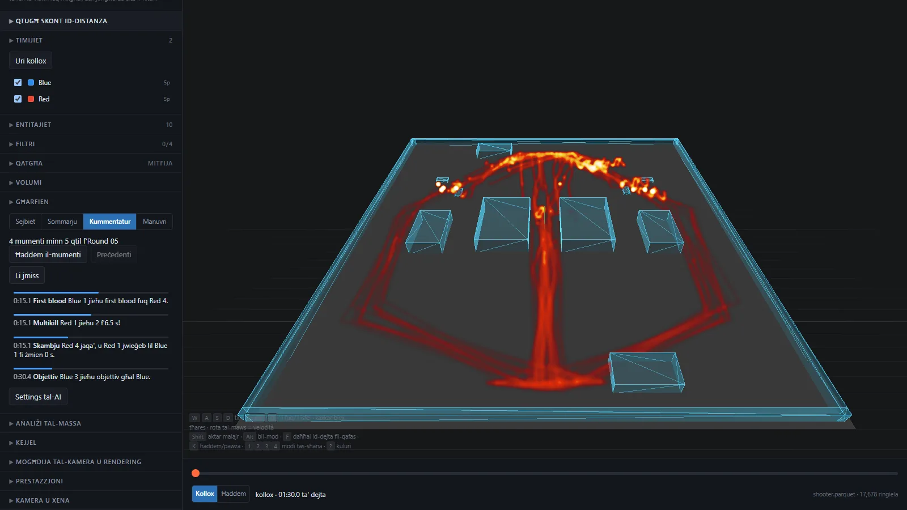

# Għarfien

**Għarfien** iħares fid-data mgħobbija għal dak li joħroġ - pożizzjonijiet b'saħħa, art mortali, trappoli tal-bidu, punti ta' konġestjoni, plejers 'il fuq minn sħabhom ħafna - u jgħidlek, l-iktar qawwi l-ewwel, bl-evidenza. Uża dan biex titgħallem f'minuta fejn intrebħet jew tilfet partita. Imbagħad jista' jikteb sommarju, u f'replay wieħed jista' jaġixxi bħala kummentatur li jiggwida għall-mumenti kbar.

Kollox jiġi għodd fil-browser tiegħek. Xejn ma joħroġ mill-kompjuter tiegħek sakemm ma tixgħel AI esterna (ara [AI esterna](#external-ai)).

It-taqsima **Għarfien** tinsab fis-sidebar tat-tabs Heatmap u Partita. Għandha tlett tabs: **Sejbiet**, **Sommarju** u **Kummentatur**.

## Sejbiet {#findings}

1. Ittella' d-data u iftaħ **Għarfien**. Agħfas **Sib għarfien** ("Qed jgħodd… n%" juri l-progress).
2. Aqra l-lista. Kull sejba għandha barra tal-qawwa, sentenza, kemm hi tajba l-evidenza (*Evidenza qawwija*, *Evidenza tajba* jew *Ftit evidenza*), liema detector sabha, u l-klassi tal-vettura fejn dan jimporta.
3. **Ikklikkja sejba**: il-viewer japplika l-filtri tagħha, iwassal il-kamera għall-post u jimxi għall-ħin, u jiftaħ id-dettalji: l-effett bl-intervall tiegħu ta' 95%, il-valuri p u q, l-evidenza miżmuma, u **Volum hawn**, li jpitti [volum](volumes.md) madwar il-post.
4. **Irrestawra l-filtri** iqiegħed lura l-filtri tiegħek. **Ikkopja JSON** jikkopja r-rapport kollu.

Il-għadd juża l-filtri attwali, il-gruppi moħbija u l-partita magħżula fuq il-medda taż-żmien kollha. Meta tbiddel il-filtri wara, nota tgħid hekk; agħfas **Għodd mill-ġdid**.

Il-linji fil-quċċata tal-lista (pereżempju t-totali tal-flus) jiġbru d-data kollha qabel is-sejbiet.

### Id-detectors {#the-detectors}

| Detector | X'isib | Teħtieġ fid-data |
|---|---|---|
| **Pożizzjonijiet tal-qawwa** | Postijiet b'probabbiltà ta' qtil għal mewt ħafna aħjar mill-bqija tal-mappa, u *art sikura* fejn ftit jmutu għall-ħin li jqattgħu | avvenimenti ta' kill u death |
| **Żoni sħan u kesħin** | Postijiet fejn tip ta' avveniment (tiri, laqtiet, kapturi ...) jseħħ ħafna iktar jew inqas milli l-ħin qattgħu hemm jbassar | kolonna ta' avveniment |
| **Art miftuħa u kenn** | Mewt fl-art miftuħa kontra ġometrija vicin tal-livell, u bil-mod kontra moviment mgħaġġel | mwiet; livell 3D għall-parti tal-ġometrija |
| **Spawns** | Spawns b'saħħa, trappoli ta' spawn, spawns sikuri, il-ħin għall-ewwel kuntatt | ħin u persuni |
| **Klassi skont il-post** | Klassi ta' vettura, jew plejers kontra AI, li jagħmlu ħafna aħjar jew agħar f'żona | kills flimkien ma' klassi ta' vettura jew kolonna ta' plejer/AI |
| **Plejers** | Plejers li jqatlu jew jmutu ħafna iktar jew inqas minn oħrajn fl-istess klassi | persuni u kills |
| **Konġestjonijiet u ġnub** | Punti ta' konġestjoni (ħafna iktar traversi milli l-art madwarhom) u toroq ta' ġnub (użati ftit, imma jwasslu għal kills) | persuni |
| **Valur** | *Art għalja* u *Art li tgħib* | [kolonni tal-valur](value-weighting.md) |

Id-detectors li ma jistgħux jaħdmu fuq id-data jidhru f'isfel bir-raġuni.

### Kif jitqiegħdu s-sejbiet {#how-findings-are-ranked}

Kull post jew grupp jiġi ttestjat kontra l-bqija tal-mappa (testijiet binomjali eżatti jew tar-rata). Ir-rata ta' skoperta falza (false discovery rate) tinżamm fuq 5% (Benjamini-Hochberg). Il-każwalità tista' tidher bħala mudell; dan iżomm l-allarmi foloz baxxi: fost is-sejbiet murija, madwar wieħed minn kull għoxrin huwa mistenni li tkun każwali. Effetti minn ftit avvenimenti jinġibdu lejn "l-ebda effett" qabel ma jitqiegħdu. Jintwerew l-iktar 60 sejba, u kull detector jieħu ftit postijiet fuq nett.

## Sommarju {#debrief}

It-tab **Sommarju** jikteb is-sejbiet f'test qasir: introduzzjoni, l-iktar sejba ċara, waħda għat-tattika, waħda għall-bilanċ, il-bqija mqassma skont id-detector, u kemm minnhom jistrieħu fuq evidenza iktar dgħajfa. Kull paragrafu għandu buttuni nnumerati li juru s-sejbiet tiegħu. **Ikkopja t-test** jikkopjah.

In-narratur ta' ġewwa jaħdem offline, fil-lingwa tiegħek. Is-selector **Lenti** ta' fuqu (ara [Il-lenti tal-għarfien](knowledge.md)) jiddeċiedi liema letteratura tiċċita l-paragrafi.

### AI esterna {#external-ai}

**Settings tal-AI** tħalli mudell tal-AI tal-għażla tiegħek jikteb is-sommarju minflok:

| Setting | Tifsira |
|---|---|
| **Fornitur** | Anthropic (Claude), OpenAI (ChatGPT), OpenRouter, Ollama (lokali), LM Studio (lokali), server llama.cpp (lokali), jew kwalunkwe endpoint li jaqbel ma' OpenAI |
| **URL bażi**, **Mudell** | Imimlija mill-fornitur; **Elenka l-mudelli** jistaqsi lis-server |
| **Ċavetta API** | Tintbagħat biss lill-URL bażi. Qatt ma tiġi nnotata, qatt ma tinħażen f'veduti, esportazzjonijiet jew fajls `.3dheat`. Ħafna mis-servers lokali ma jeħtieġu xejn. |
| **Ftakar iċ-ċavetta f'dan il-browser** | Mitfi b'mod predefinit: iċ-ċavetta titnesa meta l-paġna tingħalaq |
| **Uża AI esterna** | Mitfi b'mod predefinit |
| **Ibgħat l-ismijiet tal-plejers** | Mitfi b'mod predefinit: il-plejers jintbagħtu bħala P1, P2 ... |

Imbagħad ikteb mistoqsija fakultattiva u agħfas **Ikteb bl-AI**. Jintbagħtu biss is-sejbiet u n-numri tagħhom - qatt ir-ringieli tad-data tiegħek. It-tweġiba tidħol bil-mod, u s-sejbiet imsemmija isiru buttuni.

## Kummentatur {#caster}

Għal **partita waħda** (agħżel waħda jekk hemm diversi mgħobbijin), il-**Kummentatur** isib il-mumenti li jistħoqqilhom jiġu osservati: l-ewwel demm, multi-kills, trades, clutches, bidliet fl-għanijiet, rimonta, plejers li joqogħdu 'l fuq, tiri twil.

- Ikklikkja mument: il-veduta tinbidel għall-replay, timxi għal ftit qabel, tittrasporta lilha u ssegwi l-plejer.
- **Ħaddem il-mumenti** iħaddem kull wieħed sal-aħħar tiegħu u jmur għall-oħra; **Preċedenti** / **Li jmiss** jimxu bejniethom.
- Bl-AI esterna mixgħula, **Kummentarju mill-AI** jikteb kummentarju mil-lista tal-mumenti (tipi, ħinijiet, ismijiet jew psewdonimi, timijiet, klassijiet, distanzi).

Teħtieġ persuni u avvenimenti ta' kill/death (jew capture); kolonna `other`/`victim` tagħmel possibbli l-trades u t-tiri twil.

## Il-lenti tal-għarfien {#knowledge-lens}

Sejba tista' tinqara permezz ta' **lenti** ta' għarfien stabbilit: duttrina militari, ġlied tal-ajru u tal-baħar, operazzjonijiet urbani, disinn tal-logħba u esports (jew *Awtomatiku*, magħżul mill-unitajiet fid-data). Sejba miftuħa mbagħad turi l-entrata l-iktar qrib tad-**duttrina u l-letteratura** u **parallel storiku**, bir-referenzi, u **Kejl tal-lenti** jaħsob kejl minn dik il-letteratura fuq id-data (adattamenti ta' Lanchester, proporzjonijiet ta' skambju, proporzjonijiet ta' forza, oqsma tan-nar, art ewlenija, trades, inizjattiva). Is-sommarju u l-prompt tal-AI jinkludu dawn. Kollox dwarha: [Il-lenti tal-għarfien](knowledge.md).

Il-kejl tal-lenti jkejjel ukoll kif jimxu l-plejers bħala folla u bħala grupp - allinjament u mili, mexxa tat-toroq, sqaq u traċċi, iffullar, mexxejja u segwaċi, dawk li jitilfu t-triq, il-punt tal-kissir taħt telf, ir-riskju wara ħajja mitlufa, serji, qbil fuq l-xiri u r-reazzjoni għan-nar li jasal - kull wieħed kontra l-mudell null tiegħu: [Imġieba kollettiva](collective-behaviour.md).

## Id-data li tagħmel l-għarfien jaħdem {#data-that-makes-insights-work}

- pożizzjonijiet b'**ħin**, kolonna ta' **persuna** u kolonna ta' **tim**;
- kolonna ta' **avveniment** b'kills u mwiet (`kill`, `death`), u oħrajn (`hit`, `fire`, `capture` ...);
- kolonna ta' **parti l-oħra** (`other`, `victim`) għal trades u direzzjonijiet;
- kolonna ta' **vettura** jew **tip** għall-klassijiet; kolonna `ai` għal plejers kontra AI;
- kolonna ta' **sessjoni** / **partita** / **rawnd** meta jkun hemm diversi partiti.

[Id-data demo](demo-data.md) għandha dawn kollha.
