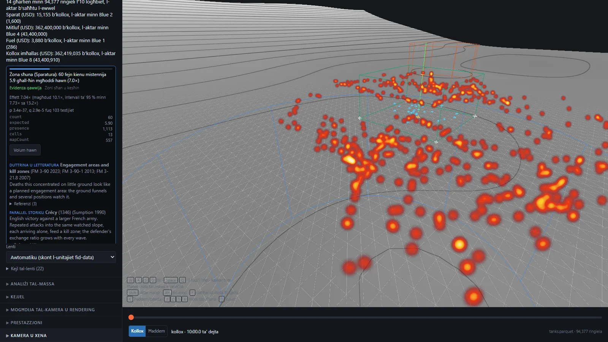

# Il-lenti tal-għarfien

Meta [Għarfien](insights.md) jsib xi ħaġa, din il-parti tispjegaha b'ideat mill-istorja militari, mid-disinn tal-logħba u mill-analiżi tal-isport, u ssemmi l-ktieb jew l-istudju li minnu ġejja. Użaha biex titgħallem *għalfejn* ikun importanti mudell, mhux biss li jeżisti.

## Ipprova {#try-it}

1. Tella' dejta u iftaħ **Għarfien**, imbagħad agħfas **Sib għarfien**.
2. Ikklikkja sejba biex tiftaħha.
3. Aqra **Duttrina u letteratura** u **Parallel storiku**; ir-referenzi sħaħ huma mitwijin taħtom.
4. Ibdel **Lenti** (per eżempju għal *Duttrina militari*) biex taqra l-istess sejba permezz ta' korp ieħor ta' letteratura.

## Kif jaħdem {#how-it-works}

Il-panew tal-Għarfien jiġġudika s-sejbiet tiegħu bl-istess mod li jagħmel analista professjonali: permezz tad-duttrina militari u tar-riċerka operattiva, tal-ingaġġi storiċi, u tal-letteratura tad-disinn tal-logħba, tad-disinn tal-livelli u tal-analitika. Jagħmel dan offline, minn bażi ta' għarfien magħżula fil-viewer, u jagħti l-istess materjal lil mudell estern meta wieħed jikteb is-sommarju.

## Dak li l-panew juri {#what-the-panel-shows}

- **Lenti** jagħżel il-korp tal-letteratura li permezz tiegħu jinqraw is-sejbiet: *Awtomatiku* (magħżul skont it-tipi ta' unitajiet fid-dejta: ajruplani, bastimenti, vetturi tal-art, infanterija), *Duttrina militari*, *Ġlieda fl-ajru*, *Navali*, *Urban*, *Disinn u bilanċ tal-logħba*, *Esports*. Dħul barra l-lenti magħżula jitħalla barra.
- Kull sejba miftuħa turi l-iktar dħul viċin tagħha tat-**duttrina u l-letteratura** u l-iktar **parallel storiku** viċin tagħha, bir-referenzi sħaħ imtewijin taħtom.
- **Kejl tal-lenti** jelenka l-kejliet tal-analiżi operattiva mħejjija fuq l-istess ringieli (hawn taħt), kull wieħed b'dak li jfisser u l-letteratura tiegħu.
- **Sommarju** iżid linji għas-sejbiet ewlenin u l-kejliet tal-lenti: "Duttrina u letteratura: ..." u "Parallel storiku: ...", kull wieħed bi kwotazzjonijiet awtur-sena u r-referenzi mitwijin taħtu.
- **Ikteb bl-AI** jibgħat l-aktar dħul rilevanti (sommarju, tagħlima, is-sejbiet li jirrelatawh, ir-referenzi sħaħ) mar-rapport, u jitlob lill-mudell jikkwotahom bl-id - `{concept.lanchester-square}` - u li ma juża l-ebda sorsi oħra.

It-tikketti huma tradotti; l-għarfien innifsu huwa bl-Ingliż.

## Kejl tal-lenti {#lens-metrics}

Jinħesbu fil-worker tal-għarfien, fl-istess passaġġ fuq ir-ringieli bħad-detectors (`src/insights/lensMetrics.ts`). Kull wieħed jitħalla barra meta d-dejta ma tkunx tista' tġorru.

| Kejl | X'jkejjel | Jeħtieġ |
|---|---|---|
| Tqabbil ta' Lanchester | It-telf ta' kull naħa kull 20 s irregressat fuq is-saħħiet ħajjin taż-żewġ naħat (Poisson, żbalji quasi-likelihood); l-esponenti fuq is-saħħa tal-għadu u tagħha, ittestjati mal-liġi tal-kwadru (nar immirat) u l-liġi lineari (nar fuq erja) | ħin, timijiet, qtil u mwiet |
| Proporzjon ta' skambju | Qtiliet għal kull mewt skont in-naħa u l-post; is-sehem tal-mwiet fuq l-iktar post mperiklu li jżomm 5% tal-ħin imqattgħa, kontra s-sehem li l-kwiet waħdu jagħti b'dak in-numru ta' mwiet; Gini tal-mwiet kontra l-ħin; Moran's I tar-rati tal-mewt | qtil u mwiet |
| Proporzjon lokali tal-forza | Unitajiet ħbieb u għedewwa ħajjin fil-firxa tal-ingaġġ ta' kull qtil (firxa mismuta mid-dejta: darbtejn l-medjan tad-distanza għall-għadu l-eqreb); s-sehem tal-qtil min-naħa li hija superjuri lokalment, u l-eċċess tagħha fuq dak li n-numri waħedhom jbassru | ħin, timijiet, persuni |
| Oqsma tan-nar | Veduti tal-postijiet l-iktar mimlija bil-qtil fuq wiċċ ta' ostruzzjoni 2.5D (il-ġeometrija tal-livell sa għoli ħajt, jew l-art imdawwra) imqabbla mal-post medju, u l-korrelazzjoni tar-rank bejn il-veduta u s-sehem tal-qtil | pożizzjonijiet; livell mgħobbi jagħmlu aktar preċiż; mhux għall-ajru |
| Stat ta' enerġija | Enerġija speċifika (l-għoli plus l-għoli li l-veloċità tista' tixtri) tal-qattiela tal-ajru u l-vittmi tal-ajru, imqabbla bl-istatistika ta' Mann-Whitney | klassijiet tal-ajruplani, ħin, għoli |
| Art ewlenija | Kemm-il darba kull post ikun fost it-tliet postijiet l-iktar mimlijin bil-qtil ta' partita | diversi partiti |
| Appoġġ reċiproku (trades) | Mwiet imwieġba minn qtil ta' sħabek fil-firxa tal-ingaġġ u fi 5 s | ħin, timijiet |
| L-ewwel kolpi | Ingaġġi - qtiliet imġemgħa skont il-partita, skont 20 s ta' kwiet u skont tlett firxiet ta' ingaġġ 'il bogħod - rebħuhom in-naħa li laqtet l-ewwel | ħin, timijiet |
| Mudell tas-salvo | L-ekwazzjoni ta' Hughes mtellgħa fuq perjodi ta' 20 s ta' bastimenti f'kuntatt: bastimenti meħuda mill-azzjoni għal kull bastiment attakkanti, u salvati għal kull bastiment difensur; fit ta' Lanchester fuq bastimenti biss | klassijiet tal-bastimenti, ħin, timijiet |
| Effettività tal-ġlieda | Qtiliet għal kull unità-siegħa fl-azzjoni ta' kull naħa u l-proporzjon taż-żewġ l-akbar (valur ta' effettività tal-ġlieda fis-sens ta' Dupuy) bl-intervall ta' 95%, u s-sehem ta' kull naħa tal-qtiliet f'numri lokali ndaqs | ħin, timijiet |
| Firxiet tal-ingaġġ | Id-distanza għall-għadu l-eqreb fil-qtiliet, fit-tnedija u fl-ewwel kolp ta' kull ħajja (l-individwazzjoni sal-ingaġġ), skont it-tip tal-unità | ħin, timijiet; tnedijiet fejn id-dejta għandha dawn |
| Katina tal-qtil | Sekondi mit-tnedija l-aħħar tal-qattiel sal-qtil, u mill-ewwel kolp tiegħu tal-ġlieda sal-qtil | ħin; tnedijiet jew avvenimenti tan-nar |
| Konċentrazzjoni jew firda | F'kull perjodu ta' 20 s, it-tixrid taż-żewġ naħat l-akbar u s-sehem tal-qtiliet meħud mill-iktar waħda magħquda | ħin, timijiet |
| Sortijiet | Għal kull naħa: sortijiet (tlugħ, jew tnedijiet tal-ajruplani), inżul, ajruplani mitlufa u qtiliet mill-ajruplani; rata tat-telf u qtiliet għal kull sortita | klassijiet tal-ajruplani; tlugħ jew tnedijiet |

Dejta b'rawnds iżżid il-kejliet tal-ġlieda mill-qrib u tal-esports - probabbiltà ta' rebħa tar-rawnd, valur tal-azzjonijiet, duelli tal-ftuħ, trades, peeker kontra holder, aim, crossfire, utility, vantaġġ fl-għadd, clutches, setups, wara l-plant, funnels fatali u l-impatt tal-plejer: ara [Ġlieda mill-qrib u rawnds](close-quarters.md).

Traċċi u timijiet iżidu l-kejliet tal-imġieba kollettiva tax-xjenza tal-folla, tal-moviment kollettiv, tal-ekonomija komportamentali u tal-psikoloġija militari - allinjament u miljing, herding tar-rotta, lanes u trails, ħafna nies flimkien, mexxejja u segwaturi, stragglers, il-punt ta' tkisser, ir-riskju wara t-telf, streaks, qbil fuq xiri u suppressjoni, kull wieħed kontra l-mudell null tiegħu: ara [Imġieba kollettiva](collective-behaviour.md).

L-armi, id-decoys u l-bini ma jitqisux bħala unitajiet. Fejn ringieli tal-armi jsemmu l-unità li titlaq minnha (kolonna `Shooter` jew `Launcher`, bħal f'dejta derivata minn Tacview), it-tnedija tiġi attribwita lil dik l-unità, imqabbla bl-isem jew bl-id tal-oġġett tagħha.

## Kif is-sejbiet jiltaqgħu mal-letteratura {#how-findings-meet-the-literature}

Dħul u sejbiet jiltaqgħu permezz ta' **tassonomija ta' mudelli** (`src/insights/knowledge/patterns.ts`): konċentrazzjoni, superjorità lokali, nar immirat u nar fuq erja, punti ta' għeluq, żoni tal-qtil, oqsma tan-nar, slope bil-lura, flanking, appoġġ reċiproku, vantaġġ ta' enerġija, pressjoni tat-tnissil, bilanċ u oħrajn. Kull tip ta' detector u kull kejl tal-lenti jgħid liema mudelli jurawlu n-numri tiegħu (`src/insights/lens.ts`); kull dħul tal-għarfien jgħid liema mudelli jitkellem dwarhom, b'piż. Ir-rilevanza ta' dħul għal sejba hija t-tqabbil mal-piż, mkejjel skont kemm il-qasam tad-dħul (art, ajru, baħar, urban) jaqbel mad-dejta u skont il-qawwa tas-sejba nnifisha. Ir-raġuni murija hija n-numri tas-sejba f'sentenza, segwiti mit-tagħlima tad-dħul.

## Katalgu {#catalogue}

Kull mudell, kunċett, metodu, każ storiku, prinċipju ta' disinn u studju, bil-bibljografija: ara l-[Katalgu tal-għarfien](knowledge-catalogue.md).

## Għall-iżviluppaturi {#for-developers}

### Iż-żieda ta' dħul {#adding-entries}

1. Agħżel il-fajl skont it-tip: `concepts.ts` u `concepts-more.ts`, `methods.ts`, `cases.ts`, `cases-land.ts`, `cases-air-sea.ts`, `cases-esports.ts`, `design.ts` (prinċipji tad-disinn) jew `studies.ts` f'`src/insights/knowledge/`.
2. Agħtih id ġdid `<type>.<slug>` (qatt terġa' tuża wieħed), il-lenti tiegħu, id-dominji, u l-mudelli li jitkellem dwarhom b'piżijiet 0..1. Żid mudell f'`patterns.ts` biss meta sejba tista' turih, u immappjah minn sejba jew kejl f'`lens.ts`.
3. Ikteb is-sommarju u t-tagħlima **bil-kliem tiegħek**. Kwotazzjonijiet biss minn xogħlijiet fid-dominju pubbliku (`pd: true` fir-referenza), u qosra.
4. Ikkwota: żid kull xogħol ġdid f'`refs.ts` bl-awturi, is-sena, it-titlu u l-pubblikatur (ġurnal bil-volum u l-paġni); URL jew DOI fejn hemm rekord pubbliku.
5. Mexxi `npx vitest run src/insights/lens.test.ts` (ids uniċi, mudelli magħrufa, referenzi li jsolvu, kwotazzjonijiet fid-dominju pubbliku, każijiet b'data u riżultat) u `node tools/knowledge-doc.mjs` biex taġġorna l-[katalgu](knowledge-catalogue.md).
