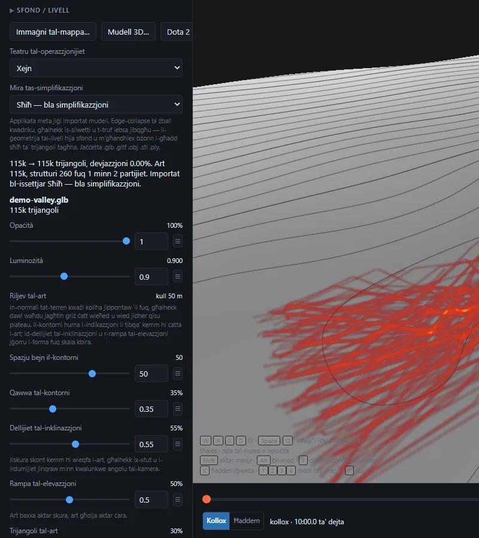

# Livelli u ġeometrija tal-isfond

Livell hu l-post 3D fejn ġara l-logħba - mappa, belt, traċċa. Poġġih wara d-dejta tiegħek u tista' tara *fejn* hi s-sħana. Il-pannell **Sfond / livell** (ara [Glossarju](glossary.md) għal "livell") jagħtik tliet tipi ta' kuntest:

- **immaġni tal-mappa**, imqiegħda bil-georeferenza permezz ta' żewġ ankri - ara [Immaġini tal-mappa](map-images.md);
- **livell 3D** - `.glb`, `.gltf`, `.obj`, `.stl` jew `.ply` - maqsum f'art, strutturi u ilma u simplifikat meta jitgħabba - ara [Livelli 3D](model-levels.md) u [Id-dehra tal-livell](level-appearance.md).
- **sfond tad-dinja vera** - għal reġistrazzjoni li tgħid fejn hi fuq l-art (fajl Tacview ACMI): l-art reali, it-toroq, l-ilma, l-ajruporti u l-bini, imniżżla minn dejta miftuħa - ara [Id-dinja vera bħala sfond](world-backdrop.md).

Meta ma jkun hemm xejn mgħobbi, ix-xena tkun skura b'grilja u assi kkuluriti (**Grilja** u **Assi** fi [Kamera u xena](camera.md)), u l-pannell jgħid *Ebda ħaġa mgħobbija - ix-xena turi grilja u assi. Żid immaġni tal-mappa jew mesh ta' livell biex tagħti kuntest lis-sħana.*

Il-livell hu maqsum mat-tliet tabs: kors mgħobbi fit-tab Analiżi tal-ġirja huwa l-istess livell li turi l-mappa tas-sħana.

## Poġġi livell wara d-dejta tiegħek {#put-a-level-behind-your-data}

1. Tagħbi d-dejta tiegħek l-ewwel ([Tgħabbija tad-dejta](getting-data-in.md)), sabiex il-livell jitqiegħed skont kif hi.
2. Iftaħ **Sfond / livell** fil-barra tal-ġenb.
3. Agħfas **Immaġini tal-mappa…** għal stampa jew **Mudell 3D…** għal livell 3D, u agħżel il-fajl. Għal reġistrazzjoni tad-dinja reali, uża **Id-dinja vera bħala sfond** jew **Teatru**.
4. Stenna li tlesti l-linja tal-progress. Mudell kbir jiġi simplifikat l-ewwel (ara **Mira tas-simplifikazzjoni** hawn taħt).
5. Agħfas **F** fil-veduta biex tqiegħed kollox fil-qafas. Uża **Opaċità** u **Luminożità** sakemm is-sħana tinqara minn fuq il-livell.
6. Agħfas **Issejvja fil-librerija** jekk se tuża l-livell għal darb'oħra ([Librerija tal-livelli](level-library.md)).

## X'jagħmel livell għas-sħana {#what-a-level-does-for-the-heat}

- **Joħbi**: punti tad-dejta wara tiegħu jiddu skont kull wiċċ, u punti wara t-terren jitwarrbu ([Fond u qtugħ](depth-and-culling.md)). Mingħajr livell, ma hemm ebda okkluzjoni.
- Jitqatta' mill-[Qtugħ](slice.md) u, bil-*Aqta' l-livell ukoll*, mill-[qtugħ skont id-distanza](depth-and-culling.md#distance-culling), flimkien mas-sħana.
- Hu l-unika ħaġa li l-[fond tal-fokus](camera.md#depth-of-field) jagħmel mċajpra, barra l-grilja u l-kaxxi.
- Livell 3D **iwessa' l-pjan 'il bogħod tal-kamera** meta jkun akbar mid-dejta: il-viċin u l-bogħod jitkejlu mid-dataset, u mappa esportata li tkejjel diversi kilometri kieku tkun kollha wara l-pjan 'il bogħod u tħalli l-veduta vojta. Il-pjan 'il bogħod isir 3 × il-firxa orizzontali tal-livell meta tkun akbar, il-pjan viċin jitħarrek miegħu (mill-inqas bogħod / 100,000) biex jinżamm il-preċiżjoni tal-fond li l-okkluzjoni tiddependi fuqha, u l-veloċità tat-tlugħ titla' għal mill-inqas firxa / 12. Dan qatt ma jiġi mnaqqas, dejjem imwessa'.

## Il-pannell, minn fuq għal isfel {#the-panel-top-to-bottom}

| Parti | Dettalji |
|---|---|
| **Immaġini tal-mappa…**, **Mudell 3D…** | Tagħbi wieħed; jissostitwixxi l-livell kurrenti. |
| **Id-dinja vera bħala sfond**, **Insa l-madum tal-mappa** | Biss għal dataset b'referenza ġeografika: jibni l-post reali taħtha bħala livell, jew ineħħi t-tiles imniżżla. [Id-dinja vera bħala sfond](world-backdrop.md) |
| **Mira tas-simplifikazzjoni** | Il-baġit tat-triangoli għall-import li jmiss tal-mudell: *Sħiħ - ebda simplifikazzjoni* (default), *Għoli - 8M*, *Medju - 3M*, *Baxx - 800k*, *Silwett - 100k*. [Livelli 3D](model-levels.md#simplification) |
| Progress u **Ikkanċella** | Waqt id-decoding jew l-import. |
| Nota tal-import | It-triangoli qabel u wara, il-qsim art / strutturi / ilma, il-livell ta' dettall użat. |
| Isem u daqs | `wisa'×għoli px · x × z m/px` għal immaġni, `N triangles (from M)` għal mudell. |
| **Opaċità**, **Luminożità** | It-tnejn it-tipi. |
| Kontrolli tal-immaġni | **Neħħi s-saturazzjoni**, **Aqleb tramuntana/nofsinhar**, **Pożizzjonament** (żewġ ankri), **Waqqaf mal-limiti tad-dejta**, **Elevazzjoni**. [Immaġini tal-mappa](map-images.md) |
| Kontrolli tal-mudell | Riljev tal-art, ilma, trijangoli tal-art, wireframe, texture, kulur maqbud, strutturi, klassifikazzjoni tal-partijiet. [Id-dehra tal-livell](level-appearance.md) |
| **Issejvja fil-librerija**, **Neħħi** | [Librerija tal-livelli](level-library.md); Neħħi jitlaq il-livell. |
| **Librerija** | Livelli mħażna f'dan il-browser. [Librerija tal-livelli](level-library.md) |

## Paġni f'din it-taqsima {#pages-in-this-section}

- [Immaġini tal-mappa](map-images.md)
- [Livelli 3D](model-levels.md) - formati, partijiet, klassifikazzjoni, simplifikazzjoni, texturi
- [Id-dehra tal-livell](level-appearance.md) - kull kontroll għal livell 3D
- [Librerija tal-livelli](level-library.md)
- [Id-dinja vera bħala sfond](world-backdrop.md) - id-dinja reali taħt reġistrazzjoni, minn dejta miftuħa

Kif tiġi livelli minn logħob u magni hi n-negozju tal-għodod separati tal-esportazzjoni (ara l-[README](https://github.com/Holdi601/3DHeat/blob/main/README.md) tar-repożitorju); il-kuntratt li jiktbu fih hu fil-qosor f'[Livelli 3D](model-levels.md#the-exporter-contract).
