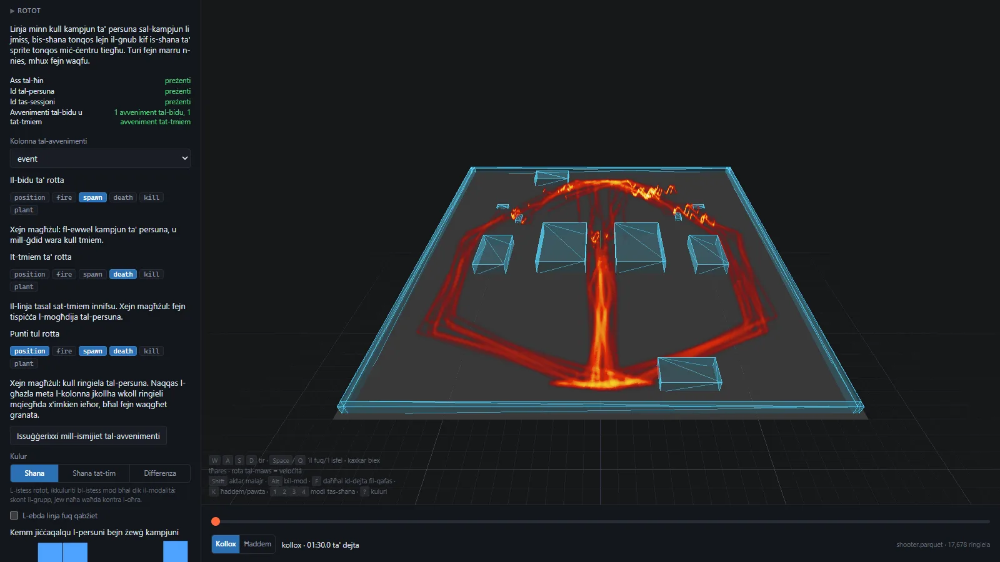

# Sħana tal-linji

Is-sħana turi fejn kienu n-nies wieqfa. Il-**Linji** juru t-triqat li mxew.

**Linji** (ċavetta 4) hija s-sħana tal-linji: linja minn kull kampjun ta' [persuna](glossary.md) sal-kampjun li jmiss tagħha, imxerrda bl-istess tnaqqis li għandu [sprite](glossary.md) - madwar il-linja minflok madwar punt. Turi fejn *marru* n-nies aktar milli fejn kienu wieqfa: korridor li għaddew minnu darba huwa viżibbli daqs kamra fejn kienu jgħixu; kampjuni mifruxa ta' plejer mgħaġġel jingħaqdu f'rotta kontinwa minflok traċċa b'tikek. Teħtieġ kolonna ta' persuna u kolonna ta' ħin.

## Kif tuża dan {#how-to-use-it}

1. Agħfas `4` (jew agħżel **Linji** fil-bar tal-modi).
2. Iftaħ **Rotot** u ara l-lista ta' kontroll ħadra: il-kolonna tal-ħin u l-id tal-persuna iridu jkunu preżenti.
3. Agħfas **Issuġġerixxi mill-ismijiet tal-avvenimenti** biex timla fejn jibdew u jispiċċaw ir-rotot.
4. Aqra l-linja tal-istatistika: "N rotot, M minnhom jilħqu tmiem".
5. Jekk linji jaqbżu fuq il-mappa, aġġusta **L-itwal pass** (ara [Il-limitu tal-qabża](#the-jump-limit)).

Linja tagħmel sens biss bejn bidu u tmiem, għalhekk il-panew **Rotot** jgħid x'jorbot rotta. Kollox minn [Ir-regoli ta' rotta](#the-rules-of-a-route) 'l quddiem huwa dettall li tista' tgħaddi minnu.

## Il-panew Rotot {#the-routes-panel}

Jidher fuq il-panels tas-sħana fil-modalità Linji.

### X'fih id-dejta {#what-the-data-has}

Lista ta' kontroll, ħadra meta tkun preżenti, kannella meta le:

| Linja | Stati |
|---|---|
| **Ass tal-ħin** | *preżenti* / *nieqes - meħtieġ* |
| **Id tal-persuna** | *preżenti* / *nieqes - meħtieġ* |
| **Id tas-sessjoni** | *preżenti* / *xejn - ir-ringieli kollha huma sessjoni waħda* |
| **Avvenimenti tal-bidu u tat-tmiem** | *N bidu, M tmiem* / *xejn magħżul - traċċi sħaħ* (ħadra biss b'kolonna ta' avvenimenti u għall-inqas bidu wieħed u tmiem wieħed) |

### Kontrolli {#controls}

| Kontroll | Tfisser |
|---|---|
| **Kolonna tal-avvenimenti** | Kolonna ta' kategorija li l-valuri tagħha huma avvenimenti (spawn, death, position, ...). *Xejn - traċċi sħaħ*: it-traċċa ta' kull persuna f'kull sessjoni hija rotta waħda, maqtugħa fejn it-traċċa jkollha xi vojt. Jiġu offruti biss kolonni miżmuma għall-filtrar meta jitgħabba. |
| **Rotta tibda minn** | Valuri ta' avvenimenti li jibdew rotta (spawn, respawn, deploy). Xejn magħżul: rotta tibda fl-ewwel kampjun ta' persuna, u mill-ġdid wara kull tmiem. |
| **Rotta tispiċċa f'** | Valuri ta' avvenimenti li jtemmu rotta (death, extraction, teleport). Il-linja tilħaq ir-ringiela tat-tmiem innifisha. Xejn magħżul: rotta tispiċċa fejn tispiċċa t-traċċa tal-persuna. |
| **Punti tul rotta** | Valuri ta' avvenimenti li r-ringieli tagħhom jinsabu tul ir-rotta. Xejn magħżul: kull ringiela tal-persuna. Naqqas dan meta l-kolonna tinżamm ukoll ringieli f'post ieħor, bħal fejn waqa' granata. |
| **Issuġġerixxi mill-ismijiet tal-avvenimenti** | Timla t-tliet listi mill-ismijiet tal-valuri (hawn taħt). |
| **Kulur** | *Sħana*, *Sħana tat-tim* jew *Differenza*. L-istess rotot fil-kuluri ta' dak il-mod: kull grupp f'tonalità tagħha, jew naħa kontra l-oħra, bil-lista tal-gruppi, il-qsim u r-rampi jaħdmu kif jaħdmu f'dawk il-modi. Default *Sħana*. Sħana tat-tim u differenza jeħtieġu kolonna ta' grupp. |
| **La linji fuq qabżiet** / **L-itwal pass** | Il-kampjun li jmiss ta' persuna li jinsab iktar 'il bogħod minn dan huwa respawn, teleport jew waqgħa, mhux post fejn marru, għalhekk l-ebda linja ma tgħaqqad iż-żewġ punti. Jitimla meta jitgħabba meta d-dejta turi vojt ċar (hawn taħt), u jitfi meta ma jkunx hemm. Jaħdem bi jew mingħajr kolonna ta' avvenimenti. |
| Linja tal-istatistika | `N rotot, M minnhom jilħqu tmiem, K segmenti`, tiġġedded kemm-il darba kull sekonda. |

Kull lista hija ringiela ta' chips tat-toggle, wieħed għal kull valur, l-iktar frekwenti l-ewwel; meta ttella' l-mouse fuq chip turi l-għadd tar-ringieli tiegħu. Jiġu offruti sa 120 valur (*N valuri oħra mhux murija*).

Jekk tagħżel kolonna ta' avvenimenti oħra, is-suġġeriment jiġi applikat meta s-suġġeriment jagħżel dik l-istess kolonna, u jibda b'listi vojta altrimenti.

### Is-suġġeriment {#the-suggestion}

Fuq kull tagħbija, u fuq **Issuġġerixxi mill-ismijiet tal-avvenimenti** ([`suggestLineSettings`](https://github.com/Holdi601/3DHeat/blob/main/src/data/lines.ts)):

- **Kolonna tal-avvenimenti:** l-ewwel kolonna ta' kategorija miżmuma msemmija `event`, `eventname` jew `eventtype`; inkella `kind`, `type` jew `action`; inkella kull waħda li fiha *event*, *kind*, *action* jew *type*.
- **Bidu:** valuri li fihom *spawn, deploy, join, enter, start, begin, respawn, revive, land/landed/landing, drop* - sakemm ma jaqblux ukoll ma' kelma ta' tmiem.
- **Tmiem:** valuri li fihom *death, died, dead, kill/killed, eliminat…, extract, evac, teleport, leave, left, disconnect, quit, exit, end, finish, downed* - ħlief il-valuri `kill` u `kills` (qtil huwa xi ħaġa li l-qattiel jagħmel, mhux it-tmiem tar-rotta tiegħu).
- **Punti:** valuri li huma eżattament *position, location, player location, move, movement, tick, sample* jew *pos*; meta wieħed minnhom jinstab, il-bidu u t-tmiem jiżdiedu wkoll mal-punti. Meta ebda wieħed ma jinstab, il-punti jibqgħu vojta (kull ringiela).

### Il-limitu tal-qabża {#the-jump-limit}

Fejn in-nies jaqbżu, it-tul tal-passi jaqa' f'żewġ gruppi b'xejn bejniethom: dak li persuna tgħaddi minnu bejn żewġ kampjuni, u l-wisa' tal-mappa. Meta titgħabba ([`suggestMaxJump`](https://github.com/Holdi601/3DHeat/blob/main/src/data/lines.ts)), il-passi jitgħoddu għal kull darbtejn tal-kwadru tat-tul tagħhom, sa 16 miljun minnhom, u l-limitu jitqiegħed fin-nofs tal-ewwel medda 'l fuq mill-medjan li hija għall-inqas darba tat-tul wiesgħa, li jżomm inqas minn 0.02% tal-passi għal kull bin, u li għandha passi 'l fuq minnha. Mingħajr medda bħal din ebda ħaġa ma tintqata', għax ma jkunx hemm mod kif tgħid qabża minn karozza mgħaġġla; meta tixgħel il-limitu b'idejk imbagħad jibda f'għaxra tad-dijagonali tad-dejta.

Il-grafika fuq il-limitu turi kemm tassew twal il-passi, b'linja fil-limitu: il-bars fil-lemin tiegħu ma jinġibdux. Iż-żewġ assi huma loġaritmiċi, għax il-qabżiet jistgħu jkunu centeżmu tal-passi u elf darba itwal. Ipponta fuq bar għall-medda tiegħu u s-sehem; ikklikkja l-grafika biex titpoġġa l-limitu hemm. Taħtha, is-sehem tal-passi 'l fuq mil-limitu.

## Ir-regoli ta' rotta {#the-rules-of-a-route}

Ir-ringieli jiġu mixjija fl-ordni taż-żmien, għal kull persuna ([`buildLines`](https://github.com/Holdi601/3DHeat/blob/main/src/data/lines.ts)):

1. Ringieli ta' [isem mqassam](sessions-persons-groups.md#names-worn-by-several-things-at-once) jitħallew barra kompletament.
2. Bil-punti magħżula, ringiela li mhijiex bidu, tmiem jew punt titħalla barra.
3. Ir-ringieli jitgħaddew għal kull persuna għal kull sessjoni, sabiex persuna li s-sessjonijiet tagħha jgħaqqdu fl-ordni taż-żmien ikollha rotta waħda f'kull waħda. Rotta tingħalaq meta r-ringiela ta' qabel ma jkollhiex suċċessur (il-[ħajja](sessions-persons-groups.md#person) tagħha hija "none") - rotta qatt ma taqsam il-fruntiera ta' sessjoni jew vojt li t-tagħbija iddeċidiet li ma għandux kampjun li jmiss. Fuq liema rotta tinsab ringiela jiġi maħdum darba u jinżamm, 4 bytes għal kull ringiela, għalhekk jekk tbiddel l-itwal pass dik il-parti ma tiġix imtennija.
4. Ringiela ta' **bidu** tagħlaq kull rotta miftuħa u tiftaħ waħda ġdida hemm.
5. Bil-bidu magħżul, ringiela barra minn rotta titħalla barra. Mingħajr bidu, kull ringiela li mhijiex tmiem barra minn rotta tiftaħ waħda.
6. Kull ringiela oħra ġewwa rotta żżid **segment** mill-ringiela ta' qabel tar-rotta sa din.
7. Ringiela ta' **tmiem** li ttawwal rotta tagħlaqha wara s-segment tagħha; dik ir-rotta titqies bħala *tilħaq tmiem*.
8. Pass itwal minn **L-itwal pass** jagħlaq ir-rotta fejn kienet, u rotta ġdida tibda fl-aħħar tal-bogħod, sakemm dik ir-ringiela ma tkunx tmiem. Ebda linja ma tinġibed fuqu, u l-linja tal-istatistika tgħoddu.

Kull segment jinħażen fuq ir-ringiela *tat-tmiem* tiegħu, għalhekk is-segmenti jibqgħu fl-ordni taż-żmien, u l-[linja taż-żmien](timeline.md) il-window, is-sampler, il-[filtri](filters.md), il-viżibbiltà tal-gruppi u s-sinjal tad-differenza kollha jaħdmu fuqhom bħal fuq punti. Filtru għalhekk japplika għar-ringiela li fiha jispiċċa segment.

## Playback {#playback}

Fil-modalità **Kollox** kull rotta tinġibed sħiħa. Fil-modalità **Play** kull persuna hija punt jiċċaqlaq bejn il-kampjuni tagħha, u jiġbed ir-rotta tagħha warajh:

- segment li jibda wara l-playhead ma jinġibidx;
- is-segment li l-persuna tkun fl-idejn tiegħu jinġibed sal-pożizzjoni interpolata tagħha, b'tarf ta' tmiem fir-ras;
- is-sħana tbaħbaħ fuq l-**denb**: bl-istorja *Kumulattiva* id-denb ma għandux limitu u r-rotta kollha s'issa tibqa'; bl-*Window* jitbaħbaħ għal xejn fuq l-*Medda* (default 30 s). Bil-*Dewmien* id-denb huwa wkoll l-*Medda*, u fil-modalità Linji l-linja taż-żmien turi l-kaxxa tal-*Medda* għal dik l-istorja wkoll (minflok *Dewmien mill-ġdid* u *Tbaħbiħ*, li s-sħana tal-linji ma tużahomx).

Waqt il-playback, kull frame jinġibed sħiħ minflok ma jitqabbad flimkien, għax ir-ras jitħarrku kull frame u medja li timxi tgħaffġ kull waħda f'xkurrija.

## Għall-iżviluppaturi {#for-developers}

### Memorja {#memory}

Ir-rotot jinbnew fuq il-main thread meta tidħol fil-modalità Linji (jew meta jinbdlu s-settings tar-rotot) u jitħallew meta tiħrab minnha: 5 bytes għal kull ringiela fil-memorja u 8 bytes għal kull ringiela fuq il-GPU (il-pożizzjoni tal-bidu ta' kull segment, iqsmu għal 16-il bit għal kull assi fil-kaxxa tal-fruntiera tad-dejta, u l-flags tiegħu).

### Kif tinġibed linja {#how-a-line-is-drawn}

Iż-żewġ backends jinġibdu kull segment mir-ringiela tat-tmiem tiegħu bħala **18-il vertex** ([`lineHeatVs`](https://github.com/Holdi601/3DHeat/blob/main/src/render/webgl2/shaders.ts) u l-ġemel tiegħu f'WGSL):

- In-nofs-wisa' f'kull tarf huwa r-[raġġ tal-isprite](sprite-shape.md#sprite-radius) f'dik id-distanza tat-tarf, bil-limiti tal-pixels applikati. Linja iktar dejqa minn 2.5 px tinġibed 2.5 px wiesgħa bis-sħana tagħha mnaqqsa skont dan, sabiex linji rqaq la jisparixxu u lanqas jiddawdu.
- Is-sħana titbaħbaħ **tul** il-linja bl-istess rampa ta' sprite - tbaħbiħ jew kurva, intensità fiċ-ċentru u fit-tarf.
- Il-gwiebet tondi jinġibdu **biss** fejn rotta tibda jew tispiċċa, sabiex il-ġonot bejn is-segmenti li jsegwu lil xulxin ma jitqassmux f'katina ta' perli.
- Il-ġeometrija tinbena fl-ispazju tal-iskrin u tiġi interpolata lineari hemm, sabiex it-tbaħbiħ jibqa' ċentrat fuq il-linja kemm jimxi fil-fond. Segment li jaqsam il-pjan qarib jinqata' hemm minflok ma jitwarrabx.

Is-sħana tal-punti u s-sħana tal-linji jpoġġu ammonti differenti ħafna ta' sħana għal kull ringiela, għalhekk is-saturazzjoni tiġi mkejla mill-ġdid meta taqleb bejniethom ([Kulur u esponiment](colour-and-exposure.md#auto-exposure)).
