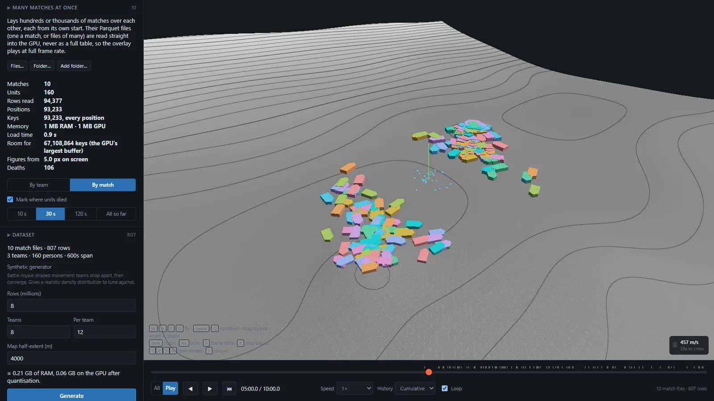

# Ħafna partiti f'daqqa

**Ħafna partiti f'daqqa** jaħdem ħafna partiti fuq xulxin, sabiex tara fejn normalment imorru l-plejers ta' kull partita. Uża dan biex tqabbel mijiet jew eluf ta' partiti f'stampa waħda.

Kull partita tibda mill-bidu tagħha stess u l-unitajiet tagħha jimxu bħala figuri. Il-fajls imorru direttament fil-kard grafiku u ma jinbena l-ebda tabella sħiħa, għalhekk jaħdem bla intoppi fejn tagħbija normali tispiċċa mill-memorja.

## Kif tuża dan {#how-to-use-it}

1. Iftaħ **Ħafna partiti f'daqqa** fis-sidebar tal-Heatmap.
2. Agħfas **Fajls…** (agħżel ħafna fajls), **Folder…** (folder u s-subfolders tiegħu) jew **Żid folder…** (żid ma' dak li diġà hu mgħobbi).
3. Il-viewer jaqleb għall-Figuri fuq xulxin u jibda mill-bidu. Agħfas **Ħaddem**.

Kull fajl huwa partita waħda (jew jżomm diversi). Fajls Parquet u kontenituri [`.3dheat`](container.md) jaħdmu. Fajl jeħtieġ kolonna ta' pożizzjoni, ħin u unità; kolonni ta' isem, tip u naħa jinżammu. Fajls oħra, u l-fajls tal-ġenb tal-konvertituri (titjiriet, messaġġi, avvenimenti, chat, għanijiet), jitħallew barra. Għal tabella normali, ara [Kif tidħol id-data](getting-data-in.md).

## Settings {#settings}

| Setting | X'jagħmel |
|---|---|
| **Skont it-tim** / **Skont il-logħba** | Ikkuluria skont in-naħa, jew kulur għal kull partita. |
| **Immarka fejn mietu l-unitajiet** | Marka fejn kull unità mietet, għal 10 s, 30 s, 120 s, jew kollha s'issa. |

Il-pannell juri kemm partiti, unitajiet, ringieli u pożizzjonijiet ġew moqrija, il-memorja użata u l-ħin tat-tagħbija. *Spazju għal* huwa kemm pożizzjonijiet oħra l-kard grafiku jista' jieħu. *Figuri minn* huwa d-daqs fuq l-iskrin taħt liema unità tinżel bħala dart żgħir minflok il-figura tagħha.

L-aspett tal-figuri juża l-istess kontrolli tar-[replay tal-partita](match-replay.md#figures): **Daqs tal-figuri**, **L-iżgħar figura fuq l-iskrin** u **Mill-bogħod**.

## Tips {#tips}

- Meta kollox ma jidħolx fil-memorja, il-pożizzjonijiet jiġu mnaqqsa (jinżamm biss pożizzjoni kull ftit metri) u l-pannell jgħid hekk.
- Il-modalitajiet tas-sħana jaħdmu wkoll fuq id-data tal-overlay.
- Għal statistika fuq eluf ta' partiti mingħajr ma tinżel, ara [Analiżi tal-massa](mass-analysis.md).
