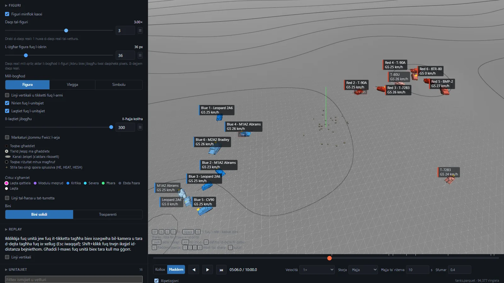
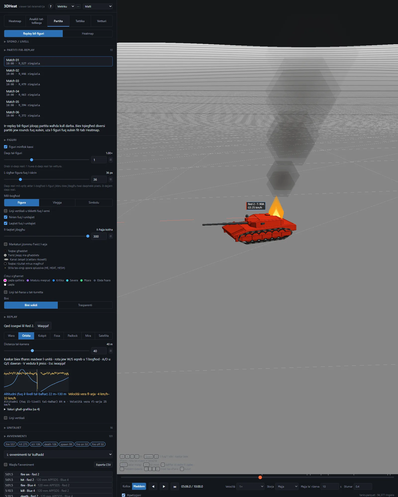
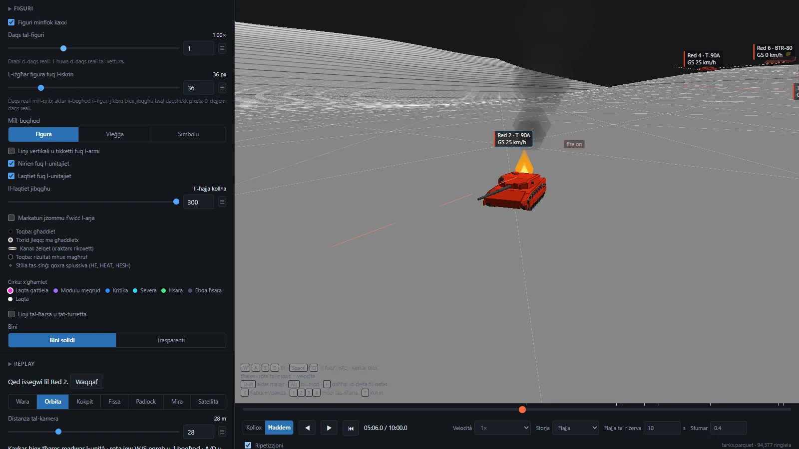
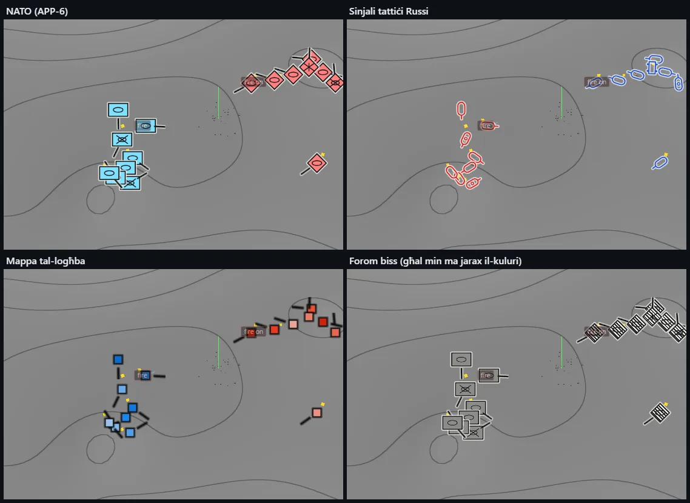
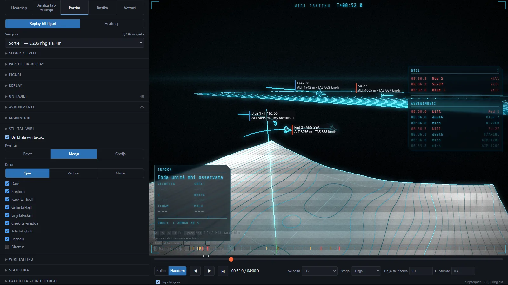
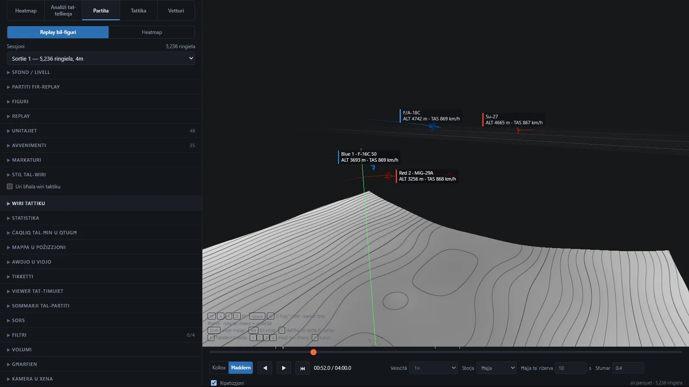

# Replay tal-partita

Ir-replay hu film tal-partita fejn kull plejer jinġibed bħala l-oġġett li kien isuq. Uża dan biex terġa' tara ġlieda, issegwi unità waħda u tara min laqat lil min.

Tiri, laqtiet, nirien u wrakkijiet jinġibdu fuq l-unitajiet u l-għanijiet fuq il-livell. Il-kameras, it-tikketti u wiri taktiku jgħinuk taqra l-ġlieda. Taf Tacview? [Parità ma' Tacview](tacview-parity.md) juri fejn hu kull wieħed mill-għodod tiegħu.

## Ibda replay {#start-a-replay}

1. Tagħbi reġistrazzjoni b'**Sors → Fajls…** jew billi tgħaffagħha fuq il-pannell tas-Sors (kwalunkwe tabella b'kolonna **persuna** u kolonna **ħin**, fajl Tacview, replay kkonvertit, jew partita [`.3dheat`](container.md)). Ara [Tgħabbija tad-dejta](getting-data-in.md).
2. Iftaħ it-tab **Partita** u agħżel **Replay bil-figuri**, jew agħżel **Figuri fuq xulxin** fil-barra tal-modi tat-tab Mappa tas-sħana.
3. Taħt **Partiti fir-replay** agħżel partita waħda, il-partiti kollha flimkien, jew diversi.
4. Agħfas **Ħaddem** fuq il-linja taż-żmien (jew `K`). Iġbed il-linja taż-żmien biex taqbeż.

Il-figuri jieħdu post il-kaxxi għal kull unità li l-isem jew it-tip tagħha magħruf (ara [Figuri](figures.md)). Dejta mingħajr kolonna ta' isem jew tip titpitter bħala suldati.

## Figuri {#figures}

| Issettjar (taqsima **Figuri**) | Default | X'jagħmel |
|---|---|---|
| **Figuri minflok kaxxi** | mixgħul | Mitfi juri kaxxi sempliċi. |
| **Daqs tal-figuri** (darbiet id-daqs veru) | 1 | 1 hu d-daqs reali; 0.25 sa 20 darba (skala logaritmika). Aktar kbir jgħin minn ’l bogħod. |
| **L-iżgħar figura fuq l-iskrin** | 36 px | Il-figuri ’l bogħod jikbru biex jibqgħu daqshekk, 0 sa 200 px; 0 iżomm id-daqs veru. |
| **Mill-bogħod**: Figura, Vleġġa, Simbolu | Figura | X'isir unità ’l bogħod. |
| **Simboli** | NATO (APP-6) | NATO (APP-6), sinjali taktiċi Russi, ikoni tal-**Mappa tal-logħba**, jew **Forom biss (għal min ma jarax il-kuluri)**. |
| **Daqs tas-simbolu**, **In-naħa tiegħi**, **Ostili / Newtrali**, **Marki tad-direzzjoni** | 28 px (12 sa 64), awtomatiku, ostili, mixgħul | Kif jidhru s-simboli u liema naħa hi tal-ħbieb. |
| **Linji vertikali** | mixgħul | Linja minn kull unità direttament ’l isfel sal-art, sabiex l-għoli jinqara f'3D. |
| **Linji vertikali u tikketti fuq l-armi** | mitfi | Linji sal-art u tikketti fuq missili u bombi. |
| **Nirien fuq l-unitajiet** | mixgħul | Fjammi mill-mument li unità tieħu n-nar sakemm jintfew. |
| **Laqtiet fuq l-unitajiet** | mixgħul | Marki fejn il-tiri laqat (hawn taħt). **Il-laqtiet jibqgħu**: 1 sa 300 sekonda, jew **Il-ħajja kollha**. **Markaturi jżommu f’wiċċ l-arja**: marki mingħajr ma jidħlu fl-art. |
| **Linji tal-ħarsa u tat-turretta** | mitfi | Mitqugħ: fejn il-plejer iħares; sod: fejn il-kanun jimmira. |
| **Bini** | sod | Bini sod jew trasparenti, meta l-livell jagħmlu. |

### Simboli ’l bogħod {#symbols-at-a-distance}

Meta unità tkun iżgħar minn **L-iżgħar figura fuq l-iskrin**, tista' ssir simbolu li jibqa' jinqara. Il-forma tgħid it-tip (pereżempju kaxxa mdawra b'marka ta' track għall-armatura); il-kulur jgħid in-naħa. Iftaħ il-menu **Simboli** biex tbiddel l-istil.

### Marki tal-laqtiet, wrakkijiet u nirien {#hit-marks-wrecks-and-fires}

- **Marki tal-laqtiet** jinsabu fuq il-wiċċ li l-tiro laqat, fuq l-iskala tal-figura. L-aspett tagħhom juri x'ġara: toqba (għadda), spray ħelwa (ma għadditx), ħaffra (niżlet bi ħlief), stilla ta' fwliegu (blast). Ċirku kulurat juri x'għamel: tir li qatel, modulu meqred, kritiku, sever, dannu, ebda dannu, laqta. Oqgħod fuq marka biex tara l-isem tal-munizzjoni.
- Unità meqruda tinġibed **mħarqa** bħala wreck minn mewtha sa ma tirkupra jew titneħħa; is-simbolu tagħha huwa mgħoddi.
- **In-nirien** jaħirqu fuq unità mill-mument li tieħu n-nar sakemm jintfew.
- **Turretti** idawru lejn fejn id-dejta tgħid li l-kanun jimmira (jew, mingħajr dik, fejn il-plejer iħares).

### Armi, dekojs u traċċanti {#weapons-decoys-and-tracers}

Bl-**Armi, tiri u laqtiet** mixgħul (taqsima Viewer tat-timijiet): missili, rokits, bombi u torpedni jtiru bħala figuri tagħhom stess b'traċċa tad-duħħan; ir-rombli u l-blalen huma traċċanti; l-impatti u x-xoqqiet jiddi. Traċċant impittir **mitqugħ** inħadem minn laqta, għax id-dejta ma kellhiex it-tir. Flares u chaff jinġibdu bħala dekojs; ikunu moħbija mil-lista tal-unitajiet sakemm ma tkunx immarkata *Dekojs u blalen*.

## Kameras {#cameras}

Ikklikkja unità jew it-tikketta tagħha biex **tsegwiha**; it-taqsima **Replay** toffri **Wara**, **Orbita**, **Kokpit** (bil-wiri head-up, `H`), **Fissa**, **Padlock**, **Mira** u **Satellita**. `V` iduru bejniethom, **Distanza tal-kamera** tgħid kemm hi 'l bogħod. Esc jieqaf.

- **Veduta ta' żewġ unitajiet**: agħżel **Mira** (jew Ctrl/Alt-klikk fuq unità) biex tarah minn dik issegwita; **Biddel** iħalli lil wieħed minnhom jiskambja.
- **Kejl**: Shift-klikk fuq żewġ unitajiet għall-idwar, il-firxa u d-differenza fl-għoli bejniethom.
- **Mappa 2D** (`M`): veduta fil-kantuntieri jew sħiħa, bi traċċi u ismijiet.
- **Markaturi** (`B`): tiffranka l-mument u l-kamera; l-qtil, il-mewt u l-markaturi tar-reġistrazzjoni nfisha huma elenkati wkoll.
- **Avvenimenti**: kull avveniment f'ordni taż-żmien; klikk imur hemm. `Page Up` / `Page Down` iqabbżu bejn l-avvenimenti; **Waqfa f'avveniment** jieqaf f'kull wieħed.

## Wiri taktiku {#tactical-display}

It-taqsima **Wiri taktiku** tiġbed, għal ebda unità, dawk magħżula, kollha, jew tip wieħed (inġenji tal-ajru, art, vapuri, armi): vetturi tal-veloċità u t-triq ’l quddiem, linji tal-muntu u tal-ġenħ, koni tar-radar, lock, rabtiet tad-dejta, żoni u linji tal-ingaġġ, linji tal-ħarsa, fejn il-plejers iħarsu (koni tal-veduta), il-mira tat-turretta, u l-kamera rreġistrata.

### Stil tal-wiri {#display-style}

`T` (jew il-ħlief **Uri bħala wiri taktiku**) jbiddel il-look għal stil ta' skrin radar: glow, kontorni, linji tal-kontorn, grilja ta' kejl, linji tal-iskan, ċrieki tal-firxa, skali tal-għoli, pannelli bil-qtil u l-avvenimenti, u **Direttur** li jmexxi l-kamera għall-avvenimenti waħdu.

## Għanijiet {#objectives}

Meta partita tiġi bl-għanijiet tagħha, it-taqsima **Għanijiet** tiġbedhom fuq il-livell: żoni ta' qbid (bis-sid u l-progress tal-qbid), spawns, ajruporti, żoni u miri tal-bombardament, kull saff jista' jitfa' u bit-tikketti. Jidhru minn taħt l-art. Meta jkunu mgħobbija diversi modi tal-logħba, **Modalità** tfilter il-partiti skont il-modalità. L-għanijiet ġejjin mill-fajl tal-partita ta' konvertitur ħdejn ir-reġistrazzjoni jew ġewwa kontenitur [`.3dheat`](container.md).

Il-partiti ta' Rainbow Six Siege iġibu s-siti tal-bomba tagħhom: iż-żewġ kmamar ta' kull sit jinġibdu fuq l-art tagħhom bħala kontorni bl-ismijiet tagħhom, misjuba minn fejn kienu l-plejers waqt li l-logħba kienet issemmi l-kamra; sit tal-mappa li ma ntlagħabx fil-partita jiġi mit-tabella tas-siti tal-konvertitur bħala ċirku. Fir-replay, is-sit tar-rawnd fil-playhead jixgħel kulur ambra, l-oħrajn jibqgħu griżi. Huma parti mis-saff taż-żoni ta' qbid.

## Tikketti u statistika {#labels-and-statistics}

- **Tikketti**: regoli għal kull tip (**Magħżula**, **Inġenji tal-ajru**, **Art**, **Vapuri**, **Armi**, **AI**): jidhru jew le, liema valuri, u **Prijorità** għal min jieħu l-post meta t-tikketti jaqgħu fuq xulxin. **Żomm it-tikketti 'l bogħod minn xulxin** iqiegħed tikketta ħdejn l-unità tagħha meta tkopri unità oħra, u titneħħa fejn m'hemmx post. **Daqs tat-tikketti** hu 60 sa 250 %. **Lura għal isem, vettura, għoli u veloċità** iġib lura r-regoli.
  - L-unitajiet tal-art jibdew b'isem, vettura u veloċità.
  - L-inġenji tal-ajru jibdew b'isem, vettura, għoli u veloċità.
  - Il-vapuri jibdew b'isem, vettura, veloċità u direzzjoni.
  - Oqgħod fuq unità biex tara kull valur li għandha.
- **Statistika**: għal kull tim u unità: qtil, mewt, tiri, laqtiet, proporzjon ta' laqtiet, tlugħ, nżul, ħin fl-ajru, l-ogħla veloċità, għoli u G, distanza. Esportazzjoni CSV.
- **Grafiċi**: il-valuri ta' unità maż-żmien, żewġ unitajiet imqabbla, jew valur wieħed kontra ieħor.

## Ħafna partiti f'daqqa {#many-matches-at-once}

Biex titfa' mijiet jew eluf ta' partiti fuq xulxin, ara [Ħafna partiti f'daqqa](many-matches.md). Dettalji tal-figuri (duħħan, nar, effetti oħra ma' ħin): [Figuri fil-wiri fuq xulxin](figure-replay.md). Lista tal-karatteristiċi ta' Tacview: [Parità ma' Tacview](tacview-parity.md), paġna figlia ta' din.
