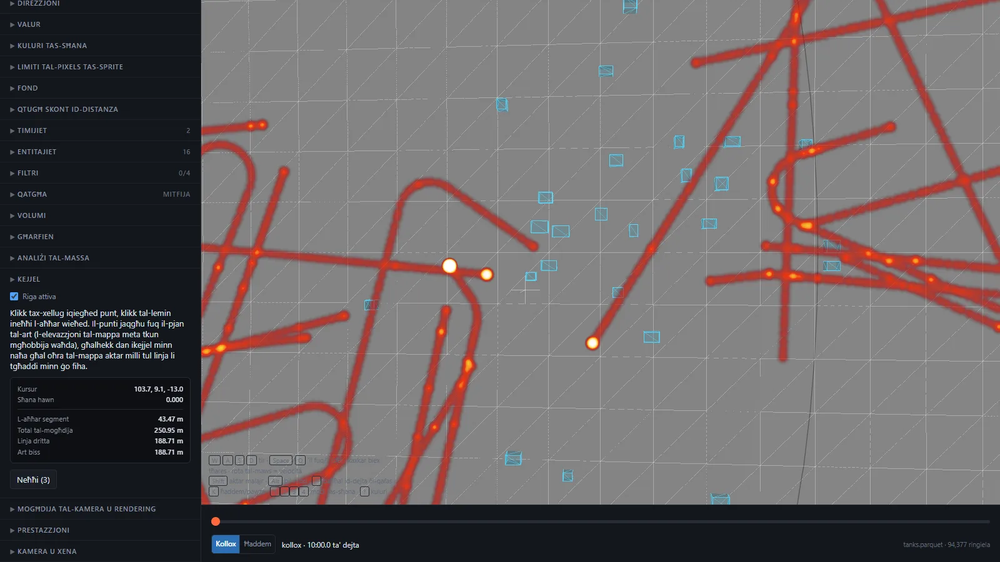

# Kejl

**Kejl** iqiegħed il-mouse bħala riga u jgħidlek kemm hu mgħobbi l-post taħt il-kursur. Uża dan biex issib kemm huma 'l bogħod żewġ postijiet, jew kemm traffiku għandu post wieħed.

## Ipprova {#try-it}

1. Iftaħ **Kejl** fis-sidebar u immarka **Riga attiva**.
2. Ikklikkja bix-xellug fuq tliet postijiet fuq il-mappa. Kull klikk iqiegħed punt.
3. Aqra **Total tal-mogħdija** (it-tul tat-triq kollha) u **L-aħħar segment** (l-aħħar parti).
4. Ikklikkja bil-lemin biex tneħħi l-aħħar punt, jew agħfas **Neħħi (3)** biex tneħħi kollox.

| Azzjoni | Effett |
|---|---|
| Klikk bix-xellug | Iqiegħed punt fejn il-kursur jilqa' l-pjan tal-art. Klikk li fih il-mouse mexa b'iktar minn 4 pixels bejn il-pressjoni u r-rilaxx huwa drag tal-kamera, mhux punt. |
| Klikk bil-lemin | Jneħħi l-aħħar punt. |
| Mexxi | Il-pożizzjoni tal-kursur u s-sħana taħtu jaġġornaw malajr. |

Il-kamera tibqa' taħdem waqt li r-riga tkun mixgħula: id-drag xorta jħares madwar, iċ-ċwievet xorta jtajjru. Waqt li r-riga tkun mixgħula hija taqbad kull klikk, għalhekk [agħżel bil-klikk](camera.md#click-to-pick) jistenna sakemm titfi.

**Il-pjan tal-art** huwa l-għoli tal-[immaġni tal-mappa](map-images.md) meta tkun mgħobbija immaġni tal-mappa, inkella l-Y l-aktar baxx tad-dataset (0 mingħajr waħda). Il-punti jaqgħu fuqu, għalhekk ir-riga tkejjel mal-mappa, mhux fuq linja li tgħaddi minnha. Ma' livell 3D il-pjan għadu l-Y l-aktar baxx tad-dataset, mhux il-wiċċ tal-livell - biex tieħu punt fuq il-wiċċ reali, itfi r-riga u kklikkja fuqu ([agħżel bil-klikk](camera.md#click-to-pick)), li jaqra l-koordinati mit-trijangoli tal-livell stess.

## Qari {#readouts}

| Linja | Tifsira |
|---|---|
| **Kursur** | X, Y, Z tad-dinja tal-punt taħt il-kursur, fuq il-pjan. |
| **Sħana hawn** | Kemm hemm sħana fil-pixel tal-kursur. Numru akbar ifisser iktar traffiku f'dak il-post. Huwa l-valur li l-rampa tal-kuluri tirċievi qabel il-punt tas-saturazzjoni jaqsmu, għalhekk tista' tqabblu mal-[Punt tas-saturazzjoni](colour-and-exposure.md#saturation-point). |
| **L-aħħar segment** | Distanza mill-aħħar punt sal-kursur (jew bejn l-aħħar tnejn). |
| **Total tal-mogħdija** | It-tul tal-linja mkisra mill-punti kollha u l-kursur. |
| **Linja dritta** | Distanza 3D mill-ewwel punt sal-kursur (jew l-aħħar punt). |
| **Art biss** | L-istess, fuq X u Z biss. |
| **Neħħi (N)** | Jneħħi l-punti kollha. |

Distanzi jintwerew f'ċentimetri taħt unità 1, f'metri taħt 1,000, f'kilometri fuq dan - filwaqt li wieħed unità tad-dinja huwa metru ([Assi, unitajiet u ħin](axes-units-and-time.md#unit-scale)). Il-koordinati huma koordinati tad-dinja, anke meta assi jkun [imqallab għall-wiri](camera.md#invert-world-axis).

Il-punti u l-linja bejniethom jinpinġew bħala overlay fil-view, b'daqs skont it-tbegħid tal-grid. Il-punti tar-riga ma jinħażnux fil-views; jibqgħu meta ttella' dejta oħra.

## Għall-iżviluppaturi {#for-developers}

**Sħana hawn** tinqara mill-GPU fil-massimu kull 120 ms, għax readback ta' pixel wieħed iwaqqaf il-pipeline. Juża l-istess mogħdija bħal `engine.readHeatProbe()`: maqsum bil-gain li bih inkiteb il-frame, għalhekk fuq il-mogħdija tal-akkumulazzjoni half-float (`?heat=f16`) hija fl-istess unitajiet bħal fuq target ta' 32-bit ([Akkumulazzjoni half-float](half-float-accumulation.md)).
